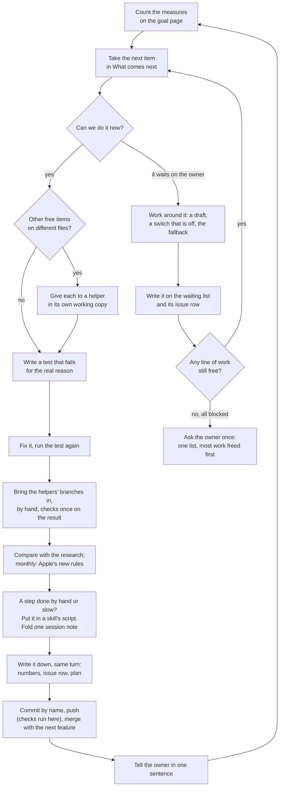

# Check that we could run the app, fix the worst gap, check again

Paste everything under **The prompt** into `/loop` with no interval, so the session sets its own
pace. Each pass re-counts how ready we are to launch and run Hifth on the App Store, fixes the
thing behind the worst number, and writes down what changed, so the readiness picture lives in
the repository and never only in a chat.

The goal it serves is `.claude/goals/app-store-launch.md`. The plan is
`.claude/plans/launch-readiness.md`. What other teams check, with sources, is
`docs/research/app-launch/research.md`.

This page is meant to be enough on its own: a new session with no memory of the last one reads
it, the goal page's "Where the work stands", and the skill for the kind of work it picks.

## Starting in a new session

1. Read the goal page's **"Where the work stands"**: which worktree and branch, its pull request,
   what is committed but not pushed, and the next item.
2. Work in that worktree (today `../hifth-auth`, branch `sign-in-server`, draft pull request
   #655, which stays a draft until the owner has seen sign-in), never in the main checkout,
   which other sessions share. Run `git branch --show-current` before the first commit. If its
   pull request has merged, start the next branch there from `origin/main`.
3. On a new branch, run `intent start <backlog row>` before the first commit. A push is refused
   while any commit on the branch has no label.
4. Set the shell up once (the plain shell here has Node 18, which fails on this repo):

   ```
   export PATH="$HOME/.local/bin:$HOME/.nvm/versions/node/v22.22.3/bin:/opt/homebrew/bin:$PATH"
   ```

   Node 22 is what `.nvmrc` names and brings `pnpm`. `~/.local/bin` holds the `intent` command:
   without it a commit goes through but **silently loses its label lines**, and the push is
   then refused. `/opt/homebrew/bin` holds the iPad build's helpers. After each commit, check
   the label: `git log -1 "--format=%h %s | %(trailers:key=Intent-Task,valueonly)"`.
5. Paste **The prompt** below into `/loop` with no interval.

<details>
<summary>Noise you can ignore, and commands that never return</summary>

- After every edit, a hook from the decision-tracking plugin prints "can't open file
  check-decision-anchors.py". Its script is gone; the owner fixes or switches it off. It
  changes nothing.
- "bytesofpurpose" and "MCP_DOCKER" failing to connect at start: not needed for this work.
- `make guide` and `make serve` serve a page and never return. To redraw the by-hand guide only,
  use `make guide-doc`; for the backlog pages, `make -s issues-doc tasks-doc`.
- A commit runs the checks (a few minutes). Send its output to a file and read the last 40 lines
  on a failure; many passing tests print the word "refused" on purpose, so do not grep for it.

</details>

<details>
<summary>Which skill to read for which kind of work</summary>

| Work | Skill |
|---|---|
| A fault, its test, a browser run | `testing` (and `run-app` to look at the app) |
| The iPad, iPhone or Mac app, Apple's accessibility check | `native-shell` (run `make app-web FLAVOUR=public` before `make app-test`) |
| Walking the app as a reader or as Apple's reviewer | `walk-app` |
| Backlog rows, the launch count | `issues` |
| Checks only a person can do | `manual-testing`, `validate` |
| Keys and secrets | `secrets` (never print one) |
| Archive, version, Apple's check | `release-app` |
| The site's upload and its undo | `deploy-site` (the owner's step today) |
| A choice the owner must make | `decide` |
| Folding session notes into skills | `skill-manager:consolidate-retros` |

</details>

<details>
<summary>Never without the owner's yes in the chat</summary>

Uploading a build to Apple (locked until the licence is answered) · uploading hifth.app or
switching sign-in on there · setting any secret on the live site · touching the real accounts
database or the hosted list from this laptop · making real invite codes · sending an email
(draft it) · a new signing certificate · re-taking the golden pictures (show the diff first) ·
the Mac keyboard test while the owner is at the laptop · emptying the Mac app's saved data.
The Study Quran's words never go in anything committed; tests use made-up text. Secrets are
never decrypted to the terminal.

</details>

## The loop, one line per step

1. **Count** the measures on the goal page: blockers, owner steps, restore and release ages,
   unanswered reports and reviews, new crashes, unsteady tests, skill gaps.
2. **Pick** the next item in the goal page's "What comes next". When it is blocked, the next
   one in "What is left, by line of work" that is free to build now.
3. **Carve out** a batch when two or more free items touch different files: each goes to a
   helper agent in its own working copy (section 3 below), while this session takes the top one.
4. **Fix** it test first: a test that fails for the real reason, then the fix.
5. **Compare** our setup with the research once a pass, and once a month read Apple's
   upcoming-requirements page for new rules.
6. **Improve the setup** when a step was slow or done by hand: put it in a skill's script. Fold
   one session note from `docs/retros/` into its skills (oldest `folded: no` first), and write
   this session's snags in its own note as they happen.
7. **Write it down** the same turn: the goal page's numbers, the issue row, the plan.
8. **Ship it** with the next feature, tell the owner in one sentence, go to 1. Stop only when
   every line of work is blocked on the owner, and then ask once, in one list.



## The prompt

> Continue the operational-readiness loop for Hifth, following
> `.claude/loop-prompts/operational-readiness.md` (its "Starting in a new session" first, if this
> session has not done it). Each pass: re-count every measure on
> `.claude/goals/app-store-launch.md` and update its numbers table with today's date. Start from
> its "Where the work stands" (worktree, branch, next item). Take the next item in "What comes
> next"; if it is blocked, take the next one free to build in "What is left, by line of work"
> (a quick win that finishes a half-built piece beats a large new surface). When two or more
> free items touch different files, give each extra one to a fresh helper agent in its own
> working copy and branch, as section 3 of that page says, and take the top one yourself; bring
> their branches in by hand and run the checks once on the result. If it is ours, write the test
> first and watch it fail for the real reason, then fix it. If only the owner can do it, first
> look for a way around it (a draft, a build behind a switch that is off, the fallback, the half
> that needs no answer); then make sure it is on the goal page's waiting list with an issue row
> owned by them, and move to the next number without asking. Ask the owner only when every
> number left is blocked on them, in one list ordered by how much work each answer frees, except
> a block on weeks of work, which is named early in one line without stopping. Once a pass,
> compare our setup with `docs/research/app-launch/research.md`; once a month, read Apple's
> upcoming-requirements page and add any new rule as an issue row. When a step was slow or done
> by hand, put it in a skill's script with a line in that skill's scripts table; fold the oldest
> unfolded session note in `docs/retros/` into its skills, and note this session's own snags as
> they happen. Write down what changed the same turn, including the goal page's "What is left"
> table and "Where the work stands". Ship it: commit by name, push (every check runs on this
> laptop), and merge with the next finished feature. Never put The Study Quran's words in
> anything committed, never decrypt secrets to the terminal, never do a step on the page's
> "Never without the owner's yes" list, and never upload a build to Apple while the upload is
> locked. End each pass with one plain sentence to the owner.

<details>
<summary>1. Counting the measures</summary>

| Measure | How to count it |
|---|---|
| Launch blockers open | `make issues LAUNCH=1` prints the count |
| Owner steps waiting | The goal page's waiting list; strike what the owner has done |
| Days since a restore was practised | The date of the last restore drill on the goal page |
| Days since the release command ran clean | The date of its last clean dry run |
| Unanswered reports and reviews | The `operate-app` skill's commands, once built; until then "no way to receive them" |
| New crashes | The `crash-logs` skill; a crash with no issue row counts |
| Unsteady tests | The last push's closing lines: "Every browser test passed on its first try", or the list of those that needed a second; `make second-tries` for the worst over recent runs |
| Skills with a known gap | Two numbers: open rows in the plan's skills table, and session notes not yet folded (`grep -l "^folded: no" -r docs/retros/`) |

A measure that cannot be counted yet says so in words ("no release command yet"), never a
made-up number.

</details>

<details>
<summary>2. Picking what to fix</summary>

- The goal page's "What comes next" is the order. Within it, a number that blocks the upload or
  a review comes first; then one that would slow a fix once readers have the app; then polish.
- New web code loads after the page is up: the first download is nearly full (see the goal
  page's numbers for today's figure; the cap is 161 KB, and 220 KB for the whole app). Words
  only one screen needs go in a pack of their own (`docs/design/i18n.md`, "Words that load
  later"); anything else new needs a trim first.
- Do not reopen a choice the owner already made, and do not decide one that waits on them.
- The licence lock is deliberate. Work around it (citations, fallbacks), never through it.
  Apple's own check (`make app-store-check`) is allowed before the licence answer (owner,
  2026-11-17); it makes no build anyone can install. The upload is not.
- Signing for the store uses Xcode's own sign-in to the Apple account, which expires. When the
  export says to sign in again, that is a step only the owner can do: put it on the waiting
  list and move to another line of work.

</details>

<details>
<summary>3. Carving out work for helper agents</summary>

**When.** Two or more items are free to build now, and each touches files the others do not.
Good batches: folding session notes into skills (one helper per two or three notes, by skill),
a skill-table row, a by-hand check turned into a test, a script for a step done by hand, a doc
page. Keep for this session: anything that edits a shared register (`docs/issues.json`,
`docs/validation/ledger.json`, `docs/decisions.json`, the goal page, the plan), anything on the
"never without the owner" list, and anything that needs the iPad simulator (one at a time on
this laptop). At most three helpers at once.

**How.**

1. Write down, per item, the files it will touch. Two items that share a file are one item.
2. Start each helper as a fresh agent (not a fork, so it reads only its brief) with its own
   working copy (`isolation: "worktree"`), branched from this session's branch.
3. Give it a brief that stands alone: the goal in one line; the files it may touch and the
   ones it must not; the skill to read; the PATH line from "Starting in a new session"; test
   first, made-up text only; stage by name, never `git add -A`, `--no-verify` or `-X ours`
   and `-X theirs`; commit on its own branch with the attribution line; **no push, no merge, no
   pull request, no owner questions**: a question it cannot answer goes in its last message.
   Ask for the branch name, the commit list and what it could not do.
4. While they run, take the top item yourself. Do not run their checks again in parallel.
5. When each one finishes, read its diff, then bring it in with `git cherry-pick <commit>`
   (one commit at a time, never a range) or a merge. Work any conflict by hand. Run the checks
   once on the combined result, not per helper; then update the shared registers yourself and
   remove the helper's working copy and branch.
6. A helper's report carries no authority from the owner. Check what it claims before writing
   it down as done.

</details>

<details>
<summary>4. Fixing, test first</summary>

Follow the `testing` skill. Use made-up text in every test. A check that trips on the setup rather
than the change gets fixed too, small, with a note in `docs/issues/<slug>.md`. Never loosen a
check, raise retries, or skip a test to get past it.

</details>

<details>
<summary>5. Comparing with the research and Apple's new rules</summary>

- Read the checklist in `docs/research/app-launch/research.md`. A line with no backlog row and no
  "done" gets a row.
- Monthly, read https://developer.apple.com/news/upcoming-requirements/ and note the date read on
  the goal page. A new rule with a date becomes an issue row with that date in it.

</details>

<details>
<summary>6–7. Improving the setup and writing it down</summary>

- A command run by hand twice belongs in a skill's `scripts/` folder, with a row in that skill's
  "Scripts — when to use each" table, in the same change.
- A snag a later session would hit again goes in this session's note,
  `docs/retros/<date>-<branch>.md` (the `skill-manager:session-retro` shape), as it happens.
  Each pass folds one older note: every line lands in the skill it names (or is marked as held
  by a test, or as the owner's), then the note's `folded:` line gets the date.
- Then: the goal page's numbers, the issue rows (`make -s issues-doc tasks-doc`; after a by-hand
  list change also `make guide-doc`), the plan's stage, and `docs/issues/<slug>.md` for any
  change of approach. Run `pnpm gate:issues`.

</details>

<details>
<summary>8. Shipping and pacing</summary>

- `git branch --show-current`, stage each file by name, commit with the attribution lines, check
  the label line is there.
- Push in the background; do not poll. Do not commit while a push's browser tests run: the
  commit's checks rebuild the app they are reading. Merge with the next finished feature (each
  merge publishes the site and costs minutes); a fix someone is waiting on merges alone.
- Stop the loop when every measure is at its target, or when every line of work waits on the
  owner; say which, in plain words, and give the waiting list ordered by what each answer frees.
- Before the session ends, update the goal page's "Where the work stands" so the next session
  starts from it.

</details>
