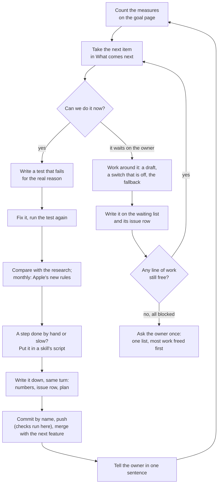

# Check that we could run the app, fix the worst gap, check again

Paste everything under **The prompt** into `/loop` with no interval, so the session sets its own
pace. Each pass re-counts how ready we are to launch and run Hifth on the App Store, fixes the
thing behind the worst number, and writes down what changed, so the readiness picture lives in
the repository and never only in a chat.

The goal it serves is `.claude/goals/app-store-launch.md`. The plan is
`.claude/plans/launch-readiness.md`. What other teams check, with sources, is
`docs/research/app-launch/research.md`.

## Starting in a new session

1. Read the goal page's **"Where the work stands"**: which worktree and branch, what is
   committed but not pushed, and the next item.
2. Work in that worktree (today `../hifth-auth`), never in the main checkout, which other
   sessions share. Run `git branch --show-current` before the first commit. If its pull
   request has merged, start the next branch there from `origin/main`.
3. On a new branch, run `intent start <backlog row>` before the first commit. A push is refused
   while any commit on the branch has no label.
4. Use the Node the repo names in `.nvmrc`.
5. Paste **The prompt** below into `/loop` with no interval.

## The loop, one line per step

1. **Count** the measures on the goal page: blockers, owner steps, restore and release ages,
   unanswered reports and reviews, new crashes, unsteady tests, skill gaps.
2. **Pick** the next item in the goal page's "What comes next". When it is blocked, the next
   one in "What is left, by line of work" that is free to build now.
3. **Fix** it test first: a test that fails for the real reason, then the fix.
4. **Compare** our setup with the research once a pass, and once a month read Apple's
   upcoming-requirements page for new rules.
5. **Improve the setup** when a step was slow or done by hand: put it in a skill's script.
6. **Write it down** the same turn: the goal page's numbers, the issue row, the plan.
7. **Ship it** with the next feature, tell the owner in one sentence, go to 1. Stop only when
   every line of work is blocked on the owner, and then ask once, in one list.

## The prompt

> Continue the operational-readiness loop for Hifth, following
> `.claude/loop-prompts/operational-readiness.md`. Each pass: re-count every measure on
> `.claude/goals/app-store-launch.md` and update its numbers table with today's date. Start from
> its "Where the work stands" (worktree, branch, next item). Take the next item in "What comes
> next"; if it is blocked, take the next one free to build in "What is left, by line of work"
> (a quick win that finishes a half-built piece beats a large new surface). If it is ours, write the test first and watch it
> fail for the real reason, then fix it. If only the owner can do it, first look for a way around
> it (a draft, a build behind a switch that is off, the fallback, the half that needs no answer);
> then make sure it is on the goal page's waiting list with an issue row owned by them, and move
> to the next number without asking. Ask the owner only when every number left is blocked on
> them, in one list ordered by how much work each answer frees, except a block on weeks of work,
> which is named early in one line without stopping. Once a pass, compare our setup with
> `docs/research/app-launch/research.md`; once a month,
> read Apple's upcoming-requirements page and add any new rule as an issue row. When a step was
> slow or done by hand, put it in a skill's script with a line in that skill's scripts table.
> Write down what changed the same turn, including the goal page's "What is left" table and
> "Where the work stands". Ship it: commit by name, push (every check runs on this
> laptop), and merge with the next finished feature. Never put The Study Quran's words in
> anything committed, never decrypt secrets to the terminal, and never upload a build to Apple
> while the upload is locked. End each pass with one plain sentence to the owner.

1. Counting the measures

| Measure | How to count it |
|---|---|
| Launch blockers open | `make issues LAUNCH=1` prints the count |
| Owner steps waiting | The goal page's waiting list; strike what the owner has done |
| Days since a restore was practised | The date of the last restore drill on the goal page |
| Days since the release command ran clean | The date of its last clean dry run |
| Unanswered reports and reviews | The `operate-app` skill's commands, once built; until then "no way to receive them" |
| New crashes | The `crash-logs` skill; a crash with no issue row counts |
| Unsteady tests | The last push's closing lines: "Every browser test passed on its first try", or the list of those that needed a second; `make second-tries` for the worst over recent runs |
| Skills with a known gap | Open rows in the plan's skills table |

A measure that cannot be counted yet says so in words ("no release command yet"), never a
made-up number.

2. Picking what to fix

- The goal page's "What comes next" is the order. Within it, a number that blocks the upload or
  a review comes first; then one that would slow a fix once readers have the app; then polish.
- New web code loads after the page is up: the first download is nearly full (159.2 of 161 KB
  on 2026-11-19, after the line for a link that goes nowhere, ㊽, took the room the account
  words' move made), and the whole app is at 219.7 of 220 KB. Words only one screen needs go in a pack of their own
  (`docs/design/i18n.md`, "Words that load later"); anything else new needs a trim first.
- Do not reopen a choice the owner already made, and do not decide one that waits on them.
- The licence lock is deliberate. Work around it (citations, fallbacks), never through it.
  Apple's own check (`make app-store-check`) is allowed before the licence answer (owner,
  2026-11-17); it makes no build anyone can install. The upload is not.
- Signing for the store uses Xcode's own sign-in to the Apple account, which expires. When the
  export says to sign in again, that is a step only the owner can do: put it on the waiting
  list and move to another line of work.

3. Fixing, test first

Follow the `testing` skill. Use made-up text in every test. A check that trips on the setup rather
than the change gets fixed too, small, with a note in `docs/issues/<slug>.md`. Never loosen a
check, raise retries, or skip a test to get past it.

4. Comparing with the research and Apple's new rules

- Read the checklist in `docs/research/app-launch/research.md`. A line with no backlog row and no
  "done" gets a row.
- Monthly, read https://developer.apple.com/news/upcoming-requirements/ and note the date read on
  the goal page. A new rule with a date becomes an issue row with that date in it.

5–6. Improving the setup and writing it down

- A command run by hand twice belongs in a skill's `scripts/` folder, with a row in that skill's
  "Scripts — when to use each" table, in the same change.
- Then: the goal page's numbers, the issue rows (`make issues-doc`), the plan's stage, and
  `docs/issues/<slug>.md` for any change of approach. Run `pnpm gate:issues`.

7. Shipping and pacing

- `git branch --show-current`, stage each file by name, commit with the attribution lines.
- Push in the background; do not poll. Merge with the next finished feature (each merge publishes
  the site and costs minutes); a fix someone is waiting on merges alone.
- Stop the loop when every measure is at its target, or when every line of work waits on the
  owner; say which, in plain words, and give the waiting list ordered by what each answer frees.
- Before the session ends, update the goal page's "Where the work stands" so the next session
  starts from it.

