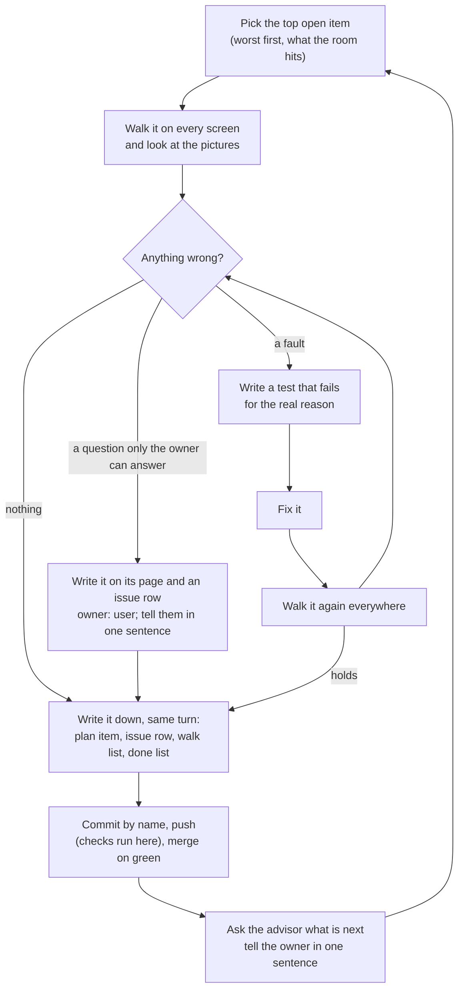

# Walk the app, fix what is wrong, walk it again

Paste everything under **The prompt** into `/loop` with no interval, so the session sets its
own pace. Each pass walks the app the way the room will see it, fixes the worst thing it
finds, ships the fix, and writes down what it found, so the list of faults and open questions
grows in the repository and never only in a chat.

## The loop, one line per step

1. **Pick** the top open item for huffaz and the pitch: worst first, the thing the room hits.
2. **Walk** it on every kind of screen the app runs on, and look at the real picture.
3. **Found a fault?** Write a test that fails for that reason, watch it fail, then fix it.
4. **Walk it again** everywhere, to see the fix hold and nothing else move.
5. **Write it down** the same turn: the plan item, the issue row, the walk list, the done list.
6. **Ship it**: commit, push (every check runs on this laptop), merge on green, start fresh.
7. **Ask the advisor** what matters most next, tell the owner in one plain sentence, go to 1.



## The prompt

> Continue the walk-and-fix loop for Hifth, following `.claude/loop-prompts/walk-and-fix.md`.
> Each pass: pick the top open item by what it is worth to a hafiz and to the pitch (the issue
> register worst first, the plan's open items, and what the advisor said last), and stay on what
> the room will hit. Walk it on every kind of screen with the walk-app skill and its checklist.
> When you find a fault, write the test first and watch it fail for the real reason, then fix
> it and walk it again everywhere. Write down what you found in the same turn: the plan item,
> the issue row, the walk list line, the done list. Ship it: commit by name, push (every check
> runs on this laptop), merge on green, start the next branch in the same worktree. Questions
> only the owner can answer go on their page with an issue row owned by them; tell the owner in
> one plain sentence and do not ask again. Never put The Study Quran's words in anything
> committed. At the end of a pass, ask the advisor what matters most next, say it to the owner
> in one sentence, and start on it if it is the top item. Send a short status line when quiet.

<details>
<summary>1. Picking the next item</summary>

- Read `docs/issues.json` worst first: a **defect** owned by the **agent** comes before a
  **risk**, and a risk before a **question**. `docs/backlog.md` is the rendered list of all of
  them; read it, never edit it by hand.
- Read the open numbered items in `docs/PLAN.md` (an item struck through is fixed).
- Rank by what it changes for a hafiz mid-revision and for the people in the room watching the
  pitch: a fault a presenter will hit in the first minute beats a polish nobody will see. A
  quick fix that finishes something half built beats a large new surface.
- Do not re-open a choice the owner already made, and do not decide one that is waiting on
  them; those are listed in `docs/waiting-on-you.md`.
- At the end of a pass, call the advisor and ask what is the next most important thing for
  huffaz and the pitch. Write the answer down (step 5) before acting on it.

</details>

<details>
<summary>2. Walking every kind of screen</summary>

The walk-app skill (`.claude/skills/walk-app/SKILL.md`) is the full method, and its checklist
(`.claude/skills/walk-app/checklist.md`) is the list of things to look for. Every fault ever
found adds a line to it, so each walk looks for the old faults on purpose.

The kinds of screen, every pass that touches what they show:

| screen | how |
| --- | --- |
| laptop, Chromium | `make drive` at a deep link, or the browser tests' `desktop` project |
| laptop, Firefox (the owner's browser) | the `desktop-firefox` project; `pitch-firefox` for the private build |
| phone | the `iphone` and `android` projects, or a phone-sized window |
| iPad upright and on its side | the `ipad` project; the private build at 1024 × 1366 and 1366 × 1024 |
| the iPad app | `make app-web`, then `make app-probe TARGET=ipad … EVALFILE=…` (add `SIDEWAYS=1` to turn it), or `make app-walk` for pictures |
| the Mac app | `make app-probe TARGET=mac` and `make app-shot TARGET=mac` **only** |
| Arabic | the same walks with `LOCALE=ar`, or the Arabic interface in the browser |

Rules for the walk:

- **Look at the real picture** before reasoning from the code. Read the screenshots.
- **Never run the Mac app's keyboard test** (`app-test-mac-ui`): it types on the laptop's real
  keyboard. Never turn the iPad simulator with a keystroke; use `SIDEWAYS=1`.
- Start and stop the simulator app without taking the owner's focus (`open -g`, and
  `xcrun simctl terminate` then `launch` with a route).
- The walk scripts that are worth keeping live in `.claude/skills/walk-app/scripts/`, each with
  a line in the skill's "Scripts — when to use each" table. A probe prints boxes, verse numbers,
  button names and yes/no answers, **never note words**.
- Pictures from a walk stay in the scratchpad, `test-results/` or `native/shots/`, all outside
  what is committed. A picture that shows the private build's notes is never attached anywhere.

</details>

<details>
<summary>3. Fixing a fault: the test comes first</summary>

1. Write the test that would have caught it: a browser test in `apps/web/e2e/pitch.spec.ts`
   for the private build, a public browser test under `apps/web/e2e/`, or a unit test. Use
   made-up text and made-up numbers; check the shape of the page, not its words.
2. Run it and **watch it fail for the real reason** (read the failure, not only "failed").
   A test that passes the moment it is written has told you nothing.
3. Fix the code. Where the fix could be done more than one way and the difference is felt,
   build the main ways; the best becomes the default and the others stay a setting in the
   info panel.
4. Run the test again on every engine it touches (Chromium, Firefox, WebKit), then walk the
   fix again on every kind of screen in step 2.

Never loosen a check, raise retries, or skip a test to get past it. A check that trips on the
setup rather than the change gets fixed too, small, with a note in `docs/issues/<slug>.md`.

Commands (run from the worktree; set the Node version from `.nvmrc` first):

```
pnpm -C apps/web exec tsc --noEmit -p .
pnpm -C apps/web exec vitest run <file>
pnpm -C apps/web build                       # before public browser tests
pnpm -C apps/web exec playwright test --project=<desktop|desktop-firefox|iphone|android|ipad> <file> -g "<name>" --retries=0
HIFTH_PITCH=1 pnpm -C apps/web exec playwright test --project=pitch pitch.spec.ts -g "<name>" --retries=0
HIFTH_PITCH=1 HIFTH_PITCH_BROWSER=webkit pnpm -C apps/web exec playwright test --project=pitch pitch.spec.ts -g "<name>"
HIFTH_PITCH=1 pnpm -C apps/web exec playwright test --project=pitch-firefox pitch.spec.ts -g "<name>"
```

</details>

<details>
<summary>4–5. Writing it down, the same turn</summary>

Nothing lives only in the chat. For each thing found:

| what | where |
| --- | --- |
| the fault or question, in plain words | the next numbered item in `docs/PLAN.md` (struck through once fixed) |
| its row in the register | `docs/issues.json`: severity `defect`, `question` or `risk`; owner `agent` or `user`; when fixed, `status: fixed` with `closedBy` (the test file) and a one-line `note` |
| what to look for next time | a new line in `.claude/skills/walk-app/checklist.md`, naming the issue |
| what was done, for the owner | an entry in `docs/tasks/done.md` |
| what only a person can check | the Parked list in `.claude/skills/manual-testing/checklist.md`; each answer later becomes a test |
| a change of approach | `docs/issues/<slug>.md`: what was tried, what showed, what replaced it |
| a choice made | the decision index, `docs/decisions.json`, with its record |

Then regenerate the rendered pages and run the register checks:

```
make tasks-doc issues-doc etl-scripts-doc
pnpm gate:issues
pnpm gate:tasks
pnpm gate:decisions        # only when decision files changed
```

A question for the owner: put it on its page with an issue row owned by `user`, tell them in
one plain sentence, and do not ask it again or decide it for them.

</details>

<details>
<summary>6. Shipping</summary>

1. `git branch --show-current`, then stage each file **by name**. Never `git add -A`, never
   `git restore .`, never a bare `git stash`. Other sessions' files are not yours.
2. Commit with a plain message ending with the session's attribution lines.
3. Push in the background. The push runs **every check on this laptop** (there is no hosted
   run): unit tests, browser tests on every project, the private build's tests, the size
   budget. Never `--no-verify`. Never two pushes at once, and do not edit files or run the
   browser or the simulator while one runs.
4. A failure is read and fixed, not retried around. A line marked "flaky" is a real unsteady
   test to fix. A size-budget failure on an intended growth: `make budget-update`, read the
   change, commit it.
5. Open the pull request and merge it once the push is green (standing approval for this
   repo). Fast-forward the main checkout, start the next branch from the new main in the
   **same worktree**, delete the old local branch.
6. A change that is only documents waits and rides along with the next code change.

</details>

<details>
<summary>The book's words never leave the private build</summary>

- No words from The Study Quran's translation or notes, not even a few, in a commit, a pull
  request, a test, a doc, a picture or a checked-in log. Name demo verses by number only.
- No commentators' names or initials in committed files; use made-up examples.
- Probes print boxes and numbers; a log that caught note words stays in the scratchpad.
- The private build's data folders are ignored by git and never committed.

</details>

<details>
<summary>Pacing the loop</summary>

- While a push's checks run (several minutes), do not poll: the session is woken when the
  background job ends. Schedule only a long fallback wake (20 minutes or more) in case it hangs.
- Between passes with nothing to wait on, pick the next item straight away; schedule a wake
  only when the work is genuinely waiting on something outside the session.
- When the owner has not heard anything for a while, send one short line saying what is being
  done, then carry on.
- Stop the loop when the owner says so, or when every open item is waiting on them; say which
  ones, in plain words.

</details>
