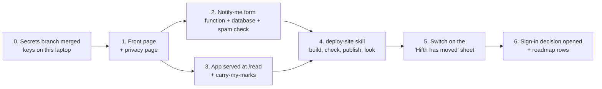

# hifth.app: a front page, the web app moved under it, a notify-me list, and a plan for signing in

*Plan written 2026-11-11. Owner's picks the same day: the page says "Mac app — coming soon"
(no App Store name, no badge); the web app moves to hifth.app/read now; the page collects emails
for a notify-me list. Hosted on Cloudflare Pages, on the new Cloudflare account that holds
hifth.app (handed over by the walk-feedback session).*

## Context

Hifth has no front door. The web app lives at blog.bytesofpurpose.com/hifth/, the Mac app has not
shipped, and the owner bought **hifth.app** on 2026-11-10. This plan gives hifth.app a front page
that announces the Mac app and opens the web app. It moves the web app to **hifth.app/read**,
carrying each reader's saved marks with them. It adds a sign-up for "tell me when the Mac app is
out". And it plans, but does not build, Sign in with Apple.

**Not on the pitch path.** The current goal (`.claude/goals/study-quran-pitch.md`) asks to pause
work a Study Quran scholar would not see. This is that kind of work. The owner asked for it, so
it goes ahead; the owner decides where it sits against the iPad walk.

## The short version

| Step | What it gives | Who |
|---|---|---|
| 0 | the Cloudflare keys work on this laptop | owner (`lpass login`), then agent |
| 1 | hifth.app shows a real page | agent |
| 2 | people can leave an email; spam is turned away | agent; owner pushes one secret |
| 3 | the app opens at hifth.app/read; old readers bring their marks | agent |
| 4 | one tested way to publish, and to see it is live | agent |
| 5 | readers at the old address are told and helped across | agent, after 4 is verified live |
| 6 | sign-in is a written decision, not a guess; future work is on the roadmap | agent; the decision is the owner's |

---

## 0. Before anything: the keys

- The Cloudflare token and the new account's ID are saved encrypted with dotenvx on branch
  `walk-feedback-capture` (worktree `../hifth-walk`, commits 6654a990, faa74270, a14e25d1,
  cf56fb14, 56c59a19). That branch is not merged yet. Wait for it to merge; do not cherry-pick.
- Then: `lpass login` (owner), `make env-keys-pull && make env-bootstrap`. Use Node 22 on PATH,
  because dotenvx refuses v18. Prove it with `make cf-tokens` and `make cf-zone DOMAIN=hifth.app`.
- Rules carried over: never print a token or the account ID; keep the account ID out of
  checked-in plain files; never run wrangler against the other (earlbear) account for hifth.
- Work in a worktree of its own, because another session shares the main checkout. Run
  `intent start <row>` before the first commit. Ship it as one PR, with one commit per step.

## 1. The front page (`apps/landing/`)

Plain HTML and CSS, no framework, English throughout. The only Arabic is the page picture.

- **What it shows:** the name and one line on what Hifth is for. A picture of a real mushaf page
  in the app. **Open Hifth in your browser** links to `/read/`. **Mac app — coming soon** has no
  store badge, because Apple's badge is meant to link to a live listing. Then the notify-me form
  (step 2), and a footer with the source-code offer (GPL) and the privacy page.
- **The picture comes from the public build only, never the pitch build.** Make it with the
  existing screenshot target (`make shots` builds plain). Add a test that the landing build
  refuses an image whose build had the private pitch folder switched on.
- `apps/landing/privacy.html` covers what we keep (an email, the date), why (one email when the
  Mac app ships, perhaps a TestFlight invite), where (Cloudflare's database), who sees it (the
  owner), how to leave (a link in that email), and no tracking. **Owed by the owner:** the contact
  address the page names.
- `apps/landing/_redirects` must **not** send every path to the front page. That rule belongs to
  the app, under `/read/` only (see step 3).
- Check it at 1280 and 390 px (Chrome DevTools tools) and in Firefox, and show the owner the
  rendered page before calling it done.

## 2. The notify-me form

- **How a sign-up works:**
  1. The browser sends the email and a Turnstile token (Cloudflare's free spam check) to
     `POST /api/notify`, a Pages Function at `apps/landing/functions/api/notify.ts`.
  2. The function checks the token **once** with Cloudflare's Siteverify. A token can only be
     checked once, so it never retries. It also checks the hostname is hifth.app.
  3. It cleans up the email and writes one row to a D1 database (Cloudflare's free database):
     `email` (unique), `created_at`, `unsubscribe_token`.
  4. A second sign-up with the same email says "you're on the list". It does not error.
- **Unsubscribing:** `GET /api/unsubscribe?t=…` deletes the row. It is built now, so the launch
  email can carry the link from day one.
- **No confirmation email in v1.** Cloudflare cannot send mail to arbitrary addresses by itself,
  and picking a mail service is a later choice (on the roadmap).
- **Keys:**
  - The Turnstile site key is public and sits in the page.
  - The Turnstile secret goes in as a Pages secret: `make push-secrets ARGS="--pages <project>
    TURNSTILE_SECRET"` reports, and adding `--push` is the owner's call.
  - Create the D1 database and its binding (in `apps/landing/wrangler.toml`) with this repo's
    token through dotenvx.
- **Data:** emails never go in the repo, a log, a test or a commit. A small make target reports
  only the count.
- **Tests first:**
  - Unit tests on the function's handler, with a fake database and Turnstile's published
    always-pass and always-fail test keys. They cover a new email, a repeat, a bad token, a bad
    email, a wrong hostname, and unsubscribing.
  - A Playwright run against `wrangler pages dev` that fills in the form end to end.

## 3. The app at hifth.app/read, and carrying marks across

- **One build, two homes.**
  - `scripts/build-hifth-app-site.mjs` (called by `make site-hifth-app`) puts the landing page
    at the root and copies `apps/web/dist` into `/read/`.
  - The app already uses relative paths (`base: "./"`, a PWA scope of `"./"`), so it runs under
    `/read/` unchanged. Confirm the service worker's scope is `/read/` and that the fallback
    rule is `/read/* /read/index.html 200`.
- **The design pages stay at the blog address.** GitHub Pages keeps publishing the same build at
  blog.bytesofpurpose.com/hifth/. Every decision link and the decision checker's site address
  (`scripts/gate-decisions*.mjs`) are left alone. Moving the pages is a later roadmap item.
- **"Hifth has moved" sheet** (`apps/web/src/moved.ts`):
  - It shows only when the page is served from blog.bytesofpurpose.com. It never shows in the
    iPad or Mac app, or on localhost.
  - It sits behind a switch, so it can merge before hifth.app is live and be switched on in step 5.
  - It has an action, so it is not a warning the reader cannot act on: **Carry my marks to
    hifth.app**, or **Later**.
- **How the carry works:**
  1. The old page opens `https://hifth.app/read/#/carry`.
  2. The new page tells its opener it is ready.
  3. The old page sends the same contents the saved file holds, built by the existing
     save-to-file code (`apps/web/src/bookmark-store.ts`, `useBookmarks.ts`). It sends them only
     to the hifth.app address.
  4. The new page accepts them only from the blog's address, loads them through the existing
     load-a-file path, and says how many marks came across.
  5. If anything fails, the reader falls back to saving a file and loading it, which already
     works today.
  6. After a successful carry, the old page offers **Open hifth.app** from then on.
- **Tests first:**
  - Unit tests for when the sheet shows.
  - A Playwright test with the build served on two local ports, standing in for the old and new
    addresses (both addresses can be set for the test). It makes marks on one, carries, and finds
    them on the other. It runs in Firefox as well as Chromium.
- **Afterwards:** check the source-code offer resolves from the new address
  (`make source-offer URL=https://hifth.app/read/`).

## 4. A `deploy-site` skill — yes, it is needed

There are now three ways to publish: GitHub Pages on every merge, the old hand-started Cloudflare
job, and hifth.app. None of them is a skill. The laptop also holds the private pitch folder, so a
laptop deploy must check the exact files it uploads.

- `.claude/skills/deploy-site/SKILL.md`:
  - Its description fires on "deploy", "publish the site", "is hifth.app live", "push the
    landing page".
  - A table of the three destinations, saying which one to use and when.
  - The rules from step 0.
  - A "Scripts — when to use each" table.
- `.claude/skills/deploy-site/scripts/deploy-hifth-app.mjs` does five things, in order:
  1. Refuses a dirty tree, or a commit that is not on origin, because the source-code offer names
     that commit.
  2. Runs `make site-hifth-app`, which builds and then runs `gate:budget`, `gate:bundle-notext`,
     `gate:notext` and `gate:scripture` on the assembled folder.
  3. Publishes with `dotenvx run -- wrangler pages deploy` to the hifth.app project.
  4. Fetches `/`, `/read/` and `/api/notify` and checks each answers. It also checks that the
     commit baked into `/read/` is HEAD.
  5. Prints the URLs to look at.
- `make deploy-hifth-app` calls that script. The old `make deploy-cloudflare` and the workflow's
  Cloudflare job point at the old account, so they get retired or pointed at the same target.
  That is decided when we read which account the old `hifth` project is on. Don't reuse the name
  blindly.
- Deploys run from the laptop after each merge, which costs no GitHub minutes. Letting Cloudflare
  build from git automatically is a roadmap item.
- Also update `.claude/skills/app-setup/SKILL.md`: its Cloudflare section still names
  hifth.bytesofpurpose.com/share. It should now name hifth.app on the new account.

## 5. Switch the sheet on

Do this once step 4 shows hifth.app/read live and working. Flip the switch from step 3 in a small
change, and let it merge alone, because readers are waiting on it. Then walk the old address in
Firefox and Chrome: make marks, carry, and see them arrive.

## 6. Signing in with Apple: a decision to open, not something to build now

**Today nothing needs an account:**
- your own iPad and Mac keep in step through your own iCloud (already chosen);
- a teacher's copy is recommended as a file first, then a link with no account, and accounts last;
- the notify list needs no account.

So the front page gets no "Sign in" button. A button with nothing behind it would be a promise
the page can't keep.

**What this plan settles for it:** the app now lives on an address of its own. The sharing
research said signing in needs one. Record in `hifth-app-domain` (docs/issues.json) that the share
page and any future sign-in live on hifth.app, not hifth.bytesofpurpose.com. That is part (a) of
the row the other session handed over. Then rebuild with `make issues-doc tasks-doc` and
`pnpm gate:issues`.

**What the decision record will lay out** (`decide` skill, new row, related to
`sharing-sign-in` and `sharing-which-way`):

- **In the iPad and Mac apps:** Apple's own sign-in sheet, passing its answer to the web layer
  through the existing bridge (`apps/web/src/native-bridge.ts`). This avoids sign-in pages inside
  the app's web view.
- **In a browser:** Apple's web sign-in with a Services ID for hifth.app. Apple posts its answer
  to a return URL that must accept POST, so it needs a server part. That would be a Pages
  Function at `hifth.app/api/auth/apple`, or Supabase's own callback.
- **Which server:**
  - **Cloudflare functions and D1** sit next to the notify list and never pause.
  - **Supabase sign-in** is ready-made, but its free plan pauses after a week with no use. It
    would have to be a new project, never the one holding the outside Qur'an data.
- **Apple's rules that come with it:**
  - an app that creates accounts must let you delete the account inside the app;
  - if Google sign-in is ever offered, Sign in with Apple must be too;
  - Apple sends the name and email only on the first sign-in.
- **What would answer it:** a throwaway trial in both apps on a test Services ID. That waits on
  the app being signed with the paid team, which still waits on the owner's Xcode sign-in.

## 7. A roadmap, and the CLAUDE.md line for it

There is no `docs/roadmap.md`. `intent roadmap` already writes a draft from the backlog into
`.intent/drafts/roadmap.md`, sorted now, next and later, and overwrites it each run. The backlog
stays the one record. A hand-kept roadmap would be a second copy that drifts, which is the thing
this repo's registers are built to refuse.

- Add `make roadmap`. It runs `intent roadmap` and writes the result to `docs/roadmap.md`, checked
  in and rebuilt like the backlog. First check how `intent roadmap` decides a row is "later", and
  use that same field.
- Add a line to the project `CLAUDE.md` under "How we work":
  **Things we will need someday go on the roadmap the same turn: a backlog row marked for later,
  then `make roadmap`. The roadmap is a view of the backlog, never a second list.**
- Rows this plan adds, all marked later:
  - the Apple link file at `hifth.app/.well-known/apple-app-site-association`, so a tapped link
    opens the app (needs the paid-team signing);
  - choosing a mail service and sending the launch email;
  - the sign-in decision and its trial (step 6);
  - App Store wording and badge, once the licence reading says yes;
  - Cloudflare building from git automatically;
  - moving the design pages to hifth.app;
  - retiring the old app address once readers have moved;
  - moving the domain's registration to Cloudflare after about 2027-01-09.

## Written down where it lives, the same turn

- **A decision row, settled by the owner 2026-11-11:** the app moves to hifth.app/read, the page
  says "Mac app — coming soon", and there is a notify list. Its record is
  `docs/decisions/hifth-app-site.md`, and it links the rendered page.
- `docs/map.json`: a `hifth-app-site` feature.
- `docs/use-cases.json`: "find Hifth and open it", and "hear when the Mac app is out".
- `docs/issues.json`: `hifth-app-domain` updated, plus the roadmap rows above.
- `app-setup` skill, `CLAUDE.md` line, `docs/roadmap.md`.

## How we'll know it works

1. `make cf-tokens` and `make cf-zone DOMAIN=hifth.app` both say yes.
2. All of these pass locally: unit tests (`pnpm test`), the new Playwright specs (form, and
   carry-my-marks across two local ports in Chromium and Firefox), and `make site-hifth-app` with
   its gates.
3. `make deploy-hifth-app` publishes, and its own checks pass: `/`, `/read/` and `/api/notify`
   answer, and the commit in `/read/` is HEAD.
4. Look at the real thing: hifth.app and hifth.app/read at 1280 and 390 px with Chrome DevTools,
   and in Firefox. Sign up with a throwaway address, see the count go to 1, unsubscribe, and see
   it go back to 0.
5. `make source-offer URL=https://hifth.app/read/` resolves.
6. After step 5: at blog.bytesofpurpose.com/hifth/, make three marks, carry them, and see three
   marks at hifth.app/read.
7. `pnpm gate:decisions`, `pnpm gate:issues` and `make tasks-doc` are clean, and
   `docs/roadmap.md` is current.
