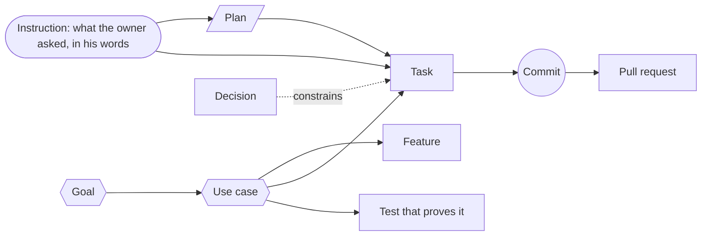

# Plan: link every commit back to what it is for

*Name: `intent-tracking`. Written 2026-11-10. Status: **not started**; slice A is next.*

**Asked** (owner, 2026-11-10, in the planning session of that day): a way to track work
properly, where a use case links to its feature, to the tasks in the task list, to the commits
that did them and to the plan they came from; checked in; commits labelled by hooks on their
own. Added the same day: it works in any repo as a plugin in the owner's marketplace; it uses
the "intent graph" idea where it fits; it draws a picture; it explains the why behind a
commit; it helps write an App Store changelog and a roadmap; it has a helper agent that works
the links out backwards from the finished-task file and git history; it has a command-line
tool, including walking the graph. And, when shown the first draft: "how will we visualize
intent vs instruction vs tasks vs commit vs plan docs".

**Serves:** the maintainer's use cases `find-where-a-feature-lives` and
`know-what-we-promise-and-what-proves-it`. It is not on the pitch path; it is here because
the owner asked for it, and its first slice is kept small so the pitch items are not held up.

**Goes with:** [the open-work list](open-work-2026-11.md), whose items 3, 3b, 4 and 5 are the
first real work this system labels.

## The short version

1. Slice A: names, a "what this branch is working on" pointer, and labels added to each
   commit by a git hook. Two to three days across the two repos, since each push runs about
   13 minutes of checks.
2. The pencil rings, the pens page, the calendar and the bottom row of pages are then built
   with slice A on. That is its real test.
3. The rest in slices: walking the chain and "why", the picture, backfill of old history, the
   changelog and roadmap drafts, a second repo.

**The one call the owner can overrule:** slice A goes before the pencil rings, which delays
the pitch items by those days. Say so and the order flips: the items first, unlabelled, then
backfilled.

**Assumptions made without asking:** a new plugin, not more hooks on the existing task
plugin; written in Python; the push check counts unlabelled commits for two weeks before it
refuses them; no extra "why" line asked of the author on each commit; the picture, the
roadmap and the release notes are made on the laptop and kept off the public site until the
owner says otherwise.

## What exists today

Counted 2026-11-10.

| Thing | Where | Linked to what, today |
| --- | --- | --- |
| 44 use cases | [docs/use-cases.json](../../docs/use-cases.json) | each names its feature and the tests that prove it; checked by a script |
| 34 features | [docs/map.json](../../docs/map.json) | each names its entry files; does not name use cases or tasks |
| 496 tasks (open and closed) | [docs/issues.json](../../docs/issues.json), drawn as [docs/backlog.md](../../docs/backlog.md) | a closed one names its test; **no link to a feature, a use case, a PR or a commit** |
| 69 decisions | [docs/decisions.json](../../docs/decisions.json) | each other, both ways |
| 108 finished-task write-ups | [docs/tasks/done.md](../../docs/tasks/done.md) | PRs and commits in prose only; the task numbers restart every session, so they collide |
| Plans and goals | [.claude/plans/](.) and [.claude/goals/](../goals/README.md) | no name, nothing points at them |
| Commits | git | plain sentences; nothing says what the commit was for |
| Git hooks | [.githooks/](../../.githooks) | one before a commit, one before a push; nothing touches the commit message |

So one link in the chain is real (use case → feature). The rest live in prose. The plan adds
the missing links and one check over the whole chain. It does not add a new database.

## What "intent graph" means here

The term has no single standard. Several separate projects use it for one idea: write down
what the work is *for* as small named items, link each item to what carries it out, and fail
a check when a link is broken or missing. The sources below were seen only as search
summaries, not read in full, so the design rests on what this repo already has and the links
are background, not evidence.

- [The AI velocity paradox](https://hackernoon.com/the-ai-velocity-paradox-faster-code-more-specification-drift):
  requirements as items, "implements" and "verifies" as links, a broken link fails the build.
- [yigraf](https://pypi.org/project/yigraf/1.1.1/): one graph over code, intent, plan and
  decisions.
- [Intent](https://github.com/dozybot001/intent): goals and decisions kept as a history on
  top of git.
- [AWS AI-DLC concepts](https://aws-samples.github.io/sample-collaborative-ai-dlc/concepts/):
  stories link to tasks, tasks link to the files they produce.
- [Spec Graph](https://oco-adam.github.io/specgraph/llms-full.txt): small specification items
  as a typed graph that agents read and write.
- [git interpret-trailers](https://git-scm.com/docs/git-interpret-trailers/2.56.0): git's own
  way to add `Key: value` lines to the end of a commit message from a hook.

## The picture of the links



Each box is something the repo already keeps, except two things this plan adds: the arrows
into **Task** and **Commit**, and the **Instruction** box.

**Instruction and intent are different things, and both are kept.** The instruction is what
was asked, in the owner's words, on a date ("the pens should be rings at the pencil's tip").
The intent is what it is for (the goal and the use case: a hafiz marks a mistake without
looking away from the verse). One instruction can serve an intent that already exists, start
a new one, or turn out to serve none, which is worth seeing. Today instructions live only in
chat logs on this laptop, in page comments and in review threads. So each plan and each task
row gains a short hand-written "asked" line: the date, a few of the owner's words, and where
it was said. Never the book's text in that line.

## Where it lives: a new plugin, `intent-manager`

In the owner's plugin marketplace repo (`oeid-claude-plugin-marketplace`, beside this one on
the laptop), under `plugins/intent-manager/`, laid out by that repo's own rules.

A new plugin, not more hooks on the existing task plugin (`task-management-manager`). That
one only guards a done file and a backlog file written as tick-box bullets; this repo's
backlog is a JSON list and its done file is headed sections, so the formats do not match. The
new plugin reads whatever lists a repo already has.

| Piece | What it is |
| --- | --- |
| A command-line tool, `intent` | Python 3 with no extra packages (the same as the other plugins' hooks, and it avoids this laptop's old bare `node`). Lives in the plugin's own `scripts/` folder. |
| A launcher, so a git hook can find the tool | The installed plugin sits in a folder named by its version, which changes on every update, so a hook cannot name it. The marketplace's own Makefile (the only allowed way to install) gains a step that writes a small launcher which looks up the current version each time. Where it goes is settled by a test, not assumed: a hook run through `make` must find it. `intent init` writes the launcher's full path into the repo's hook hand-off if it is not on the path. |
| A settings file per repo, `.intent/config.json`, checked in | Says where this repo keeps each kind of thing, and which field is its name. Here it points at the lists above. In a repo with none, the setup skill writes plain starter files. |
| Skills | `introduce`; `enable-intent-tracking` (sets a repo up, with an undo); `trace-intent` (answer "why is this here?" and "what did this use case cost?"); `write-release-notes`; `backfill-links`. Each has a "Scripts — when to use each" table. |
| A helper agent, `link-backfiller` | Works one batch of old commits and done-file entries at a time and proposes links. See "Backfill". |
| Claude hooks | Before a `git commit`: remind when no task is set. At session start: say, and ask, if the check could not run or links are broken. All of them do nothing in a repo with no settings file. |

## How a commit knows what it belongs to

This is the tightest part, so it is decided first.

- **The task and the plan** come from a pointer the session sets once per branch:
  `intent start pencil-pens-as-rings --plan open-work-2026-11`. It is stored against the
  branch in git's local settings, not in a file, so two sessions on two branches never
  overwrite each other.
- **The feature and the use case** come from the task's own row, which gains two optional
  hand-written fields naming them. When a row has neither, the tool falls back to matching
  the changed files against each feature's entry files. Before relying on that fallback,
  measure it: run it over the last 200 commits and print how many it places. If it places
  few, it stays a hint and is not written as a label.
- **The label is written by a real git hook**, because a Claude hook can only remind. A new
  hook file hands off to `make`, exactly like the two that exist, and the make target runs
  `intent label-commit`. It adds lines like these to the end of the message:

  ```
  Intent-Task: pencil-pens-as-rings
  Intent-Use-Case: pick-a-pen-without-leaving-the-verse
  Intent-Feature: pens-and-pencil
  Intent-Plan: open-work-2026-11
  ```

  The names all start with `Intent-` on purpose: ordinary body lines in old commits already
  get read by git as labels (`Notes:`, `Design:`), and these must never be confused with
  them. They are read back with git's own parser, not a home-made one.
- **When the hook cannot run** (the tool is not installed, the settings file is broken), it
  prints a line that says so and lets the commit through unlabelled. A silent hook looks the
  same as a working one. The push check then lists unlabelled commits.
- **A commit that truly belongs to nothing** carries `Intent-None: <reason>`. For the first
  two weeks the push check only counts unlabelled commits; once the count stays at zero it
  refuses them.
- **Merge commits** carry no labels. The tool walks the commits a merge brought in.
- **Old history is not rewritten.** Links for old commits go in a checked-in file,
  `.intent/links.jsonl`, one line per link, each saying where it came from and how sure it is.

## Names

- A task's name is its backlog row's name (`pencil-pens-as-rings`), never a session task
  number, because those restart and collide.
- A Claude session task that leads its subject with that name is tied to it.
- A plan and a goal get a few lines at the top of the file: a name, what was asked, the use
  cases it serves, and the tasks it holds. This file's top is the first example.

## What is stored, and what is worked out

Hand-written and checked in: the two new fields on a task row, the top lines of a plan, the
labels in each commit, and the backfill file. Everything else (which commits belong to a use
case, which use cases have no work, which tasks have no commits) is worked out fresh each
time the tool runs. Nothing generated is written back into the hand-edited lists.

## The command-line tool

| Command | What it does |
| --- | --- |
| `intent init` | Write the settings file and the hook hand-off for this repo. It reads where the repo's git hooks live first. With a Makefile it adds a target and a one-line hook, as here; with none, the hook calls the tool directly; if a commit-message hook already exists it stops and shows the one line to add by hand. |
| `intent start <task> [--plan <plan>]` / `intent status` | Set, or show, what this branch is working on |
| `intent label-commit <file>` | The hook's entry: add the labels |
| `intent check [--range A..B]` | Refuse a link that points at nothing; list commits with no label, tasks with no use case, use cases with no task |
| `intent show <name>` | One item and everything directly linked to it |
| `intent trace <name> --up` / `--down` | Walk the chain: up to the goal, or down to the commits and tests |
| `intent why <commit or file>` | The chain as a short paragraph: this commit did this task, for this use case, which serves this goal, under these decisions |
| `intent draw [--use-case X] [--plan Y]` | The picture (below) |
| `intent changelog --since <tag or date>` and `intent roadmap` | Drafts (below) |
| `intent backfill prepare` / `merge` | Cut old history into batches; fold the agent's answers in |
| `intent export --json` | The whole graph, for any other tool |

## The page it draws

`intent draw` writes one self-contained page. The top is a table: each goal, its use cases,
and for each the count of open tasks, finished tasks and commits. Opening a use case or a
plan shows its own small diagram down to the commits. One diagram of everything would hold
about 500 tasks and over a thousand commits and be unreadable, so it is always per use case
or per plan. The first one is rendered and looked at in a browser, at laptop and phone width,
before the layout is called done.

**How each kind is told apart.** Every kind has its own column, colour and shape, the same on
every view, with a key at the top:

| Kind | Column (left to right) | Shape | What its box shows |
| --- | --- | --- | --- |
| Instruction | 1 | speech bubble | the date and the owner's first few words |
| Goal, use case | 2 | six-sided | the goal in the reader's words; how many tasks are open |
| Plan document | 3 | page with a folded corner | the plan's title; opens the file |
| Decision | 3, below the plan | diamond | the question; dotted line to what it constrains |
| Task | 4 | tick box, filled when done | the task's name and status |
| Commit, pull request | 5 | small dot, grouped inside its pull request | the subject line; opens the diff |
| Test that proves it | 6 | shield | passing or missing |

**Three views of the same links, switched with a control at the top:**

1. **Lanes** (default). The six columns above for one use case or one plan, lines joining
   the boxes. Click any box and its whole chain lights up, left to the instruction and right
   to the commits; everything else fades. This answers "what is this for?" and "what did
   this ask turn into?".
2. **Timeline.** Days across the top, one row per kind. It shows the order things really
   happened: the ask, then the plan, then tasks, then commits. A commit that lands before
   any ask or task stands out.
3. **Gaps.** A plain table of what is not joined up: an instruction no task came from, a
   task with no commits, a commit with no task, a use case with no test, a plan nothing
   points at. This is the view to work from.

An unsure link (from backfill) is dashed in every view. The first build draws the three
views for one real chain, the pencil rings, and the owner picks the default from the page,
not from this description.

The page changes with every commit, so it is not checked in. `make intent` makes and opens it
on the laptop, in a folder git ignores. The public site cannot make it: that build runs from
a fresh copy where the plugin is not installed. If the owner wants it public, the choice is a
snapshot checked in under `docs/` at each release. It holds commit subjects and task names
only. None of the book's text can reach it.

## Explaining the why

`intent why` is the answer. A commit's message says what changed; the chain says what for.
The task row's note, the use case's goal in the reader's own words, the decisions that
constrain it and the plan it came from are all one walk away once the labels exist.

## Changelog for the App Store, and the roadmap

- `intent changelog --since <last release>` groups the commits since then by use case and
  prints, for each use case a reader would notice, its goal and the tasks finished. Use cases
  whose actor is the maintainer are left out.
- The `write-release-notes` skill turns that draft into the App Store's "What's New" text, in
  plain words and inside Apple's length limit, saved as a draft for the owner to correct.
  Nothing is posted by the tool.
- `intent roadmap` writes a draft: open tasks grouped by use case, in three bands (now, next,
  later) taken from the task's status and its plan's order.
- **Both drafts are written outside `docs/`** (in `.intent/drafts/`, checked in), because
  everything under `docs/` goes on the public site the moment it merges, and a roadmap that
  names paid features and TestFlight is a publishing choice the owner has not made.

## Backfill

1. **By rule first**, no agent: a done-file entry that names "pull request #N" is tied to
   that PR's commits; a closed task that names its test is tied to the commit that added the
   test; a commit is tied to features by its files.
2. **The helper agent for the rest.** `intent backfill prepare` cuts what is left into batch
   files. One `link-backfiller` agent per batch reads the entries and commit messages and
   writes proposed links, each with the words it rests on. `intent backfill merge` checks each
   name exists and adds the links to `.intent/links.jsonl`.
3. **Unsure links are marked, not dropped and not trusted.** The picture draws them dashed.
4. Start with the two weeks since 2026-11-01 as a trial, look at the result, then decide how
   far back to go. All of history is over a thousand commits; that run gets a priced heads-up
   first.

## Order of building

| Slice | What lands | Where |
| --- | --- | --- |
| **A** | The plugin skeleton, `init`, `start`, `status`, `label-commit`, `check`; this repo's settings file, the hook hand-off and make targets; the two fields on task rows; names on the plans and the goal | both repos |
| **B** | `show`, `trace`, `why`, `export`; the `trace-intent` skill | marketplace |
| **C** | `draw`, `make intent` | both |
| **D** | Backfill by rule, the helper agent, the trial on two weeks | both |
| **E** | `changelog`, `roadmap`, the `write-release-notes` skill | both |
| **F** | The push check turns from counting to refusing; a second repo is set up with `enable-intent-tracking` to prove it works outside this one | both |

Each slice is its own PR in each repo. This repo installs the plugin the way any repo would
(through the marketplace's own update command), with no private shortcut.

## Files that change

In the marketplace: `plugins/intent-manager/` (new), `.claude-plugin/marketplace.json`, the
Makefile step that writes the launcher, and a line in the plan-manager plugin's `trace-plan`
skill to read the labels first and guess only where there are none.

In this repo:

- `.intent/config.json`, `.intent/links.jsonl` (new)
- `.githooks/prepare-commit-msg` (new, one hand-off line), [Makefile](../../Makefile)
- [docs/issues.json](../../docs/issues.json) and
  [scripts/gate-issues.mjs](../../scripts/gate-issues.mjs): the two optional fields, checked
  against the use-case and feature lists
- the check that lists allowed hook files, if it needs the new one named
- the top lines of each file in [.claude/plans/](.) and [.claude/goals/](../goals/README.md)
- [CLAUDE.md](../../CLAUDE.md): one row in "The other registers", one line in "How we work"
- a decision record and row for "how does a commit say what it was for?", since this sets
  direction

Reused, not rewritten: the readers in `scripts/` stay the checks for their own lists; the
git-in-a-test helper `fixtureEnv` in
[scripts/gate-fixture.mjs](../../scripts/gate-fixture.mjs) is the pattern for the hook's
tests (a test that ran git inside a commit hook once damaged the real repo).

## How we check it worked

- **The hook:** tests written first, in a throwaway git repo with the git variables stripped:
  a commit on a branch with a task set gains the four lines; one with none gains nothing and
  prints the "no task set" line; with the tool missing it prints the "could not run" line and
  still commits; a merge commit is left alone; an old body line like `Notes:` is not read as
  one of ours; amending a commit does not double its labels; a cherry-pick or a rebase keeps
  the labels the commit already had and does not swap in the current branch's task; a commit
  with no branch checked out, and one made straight on main, each print a clear line.
- **The check:** tests that a label naming a task that does not exist is refused, and that a
  task naming a use case that does not exist is refused.
- **For real:** after the pencil rings merge, `intent trace pencil-pens-as-rings --down` lists
  its commits and PR, and `intent why <one of those commits>` reads as a true sentence.
- **The picture:** opened in a browser at 1280 and 390 wide, in Firefox too, with one use
  case and one plan expanded.
- **Another repo:** `enable-intent-tracking` run there, one commit made, the labels there.
- **Changelog:** the draft since the last TestFlight build, read by the owner.
