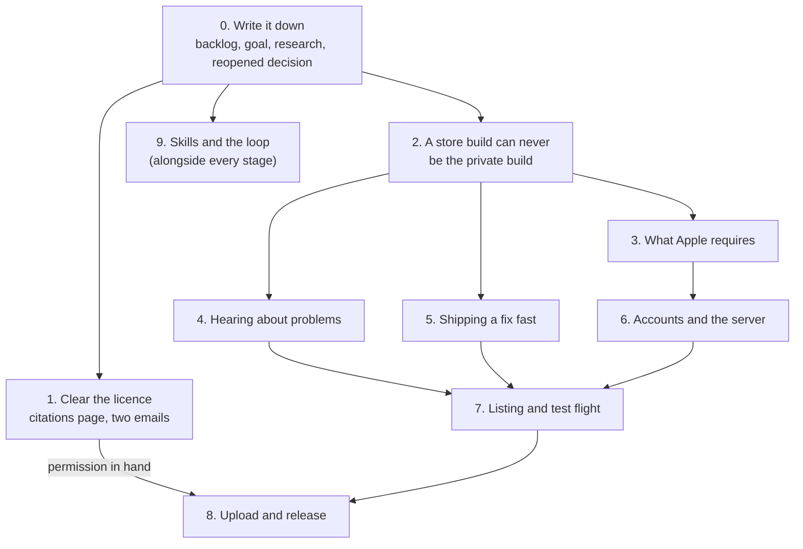

# Getting Hifth ready for the App Store, and ready to run once it is there

*Written 2026-11-15. Name: `launch-readiness`.*

## Context

The owner wants to take Hifth to the App Store. That needs two things this repo does not have
yet: the loose ends closed, and a way to hear about problems, find their cause and ship a fix
quickly once readers have the app.

This plan was built from a survey of the latest main, two independent web research passes on
what teams address before a launch, and status replies from three other sessions whose work
overlaps (the iPad walk, sign-in, and the hifth.app front page).

**Choices the owner made on 2026-11-15:**

| Question | Answer | What it means for the work |
|---|---|---|
| The licence clash | Build a citations page and ask the rights holders for written permission. The upload stays locked until they answer. | Everything else goes ahead meanwhile. A fallback date is needed. |
| Devices | iPad, iPhone and Mac together | The Mac build needs sandboxing and real signing, plus its own listing. |
| Accounts | Sign-in at launch | In-app account deletion, backups and a fuller privacy policy become launch blockers. |
| Crash reports | Apple's own reports plus a report the reader chooses to send | No outside company receives anything. |

**Four facts that shape the order:**

1. **The repo still records the App Store as "not a target".** Uploads are locked by a recorded
   decision (`native-testflight-licence` = own devices only). This plan reopens that decision
   in the register; it does not quietly step past it.
2. **The web part is packed inside the app**, served from the bundle (`native/Hifth/Web/LocalScheme.swift`).
   So every fix to the store app is a new build through Apple's review. A remote off-switch
   and a practised release path are the only fast levers.
3. **A store build could today be the private one.** `make app-web` builds the pitch flavour by
   default (`native/Makefile.native:48`) and nothing forces an archive to the public flavour.
4. **The main checkout is 188 commits behind.** All work happens in a new worktree off
   `origin/main` (`../hifth-launch`), never in the main checkout, which other sessions share.

## How the work is ordered

Stages 2 to 7 do not wait on the licence answer. Only stage 8 does.

## Stage 0. Write it down first

- **Backlog rows** in `docs/issues.json` for every item below that has none, then `make issues-doc`.
- **A second goal file**, `.claude/goals/app-store-launch.md`, with the same sections as the pitch
  goal and a scorecard (see stage 9). The pitch goal stays; the README lists both.
  *Assumption: the launch runs beside the pitch, not instead of it. Say so if it replaces it.*
- **The research, kept in the repo.** Write the two passes to `docs/research/app-launch/a.md`
  and `b.md`, each marking which sources were opened and which were only seen as a search
  result. Then a checker pass re-opens the sources behind the claims that matter and writes
  `docs/research/app-launch/research.md`, the one to act on. Claims the checker must settle:
  - whether Supabase's free plan keeps any backups (the two passes disagree);
  - whether a staged release applies to a first version;
  - whether the web part's offline cache works inside Apple's web view (tested on a device);
  - the exact privacy-manifest reason codes for the shell.
- **Reopen the decision** with the `decide` skill: "May Hifth be offered on the App Store?",
  linking the citations-and-permission route chosen today, and update `CLAUDE.md`'s opening,
  which still says Hifth is not being released.

## Stage 1. Clear the licence clash

- **A citations page**, in the app and at hifth.app, naming every source with its licence and
  a link back: the page artwork, the word-root corpus, the tajweed colouring data, Tanzil and
  the rest in `SOURCES.md` and `LICENSES.md`. A gate checks the page lists every source those
  files name.
- **Two permission emails for the owner to send**, drafted from
  `docs/design/testflight-licence-brief.md`: one to the word-root corpus's owners, one to the
  tajweed data's author, each asking for written permission to ship on the App Store.
- **Read the page-artwork terms** (open board item 55) and record the reading.
- **A fallback date.** If no answer by then, the plan switches to fetching that data from
  hifth.app after install. *Owner sets the date; suggested: four weeks after the emails go.*
- **The recitation audio** is fetched from another site (`apps/web/src/audio.ts:32`) with no
  licensing note. Find its terms and add it to the citations page, or switch it off in the
  store build.

## Stage 2. A store build can never be the private build

- The archive step refuses any flavour but public, by reading the flavour stamp the copy step
  already writes (`.hifth-web-flavour`). Test first: an archive attempt on a pitch build fails.
- Keep the existing release check (`.claude/skills/walk-app/scripts/release-check.mjs`), which
  proves a release build carries none of the debug capture code, and add the flavour check to it.
- The owner's two leftover steps on the old held pictures stay first on their list: delete the
  134 merged branches on GitHub, and ask GitHub Support to purge the old commits.

## Stage 3. What Apple requires

"Today" is as of 2026-11-15, when the plan was written. What is done since (the privacy file, the
version command, the archive with Apple's own check) is kept on the goal page,
`.claude/goals/app-store-launch.md`, so this table is not kept up to date.

| Item | Today | Work |
|---|---|---|
| Privacy manifest | Missing | Add it, with the reasons for each system feature the shell uses |
| Mac sandbox and signing | Empty entitlements, ad-hoc signed | Turn on the sandbox, sign with the paid team, fix what the sandbox breaks |
| iPad and iPhone entitlements | No file | Add Sign in with Apple and the hifth.app link file |
| Version numbers | 0.1.0 and build 1, fixed | One command that sets the version and raises the build number |
| Archive and upload | Both commands are stubs | Real archive and export, with the upload step still behind the licence lock |
| Sound with the silent switch on | Not set up | Set the audio mode so recitation plays; test on a device |
| "More than a website" (Apple's rule 4.2) | Not addressed | List what the shell adds (offline, pencil, links from other apps, downloads) in the review notes; make first launch work with no connection |
| Wandering web view | Unchecked | Prove no link inside the app can open an arbitrary site in it |
| Top-level error screen | One partial catcher | A whole-app error screen with "Report a problem", and a handler for errors nothing else caught |
| Accessibility | Screen-reader walk pending | Do the walk on iPad, iPhone and Mac; fix what it finds |
| Open faults a reviewer would hit | 11 open defects | Fix the ones on the public build, worst first, each with its test |

Reuse: `native/project.yml` (the project is generated from it), `native/scripts/signing-team.sh`,
`native/scripts/release-watch.mjs`, the `swift-shell-review` skill.

## Stage 4. Hearing about problems

- **Apple's crash reports from readers.** Subscribe the shell to the system's own daily
  diagnostics and keep them on the device, so they can go into a reader's report. Add a
  command that lists new crashes from Apple's developer tools.
- **"Report a problem".** A button in the info panel and on the error screen. It builds a
  small report (app version, device, the last errors, the last few steps as counts and names,
  never the reader's notes or marks), shows it to the reader in full, and only then lets them
  send it by mail to the support address. This follows the rule that the reader decides who
  sees their data, and is drawn as a design page first.
- **Proper logging.** Replace the shell's bare prints with the system log, and give the web
  part a small in-memory log the report can include. Each event carries the app version and
  the build's commit, which the web build already stamps.
- **A place to read what arrives.** Reports to the support address land in one folder; a
  command turns each into an issue row.
- **Store reviews.** A command that lists new reviews, and a habit of answering them.
- **Support and known-issues page** at hifth.app/support (takes over the backlog row
  `hifth-app-support-page`).

Reuse: the debug walk capture's touch trail (`native/Hifth/Capture/CaptureTrail.swift`) as the
model for "the last few steps"; `.claude/skills/crash-logs/scripts/pull-crashes.mjs`.

## Stage 5. Shipping a fix fast

- **A remote off-switch.** One small public file at hifth.app that the app reads at launch:
  the lowest version still allowed, a message to show, and on/off for risky features. With no
  connection the app carries on as before.
- **One release command**, from version bump to an uploaded build, with every check before it.
- **A written fix-in-a-hurry page**: how to reproduce, patch, build, upload, ask Apple for a
  faster review (with the request text ready to paste), and what a staged release can and
  cannot undo.
- **Undo for the site.** `deploy-site` gets a "put the previous release back" command, tested.
- **Updates for the browser version.** The site's offline cache gets a "new version ready"
  prompt, and old files are kept for one release so a cached page does not break.
- **Unsteady tests.** A test that passes only on its second try currently goes green; make the
  push report those so they get fixed.

## Stage 6. Accounts and the server

This stage is the longest (the sign-in page estimates about three weeks). It needs three
choices from the owner that are already written up in `docs/design/sign-in.md`: what sign-in
unlocks first, where reader accounts live, and whether a reader's copy is locked so we cannot
read it.

*Status 2026-11-19: the three choices were made 2026-11-18. Sign-in, delete my account, the
account section and the copy of a reader's marks are built on the laptop and switched off
(order in `.claude/plans/sign-in-build.md`, step table on the sign-in page). Backups are built,
with a restore practised on made-up rows (㉘). What is left waits on the owner's steps, listed on
the goal page.*

- Sign in with Apple through Apple's own sheet in the apps, as the sign-in page recommends.
- **Delete my account, inside the app**, which also cancels the Apple sign-in. Apple requires it.
- A place in the app to see what is stored about you and to remove it.
- **Backups and one practised restore** of whatever holds reader data, on a schedule, with a
  message if a backup fails.
- Limits on the public forms against abuse, and a written page for replacing a leaked key
  (the `secrets` skill has the checks).
- Database changes that never break the previous app version, since old builds stay in use.
- The notify-me list: choose how its form reaches the list, keep the project from pausing
  after 7 quiet days, add the mail-protection records, choose the sender.
- **Privacy policy for the apps**, not only the list: what stays on the device, what an
  account stores, the recitation fetch, the reader-sent report.

## Stage 7. Listing and test flight

- Store answers drafted in the repo: the privacy labels, the age questions, the EU trader
  declaration (owner's call), export answer (already set in the app).
- Name, description, keywords, review notes with a test account, the support and privacy
  addresses.
- **Screenshots at Apple's sizes** for iPhone, iPad and Mac, taken of the public build by a
  command (extends `make app-shot`), in English and Arabic.
- Release notes from the commit labels (`intent-manager:write-release-notes`), with the 42
  guessed lines checked.
- A test flight with a few named readers before the real release, and their feedback read.

## Stage 8. Upload and release (waits on the permissions)

- Unlock the upload in the register once the written permissions are in the repo.
- Submit, answer review, release in stages, watch the first two weeks daily.

## Stage 9. Skills and the loop

**Gaps in our skills, closed as each stage lands:**

| Skill | Gap | Fix |
|---|---|---|
| (new) `release-app` | No skill covers version, archive, upload, review, staged release | Done 2026-11-17: the skill exists, with `make app-release` |
| (new) `operate-app` | Nothing covers reading crashes, reports and reviews, or the fix-in-a-hurry path | Done 2026-11-20: a map skill that hands each step to its owner; fix-in-a-hurry stays in understanding-processes |
| `crash-logs` | Works only with a cable | Done: `make app-store-crashes` reads what Apple collected |
| `deploy-site` | ~~No undo~~ done (`make hifth-app-put-back`, its drill waits on the first upload) | Add the put-back command |
| `app-setup` | No store-listing or signing-for-the-store steps | Add them |
| `native-shell` | ~~Says nothing of store builds~~ done: the store build, Apple's accessibility check, the profile check (the default flavour is still the private one, on purpose, for the pitch) | Add the store build and its guard |
| `walk-app` | ~~No store-build walk~~ done: the release check with the public flavour, the first-open walk as Apple's reviewer, the fresh-install look (a sign-in walk waits on sign-in being switched on) | Add a first-launch, no-connection and sign-in walk |
| `manual-testing` | ~~Parked list predates the launch~~ done 2026-11-20: the silent switch and crash report checks are on the list, and a check fails the push when a waiting ledger check is missing from it | Add the screen-reader and device checks |
| `testing` | ~~Silent on unsteady tests~~ done 2026-11-19 (㉕) | The rule, the push's report and `make second-tries` |
| every skill | Not checked recently | Read each one's first line (what makes it fire) and fix vague ones |
| every skill | 28 session notes in `docs/retros/` say `folded: no` (2026-11-19): snags no skill has taken in yet | Fold them with `skill-manager:consolidate-retros`, oldest first; the loop counts what is left |

Open on 2026-11-20: 5 rows above, and 18 notes not folded. (2026-11-19: 6 rows, 28 notes.)

**The loop prompt:** `.claude/loop-prompts/operational-readiness.md`, beside the existing
walk-and-fix one (the repo's folder for these; no second folder). Run with `/loop` and no
interval. Each pass:

1. Re-count the scorecard in the launch goal file: open launch blockers, days since a restore
   was practised, days since the release command last ran clean, unanswered reports and
   reviews, new crashes, unsteady tests, skills with a known gap, owner steps still waiting.
2. Pick the worst number and fix one thing behind it, test first.
3. Check our setup against `research.md`, and once a month look again at Apple's
   upcoming-requirements page for new rules.
4. Write down what changed, the same turn; ship it with the next feature.
5. Tell the owner in one sentence; stop when everything left waits on them.

## The other sessions' work

| Session | What this plan takes over | What stays with them |
|---|---|---|
| iPad walk | Reader-facing feedback (stage 4); crashes from readers (stage 4) | Their two unpushed commits; the sideways link check; the owner's first real capture |
| Sign-in | Building sign-in and account deletion (stage 6); the notify form's route to the list | Their session note, which rides in with any later merge |
| hifth.app front page | The support page; the apps' privacy policy; store badge wording | Their five unpushed commits; the first upload of the site and the owner steps it waits on |

After approval, each session gets a message saying exactly this.

Also to raise with the owner, not to touch: the folder `hifth-native` holds an old branch with
no copy on GitHub, last changed 2026-09-30.

## Waiting on the owner

- Send the two permission emails; set the fallback date.
- Delete the 134 merged branches and ask GitHub Support for the purge.
- ~~The three sign-in choices.~~ Made 2026-11-18. The live list is on the goal page.
- The hifth.app first upload steps (key permission, database step, four secrets, mail sender).
- The EU trader declaration.
- Give the terminal the permission the Mac's keyboard test needs, or run it while away.

## How we will know it works

- **Every fix has a test that failed first**, per the repo's rule; all checks run on the laptop
  before each push.
- **The store build guard:** archiving a private build fails, by test.
- **A walk of the public store build** on a real iPad, iPhone and Mac: first launch with no
  connection, sign in, delete the account, send a problem report, read it on the laptop.
- **A forced crash** on a test device appears in the crash command's list.
- **The off-switch:** change the file, relaunch, see the message; remove the connection, see
  the app carry on.
- **A restore drill:** restore last night's backup to a scratch database and count the rows.
- **A dry run of the release command** up to the locked upload step, clean.
- **The site undo:** release, put back, check the live commit.
- **The scorecard** in the goal file, re-counted by the loop, trends to zero blockers.

## Merges

One pull request per finished feature, with one labelled commit per task; documents and agent
files ride along. `intent start` once per branch.
