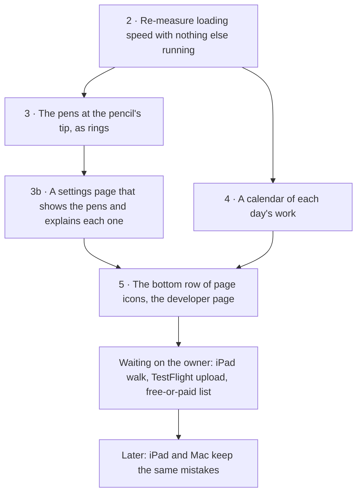

# Open work, one list (2026-11-10)

*Name: `open-work-2026-11`. Tasks: `remeasure-loading-speed`, `pencil-pens-as-rings`,
`pencil-pens-settings-page`, `calendar-of-each-days-work`, `app-pages-settings-and-developer`,
`app-pages-developer-page`. Use cases: `pick-a-pen-without-leaving-the-verse`,
`see-what-i-have-not-opened-lately`, `have-it-my-way-and-keep-it`. Before the first commit on
a branch, run `intent start <task> --plan open-work-2026-11`.*

All the open work as of 2026-11-10, in the order it will be taken. A new session should be
able to start from this page alone. Each item says what to build, where the code is, how to
test it and what counts as done.

- Finished work from the sessions of 9 and 10 November is in `docs/tasks/done.md`.
- The full backlog is still `docs/backlog.md`. The goal (a demo for the team behind The
  Study Quran) and its numbers are in `.claude/goals/study-quran-pitch.md`.
- When an item is done, move it to `docs/tasks/done.md` (one line, dated) and delete it here.

## In what order, and why

Item 1, the drawer levels, merged on 2026-11-10 as PR #586.

Items 3, 3b and 4 all add code, and the app has 0.7 KB of room left under its 200 KB size
limit. So item 2 comes first: it decides whether the limit can go up.

## Before you start: how this repo is worked

- **Node:** put `PATH=/Users/omareid/.nvm/versions/node/v22.22.3/bin:$PATH` in front of every
  pnpm or node command. The bare `node` on this laptop is too old.
- **Where to work:** the main checkout is `/Users/omareid/Workspace/git/hifth` and serves the
  dev app that the owner comments on. Work on a branch in a separate working copy. Reuse an
  idle one (`/Users/omareid/Workspace/git/hifth-walk`, `hifth-words`):
  `git -C <it> switch -c <branch> origin/main`. A hook stops and asks once 5 working copies exist, and it does
  not see the ones a helper agent makes under `.claude/worktrees/`, so remove those by hand
  when the agent's work is on main (three were left over and removed on 2026-11-10).
- **Git:**
  - run `git branch --show-current` before every commit;
  - stage files by name, never `git add -A`;
  - never `--no-verify`;
  - work every conflict by hand;
  - leave the main checkout's `.page-comments/threads/*.jsonl` and memory changes alone.
- **Checks:**

  | check | command |
  | --- | --- |
  | build | `pnpm --dir apps/web exec vite build --logLevel error` |
  | browser tests | `pnpm --dir apps/web exec playwright test <spec names> --project desktop --project desktop-firefox --reporter line` (they test the built app, so build first) |
  | types | `pnpm -r typecheck` |
  | unit tests | `make test` |
  | size | `pnpm -s gate:budget`, accept a new size with `make budget-update` |
  | backlog pages | `make issues-doc backlog` |

- **Pushing:** the push runs every local check (about 13 minutes). Run it in the background
  with its output in a log file. Don't edit that working copy until it finishes. Browser
  tests in another working copy are fine: each working copy serves the app on its own port
  (`scripts/lib/e2e-port.mjs`).
- **Firefox runs only the tests on its list.** The `desktop-firefox` run covers a fixed list
  of test files in `apps/web/playwright.config.ts`. A new test file, and the pencil tests,
  are not on it, so add them there or the Firefox run tests nothing for that work.
- **Merging:** there is standing approval to merge a green PR:
  1. `gh pr merge N --repo omars-lab/hifth --merge --delete-branch`
  2. `make -C <working copy> board` to update the project board
  3. `git -C /Users/omareid/Workspace/git/hifth fetch -q origin main`, then
     `git -C /Users/omareid/Workspace/git/hifth merge --ff-only -q origin/main`
- **A new setting** follows one pattern. `apps/web/src/drawer-marks.ts` is a small recent
  example:
  - a small module with the choices, a key and `saved…()` / `remember…()`;
  - App.tsx keeps it in state with a `choose…` callback;
  - the info panel (`Colophon.tsx`) shows it as a radio group.
  - Its words go in `en.json`, `ar.json` and `i18n.tsx`, then `pnpm -s i18n:build`.
- **Rules that never bend:**
  - The book's text never leaves the private pitch build: not in a commit, a PR, a test or a
    doc. Tests use made-up text.
  - Every fix or feature ships with its test, written first and seen failing.
  - Plain words in everything the owner reads.
  - Look at the real thing, in Firefox too, before calling it done.

## 2 · Re-measure loading speed, then decide the size limit

- **Why now:** 199.3 KB of the 200 KB limit is used. The trims still on the list only move
  code between files, so they don't lower the total.
- **How:**
  - stop every preview and dev server you started;
  - run `make perf-sweep` with nothing else running;
  - raise the limit only if the sweep shows room, by the rule in the optimizing-performance
    skill;
  - write the result at the top of `.claude/skills/optimizing-performance/trims.md`.
- **Done when:** the limit is either raised with the sweep's numbers written down, or kept,
  and a trim is taken before item 3.

## 3 · The pens at the Apple Pencil's tip, as rings (owner, 2026-11-10)

- **Ask:** the pens that open beside the pencil's tip are laid out as rings around the tip,
  "layers of an onion". Picking a tool that has its own choices adds an outer ring:
  - the highlighter adds a ring of its four pens;
  - the one Mark button adds a ring of Note, Harakat and Word.
- **How it's seen today:** only in the iPad app, with an Apple Pencil:
  - squeeze a Pencil Pro, or double-tap a 2nd-generation Pencil;
  - the iPad's Settings → Apple Pencil action has to be "Show Tool Palette", or the colour
    palette, which opens it with the highlighter in hand;
  - "Switch to Eraser" and "Last Used" only swap the tool, with no pens shown;
  - a computer has no way to open it.
- **Where the code is:**
  - `apps/web/src/components/PenHomes.tsx`: `PenHomeAt` draws the pens at the tip, and
    `ToolRow` is today's row (a radio group with arrow keys);
  - `apps/web/src/pencil.ts`: `pencilAction` turns the iPad's Pencil setting into an action,
    and `besideTip` places the pens beside the tip, never under it;
  - the outer choices today: `PenPicker` (`components/PenPicker.tsx`, four pens) and
    `AimPicker` (`components/PageToolbar.tsx`, Note, Harakat and Word);
  - App.tsx, `onPencil` (near `exposeToShell`, about line 3686) opens the pens when the iPad
    app passes a gesture in;
  - `apps/web/src/pen-home.ts` is the setting for where the pens sit on a computer (float,
    side or bottom). The ring-or-row choice is a new setting beside it.
- **Plan:**
  - Rings become a second layout for the pens at the tip, picked in the info panel. Rings are
    the default because the owner asked for them; today's row stays as the other choice.
  - The tip sits in the ring's hole, so the pens never cover it, and the ring stays inside
    the window near an edge.
  - The arrow keys go round the ring.
  - On a computer, a right-click could open the pens where the pointer is. Nothing in the
    app uses right-click today. But item 3b may make this unnecessary, so decide after 3b.
- **Tests:**
  - `apps/web/e2e/pencil.spec.ts` and `pen-homes.spec.ts` must pass with both layouts;
  - new tests: the inner ring, the outer ring opening for the highlighter and for Mark, and
    the arrow keys going round;
  - in a test, open the pens with
    `window.__HIFTH_PAGE__.pencil({ kind: "squeeze", pref: "palette", x, y })`.
- **Check on the device:** the hand holding the pencil may cover part of a ring centred on
  the tip. Look on the iPad (the run-app or walk-app skill), not only in the browser tests.
  Add that check to `docs/ipad-walk.md`.
- **Write down:** a line in `docs/design/pencil-gestures.md` and
  `docs/design/notes-style-toolbar.md` saying the rings are the default and the row is the
  setting.

## 3b · A settings page that shows the pencil's pens and explains each one (owner, 2026-11-10)

- **Ask:** a page of its own, among the settings, that draws the pens a reader would see at the
  Apple Pencil's tip and explains each button.
- **Why it matters:** today the pens only appear on an iPad with a Pencil, after the right
  iPad setting. A reader without one, or one who hasn't found the squeeze, never learns what
  is there. This page shows it to everyone, including the team behind The Study Quran, on a
  laptop.
- **What it shows:**
  - the same pens component the iPad opens, working, not a picture. It shows the rings (item
    3) or the row, whichever the reader picked, so changing the setting changes the drawing;
  - pressing a tool there opens its outer ring as at the tip, but nothing is drawn on the
    page: the highlighter's four pens, or Mark's Note, Harakat and Word;
  - beside each button, one plain line on what it does and when a hafiz would reach for it;
  - at the top, how to open the pens for real (the steps in item 3's "How it's seen today").
- **Where it lives:** opened from the info panel for now. When the bottom row of page icons
  (item 5) gives settings their own page, it moves there.
- **Shared with item 3:** the explanations come from one list that both use, so a pen's hover
  label and the line on this page never say different things. The hover labels on the page
  tools (PR #584, `e2e/tool-help.spec.ts`) already carry each tool's words. Start from those.
- **Tests:**
  - a browser test opens the page and checks every pen has its explanation;
  - it presses the highlighter and sees its four pens;
  - it checks that nothing landed on the mushaf page;
  - it runs again with the row layout picked;
  - seen failing first.

## 4 · A calendar of each day's work (owner, 2026-11-10)

- **Ask:** a calendar view with numbers for each day: how many mistakes were added that day,
  how many pages they covered, and so on.
- **What exists already:**
  - each note, a mistake included, keeps the moment it was made: `createdAt` in
    `packages/core/src/notes.ts` and `scoped-notes.ts`, and a scoped note's verses carry
    `addedAt`;
  - each verse looked at is already recorded, one record per day, on the device only. The
    counting is in `packages/core/src/revision.ts`, the storing in
    `apps/web/src/revision-store.ts`, which also keeps the day recording started;
  - the earlier plan for this record is `.claude/plans/interaction-calendar.md`. Read it
    first, but it is out of date where it says hizb boundaries do not exist;
  - a picture of that record is already built: `apps/web/src/components/RevisionMap.tsx`
    colours each page, hizb or juz by how many days ago it was last opened. It is laid out
    by place in the mushaf, not by day, and it does not count mistakes;
  - the hizb boundaries are already in our own data (`HIZB_STARTS` and `hizbOf` in
    `packages/core/src/quran-meta.ts`).
  - So the counts need no new data. The new part is the by-day layout and the mistakes per
    day, built beside the existing picture and sharing its counting.
- **Per day, first cut:**
  - mistakes added, split by kind (wrong letter, wrong vowel, verse ran on);
  - how many different pages they fall on;
  - pages and verses opened;
  - the juz touched;
  - tapping a day lists its mistakes, and each one opens its verse.
- **Rules carried over from the earlier plan:**
  - The record never leaves the device: no link, no share, no address.
  - The calendar says how old its record is ("recording since 3 March"), because an iPad
    browser tab can lose its stored data after seven days unused. The installed app keeps it.
  - A day runs by the reader's own clock: work at 11 pm and at 1 am counts on two days.
  - Counting by hizb uses the boundaries already in our data, never "half a juz".
- **Build it more than one way:**
  - a month grid with a shade per day;
  - a list of days, newest first, with the numbers written out.
  - The owner picks; the other stays as a setting.
- **Where it opens:** from the info panel, or as one of the bottom-row page icons if item 5
  lands first.
- **Tests:**
  - unit tests for the counting next to `revision.test.ts`, with day-boundary and time-zone
    cases;
  - a browser test that adds mistakes on two made-up days and reads the counts back;
  - all of it uses made-up text, never the book's.

## 5 · The bottom row of page icons, and the developer page

- **Ask** (the owner's page comment of 2026-11-07, thread `t_2bf0d8`):
  - page icons along the bottom, like a Mac app, with the mushaf page as the default and
    settings as a page of their own;
  - a developer page that shows only when the app runs on this laptop and never in a real
    build.
- **Already built:** the reading settings behind one ⚙ button, in a drawer (PR #585, a
  setting). The settings page here can take those, the pencil page (3b) and the calendar (4).
- **Where:** the questions are written up in `docs/design/app-pages.md`. Build it roughly
  first, as the project's rule says, then write the pros and cons from what the build
  showed.
- **When done:** reply on and close comment thread `t_2bf0d8`. See "Comments waiting on the
  owner" below.

## Waiting on the owner

- **The iPad walk** (`docs/ipad-walk.md`): the owner walks the checks on the iPad. Each answer
  becomes a test.
- **TestFlight upload:** the archive build can be made now. The upload waits on two things:
  the App Store Connect side being finished, and the licences being read, because any
  TestFlight build is an upload to Apple and today's decision says nothing is uploaded until
  then. Steps and what is left are in `docs/research/2026-11-09-testflight-own-devices.md`.
- **Free or paid:** draft which features would be free and which paid, for the owner to mark
  up. The questions are in `docs/design/paid-features.md`. Nothing of the Qur'an itself is
  ever paid for.

## Comments waiting on the owner

These are comments left on the app's own pages, answered and kept open for the owner to try.
Each one opens from `.page-comments/run show <id>` in the main checkout. Follow the
`development-manager:answer-page-comments` skill when the owner writes back.

| thread | asked | where it stands |
| --- | --- | --- |
| `t_e5432d` | a settings button with all the settings in a drawer, each drawer level marked | built (PRs #585 and #586), waiting for the owner to try it |
| `t_2bf0d8` | page icons along the bottom, a settings page, a developer page | the settings drawer is built; the rest is item 5 |

## Later

- **iPad and Mac keep the same mistakes,** through iCloud, mistakes first. The design is
  `docs/design/icloud-sync.md`. Building it waits on the TestFlight build reaching both
  devices.
