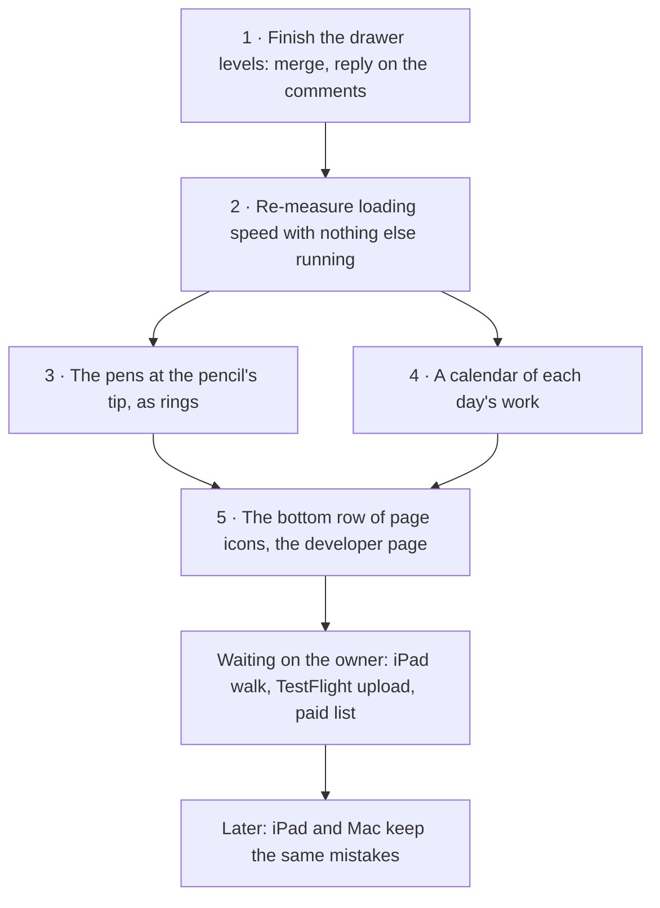

# Open work, one list (2026-11-10)

Everything still open from the sessions of 2026-11-09 and 11-10, in one place, in the order
it will be taken. Finished work from those sessions is in `docs/tasks/done.md`. The full
backlog is still `docs/backlog.md`, and the goal's numbers are in
`.claude/goals/study-quran-pitch.md`. This page lists the open items, with links to the
pages that explain each one.

## In what order, and why

Steps 3 and 4 both add code, and the app has 0.7 KB of room left under its size limit. So
step 2 comes first: it decides whether the limit can go up.

## 1 · Which drawer sits on which (finishing)

- **What:** the word's drawer names the verse's drawer under it, with a path by default or
  a tag per level as a setting. It is built and tested, and its push was running on
  2026-11-10 (branch `drawer-path`).
- **Left:** merge it, update the board, and reply on the owner's drawer comments.
- **Where:** `docs/design/ayah-drawer.md` ①, backlog item `drawers-for-every-tool`.

## 2 · Re-measure loading speed, then decide the size limit

- **Why now:** 199.3 KB of the 200 KB limit is used. The trims still on the list only move
  code between files, so they don't lower the total.
- **How:** stop the preview server, run `make perf-sweep` with nothing else running, and
  raise the limit by the skill's rule only if the sweep shows room. Write the result in the
  trims list.
- **Where:** `.claude/skills/optimizing-performance/trims.md`.

## 3 · The pens at the Apple Pencil's tip, as rings (new, owner 2026-11-10)

- **Ask:** the pens that open beside the pencil's tip are laid out as rings around the tip,
  "layers of an onion". Picking a tool that has its own choices adds an outer ring:
  - the highlighter adds a ring of its four pens;
  - the one Mark button adds a ring of Note, Harakat and Word.
- **How it's seen today:** only in the iPad app, with an Apple Pencil. The iPad's Settings →
  Apple Pencil action has to be "Show Tool Palette" (or the colour palette, which opens it
  with the highlighter in hand). A computer has no way to open it.
- **Plan:**
  - Rings become a second layout for those pens, picked in the info panel. Rings are the
    default because the owner asked for them; today's row stays as the other choice.
  - The tip sits in the ring's hole, so the pens never cover it.
  - The arrow keys go round the ring.
  - On a computer, a right-click on the page opens the pens where the pointer is. This is
    an assumption, so the owner can try the rings in Firefox. Nothing in the app uses
    right-click today.
- **Look for on the device:** the hand holding the pencil may cover part of a ring centred
  on the tip. Check it on the iPad, not only in the browser tests.
- **Tests:** the pencil browser tests (`e2e/pencil.spec.ts`) must pass with both layouts.
  New tests cover the outer ring, and they are seen failing first.
- **Where:** `docs/design/pencil-gestures.md`, `docs/design/notes-style-toolbar.md`.
  Also add a line to the iPad walk (`docs/ipad-walk.md`): check the rings, and the hand
  over them.

## 4 · A calendar of each day's work (new, owner 2026-11-10)

- **Ask:** a calendar view with numbers for each day. How many mistakes were added that
  day, how many pages they covered, and so on.
- **What exists already:**
  - each note, a mistake included, keeps the moment it was made;
  - each verse looked at is already recorded, one record per day, on the device only (the
    revision record, `.claude/plans/interaction-calendar.md`).
  - So the counts need no new data, only a view.
- **Per day, first cut:**
  - mistakes added, split by kind (wrong letter, wrong vowel, verse ran on);
  - distinct pages they fall on;
  - pages and verses opened;
  - the juz touched.
  - Tapping a day lists its mistakes, and each one opens its verse.
- **Rules carried over from the earlier plan:**
  - The record never leaves the device: no link, no share, no address.
  - The calendar says how old its record is ("recording since 3 March"), because an iPad
    browser tab can lose its stored data after seven days unused. The installed app keeps
    it.
  - A day runs by the reader's own clock: work at 11 pm and at 1 am counts on two days.
- **Build it more than one way:**
  - a month grid with a shade per day;
  - a list of days, newest first, with the numbers written out.
  - The owner picks; the other stays as a setting.
- **Where it opens:** from the info panel, or one of the bottom-row page icons (item 5) if
  that lands first.
- **Tests:**
  - day-boundary and time-zone cases in the counting;
  - a browser test that adds mistakes on two made-up days and reads the counts back;
  - all of it uses made-up text, never the book's.

## 5 · The bottom row of page icons, and the developer page

- **Ask:** the owner's page comment of 2026-11-07, thread `t_2bf0d8`.
- **Where:** `docs/design/app-pages.md`, the last part of `drawers-for-every-tool`.

## Waiting on the owner

- **iPad walk** (`docs/ipad-walk.md`): walk the checks on the iPad. Each answer becomes a
  test.
- **TestFlight upload:** the archive build is ready to make. The upload is still locked
  until the App Store Connect side is done
  (`docs/research/2026-11-09-testflight-own-devices.md`).
- **Free or paid:** draft which features would be free and which paid, for the owner to mark
  up.

## Later

- **iPad and Mac keep the same mistakes,** through iCloud, mistakes first. The design is in
  the iCloud sync page. Its building waits on the TestFlight build reaching both devices.
