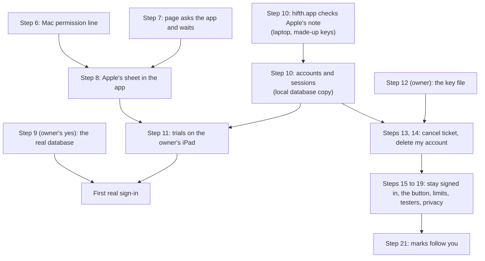

# Building sign-in

*Written 2026-11-18. Name: `sign-in-build`. Backlog row: `launch-sign-in`.*

The three choices are made (docs/design/sign-in.md, ① ② ③): a reader's marks follow them; our
own small code on hifth.app's Cloudflare with its free database; the copy not locked at first.
The step table on that page is the plan. This file only says the order we take it in and the
rules that hold throughout, so it does not restate the steps.

## Order

Steps 10, 6 and 7 do not depend on each other, and none waits on the owner, so they go first.

## Rules that hold throughout

- **Every check is written first and watched failing.** For Apple's note: a wrong signature, the
  wrong issuer, the wrong audience, an expired note, a one-off word that does not match, a signing
  method other than the one we pin, and a key id Apple does not list. All with a made-up key pair
  and made-up notes; never a real Apple account's.
- **Accounts are found by Apple's lasting user number, never by email.** Readers may hide their
  email, and it can change.
- **Only a scrambled copy (a hash) of a session token is stored.** A leaked database lets no one
  sign in.
- **jose runs on the server only.** It never enters the web app's bundle; a check proves it.
- **The local database only** until the owner says yes to the real one (step 9).
- **The new way off the device is named in the privacy check**, and the whole feature stays behind
  the developer setting until step 16's button exists.
- The code lives with the notify list's: thin files under `apps/landing/functions/api/`, the work
  in `apps/landing/lib/`, tested with node's own test runner and stand-ins for outside services.

## Not yet known

- How much server time one sign-in takes on Cloudflare's free plan. Measurable only after
  hifth.app's first upload, which the owner runs. On the laptop's Cloudflare stand-in, checking
  one note took about 1 ms (2026-11-18), well inside the free plan's 10 ms.
- Whether Apple hands its keys to the live site. Settled as far as the laptop can take it: see
  "What step 10 showed" below.
- ~~Who calls hifth.app's sign-in addresses from inside the apps?~~ **Settled in step 7
  (2026-11-18): the Swift app.** Inside the apps the page is served from the app's own bundle,
  so a call from the page would count as another site's, and the server would need a list of
  sites allowed to call it. The Swift app calls instead, after Apple's sheet closes, keeps the
  session in the Keychain, and answers the page's question with "signed in" only; the session
  never reaches the page. A server test holds that no reply lets another site's page read it.
  The browser version on hifth.app calls from the same site and needs neither.

## What step 7 showed (2026-11-18)

- The page asks with `askApp`; the app answers through a door the page puts in place first,
  matched by id. In the real Mac app, "ping" came back "pong" and an unknown question came back
  as a no, through `make app-probe`. The iPad still gets the same trial in step 11.

## What step 10 showed (2026-11-18)

- **jose runs on Cloudflare's runtime.** On the laptop's stand-in (`wrangler pages dev`, a
  throwaway local database), jose built in, checked a made-up note signed the way Apple signs,
  and refused a tampered one.
- **The three addresses answer as the tests say**: a word with "no-store", a junk body 400,
  sign-out 204, and a made-up note refused.
- **On the laptop, Apple refuses to hand over its keys**, so a note there is refused as
  "keys-unreachable" even when nothing is wrong. The stand-in names every request it sends as
  coming from `….example.com`, and Apple answers that name with 403. The same request naming
  `hifth.app` or `hifth-app.pages.dev` gets the keys. So this is a laptop-only quirk; the first
  real sign-in after the upload is what proves the live fetch. Full write-up:
  `docs/issues/apple-keys-refuse-local-runtime.md`.
- **Nothing was added to the Cloudflare settings file.** A database line there needs the real
  database's id, which waits on step 9. Until then the addresses answer 404 unless `SIGN_IN` is
  "on", and 503 if it is on with no database.

## What step 8 showed (2026-11-18)

- **The app asks hifth.app for the word before it shows Apple's sheet.** A server with sign-in
  switched off answers 404 first, so a reader never sees Face ID for nothing. The page hears
  only "signed-in" or a short reason ("cancelled", "sign-in-off", "busy", "offline",
  "refused:<why>"); the session stays in the app, in memory until step 15.
- **Apple is asked for no name and no email**, since the server keeps neither. The design
  page's diagram had the app sending the name; it now matches.
- **The one-time code is carried but not sent.** Step 13 sends it with the note.
- **Only builds that are not for the store can be pointed at another server**, with
  `HIFTH_SIGN_IN_URL`; with none set they answer "sign-in-off". The store build always uses
  hifth.app, and the release check now looks for that setting's name in a store archive.
- **In the real Mac app** (`make app-probe`, no server named), "sign-in" came back
  "sign-in-off" at once and no sheet was shown. The real sheet is first seen on the iPad
  in step 11.
- **Naming the new way out in the privacy check moves to step 16**, with the button that says
  what leaves the device. Nothing reaches a reader before that button exists.
