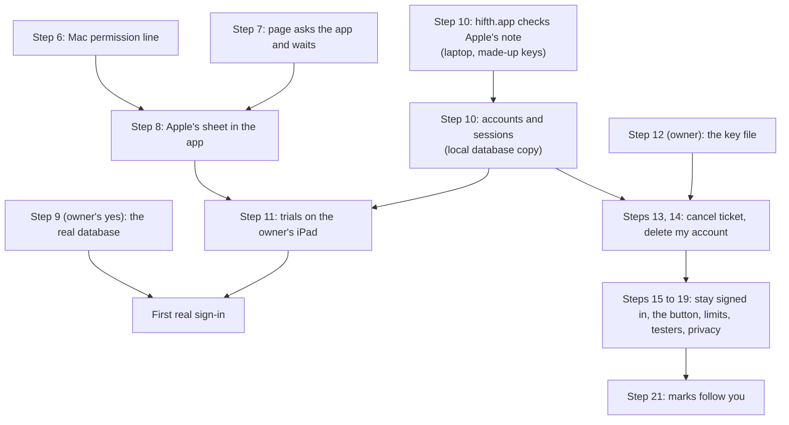

# Building sign-in

*Written 2026-11-18. Name: `sign-in-build`. Backlog row: `launch-sign-in`.*

The three choices are made (docs/design/sign-in.md, ① ② ③): a reader's marks follow them; our
own small code on hifth.app's Cloudflare with its free database; the copy not locked at first.
The step table on that page is the plan. This file only says the order we take it in and the
rules that hold throughout, so it does not restate the steps.

## Order

Steps 10, 6 and 7 do not depend on each other, and none waits on the owner, so they go first.

## Rules that hold throughout

- **Every check is written first and watched failing.** For Apple's note: a wrong signature, the
  wrong issuer, the wrong audience, an expired note, a one-off word that does not match, a signing
  method other than the one we pin, and a key id Apple does not list. All with a made-up key pair
  and made-up notes; never a real Apple account's.
- **Accounts are found by Apple's lasting user number, never by email.** Readers may hide their
  email, and it can change.
- **Only a scrambled copy (a hash) of a session token is stored.** A leaked database lets no one
  sign in.
- **jose runs on the server only.** It never enters the web app's bundle; a check proves it.
- **The local database only** until the owner says yes to the real one (step 9).
- **The new way off the device is named in the privacy check**, and the whole feature stays behind
  the developer setting until step 16's button exists.
- The code lives with the notify list's: thin files under `apps/landing/functions/api/`, the work
  in `apps/landing/lib/`, tested with node's own test runner and stand-ins for outside services.

## Not yet known

- How much server time one sign-in takes on Cloudflare's free plan. Measurable only after
  hifth.app's first upload, which the owner runs; until then, timed on the laptop.
- Whether jose needs anything Cloudflare's runtime lacks. Its own tests on the laptop's
  Cloudflare stand-in settle it at step 10.
