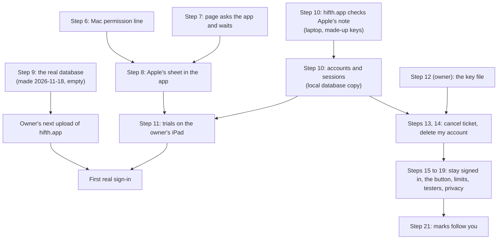

# Building sign-in

*Written 2026-11-18. Name: `sign-in-build`. Backlog row: `launch-sign-in`.*

The three choices are made (docs/design/sign-in.md, ① ② ③): a reader's marks follow them; our
own small code on hifth.app's Cloudflare with its free database; the copy not locked at first.
The step table on that page is the plan. This file only says the order we take it in and the
rules that hold throughout, so it does not restate the steps.

## Order

Steps 10, 6 and 7 do not depend on each other, and none waits on the owner, so they go first.

## Rules that hold throughout

- **Every check is written first and watched failing.** For Apple's note: a wrong signature, the
  wrong issuer, the wrong audience, an expired note, a one-off word that does not match, a signing
  method other than the one we pin, and a key id Apple does not list. All with a made-up key pair
  and made-up notes; never a real Apple account's.
- **Accounts are found by Apple's lasting user number, never by email.** Readers may hide their
  email, and it can change.
- **Only a scrambled copy (a hash) of a session token is stored.** A leaked database lets no one
  sign in.
- **jose runs on the server only.** It never enters the web app's bundle; a check proves it.
- **Tests and laptop trials use a local database only.** The real one exists since step 9
  (2026-11-18), but nothing in this work writes to it; only the live site does, once sign-in is
  switched on there.
- **The new way off the device is named in the privacy check**, and the whole feature stays behind
  the developer setting until step 16's button exists.
- The code lives with the notify list's: thin files under `apps/landing/functions/api/`, the work
  in `apps/landing/lib/`, tested with node's own test runner and stand-ins for outside services.

## Not yet known

- How much server time one sign-in takes on Cloudflare's free plan. Measurable only after
  hifth.app's first upload, which the owner runs. On the laptop's Cloudflare stand-in, checking
  one note took about 1 ms (2026-11-18), well inside the free plan's 10 ms.
- Whether Apple hands its keys to the live site. Settled as far as the laptop can take it: see
  "What step 10 showed" below.
- ~~Who calls hifth.app's sign-in addresses from inside the apps?~~ **Settled in step 7
  (2026-11-18): the Swift app.** Inside the apps the page is served from the app's own bundle,
  so a call from the page would count as another site's, and the server would need a list of
  sites allowed to call it. The Swift app calls instead, after Apple's sheet closes, keeps the
  session in the Keychain, and answers the page's question with "signed in" only; the session
  never reaches the page. A server test holds that no reply lets another site's page read it.
  The browser version on hifth.app calls from the same site and needs neither.

## What step 7 showed (2026-11-18)

- The page asks with `askApp`; the app answers through a door the page puts in place first,
  matched by id. In the real Mac app, "ping" came back "pong" and an unknown question came back
  as a no, through `make app-probe`. The iPad still gets the same trial in step 11.

## What step 10 showed (2026-11-18)

- **jose runs on Cloudflare's runtime.** On the laptop's stand-in (`wrangler pages dev`, a
  throwaway local database), jose built in, checked a made-up note signed the way Apple signs,
  and refused a tampered one.
- **The three addresses answer as the tests say**: a word with "no-store", a junk body 400,
  sign-out 204, and a made-up note refused.
- **On the laptop, Apple refuses to hand over its keys**, so a note there is refused as
  "keys-unreachable" even when nothing is wrong. The stand-in names every request it sends as
  coming from `….example.com`, and Apple answers that name with 403. The same request naming
  `hifth.app` or `hifth-app.pages.dev` gets the keys. So this is a laptop-only quirk; the first
  real sign-in after the upload is what proves the live fetch. Full write-up:
  `docs/issues/apple-keys-refuse-local-runtime.md`.
- **Nothing was added to the Cloudflare settings file then.** A database line there needed the
  real database's id, which came in step 9 (below). The addresses answer 404 unless `SIGN_IN` is
  "on", and 503 if it is on with no database.

## What step 8 showed (2026-11-18)

- **The app asks hifth.app for the word before it shows Apple's sheet.** A server with sign-in
  switched off answers 404 first, so a reader never sees Face ID for nothing. The page hears
  only "signed-in" or a short reason ("cancelled", "sign-in-off", "busy", "offline",
  "refused:<why>"); the session stays in the app, in memory until step 15.
- **Apple is asked for no name and no email**, since the server keeps neither. The design
  page's diagram had the app sending the name; it now matches.
- **The one-time code is carried but not sent.** Step 13 sends it with the note.
- **Only builds that are not for the store can be pointed at another server**, with
  `HIFTH_SIGN_IN_URL`; with none set they answer "sign-in-off". The store build always uses
  hifth.app, and the release check now looks for that setting's name in a store archive.
- **In the real Mac app** (`make app-probe`, no server named), "sign-in" came back
  "sign-in-off" at once and no sheet was shown. The real sheet is first seen on the iPad
  in step 11.
- **Against the laptop's stand-in server** (the real server code under `wrangler pages dev`
  with a local database, and `make app-probe TARGET=mac SIGN_IN_URL=…`, added for this): with
  sign-in switched off the server really answered 404 and the app said "sign-in-off"; with it
  on, the app fetched a real word and then said "not-available", because the everyday Mac build
  is not allowed Sign in with Apple. No sheet appeared either time. The command:
  `pnpm dlx wrangler pages dev apps/landing/dist --cwd apps/landing --ip 127.0.0.1 --port 8799
  --d1 ACCOUNTS=local-sign-in-check --binding SIGN_IN=on --binding APPLE_APP_IDS=app.example.hifth
  --persist-to <scratch folder>`. Keep the `--d1` part even now the settings file names the real
  database: the laptop server ignores databases in that file (see step 9 below).
- **The store-build check was missing three launch settings** (the probe's wait, the picture's
  wait, the Mac window size). A test now matches the check's list against every name the app's
  code reads, so a new setting cannot be left off it.
- **Naming the new way out in the privacy check moves to step 16**, with the button that says
  what leaves the device. Nothing reaches a reader before that button exists.

## What step 9 showed (2026-11-18, the owner's yes)

- **The accounts database is made** on hifth.app's Cloudflare account, named `hifth-accounts`,
  in western North America. Its three tables (accounts, sessions, one-off words) were put in
  from `apps/landing/migrations/`, and a count on the real database found all three empty.
- **The settings file names it** (`apps/landing/wrangler.toml`, binding `ACCOUNTS`). The id is
  not a secret: only someone signed in to the account can reach the database.
- **The release check allows that one database and no other.** It refused every database line
  before; a test now holds that the accounts line passes and any other (the old list line, one
  with no name) is still refused.
- **Sign-in is still off on the live site.** Nothing was uploaded, and `SIGN_IN` and
  `APPLE_APP_IDS` are not set on the live project. The database reaches hifth.app with the
  owner's next upload: wrangler sends the settings file with every upload.
- **The laptop server ignores the settings file's databases.** `wrangler pages dev` (4.164)
  takes databases only from its `--d1` flag; started with the settings file alone, the word
  address answered 503 "not set up". So laptop trials keep `--d1`, which also keeps them off the
  real database.

## What steps 13 and 14 showed (2026-11-18, server half)

Built by a helper agent on this branch; the app's half is still to do.

- **The sign-in address now takes Apple's one-time code** beside the note and the word. With a
  code, a key file and no ticket yet, the server trades the code with Apple for the cancel ticket
  and keeps it locked in a new table (`apps/landing/migrations/0002_apple_tickets.sql`). Failing
  to keep a ticket never blocks a sign-in.
- **The ticket's lock is worked out from the Sign in with Apple key file**, so no new secret
  name exists. The cost: after a key file swap, old tickets cannot be opened, and nothing
  replaces them (sign-in sees one is kept and skips the trade). Those readers' deletes answer
  "left". Worth fixing before a key is ever replaced.
- **Apple's notices** arrive at `/api/sign-in/apple-notice`. "Stopped using Apple sign-in" ends
  the sessions and drops the ticket but keeps the account; "deleted their Apple account" deletes
  everything. Only things older than the notice are touched, so a replayed notice cannot undo a
  later sign-in.
- **Delete my account** is `/api/sign-in/delete-account`, with the session as a Bearer header.
  It answers `appleLink: "cut"` or `"left"`; on "left" the app must tell the reader to remove
  Hifth in their Apple settings.
- **Still to do:** the app sends the code (it holds it but sends only the note and the word);
  the owner registers the notice address on Apple's developer site; the new table goes into the
  real database before sign-in is switched on. Not provable on the laptop: a real trade, a real
  revoke, the real shape of Apple's notices.
- **Sessions last a fixed 60 days and do not renew**, though the design page says a sign-in
  renews when used. And nothing clears out sessions or one-off words that have run out. Both
  found by the privacy draft (step 19); settle them with step 15's "stays signed in for months".

## What step 17 showed (2026-11-18)

- **The plan's "reuse the notify list's are-you-a-person check" does not fit.** That check is a
  widget in a web page, tied to hifth.app; sign-in is asked by the Swift app. Why, and what
  replaced it: `docs/issues/sign-in-limit-not-the-person-check.md`.
- **Built instead:** `handOutWord` (`apps/landing/lib/accounts.mjs`) counts each word into its
  ten-minute stretch (`sign_in_counts`, migration 0003) with one conditional statement, and
  refuses past `MOST_WORDS_A_STRETCH` (60). Refused means `null`, nothing written, and the word
  address answers 429 `too-many` with `Retry-After` set to the seconds left in the stretch. Nothing else is limited.
- **The first version counted words waiting, and that was wrong:** ask, burn with a junk note,
  ask again never reached it (a test got 180 words out of a cap of 60). Count what is handed
  out, not what is waiting.
- **Nothing about a caller is kept**, so the 60 are shared, and one caller at one ask per ten
  seconds takes them all. Cloudflare's free per-caller rule cannot be set tighter than that, so
  it only stops floods. The real answer is who may start a sign-in at all: question ⑮, and it
  moves step 18's invite check to before the word is handed out.
- **Migration 0003 goes into the real database with 0002**, on the owner's yes (question ⑩).
  Without it every ask for a word fails.
- **The counting statement was tried on Cloudflare's own local database** (a one-off page
  function under `wrangler pages dev --d1`, limit 2, four asks): it reported 1, 1, 0, 0 changes
  and kept 2. So a refused ask is told apart on Cloudflare the same way as in the tests.

## What step 18's server half showed (2026-11-18)

- **The invite check is on the word address only, before the database** (`uninvited` in
  `apps/landing/lib/sign-in-api.mjs`): 403 `invite-needed`, nothing written, the ten-minute count
  untouched. It is off until `SIGN_IN_INVITES` is set; sign-out, delete my account and Apple's
  notices never ask for a code. The owner has not yet chosen to use it (question ⑮).
- **Codes are made, never picked** (`apps/landing/lib/invites.mjs`, `make hifth-app-invites`):
  80 random bits, so the setting can hold plain SHA-256 copies and not be a secret. A code a
  person chose would be guessable from the setting; do not add a way to set one.
- **`tidyInvite` is fixed from the first code handed out**: small letters, o read as 0, i and l
  as 1, everything else dropped. The app must send what the tester typed and leave the tidying
  to the server, or tidy with the same rule.
- **An unset setting means open to everyone**, and a setting that holds something other than
  scrambled copies lets nobody in.
- **Left for the app half:** send `invite` with the ask for a word; show 403 as "invite needed";
  decide where the code is kept (each new sign-in needs it again; the keychain, beside the
  session, is the likely place); the test login for Apple's beta reviewers.
- **Every ask runs our code, refused or not**, and the free plan runs it 100,000 times a day.
  The owner's one free Cloudflare rule on the word address is what keeps one caller under that.
- **The app** shows 429 as a plain "server-error" today. Step 16 maps it to "try again shortly"
  when the held Swift files are in.

### Still open for step 11: how the iPad trial asks for sign-in

A tapped app has no launch setting, and the page has no sign-in button until step 16. Two ways,
to settle when step 11 starts:

- **A non-store iPad build launched by the laptop** with `SIGN_IN_URL` pointing at the laptop's
  stand-in on the home network (`--ip 0.0.0.0`). Needs nothing from the owner, but Apple's keys
  are refused on the laptop (`docs/issues/apple-keys-refuse-local-runtime.md`), so the note is
  sent but cannot be checked there.
- **The store-signed build against hifth.app.** The database is ready (step 9); it still needs
  the owner to upload hifth.app and to set `SIGN_IN` and `APPLE_APP_IDS` on the live project.
  This is the first time a real note is checked end to end.
