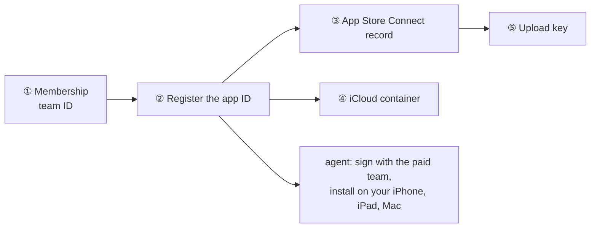

# Setting Hifth up

One page for every one-time step: what it is, the ID or value it needs, the link to do it on,
whose it is, and the backlog item that tracks it. **The status of each step lives in its
backlog item, not here** — this page holds the facts that do not change (the IDs, the links,
the order), so it stays right while the items move.

Who: **you** = the owner, Omar, signed in to the account. **agent** = Claude, from this laptop.

## The IDs, in one place

| what | value | where it is set |
|---|---|---|
| Apple team ID | `76NHKA839A` (individual account, Omar Eid) | `native/project.yml`, `TEAM=` on the make targets |
| The app's ID (bundle ID) | `com.bytesofpurpose.hifth` | `native/project.yml` |
| Its test IDs (not registered; local only) | `com.bytesofpurpose.hifth.tests`, `com.bytesofpurpose.hifth.uitests` | `native/project.yml` |
| The name shown to testers | "Hifth - The Huffaz Toolkit", published by Omar Eid | App Store Connect record |
| The App Store Connect record (iOS and macOS) | Apple ID `6832642191`, made 2026-11-09 | <https://appstoreconnect.apple.com/apps/6832642191> |
| iCloud container (proposed, not made yet) | `iCloud.com.bytesofpurpose.hifth` | made in ④ below; [icloud-sync.md](../../../docs/design/icloud-sync.md) |
| The reading site | `blog.bytesofpurpose.com/hifth/` | the build |
| The share page (for now) | `hifth.bytesofpurpose.com/share` | Cloudflare, ⑥ below |

## Apple: the iPhone, iPad and Mac app

One app covers all three: the same build targets iPhone and iPad, and a Mac build sits beside
it. Do them in this order; each waits on the one before.



| step | who | what to do | link | tracked as |
|---|---|---|---|---|
| ① Membership and team ID | you | done 2026-11-08: team `76NHKA839A` | <https://developer.apple.com/account#MembershipDetailsCard> | `testflight-membership-active` (answered) |
| ② Register the app ID | you | **Identifiers → +** → *App IDs* → *App*. Description "Hifth", **Explicit** bundle ID `com.bytesofpurpose.hifth`. Tick **iCloud** (with CloudKit), **Associated Domains** and **Siri**; **Push Notifications** and **Sign in with Apple** are optional (the table below says why each is there). Continue, Register. | <https://developer.apple.com/account/resources/identifiers/add/bundleId> | `testflight-register-app` (**next**) |
| ③ App Store Connect record | you | **Apps → + → New App**. Platforms **iOS and macOS** both ticked (one record for iPhone, iPad and Mac, since the Mac build uses the same ID), name "Hifth - The Huffaz Toolkit" (the name is 30 characters at most and must not be taken by another app), language English, bundle ID `com.bytesofpurpose.hifth` (it appears in the list once ② is done), SKU `hifth`, access Full. No store listing is needed for TestFlight. | <https://appstoreconnect.apple.com/apps> | `testflight-register-app` |
| ④ iCloud container | agent, or you | **Identifiers → +** → *iCloud Containers*, ID `iCloud.com.bytesofpurpose.hifth`; then on the app ID from ②, *iCloud → Configure* and tick it. Xcode can also make it the first time the agent signs with the team. | <https://developer.apple.com/account/resources/identifiers/list/cloudContainer> | `icloud-sync-try-signed` |
| ⑤ Upload key | you | **Users and Access → Integrations → App Store Connect API → +**, access *App Manager*. Download the `.p8` once (Apple never offers it again) and move it to `~/.appstoreconnect/private_keys/AuthKey_<key ID>.p8`, readable only by you (`chmod 600`). Apple's upload tools look for it there by name. **Never in the repo or a chat.** Tell the agent the key ID and the issuer ID; neither is secret. | <https://appstoreconnect.apple.com/access/integrations/api> | `testflight-upload-key` |
| Devices (only for a cable install) | you say yes, the agent registers | Each device takes one of Apple's 100 slots of its kind for the year. The add-device skill lists what is registered (`make app-devices`), asks you, then registers and installs (`make app-device-register`). The plain install does not register a new device; it stops and says so. | <https://developer.apple.com/account/resources/devices/list> | — |

### What the app's ID allows, and why

Registered 2026-11-09. A box ticked here only *allows* a feature; nothing happens until the
app itself asks for it, so an extra tick is harmless and a missing one can be added later on
the same page.

| feature on the ID | why it is on | used today? |
|---|---|---|
| iCloud (with CloudKit) | a reader's marks and counts follow them between iPad, iPhone and Mac | not yet (`icloud-sync-try-signed`) |
| Associated Domains | a link to the reading site opens the app | not yet |
| Siri | "Hey Siri, play al-Kahf in Hifth"; on a HomePod only after Apple's separate approval, below | not yet (`siri-play-recitation`) |
| Push Notifications | room for a reminder to revise, if one is ever built; it would also need its own key | no |
| Sign in with Apple | the simplest sign-in if readers ever need an account to share copies; Apple requires it if any other sign-in (Google and the like) is offered | no |

**Not on the ID page, but needed:**

- **Playing recitation:** no box. The app needs three changes of its own instead: playing
  with the ring switch on silent, audio in the background, and lock-screen controls
  ([iphone-app.md](../../../docs/design/iphone-app.md) ⑤–⑦).
- **Before the first upload:** the standard-encryption answer and Apple's privacy file
  (TestFlight ④).
- **Only if the voice coach ships:** a line saying why the app uses the microphone.
- **Only if a home-screen widget is built:** an App Group, which *is* a box on the ID page.
- **Paid features:** in-app purchase is on for every ID already.

### Siri on a HomePod: its own approval

Ticking Siri on the ID is not enough for a HomePod. Apple has to approve the app separately
before a HomePod will pass "Hey Siri, play …" to Hifth. In order:

| step | who | what | link | tracked as |
|---|---|---|---|---|
| AirPlay to a HomePod | agent | an AirPlay button; no approval needed | — | `recitation-airplay` |
| Siri plays recitation on the iPhone and iPad | agent | the app answers Siri's play requests | — | `siri-play-recitation` |
| Ask Apple for HomePod | you, signed in | the request form; send it only once the step above works | <https://developer.apple.com/contact/request/sirikit-media-intent-for-homepod/> | `homepod-siri-request` |

Then the agent: set the team in `native/project.yml`, sign, and install on your devices
(`testflight-sign-with-paid-team`), then the archive (`testflight-archive-builds`). The upload
stays locked until the TestFlight licence decision moves to A
([native-testflight-licence.md](../../../docs/decisions/native-testflight-licence.md)). The whole
road is [testflight-plan.md](../../../docs/design/testflight-plan.md); the iPhone's own questions
are [iphone-app.md](../../../docs/design/iphone-app.md).

### The tools for signing, archiving and uploading

Nothing to install beyond Xcode. Checked 2026-11-09 on this laptop; that day Xcode had no
account signed in, so the first signed build stopped (`testflight-sign-with-paid-team`).

| tool | what it does here | how to check it |
|---|---|---|
| Xcode (26.6) | builds, signs, archives | `xcodebuild -version` |
| Xcode signed in to your Apple account (**you**; it needs your password) | lets the build make and renew certificates and profiles by itself (`-allowProvisioningUpdates`); without it the build fails with "No Accounts" | Xcode → Settings → Accounts shows your name with **"Developer Team"** under it (team `76NHKA839A`). From the terminal, `sh native/scripts/xcode-account.sh` says whether an account is signed in at all. Whether the team is paid is checked on the built app instead: `sh native/scripts/profile-lasts.sh <path to Hifth.app>` reads the signing profile inside it — about 365 days means the paid team signed it, 7 days means a free "Personal Team" did (that install stops opening after a week) — and `make app-device-install` runs both, stopping before the install on a free team. Don't trust Xcode's saved settings for the team kind: on 2026-11-09 they still said Personal Team while the Accounts screen showed the paid Developer Team |
| XcodeGen | makes the Xcode project from `native/project.yml` | `xcodegen --version` (`brew install xcodegen` if missing) |
| `xcodebuild -exportArchive` with the upload key | sends the archive to App Store Connect | needs the key file from ⑤ |
| `xcrun devicectl` | installs on a plugged-in iPhone or iPad | `xcrun devicectl list devices` |

**After an install, if the app closes by itself on the device:** the `crash-logs` skill has
the steps: list and copy the crash file with `xcrun devicectl`, then get the reason Apple
leaves out of it by relaunching with `--console`. Use the device's name, never its id, in
anything written down.

Not used: fastlane (a third-party tool that wraps the same Apple commands) and Apple's
Transporter app. The first certificate for uploads ("Apple Distribution") is made by Xcode the
first time it archives; nothing to do by hand.

## Cloudflare: the share page

| step | who | what | link | tracked as |
|---|---|---|---|---|
| ⑥ `hifth.bytesofpurpose.com/share` | you sign in; agent writes the server | the address entry, a small Cloudflare server at `/share`, its free database. Nothing goes live before the consent question is answered. | <https://dash.cloudflare.com/> | `sharing-cloudflare-setup` |

## The outside-library store (Supabase)

Managed with the Supabase command line on its own account, not the connected one (that one is
at its free limit). Never write the project's private ID in the repo, a PR or a chat. Tracked
in the held-copy plugin's own pages, under the `qul-etl-plugins` decision.

**Always name the profile.** The command line keeps one saved login per *profile*, and the
default login on this laptop belongs to a different account. Hifth's account has its own profile
file, `~/.supabase/profiles/hifth.yaml`. So every command that reaches the hosted store takes
`--profile ~/.supabase/profiles/hifth.yaml`. A command without it runs as the other account.
`scripts/supabase-profile.test.mjs` fails if a skill lists one without it.

| Step | Who | Command |
| --- | --- | --- |
| Make the profile file (once per laptop) | agent | write the five lines below to `~/.supabase/profiles/hifth.yaml` |
| Log in (opens a browser) | you, in your own terminal | `supabase login --profile ~/.supabase/profiles/hifth.yaml` |
| Check it is the right account | agent | `supabase --profile ~/.supabase/profiles/hifth.yaml projects list` |
| Link a checkout (per checkout) | agent | `supabase --profile ~/.supabase/profiles/hifth.yaml link --project-ref <ref>` |
| Build the tables | agent | `supabase --profile ~/.supabase/profiles/hifth.yaml db push` |

```
name: hifth
api_url: https://api.supabase.com
project_host: supabase.co
dashboard_url: https://supabase.com/dashboard
pooler_host: supabase.com
```

The older account (the bytesofpurpose site's project, and the old hifth store, kept
running until the move is proven) has its own profile the same way: `~/.supabase/profiles/bytesofpurpose.yaml`, with
`name: bytesofpurpose`. Use it for anything on that account, never for hifth.

The login is filed under `name`, which is why a bare `--profile hifth` does not work: the tool
reads anything that is not one of its built-in names as a path to a profile file, and there is
no file called `hifth`. Leave
`SUPABASE_ACCESS_TOKEN` unset, because it overrides every saved login. The link to a project is
kept per checkout, in the ignored `supabase/.temp`, so a new worktree links again. The
building scripts don't use the login at all: they connect with the password-bearing address in
`SUPABASE_DB_URL`, which is yours to hold.

## This laptop

| step | command | why |
|---|---|---|
| Node 22 | `nvm use` (the repo's `.nvmrc` says 22) | bare `node` here is 18 and fails with unrelated-looking errors |
| pnpm 9.15 | `corepack enable` | the version `package.json` pins |
| Packages and the commit hook | `make install` | also wires the secret scan that runs on every commit |
| Test browsers | `pnpm --filter web exec playwright install chromium firefox webkit` | Firefox is the owner's browser; WebKit stands in for the iPhone and iPad |
| Xcode and the project | `make app-generate` | regenerates the Xcode project from `native/project.yml` |
| Run it | `make dev` (web), `make app-run-ipad`, `make app-run-mac` | the `run-app` and `native-shell` skills |

## Scripts — when to use each

This skill has no scripts of its own; every step above is a link for you or an existing make
target for the agent. If a step grows a script (say, checking that the IDs above match
`native/project.yml`), it goes in `.claude/skills/app-setup/scripts/` with a row here.

## Keeping this page right

- A new account, ID or one-time step: add a row here with its link **and** an item on the page
  it belongs to (with a row in `docs/issues.json`), the same change.
- A step done: close its backlog item; change this page only if a fact changed (an ID, a link).
- Never put a secret here: no key file, password, token or the Supabase project's private ID.
