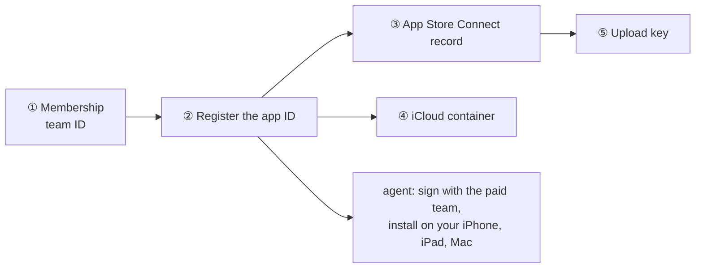

# Setting Hifth up

One page for every one-time step: what it is, the ID or value it needs, the link to do it on,
whose it is, and the backlog item that tracks it. **The status of each step lives in its
backlog item, not here** — this page holds the facts that do not change (the IDs, the links,
the order), so it stays right while the items move.

Who: **you** = the owner, Omar, signed in to the account. **agent** = Claude, from this laptop.

## The IDs, in one place

| what | value | where it is set |
|---|---|---|
| Apple team ID | `76NHKA839A` (individual account, Omar Eid) | `native/project.yml`, `TEAM=` on the make targets |
| The app's ID (bundle ID) | `com.bytesofpurpose.hifth` | `native/project.yml` |
| Its test IDs (not registered; local only) | `com.bytesofpurpose.hifth.tests`, `com.bytesofpurpose.hifth.uitests` | `native/project.yml` |
| The name shown to testers | Hifth, published by Omar Eid | App Store Connect record |
| iCloud container (proposed, not made yet) | `iCloud.com.bytesofpurpose.hifth` | made in ④ below; [icloud-sync.md](../../../docs/design/icloud-sync.md) |
| The reading site | `blog.bytesofpurpose.com/hifth/` | the build |
| The share page (for now) | `hifth.bytesofpurpose.com/share` | Cloudflare, ⑥ below |

## Apple: the iPhone, iPad and Mac app

One app covers all three: the same build targets iPhone and iPad, and a Mac build sits beside
it. Do them in this order; each waits on the one before.

| step | who | what to do | link | tracked as |
|---|---|---|---|---|
| ① Membership and team ID | you | done 2026-11-08: team `76NHKA839A` | <https://developer.apple.com/account#MembershipDetailsCard> | `testflight-membership-active` (answered) |
| ② Register the app ID | you | **Identifiers → +** → *App IDs* → *App*. Description "Hifth", **Explicit** bundle ID `com.bytesofpurpose.hifth`. Tick **iCloud** (with CloudKit) and **Associated Domains**. Continue, Register. | <https://developer.apple.com/account/resources/identifiers/add/bundleId> | `testflight-register-app` (**next**) |
| ③ App Store Connect record | you | **Apps → + → New App**. Platform **iOS** (covers iPhone and iPad), name "Hifth", language English, bundle ID `com.bytesofpurpose.hifth` (it appears in the list once ② is done), SKU `hifth`, access Full. No store listing is needed for TestFlight. | <https://appstoreconnect.apple.com/apps> | `testflight-register-app` |
| ④ iCloud container | agent, or you | **Identifiers → +** → *iCloud Containers*, ID `iCloud.com.bytesofpurpose.hifth`; then on the app ID from ②, *iCloud → Configure* and tick it. Xcode can also make it the first time the agent signs with the team. | <https://developer.apple.com/account/resources/identifiers/list/cloudContainer> | `icloud-sync-try-signed` |
| ⑤ Upload key | you | **Users and Access → Integrations → App Store Connect API → +**, access *App Manager*. Download the `.p8` once; it goes in the keychain, **never in the repo or a chat**. Note the key ID and issuer ID. | <https://appstoreconnect.apple.com/access/integrations/api> | `testflight-upload-key` |
| Devices (only for a cable install) | you | Xcode registers a plugged-in iPhone or iPad by itself when the agent installs; add one by hand only if asked. | <https://developer.apple.com/account/resources/devices/list> | — |

### What the app's ID allows, and why

Registered 2026-11-09. A box ticked here only *allows* a feature; nothing happens until the
app itself asks for it, so an extra tick is harmless and a missing one can be added later on
the same page.

| feature on the ID | why it is on | used today? |
|---|---|---|
| iCloud (with CloudKit) | a reader's marks and counts follow them between iPad, iPhone and Mac | not yet (`icloud-sync-try-signed`) |
| Associated Domains | a link to the reading site opens the app | not yet |
| Push Notifications | room for a reminder to revise, if one is ever built; it would also need its own key | no |
| Sign in with Apple | the simplest sign-in if readers ever need an account to share copies; Apple requires it if any other sign-in (Google and the like) is offered | no |

**Not on the ID page, but needed:**

- **Playing recitation:** no box. The app needs three changes of its own instead: playing
  with the ring switch on silent, audio in the background, and lock-screen controls
  ([iphone-app.md](../../../docs/design/iphone-app.md) ⑤–⑦).
- **Before the first upload:** the standard-encryption answer and Apple's privacy file
  (TestFlight ④).
- **Only if the voice coach ships:** a line saying why the app uses the microphone.
- **Only if a home-screen widget is built:** an App Group, which *is* a box on the ID page.
- **Paid features:** in-app purchase is on for every ID already.

Then the agent: set the team in `native/project.yml`, sign, and install on your devices
(`testflight-sign-with-paid-team`), then the archive (`testflight-archive-builds`). The upload
stays locked until the TestFlight licence decision moves to A
([native-testflight-licence.md](../../../docs/decisions/native-testflight-licence.md)). The whole
road is [testflight-plan.md](../../../docs/design/testflight-plan.md); the iPhone's own questions
are [iphone-app.md](../../../docs/design/iphone-app.md).

## Cloudflare: the share page

| step | who | what | link | tracked as |
|---|---|---|---|---|
| ⑥ `hifth.bytesofpurpose.com/share` | you sign in; agent writes the server | the address entry, a small Cloudflare server at `/share`, its free database. Nothing goes live before the consent question is answered. | <https://dash.cloudflare.com/> | `sharing-cloudflare-setup` |

## The outside-library store (Supabase)

Managed with the Supabase command line on its own account, not the connected one (that one is
at its free limit). Never write the project's private ID in the repo, a PR or a chat. Tracked
in the held-copy plugin's own pages, under the `qul-etl-plugins` decision.

## This laptop

| step | command | why |
|---|---|---|
| Node 22 | `nvm use` (the repo's `.nvmrc` says 22) | bare `node` here is 18 and fails with unrelated-looking errors |
| pnpm 9.15 | `corepack enable` | the version `package.json` pins |
| Packages and the commit hook | `make install` | also wires the secret scan that runs on every commit |
| Test browsers | `pnpm --filter web exec playwright install chromium firefox webkit` | Firefox is the owner's browser; WebKit stands in for the iPhone and iPad |
| Xcode and the project | `make app-generate` | regenerates the Xcode project from `native/project.yml` |
| Run it | `make dev` (web), `make app-run-ipad`, `make app-run-mac` | the `run-app` and `native-shell` skills |

## Scripts — when to use each

This skill has no scripts of its own; every step above is a link for you or an existing make
target for the agent. If a step grows a script (say, checking that the IDs above match
`native/project.yml`), it goes in `.claude/skills/app-setup/scripts/` with a row here.

## Keeping this page right

- A new account, ID or one-time step: add a row here with its link **and** an item on the page
  it belongs to (with a row in `docs/issues.json`), the same change.
- A step done: close its backlog item; change this page only if a fact changed (an ID, a link).
- Never put a secret here: no key file, password, token or the Supabase project's private ID.
