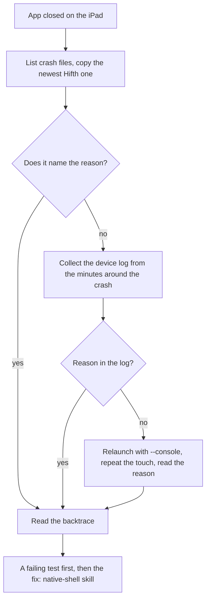

# When the app crashes on a device

The steps that work today, with the tools already on the laptop. Why each step is there, and
what is still to be built, is in
[docs/research/2026-11-10-ios-crash-troubleshooting.md](../../../docs/research/2026-11-10-ios-crash-troubleshooting.md).

**Never write a device's real id (UDID) in the repo, a PR or a chat.** Use the device's name,
or `<device-id>` in anything checked in.

## Short version

| step | command |
|---|---|
| **after installing, fail if a new crash report appears** | `make app-release-ipad DEVICE=<device-id>` (native-shell skill) |
| **copy every Hifth crash report and say what stopped the app, in one go** | `make app-crash-logs DEVICE=<device-id> [SINCE=<ISO time>]` |
| name of the plugged-in iPad | `xcrun devicectl list devices` |
| list crash files on it | `xcrun devicectl device info files --device <device-id> --domain-type systemCrashLogs` |
| copy one to the laptop | `xcrun devicectl device copy from --device <device-id> --domain-type systemCrashLogs --source <file>.ips --destination <path>` |
| read it | header line, then JSON body: `exception`, `asi`, `lastExceptionBacktrace`, `faultingThread`, `usedImages`, `captureTime` |
| get the reason the file left out | `xcrun devicectl device process launch --console --terminate-existing --device <device-id> com.bytesofpurpose.hifth`, then repeat the touch that crashed it |
| copy the device's system log | `/usr/bin/log collect --device --last 30m --output <path>.logarchive` |

Keep copied crash files and log archives in the scratch folder or a git-ignored folder: they
carry device details, and a log may carry page text.



## 1. Find and copy the crash file

```
xcrun devicectl list devices
xcrun devicectl device info files --device <device-id> --domain-type systemCrashLogs
```

`<device-id>` can be the name `list devices` prints. Hifth's files start with `Hifth-` and
carry the date and time.

`make app-crash-logs DEVICE=<device-id>` copies all of them to `native/build/crashes/` (git
ignores it) and prints one line per report: when, which build, the kind of stop, Apple's last
words, and the first call past Apple's throwing code (`frame=`), which is usually the one that
names the cause. Add `SINCE=2026-11-10T20:11:00Z` to see only the reports written after a fix
went on. By hand, copy the newest:

```
xcrun devicectl device copy from --device <device-id> --domain-type systemCrashLogs \
  --source Hifth-<date>-<time>.ips --destination <scratch>/Hifth-<date>-<time>.ips
```

On the iPad itself, the same files are under Settings › Privacy & Security › Analytics &
Improvements › Analytics Data, and each can be shared from there.

## 2. Read the crash file

An `.ips` file is two pieces of JSON: the **first line** is a short header (app name, version,
OS version, the time), and **everything after it** is the body. Read the body with
`tail -n +2 <file>.ips` and a JSON tool, or open the file in Console.app or Xcode, which show
it as text.

| field | what it tells you |
|---|---|
| `captureTime` | when it crashed; match it to what the reader was doing |
| `exception` | the kind of stop. `EXC_CRASH` with `SIGABRT` means an exception nobody caught: the app was stopped on purpose |
| `asi` | Apple's "last words": the reason, **when it is kept** |
| `lastExceptionBacktrace` | the chain of calls where the exception was thrown; read from the top: Apple's throwing code first, then the call that threw, then (lower) the first of our own functions, if any |
| `faultingThread` | which entry in `threads` crashed |
| `usedImages` | the app and libraries loaded, used to turn addresses into names |

If no frame of our own code is in the backtrace, the crash came from inside Apple's code (a
touch going straight from the window into UIKit, say). Read all the threads as clues to what
the app was doing.

**The reason is often missing on purpose.** Apple leaves the exception's message out of the
file for some errors, for privacy. That is not a broken file. Get the reason from step 3 or 4.

## 3. Get the reason from the device log

Apple's own handler writes the exception message to the device log before it stops the app.
Right after a crash, with the iPad plugged in, unlocked and trusted:

```
/usr/bin/log collect --device --last 30m --output <scratch>/ipad.logarchive
/usr/bin/log show --archive <scratch>/ipad.logarchive --predicate 'process == "Hifth"' --style compact
```

Use `--device-name "<name>"` instead of `--device` when more than one is plugged in. Call
`/usr/bin/log` by its path: in zsh, a bare `log` is a built-in maths command. It may ask for
`sudo`. Console.app, with the iPad picked in its side bar, shows the same lines live.

## 4. Get the reason by watching it crash

```
xcrun devicectl device process launch --console --terminate-existing \
  --device <device-id> com.bytesofpurpose.hifth
```

The app starts with its output attached to the terminal. Repeat the touch that crashed it; the
reason prints just before the app stops (this is how "Invalid parameter not satisfying:
targetNode" was found on 2026-11-10). `--console` shows only what the app prints, not the whole
system log. To pass a route: `DEVICECTL_CHILD_HIFTH_ROUTE=/hafs-kfqc/p45` before the command.

## 5. Turn names back on, if needed

Apple's own frames (UIKit, WebKit) usually arrive named. Our own frames need the build's debug
symbols (the `.dSYM` folder Xcode writes beside the app). Opening the `.ips` in Xcode names
them when that build is still on the laptop. By hand, one address at a time:
`atos -arch arm64 -o <Hifth.app.dSYM>/Contents/Resources/DWARF/Hifth -l <load-address> -i <address>`.

## 6. After the reason is known

- Write a test that does what crashed it, and watch it fail first (the native-shell skill:
  simulator on the iPad's iOS version, then the device).
- Write what was found in `docs/issues/<slug>.md`.
- Add the touch that crashed it to the walk checklist (walk-app skill).

## Known crash: touching a verse closes the app (2026-11-10)

Reason: `NSInternalInconsistencyException`, "Invalid parameter not satisfying: targetNode",
thrown in UIKit's gesture code on a touch. Cause, proven: the web view was built before iPadOS
had finished starting the app; it is now built on first use (fixed 2026-11-10, no crash since). See the research page above and the native-shell skill's
"Crashes" section.

## Planned, not built yet

None of these exist today. Do not run them; they are what the research page recommends.

- Collecting the recent device log in the same command as the crash reports.
- The app saving Apple's crash summary (MetricKit) as a file on the next launch. Copying a
  file out of the app's own folder is built (the walk-app skill's `walk-captures.mjs pull`
  does it with `--domain-type appDataContainer --domain-identifier com.bytesofpurpose.hifth`),
  so only the saving is left.
- The app logging through the system log (one subsystem, `com.bytesofpurpose.hifth`) instead
  of `print`.
- A make target that runs a UI test on the plugged-in iPad.
- The 18.5 simulator pass in the regular push checks.
- A release (TestFlight) path with uploaded debug symbols, so testers' crashes reach Xcode's
  Organizer; waits on the TestFlight decision.

## Scripts — when to use each

| script | what it does | when to reach for it | command |
|---|---|---|---|
| `scripts/pull-crashes.mjs` | Copies the app's crash reports off a plugged-in iPad (only ones not already copied), and prints one `ev=crash` line each with the kind of stop, Apple's last words and the first call past the throw, then `ev=done new=N`. `--since` keeps only newer reports; `--fail-on-new` exits 3 when there is one. Exits 1 when the iPad cannot be reached, never an empty pass. Tested with a stand-in device tool in `scripts/crash-logs-pull.test.mjs` | The app closed on the iPad; or after installing, to prove no new crash (the release command does this) | `make app-crash-logs DEVICE=<device-id> [SINCE=<ISO time>]` |
