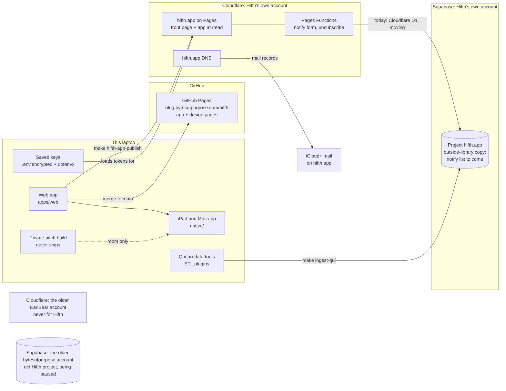

# How Hifth is set up today

This is a map, not a record. Each piece below points at the page or register that holds its
reasons. When this page and a record disagree, the record wins; fix this page.

## The short version

| Piece | Where it runs | Account | How to reach it | Where its record lives |
|---|---|---|---|---|
| Web app (`apps/web`) | the browser; built on this laptop | none | `make dev`, `make build` | `docs/map.json` |
| iPad and Mac app (`native/`) | the devices; wraps the web app | Apple developer team | `make app-web`, `make app-run-mac`, `make app-release-ipad`, `make app-devices` | the `native-shell` feature in `docs/map.json`; the `app-setup` and `native-shell` skills |
| Public site, design pages | GitHub Pages at blog.bytesofpurpose.com/hifth/ | GitHub | merges to main publish it (`.github/workflows/deploy.yml`) | the "Every design is public" tenet in `CLAUDE.md` |
| hifth.app front page and app at /read | Cloudflare Pages, project `hifth-app` | Hifth's own Cloudflare account | `make hifth-app-check`, `make hifth-app-publish`, `make hifth-app-verify`, `make hifth-app-serve` (local) | `docs/design/hifth-app-site.md`, decision `hifth-app-site`, the `deploy-site` skill |
| Notify form and unsubscribe | Pages Functions in `apps/landing/functions/api/` | Hifth's own Cloudflare account | `make hifth-app-list-count` (count only) | `docs/design/hifth-app-site.md` |
| The old Cloudflare copy | Cloudflare Pages, project `hifth` | the **EarlBear** account | `make deploy-cloudflare`, only on a day GitHub is down | the `deploy-site` skill |
| Database | Supabase, project `hifth.app` (us-east-1) | Hifth's own Supabase account | the `manage-database` skill; its login check first | decisions `qul-store`, `qul-store-purpose`; `docs/design/supabase-move.md` (on the unmerged `supabase-move` branch only) |
| The old database | Supabase, project `hifth`, being paused (it read "pausing" on 2026-11-12) | the older bytesofpurpose Supabase account | profile `~/.supabase/profiles/bytesofpurpose.yaml` | `docs/design/supabase-move.md` (unmerged branch) |
| Email on the domain | iCloud+ Custom Email Domain; hifth.app's mail records point at Apple | the owner's Apple account | iCloud settings, by the owner | not recorded yet |
| DNS for hifth.app | Cloudflare | Hifth's own Cloudflare account | `make cf-zone DOMAIN=hifth.app` | the `app-setup` skill |
| Saved keys | `.env.encrypted` in the repo, unlocked by a private key kept in LastPass | the owner's LastPass | `make env-keys-pull`, then `make env-bootstrap`; `make cf-tokens` checks the Cloudflare ones | `env.mk` |
| Qur'an-data tools | this laptop | none, or the Supabase store for the held copy | `make etl`, `make etl-list`, `make ingest-qul` | the `etl-plugins` feature in `docs/map.json`; decision `qul-etl-plugins`; `docs/design/etl-scripts.md` |
| Private pitch build | this laptop and the iPad, shown in a room | none | `make pitch`; `make app-web FLAVOUR=pitch` | `apps/web/src/pitch/`; "What we are building right now" in `CLAUDE.md` |

## What is settled, and what is still open

- **Settled 2026-11-12 by the owner, in chat:** the notify list's data lives in Supabase, not in
  Cloudflare's own database (D1). Recorded as decision `notify-list-store`.
- **Not done yet:** the notify function in `apps/landing/functions/api/` and
  `apps/landing/wrangler.toml` are still written against D1. They have to move to Supabase
  before the first release (issue `notify-function-on-d1`).
- **Still open:** what sends the mail to the list, decision `notify-list-sender`, with Resend's
  free plan from news.hifth.app recommended. The design is `docs/design/hifth-app-mailing-list.md`
  (its page, `docs/design/hifth-app-mailing-list.html`, is rebuilt by
  `scripts/build-hifth-app-mailing-list.mjs`); the research behind it is in
  `docs/research/2026-11-12-mailing-list-*`.
- **Worth a look:** hifth.app's mail records (checked 2026-11-12) send mail to Apple and carry
  Apple's signing record, but the sender rule still also names the registrar's old mail
  forwarding, and there is no record telling other mail servers what to do with forged mail
  (no DMARC). Both matter once the list sends from the domain (issue `hifth-app-dmarc-spf`).
- **Still open:** the share page at hifth.app/share. The `app-setup` skill still describes it on
  Cloudflare with its own free database; that predates the Supabase choice.

## Rules that come with it

- Never print a token, an account or project ID, a database password or an email address, in a
  chat, a log, a commit or a test.
- Never use the EarlBear Cloudflare account for Hifth. The hifth.app keys come through dotenvx.
- Never use the connected Supabase tools in the chat for Hifth; they reach a third account.
  Use the command line with Hifth's profile (the `manage-database` skill).
- Logging in to Supabase opens a browser, so the owner runs it in their own terminal.
- The pitch build and the held Qur'an text never reach a public build, a commit or a page.

## Keep this current

When a change adds, moves or retires a piece, update this page in the same commit: the
diagram, the table row and, if it settles or opens something, the list above.
