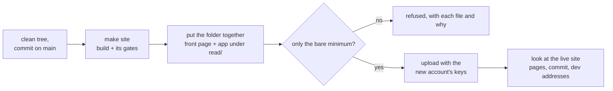

# Releasing Hifth's site

## The short version

```
make hifth-app-check      build, put the release folder together, refuse anything extra
make hifth-app-publish    the check, then upload with the saved keys, then look at the live site
make hifth-app-verify     look at the live site again, any time
make hifth-app-put-back   the release just published is broken: put the one before it back
```

**When a release is broken,** put the previous one back first and fix after.
`make hifth-app-put-back ARGS=list` shows the finished uploads, newest first, with the live one
marked. `ARGS="run --dry"` says which one it would put back and changes nothing. With no ARGS, it
points hifth.app at the upload before the live one and checks the live app carries that upload's
commit. Nothing is copied: Cloudflare keeps every upload. Each put-back goes one further back, and
`ARGS="run --to <commit>"` picks one by its commit. Going forward again is a fix, a merge and
`make hifth-app-publish`. A put-back changes only the site, never the iPad or Mac app, which has
its own fix-in-a-hurry page (`understanding-processes/fix-in-a-hurry.md`).

Run them with Node 22 on the path (`export PATH="$HOME/.nvm/versions/node/v22.22.3/bin:$PATH"`).
Release after the merge, from a worktree switched to origin/main with nothing uncommitted. The
main checkout usually holds other sessions' work, so the check would refuse it. The check refuses
anything but a clean tree whose commit is on origin/main.



## Where Hifth is published, and when to use each

| Where | How it gets there | When |
|---|---|---|
| **hifth.app** (front page, app at /read/) | `make hifth-app-publish` from this laptop | After a merge that changes the front page or the app. This is the address readers are given. |
| blog.bytesofpurpose.com/hifth/ (app and design pages) | GitHub Pages, on every merge to main, by itself | Nothing to do. The design pages live only here. |
| The old Cloudflare copy (`make deploy-cloudflare`) | wrangler's own login, which is a **different account** | Only on a day GitHub is down. Never for hifth.app. |

## What the check refuses

The release reads the exact folder it will upload. A file is refused unless it is on the list
of what the site needs. A text file is refused if it carries a sign of a development feature.
The lists live in `scripts/shipped.mjs`. A new kind of file has to be added there on purpose.

- **Files that never go up:**
  - a pitch build (`read/pitch/`), which holds The Study Quran's text;
  - debug copies of the source (`.map`);
  - the design pages (`read/docs/`);
  - hidden files;
  - the server's own code (`functions/`, `lib/`).
- **Signs of development in a shipped file:**
  - the development server's live reload;
  - the page-comment button;
  - the "what each commit was for" picture;
  - the outside library's page data;
  - Cloudflare's test key for the spam check;
  - a `localhost` or `127.0.0.1` address;
  - the privacy page's "[contact address to come]" placeholder.
- **Missing pieces:** the front page, the privacy page, the "no page here" page, the app's page,
  and its service worker. Without the "no page here" page, Cloudflare answers every unknown
  address with the front page, so a mistyped link looks like it worked.
- **The wrong commit:** the app must carry the commit being released, because its source-code
  offer names that commit (the app's licence is the GPL).
- **The tree:** uncommitted changes, or a commit not on origin/main. Changes to the page-comment
  files (`.page-comments/`) do not count: the comment tool writes to them after every commit, and
  none of them is in the site.

When the check refuses, fix the cause. Don't widen a list to make the refusal go away, unless the
file really belongs on the site. If it does, say so in the commit.

After the upload, `verify` fetches the live front page, the privacy page and the app, and checks
that the app carries this commit (in its main script or a script that one loads). Then it asks
for every development address (`live.mjs`, `DEV_PATHS`). Each must answer with an error, or with
the same page as an address that cannot exist, never with content.

**Try it before publishing** on Cloudflare's own local server, which behaves like the real host.
This copy has no comment bar and no side bar. To look at the site or comment on it, use
`make hifth-app-serve` (7124) instead. The `run-app` skill's "Which way to run it?" table sets
every local way side by side.

```
make hifth-app-check ARGS=--no-build
(cd apps/landing && wrangler pages dev dist --port 8788)
make hifth-app-verify ARGS="--url http://localhost:8788 --commit <the commit the build carries>"
```

**The email form** has a server part. Its code is `apps/landing/lib/notify.mjs`, with Cloudflare's
three entry files in `apps/landing/functions/api/` (sign up, confirm, leave). The list itself is on
Supabase: the table and the three database functions the form calls are in
`supabase/migrations/20261113000001_notify_list.sql`, with their checks in
`supabase/tests/notify_list.test.sql`. The upload runs from `apps/landing/`; none of this is
copied into the release folder, and `wrangler.toml` names no database (the check refuses one).

- **Once, by the owner** (it needs the database password; the `manage-database` skill's login
  check first):
  1. Push the migration to the real Supabase project, and store the hash of a new, real site key
     in the list's key table, as `supabase/seed.sql` does for the made-up local one.
  2. Put four Pages secrets in: `SUPABASE_URL`, `SUPABASE_PUBLISHABLE_KEY`, `LIST_KEY` (that real
     site key) and `TURNSTILE_SECRET`. Also the sender's settings, once the decision
     `notify-list-sender` is made.
  3. Add `SUPABASE_DB_URL` to the saved keys, so `make hifth-app-list-count` can count.
- **To try the form locally:** `supabase start` (in a scratch copy if the repo's own is busy, named
  by `SUPABASE_WORKDIR`), then `make hifth-app-serve`, and open http://127.0.0.1:7124/ (press C to
  leave a comment on the page). It reads the local list's address and key from `supabase status`
  and starts the server with Cloudflare's always-pass spam-check secret and a stand-in mailer that
  logs the confirm link (`ev=notify_confirm_link`), never the address. Count with
  `make hifth-app-list-count ARGS=--local`. Without a local Supabase the form says the list is
  not open yet.
- **To check the database's own rules:** `make notify-db-test` against the local copy.

The site has no `_redirects` file on purpose: Cloudflare ignored the app's catch-all rule under
`/read/` as an endless loop, and the app needs none, since it keeps its place after the `#`.
Cloudflare also serves `privacy.html` at `/privacy`, `sources.html` at `/sources` and
`support.html` at `/support`, so `_headers` names those addresses.

**The support page** (`support.html`, `ar/support.html`) is the address the store listing gives
for help. It says how to send a problem report from the app, naming the buttons by the words the
app shows (`apps/landing/lib/pages.test.mjs` reads them from the app's message files, so a
renamed button fails the test), and lists the problems we know about. **When a fault a reader can
meet opens or closes, update that list in both languages in the same change.** A release missing
either copy is refused.

**The privacy page** covers the apps as well as the list: what stays on the device, the
recitation fetch, the problem report, and accounts. Both copies must have the same sections in the
same order (the same test). When the app starts sending or fetching anything new, say so here in
the same change, and check Apple's privacy file (`native/Hifth/Resources/PrivacyInfo.xcprivacy`)
still agrees.

**The sources page** (`sources.html`, `ar/sources.html`) names every outside source the app is
built on, with its terms and a link. It is written by hand, and `scripts/landing-sources.test.mjs`
holds both copies to `SOURCES.md` row for row, and refuses a short name `LICENSES.md` uses that the
page leaves out. A release missing either copy is refused. To change a source, change
`SOURCES.md` first, then both pages until that test passes.

## Rules

- **Keys:** never print a key or the account ID. `make hifth-app-publish` loads them through
  dotenvx. The script refuses to upload unless the new account's token and ID are both loaded,
  because otherwise wrangler would fall back to its own login, which is the other account.
- **First time on a laptop:** `lpass login` (the owner), then
  `make env-keys-pull && make env-bootstrap`. Prove the keys with `make cf-tokens`.
- **Commands typed by hand use the `hifth` sign-in.** The publish scripts use the saved keys.
  Any other `wrangler` command (looking at a deployment, reading logs) uses a sign-in, and
  wrangler's own `default` sign-in is the other account. So this laptop has a second sign-in
  named `hifth` (made 2026-11-16 with `wrangler auth create hifth`, which opens the browser for
  the owner), tied to folders. Things to know, each checked on wrangler 4.131:
  - It is tied one folder at a time. A new working copy beside the main checkout does **not**
    pick it up and silently uses `default`. Tie each new one:
    `wrangler auth activate hifth <folder>`. `wrangler auth list` shows which folders are tied.
  - `wrangler auth …` refuses to run while a saved key is loaded ("Cannot manage auth profiles
    while CLOUDFLARE_API_TOKEN is set"). The main checkout's `.env` loads one, so run those
    commands from a folder with no `.env`, with the key unset in that shell, and pass the
    folder to tie as the last word.
  - To see which sign-in a folder uses: `wrangler whoami` there prints "Active profile: hifth".
    In the main checkout the saved key wins over the sign-in, which is what the scripts want.
  - Cloudflare marks these commands experimental, so check `wrangler auth --help` if one fails.
- **The Cloudflare Pages project** is `hifth-app` unless `HIFTH_APP_PAGES_PROJECT` says otherwise.

## Scripts — when to use each

| Script | What it does | When to reach for it | Command |
|---|---|---|---|
| `scripts/release-hifth-app.mjs check` | Makes a clean copy of main as GitHub has it in a scratch folder (no ignored files, so no private pitch folder, and nothing uncommitted), installs its packages, builds it (make site), puts the release folder together there, and refuses it if it holds anything extra | Before every release; to see what would go up | `make hifth-app-check` (`ARGS=--no-build` looks at this laptop's last build instead, as a look only) |
| `scripts/release-hifth-app.mjs prepare` | Builds and checks the release folder like `check`, without asking for a merged commit (what would stop a release is listed, not refused). After the check, it adds the local-only side bar (see `dev-sidebar.mjs`), every design page and written note under `/docs/design/`, and the features page from `../hifth-walk/.dev-hub` under `/dev-hub/` when that folder is there. It leaves the script rule (`Content-Security-Policy`) out of the local copy's `_headers`, because the side bar and the comment button are written into each page and the rule would block them; to look at the pages with the rule on, serve the folder `check` builds (`cd apps/landing && wrangler pages dev dist`). It clears the old folder by moving it aside first, because Finder can write into a folder while it is being deleted | First half of looking at hifth.app on this laptop | `make hifth-app-serve` runs it (`ARGS=--no-build` reuses the last build) |
| `scripts/release-hifth-app.mjs serve --port N` | Serves the prepared folder with Cloudflare's local server, the spam check's always-pass test keys, and the local Supabase list when one is running | Second half; `make hifth-app-serve` has the comment server start it behind itself, so http://127.0.0.1:7124 has the Comment button | `make hifth-app-serve` |
| `scripts/release-hifth-app.mjs publish` | The check, then keeps the live release's app files (`carry-previous.mjs`), then `wrangler pages deploy` from the clean copy with the saved keys, then verify | To release hifth.app | `make hifth-app-publish` (`ARGS=--no-carry` for the very first upload only, when nothing is live yet) |
| `scripts/carry-previous.mjs` | Reads the list of app files the live site's offline worker holds, and copies into the new release each script or style the new build no longer has, so a page a reader opened before the upload keeps working (launch item ㉔). Only the live release's own list is read, so a file is kept one release, then goes. Refuses the upload if the live site answers but a file cannot be fetched, or comes back as a page | Changing how old files are kept across a release | imported by `publish`; tests: `node --test .claude/skills/deploy-site/scripts/carry-previous.test.mjs` |
| `scripts/release-source.mjs publish --to <repo>` | Puts the source of one release in the public source repo: one commit holding exactly the released commit's files, on top of the release before it, tagged `release-<first 12 of the commit>`, signed by the project, never carrying this repo's history. A release that is already public is left alone, even an older one, and the branch and tag go up together | Before each release's upload, for the commit that release built, once the repo is private and the public source repo exists (waits on the owner; docs/design/laptop-publish.md). The app links that tag only when `SOURCE_COPY` in `apps/web/src/provenance.ts` is set | `make hifth-app-source TO=<repo> COMMIT=<released commit>`; tests: `node --test .claude/skills/deploy-site/scripts/release-source.test.mjs` |
| `scripts/put-back.mjs` | Asks Cloudflare which upload of the site is live, and points hifth.app at the finished production upload before it (Cloudflare's "rollback"), then looks at the live site for that upload's commit. Previews never count. `list` shows the uploads; `run --dry` names the one it would put back; `run --to <commit>` picks one by the first 7 or more characters of its commit. Refuses unless the saved token and account id are loaded, and prints neither | The release just published is broken, before the fix is ready | `make hifth-app-put-back` (`ARGS=list`, `ARGS="run --dry"`, `ARGS="run --to <commit>"`); tests: `node --test .claude/skills/deploy-site/scripts/put-back.test.mjs` |
| `scripts/release-hifth-app.mjs verify` | Looks at the live site as a reader's browser does | After a release; when someone asks if hifth.app is live | `make hifth-app-verify` (`ARGS="--url https://x.pages.dev"` for a preview) |
| `apps/web/e2e/landing-shots.spec.ts` (a Playwright file, not a script here) | Builds the plain public app and photographs it for the front page: the laptop, phone and iPad-with-pen views and one picture per feature, into `apps/landing/shots/` as JPEGs. Each picture checks the screen shows what it is meant to before it is taken. Never from the pitch build | After a change to how the app looks that the front page's pictures show; before a release that changes the front page | `make landing-shots` |
| `scripts/list-count.mjs` | Asks the Supabase database how many people are on the Mac-app list and how many still have to confirm, and prints those two numbers only; an answer holding anything else is refused. The password goes in the environment, never on the command line | When someone asks how many signed up; after a sign-up test on the live site | `make hifth-app-list-count` (`ARGS=--local` for the copy on this laptop) |
| `scripts/turnstile-widget.py` | Looks for the spam check's widget for hifth.app on the new Cloudflare account and prints its public site key. With `--make` it makes the widget if there is none, then saves its secret as `TURNSTILE_SECRET` through `scripts/env/env-set.sh`. The token, account ID and secret are never printed. The token needs the Account, Turnstile, Edit permission; without it Cloudflare answers "Authentication error" (seen 2026-11-14) | Once, before the first release; to read the site key again | `make hifth-app-turnstile` (`ARGS=--make` to make it) |
| `supabase/tests/notify_list.test.sql` (database checks, not a script here) | Proves the public key alone cannot read the list or the keys, the site key is needed, a repeat sign-up answers the same, only the latest confirm code works, and leaving removes the row | After changing the list's database part | `make notify-db-test` (`supabase start` first) |
| `scripts/shipped.mjs` | The lists of what may and may not go up, and the folder check | Changing what the site may hold | imported; tests: `node --test .claude/skills/deploy-site/scripts/shipped.test.mjs` |
| `scripts/app-links.mjs` | Writes and checks the file at `/.well-known/apple-app-site-association` that tells Apple which hifth.app links open the iPad and iPhone app (launch item ⑨). The release fills in the Apple team's id from this laptop's signing setup (`scripts/lib/signing-team.mjs`, shared with the store build check), so the id is never in the repo, and no message ever prints it. It claims only the reader's addresses with a mus'haf place, the same ones the app takes (`Route.swift`). With no signing team, a release is refused and `check --no-build` leaves the file out with one line. `_headers` serves it as JSON, never cached; `verify` checks it answers with no redirect, since Apple follows none | Changing which links open the app, or adding a mus'haf the app ships | imported by `check`, `publish` and `verify`; tests: `node --test .claude/skills/deploy-site/scripts/app-links.test.mjs` |
| `scripts/dev-sidebar.mjs` | The side bar on every local front page, design page and the features page (never in the app, never on the live site). Its groups: the front pages, then each section of the features page with its cards (pitch-only cards tagged), then the design pages. It lights the page you are on, folds to icons on a laptop and becomes a Menu drawer on a phone. The release check refuses its marker and `dev-hub/` if either reaches a folder going up | Changing the side bar's groups or looks; a new feature card or design page needs nothing, it is read from the pages | imported by `prepare`; tests: `node --test .claude/skills/deploy-site/scripts/dev-sidebar.test.mjs` |
| `scripts/dev-designs.mjs` | Lists every options page and written note for the side bar, newest commit first, and draws each note (its pictures, diagrams and highlighted boxes) as a page. The release check refuses `docs/` if it ever reaches a folder going up | Changing how notes are drawn or listed; a new design page needs nothing, the list is read from the folders | imported by `prepare`; tests: `node --test .claude/skills/deploy-site/scripts/dev-designs.test.mjs` |
| `scripts/live.mjs` | The look at the live site | Changing what verify asks for | imported; tests: `node --test .claude/skills/deploy-site/scripts/live.test.mjs` |

All the tests run with `pnpm test:scripts`.
