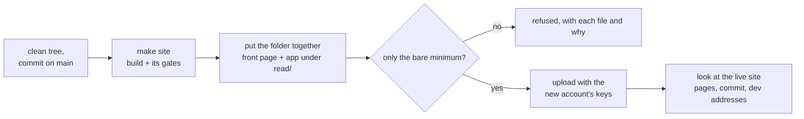

# Releasing Hifth's site

## The short version

```
make hifth-app-check      build, put the release folder together, refuse anything extra
make hifth-app-publish    the check, then upload with the saved keys, then look at the live site
make hifth-app-verify     look at the live site again, any time
```

Run them with Node 22 on the path (`export PATH="$HOME/.nvm/versions/node/v22.22.3/bin:$PATH"`).
Release from a clean main checkout, after the merge. The check refuses anything else.



## Where Hifth is published, and when to use each

| Where | How it gets there | When |
|---|---|---|
| **hifth.app** (front page, app at /read/) | `make hifth-app-publish` from this laptop | After a merge that changes the front page or the app. This is the address readers are given. |
| blog.bytesofpurpose.com/hifth/ (app and design pages) | GitHub Pages, on every merge to main, by itself | Nothing to do. The design pages live only here. |
| The old Cloudflare copy (`make deploy-cloudflare`) | wrangler's own login, which is a **different account** | Only on a day GitHub is down. Never for hifth.app. |

## What the check refuses

The release reads the exact folder it will upload. A file is refused unless it is on the list
of what the site needs. A text file is refused if it carries a sign of a development feature.
The lists live in `scripts/shipped.mjs`. A new kind of file has to be added there on purpose.

- **Files that never go up:**
  - a pitch build (`read/pitch/`), which holds The Study Quran's text;
  - debug copies of the source (`.map`);
  - the design pages (`read/docs/`);
  - hidden files;
  - the server's own code (`functions/`, `lib/`).
- **Signs of development in a shipped file:**
  - the development server's live reload;
  - the page-comment button;
  - the "what each commit was for" picture;
  - the outside library's page data;
  - Cloudflare's test key for the spam check;
  - a `localhost` or `127.0.0.1` address;
  - the privacy page's "[contact address to come]" placeholder.
- **Missing pieces:** the front page, the privacy page, the app's page, and its service worker.
- **The wrong commit:** the app must carry the commit being released, because its source-code
  offer names that commit (the app's licence is the GPL).
- **The tree:** uncommitted changes, or a commit not on origin/main.

When the check refuses, fix the cause. Don't widen a list to make the refusal go away, unless the
file really belongs on the site. If it does, say so in the commit.

After the upload, `verify` fetches the live front page, the privacy page and the app, and checks
that the app carries this commit. Then it asks for every development address (`live.mjs`,
`DEV_PATHS`). Each must answer with an error or with the app's own page, never with content.

## Rules

- **Keys:** never print a key or the account ID. `make hifth-app-publish` loads them through
  dotenvx. The script refuses to upload unless the new account's token and ID are both loaded,
  because otherwise wrangler would fall back to its own login, which is the other account.
- **First time on a laptop:** `lpass login` (the owner), then
  `make env-keys-pull && make env-bootstrap`. Prove the keys with `make cf-tokens`.
- **The Cloudflare Pages project** is `hifth-app` unless `HIFTH_APP_PAGES_PROJECT` says otherwise.

## Scripts — when to use each

| Script | What it does | When to reach for it | Command |
|---|---|---|---|
| `scripts/release-hifth-app.mjs check` | Builds (make site), puts the release folder together in `apps/landing/dist/`, and refuses it if it holds anything extra or the commit is not releasable | Before every release; to see what would go up | `make hifth-app-check` (`ARGS=--no-build` checks the last build) |
| `scripts/release-hifth-app.mjs publish` | The check, then `wrangler pages deploy` with the saved keys, then verify | To release hifth.app | `make hifth-app-publish` |
| `scripts/release-hifth-app.mjs verify` | Looks at the live site as a reader's browser does | After a release; when someone asks if hifth.app is live | `make hifth-app-verify` (`ARGS="--url https://x.pages.dev"` for a preview) |
| `scripts/shipped.mjs` | The lists of what may and may not go up, and the folder check | Changing what the site may hold | imported; tests: `node --test .claude/skills/deploy-site/scripts/shipped.test.mjs` |
| `scripts/live.mjs` | The look at the live site | Changing what verify asks for | imported; tests: `node --test .claude/skills/deploy-site/scripts/live.test.mjs` |

All the tests run with `pnpm test:scripts`.
