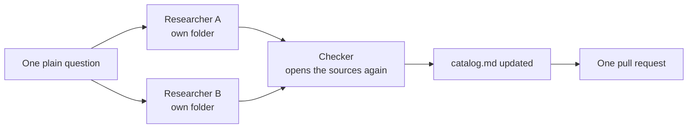

# Finding what other open apps can teach us

The catalog at `docs/research/influences/catalog.md` records what other open apps do that we could borrow, with a link to the exact code and a note on how sure we are.
This skill is how the catalog grows without filling up with guesses.

## The short version

1. Write the question down as one plain sentence, and list which catalog apps already answer part of it.
2. Start two researchers who cannot see each other's work, each with the same question and the rubric in [what-to-look-for.md](what-to-look-for.md).
3. When both finish, start one checker that opens the sources again and marks each claim.
4. Fold the checker's result into the catalog, tie the commits to the backlog row, and send one pull request.

## What must never happen

- **Nothing about us goes out.** A search, an address or a request never carries this app's name, the owner's name or email, or what we are building. Search for the general thing ("open source epub reader page slider") and for the other app by its own name.
- **Ideas, not code, from copyleft apps.** An app under the GPL or AGPL can teach us a behaviour. We copy none of its code. The catalog's app table says which apps this covers.
- **Downloaded code is read, never run.** Each download goes in its own new empty folder in the session's scratch folder, never inside the repo. No build tool or interpreter is run from inside it.
- **No scripture or commentary text** in any research file. This research never needs any.
- **A claim nobody opened is not a finding.** A README line, a search result or a file that was listed but not read is written down as exactly that.

## The steps in full

### 1. Say what is being asked

One sentence, as a question a stranger could answer: "How do page readers let you jump far away and get back?"
Read the catalog first. If it already answers the question, say so and stop; link the finding instead of researching again.
Pick the date for this round, `YYYY-MM-DD`, and a short topic word when the round is about one thing.

### 2. Two researchers, apart

Start two fresh agents in the same message, each in its own working copy on its own branch (`influences-<topic>-a` and `-b`).
Fresh means not a fork: a fork inherits this session's framing and the two would agree for the wrong reason.

Give each the same brief:

- the question, and the list of things the app has (a page-by-page reader, a page slider, pens, a long settings list, links that open a place in the app, one web codebase inside a native Swift shell on iPad, iPhone and Mac, plus the browser), in general words with no names;
- the whole of [what-to-look-for.md](what-to-look-for.md);
- the "what must never happen" list above;
- the two files to write: `docs/research/influences/<date>-<a|b>-findings.md` (raw: every source, and for each whether the file was opened or only seen in a search result) and `<date>-<a|b>-design.md` (what they would do with it);
- that they do not read the other researcher's files or the existing catalog's recommendations (the app table is fine, so they can skip apps already covered unless the question is new);
- that they commit their two files and stop. They do not push. See step 4 for why.

### 3. One checker

When both have reported, make one branch that merges both research branches.
Both will have added lines to the same record of commits; keep both sets of lines by hand.

Start a third fresh agent on that branch. It:

- reads both researchers' files;
- opens the source again behind every claim that would change what we build, and every claim the two disagree on;
- marks each finding as one of: both found it, both found it but they disagree (and which side the source supports), only one found it, or rests on something nobody opened;
- writes its result into `catalog.md` (new apps into the table, new findings under the right question, new gaps into "what nobody looked at"). It edits no other file.

Read the checker's catalog yourself before going on. Check a handful of its links open and say what it claims.

### 4. Write it down and send it

- **The backlog row.** Each round has one row in the backlog, whose source is a numbered item in the "Open questions" section of the folder's front page (`docs/research/influences/README.md`). The first round's row is `influence-catalog`. If the last round's row is closed, add a new numbered item and a new row for this round.
- **Say what the branch is for before the first commit:** `intent start <this round's row>` in the checker's working copy. The push check refuses any commit that names no task. The first round of this research lost an hour here: both researchers' pushes were refused, and the fix the check suggests makes a new commit that is itself refused. Researchers therefore do not push; the checker's branch carries everything.
- **Tie the researchers' commits to the row** with `intent answer <commit> <this round's row>`, run from inside the checker's working copy (the tool writes into whatever folder it is run from).
- **Redraw the backlog pages and run their two checks** (the `issues` skill has the commands).
- **One pull request.** The backlog row and the record of commits are not Markdown, so merging it alone makes the site publish, which uses paid minutes. Unless someone is waiting on it, let it ride on the next feature's merge.
- **Fold what changed into the plan it affects.** A finding that changes an open design item is added to that item, with a link back to the catalog. Do it in the same round, or leave an open item on the front page saying it is owed.
- **Clean up.** Remove the two researchers' working copies and local branches once the pull request has merged.

## What goes where

| File | What it holds | Who writes it |
| --- | --- | --- |
| `docs/research/influences/catalog.md` | The page to act on: the apps, the findings by question, how sure we are, what nobody looked at | The checker |
| `docs/research/influences/<date>-a-findings.md`, `-b-findings.md` | Raw notes, every source, opened or not | Each researcher |
| `docs/research/influences/<date>-a-design.md`, `-b-design.md` | What each researcher would do with it | Each researcher |
| `docs/research/influences/README.md` | The front page and the open items | Whoever runs the round |
| [what-to-look-for.md](what-to-look-for.md) | Which apps count, what to read in them, how to write a finding | Sharpen it after each round |

## After each round

Add to [what-to-look-for.md](what-to-look-for.md) whatever the round taught: a kind of file that turned out to hold the answer, a search that found nothing, a question the rubric had no line for.
The rubric is read fresh each run, so it can get sharper without this page changing.
