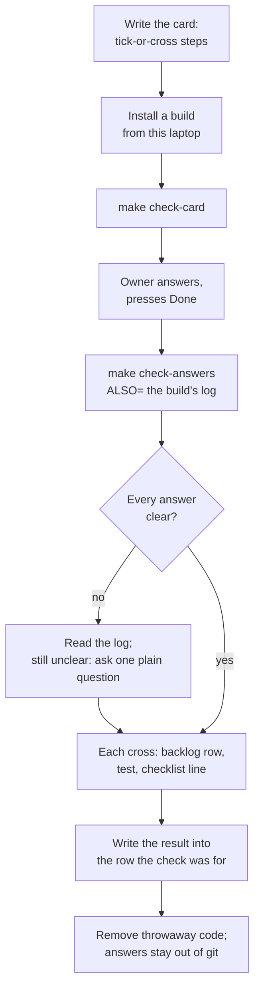

# Guided checks on the iPad

**What it answers:** something only a person holding the device can tell us. Examples: does iOS
ask a question, does a gesture feel right, does a screenshot get heard.
**What you need:** the iPad plugged in, unlocked and trusted, or a booted simulator.
**How long:** five minutes to write the card, one install, then a few minutes of the owner's time.

1. **Write the card.** Use a row of the by-hand checks list, or a small steps file in `checks/`.
   Every step is a question with a tick or a cross for an answer.
2. **Install a build from this laptop.** Release builds have no card.
3. **Send the card:** `make check-card`. It opens in the app.
4. **The owner answers it** and presses Done. Wait for them to say so; don't poll.
5. **Copy the answers back:** `make check-answers`. Add `ALSO=` if the build wrote its own log.
6. **Read them.** Where a cross is unclear, the log usually says what happened. If it doesn't, ask
   the owner one plain question.
7. **Turn each cross into work:** a backlog row, a test, and a line on the walk checklist. Write
   what the check proved into the row it was for.
8. **Clean up:** take out any throwaway code the check needed. Keep the answers out of git.



## How do I write a card that gives a readable answer?

A card holds at most 12 steps, in a link of at most 2,000 characters. iOS cuts a longer link, and
a step past the cut never reaches the card. The script splits a longer list and prints the
`FROM=` that sends the rest.

Each step has a `do` (one action) and a `see` (what tells a tick from a cross):

- **One action per step.** "Take a screenshot with the two buttons", not "take two screenshots and
  then open the drawer".
- **The `see` says what a tick means, and what a cross means,** when that is not obvious:
  "Tick if iOS did not ask about recording again, cross if it asked."
- **Never ask for a note instead.** "Note whether iOS asked again" came back as a cross with no
  note (2026-11-12), and nobody could tell what it meant. The script names any step worded that
  way (`ev=unclear_step`). Fix the wording before you send it.
- **Questions about what happened before the card opened** still work: "When the app opened, did
  iOS ask to allow recording? Tick if it asked."
- **Only made-up text in a steps file.** It is checked in. Never put the book's words in a step.

A steps file is `{ "id", "title", "steps": [{ "do", "see" }] }`, kept in `checks/` next to this
file; [checks/walk-probe.json](checks/walk-probe.json) is the one from the screenshot test.
From a by-hand checks list row, each runbook step's short line is the step, and the first sentence
of what it expects is the `see`. A row worded badly is fixed in `docs/validation/ledger.json`.

## How do I get a build with the card onto the iPad?

Any build installed from this laptop has the card:

```
xcrun devicectl list devices                 # the iPad's name, if HIFTH_IPAD is not set
make app-device-install DEVICE="$HIFTH_IPAD"
```

A build that writes its own log for this check (a throwaway probe, say) is installed the same way.
It writes into the app's `Documents/<its folder>/`, so `ALSO=` can bring the log back.

In the simulator: `make app-run`, then `SIM=1` in place of `DEVICE=` everywhere below.

## How do I send it?

```
make check-card ID=<row in docs/validation/ledger.json> DEVICE="$HIFTH_IPAD"
make check-card FILE=.claude/skills/guided-check/checks/<name>.json DEVICE="$HIFTH_IPAD"
make check-card ID=<row> FROM=13 DEVICE="$HIFTH_IPAD"     # the rest of a long list
```

It prints `ev=sent … to=ipad` and the link. Tell the owner, in one line, that a card is on the
iPad and roughly how long it takes. Then wait for them to say they've answered it.

## How do I get the answers back?

```
make check-answers DEVICE="$HIFTH_IPAD"
make check-answers DEVICE="$HIFTH_IPAD" ALSO=Documents/walk-probe    # and the build's own log
```

What it prints, one line each:

| line | what it means |
| --- | --- |
| `ev=answer file=… id=… result=pass\|fail passed= failed= unanswered= note="…"` | one card's answers, newly copied |
| `ev=failed_step id=… step=N action="…"` | a step the owner crossed |
| `ev=also_copied from=… files=N to=…` | the build's folder, copied to `native/shots/checks/<its name>/`, replacing the last copy |
| `ev=done out=… found=N new=N` | how many answer files the app holds, and how many were new |
| `ev=error where=ipad …` | the iPad couldn't be reached. Or no card has been answered yet: the app makes its answers folder at the first Done. |

Answers land in `native/shots/checks/<id>-<time>.json`, which git ignores:

```json
{ "at": "…", "id": "…", "title": "…", "route": "/hafs-kfqc/p7", "note": "…", "result": "fail",
  "steps": [{ "action": "…", "see": "…", "answer": "pass | fail | not answered" }] }
```

`route` is where the app was when Done was pressed.

Any other file the app wrote can be copied off by hand the same way:

```
xcrun devicectl device copy from --device "$HIFTH_IPAD" --domain-type appDataContainer \
  --domain-identifier com.bytesofpurpose.hifth --source Documents/<path> --destination <folder>
```

## What do I do with what came back?

- **Read the build's log beside the answers.** It often settles what a cross meant. On
  2026-11-12 the log showed the recorder failing once on return from the Home Screen, then
  starting, which the card alone couldn't say.
- **Still unclear?** Ask the owner one plain question about that step. Don't send a whole card
  again.
- **Each cross is a fault:** a backlog row in `docs/issues.json`, a test that fails before the fix,
  and a line on the walk-app checklist so the next walk looks for it.
- **Write what the check proved** into the note of the backlog row it was run for, the same turn.
  For a row of the by-hand checks list, follow the manual-testing skill's "When a verdict comes
  back": turn the verdict into a test, or record it with `make record`.
- **A card that was hard to answer is a fault too.** Fix the wording in the steps file or the
  ledger row, and add a test if the script could have caught it.

## What stays private?

- Answers, logs and clips stay in `native/shots/` (ignored by git). They can describe what the
  pitch build showed, so they are never committed, sent or published.
- Backlog rows and tests describe what happened in words. They never quote text from the screen.
- No device name or ID goes in a checked-in file. Use `DEVICE="$HIFTH_IPAD"` in docs.

## Scripts — when to use each

| script | what it does | reach for it when | command |
| --- | --- | --- | --- |
| `scripts/check-card.mjs link` | prints the card's link, and names any step that asks for a note | checking a card's wording and length before sending it | `node .claude/skills/guided-check/scripts/check-card.mjs link --file .claude/skills/guided-check/checks/<name>.json` |
| `make check-card` (`check-card.mjs send`) | sends the card to the iPad (`DEVICE=`) or the booted simulator (`SIM=1`) | every guided check | `make check-card FILE=… DEVICE="$HIFTH_IPAD"` |
| `make check-answers` (`check-card.mjs answers`) | copies the answers into `native/shots/checks/` and sums each one up; `ALSO=` copies one more folder from the app's data | after the owner says they've answered | `make check-answers DEVICE="$HIFTH_IPAD" ALSO=Documents/<folder>` |
| `scripts/check-card.test.mjs` | tests the script against stand-ins for Apple's tools, with no device | after changing the script; the push check runs it too | `node --test .claude/skills/guided-check/scripts/check-card.test.mjs` |

Exit codes: 0 done, 1 the device couldn't be reached (or the folder isn't there), 2 nothing to
send or bad usage. `HIFTH_SIMCTL` and `HIFTH_DEVICECTL` swap in stand-ins for Apple's tools.

The app side of the card is in `docs/design/check-card.md`.
