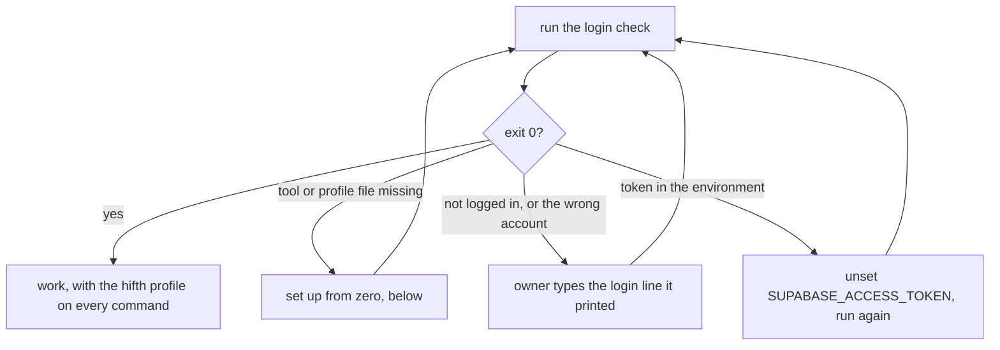

# Hifth's database

Hifth's data lives in one Supabase project, **hifth.app**, on Hifth's own Supabase account.
This laptop is also logged in to an older account by default, and that one holds the old
Hifth project and two others. So every command that reaches the hosted project names Hifth's
profile, and the first step of any database work is the login check.

## The short version

1. **Check the login:** `node .claude/skills/manage-database/scripts/check-supabase-profile.mjs`.
   It must end with exit 0 and say the hifth login reaches one project, hifth.app.
2. **If it fails,** it prints the line the owner types in the prompt. The login opens a browser,
   so it is theirs to run.
3. **Then do the work,** with `--profile ~/.supabase/profiles/hifth.yaml` on every hosted command.

## Scripts — when to use each

| Script | What it does | When to reach for it | Command |
|---|---|---|---|
| `scripts/check-supabase-profile.mjs` | Checks the tool is installed, the profile file is there, the hifth login reaches exactly one project named hifth.app, and no token in the shell overrides it. Says which projects the default login reaches. Prints names and states only. Exit 0 right, 1 wrong or missing login, 2 tool or profile file missing. | Before any database work, and whenever a command answers with the wrong projects | `node .claude/skills/manage-database/scripts/check-supabase-profile.mjs` |
| `scripts/check-supabase-profile.test.mjs` | Offline tests: only names and states survive the project list, a wrong account is refused, the login line names the profile | Runs in `pnpm test:scripts` | `node --test .claude/skills/manage-database/scripts/check-supabase-profile.test.mjs` |

## Which account is which

| Login | How it is chosen | What it reaches | Use it for |
|---|---|---|---|
| Hifth's own account | `--profile ~/.supabase/profiles/hifth.yaml` | hifth.app only | everything Hifth |
| The older bytesofpurpose account | the default, with no profile; or `~/.supabase/profiles/bytesofpurpose.yaml` | the old Hifth project (being paused) and two unrelated projects | nothing new; reading the old project during the move |
| The connected Supabase tools in the chat | the chat's own connection | a third account, at its free limit | never for Hifth |

`SUPABASE_ACCESS_TOKEN` in the shell beats every saved login, whichever profile is named. The
check warns when it is set.

## Setting up the profile from zero

On a new laptop, or if the profile file is gone.

1. Install the tool: `brew install supabase/tap/supabase`.
2. Write `~/.supabase/profiles/hifth.yaml` with Hifth's settings. It holds a name for the login
   and the Supabase addresses, no secret: copy it from the owner's other laptop, or see
   `docs/design/supabase-move.md` (on the `supabase-move` branch until it merges).
3. The owner logs in, in the prompt, with Hifth's account in the browser:
   `! supabase login --profile ~/.supabase/profiles/hifth.yaml`
4. Run the check. It must say one project, hifth.app.

## Applying migrations to the hifth project

The schema lives in `supabase/migrations/`, one SQL file per change, named by date. The checked-in
`supabase/config.toml` still names the project `hifth`; that is the local name only.

1. Run the check.
2. Link this checkout to the project once. The link is kept in `supabase/.temp/`, which git
   ignores. The project's reference comes from the dashboard and is never written into a
   checked-in file or a chat:
   `supabase --profile ~/.supabase/profiles/hifth.yaml link --project-ref "$HIFTH_SUPABASE_REF"`
3. See what would change: `supabase --profile ~/.supabase/profiles/hifth.yaml migration list`
4. Apply: `supabase --profile ~/.supabase/profiles/hifth.yaml db push`
5. Try a migration locally first when it is more than a new table: `supabase start`, then
   `supabase db reset` (local only, no profile needed).

The load scripts for the held outside-library copy (`make ingest-qul`) talk to the database
through `psql` and the address in `SUPABASE_DB_URL`, the session pooler (the direct address is
IPv6 only). That address carries the password, so it is the owner's to hold and is never printed.

## How a Pages Function writes to it

The owner decided on 2026-11-12 that the notify list lives here, not in Cloudflare's own
database. The function in `apps/landing/functions/api/` is still written for Cloudflare's
database and has to move (issue `notify-function-on-d1`). The table and the function's shape
are in `docs/design/hifth-app-mailing-list.md`, under "Where does the list live, and who can
read it?".

What any version must keep:

- The table has row-level security on and no rule that lets the public read it.
- The table sits in a schema the web interface does not serve. The site calls three narrow
  database functions (add, confirm, remove), each with fixed rights and a fixed search path, using
  only the publishable key. The secret key never goes on the site: it gets past every rule in the
  project, including the held outside library. The Supabase address and publishable key reach
  the Pages project through `make push-secrets`, never `wrangler.toml` or the front page.
- The laptop send script reads the list with the database password the load scripts already
  use, so no new all-powerful key is made.
- Counting the list prints a number only, as `make hifth-app-list-count` does today.

## Rules

- Never print a token, a project reference, a database password or an email address.
- Never run a hosted command without `--profile ~/.supabase/profiles/hifth.yaml`. A test on the
  `supabase-move` branch checks every skill for this.
- Never use the connected Supabase tools in the chat for Hifth.
- The login is the owner's to run. Do not paste a token for them.
- No held Qur'an text in a migration, a seed file or a test.
- A change that adds a table, a project or an account updates the `current-architecture` skill
  in the same commit.
