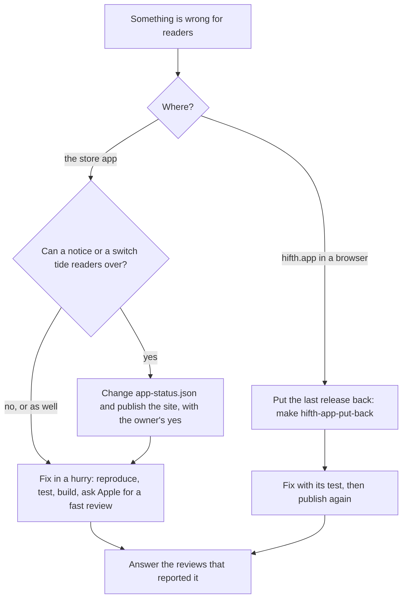

# Looking after the app once readers have it

This skill owns no commands. It is the map: what to look at, in what order, and which skill
holds each step. When a step's command changes, change it in the owning skill. The test next to
this page fails if this page names a command or a skill that is not there.

## The regular look

Do these in order. Each one prints counts only, and keeps what it fetched in `.store/`, which git
ignores.

1. **Crashes.** `make app-store-crashes` lists what Apple's server collected: crashes, freezes and
   slow launches, heaviest first. A crash on a plugged-in iPad is `make app-release-ipad`'s watch,
   or the crash-file steps. Reading one is the `crash-logs` skill.
2. **Reviews.** `make app-store-reviews ARGS=pull`, then `ARGS=waiting` for the ones with no
   answer. Draft each answer. An answer goes out only after the owner says yes to its words. The
   `store-feedback` skill.
3. **Downloads.** `make app-store-numbers ARGS=summary` for the last 30 days, by device and
   country. The `store-numbers` skill.
4. **The web app is up.** `make hifth-app-verify` checks hifth.app answers, and that it runs the
   commit we think it runs. The `deploy-site` skill.
5. **Readers' data is copied.** `make hifth-app-backup-status` says how old the last copy and the
   last practised restore are. The `deploy-site` skill.

Write what you found on the launch goal's numbers table (.claude/goals/app-store-launch.md), and
put each new fault in the backlog with the `issues` skill.

## When something goes wrong

- **A bad web release.** `make hifth-app-put-back ARGS=list` shows the uploads. `ARGS="run --dry"`
  shows what would change, and `ARGS=run` points hifth.app at the one before. It then looks at the
  live site. Putting back changes the live site, so it needs the owner's yes, like any upload. The
  `deploy-site` skill.
- **A notice, a forced update, or switching a feature off in the store apps.** The apps read
  `apps/landing/app-status.json` from hifth.app once per launch. It can ask readers below a version
  to update, show a short notice in English and Arabic, and switch off writing with the pencil or
  links from other apps. It cannot fix a bug, and readers with no connection never see it. Publishing
  it is a hifth.app upload, so it needs the owner's yes. The `deploy-site` skill.
- **A store version that must be replaced fast.** The steps, and the request for a faster review
  ready to paste, are on the fix-in-a-hurry page
  (.claude/skills/understanding-processes/fix-in-a-hurry.md). The build is `make app-release`, in
  the `release-app` skill. The upload to Apple stays locked until the licence question is answered.
- **A reader wrote in.** The problem report they send holds the version, the build, the device and
  the last errors, never their notes or marks. Match the version to a release, reproduce it, and fix
  it with its test. If the problem is known, add it to the support page's known-problems list in
  the same change (the `deploy-site` skill says where).

## What never happens without the owner's yes

Posting a review answer · any upload to hifth.app, including a put-back and a changed
app-status.json · uploading a build to Apple · touching the real accounts database or the hosted
list from this laptop · sending an email (draft it instead). Secrets are never printed: the
commands above read their keys themselves.

## Scripts — when to use each

| script | what it does | when to reach for it | command |
|---|---|---|---|
| `scripts/commands.test.mjs` | Fails if this page names a make command no Makefile has, or a skill that is not there | Runs with the other script tests; run it after changing this page | `node --test .claude/skills/operate-app/scripts/commands.test.mjs` |
