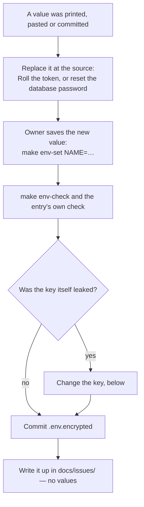

# Saved secrets

Hifth keeps a handful of secret values: a database address with its password in it, two
Cloudflare tokens, and the key that unlocks them. This page says, for each one, where its value
comes from and which command saves, checks or replaces it. It also says who runs each command,
because some steps belong to the owner alone.

## The short version

- **The `make` commands are the only way in.** Every check prints names, shapes and dates, never
  a value. The checks are allowed to run without a prompt; the commands that save or replace a
  value are the owner's, typed in their own terminal.
- **Claude never sees a value.** A guard refuses any command that could print one (see "What the
  guard refuses" below). If the guard refuses a command, use a check from the table instead. Never
  look for a way around it.
- **If a value leaked, replace it where it was made first**, then save the new one here. Deleting
  the chat does not undo a leak.

| I want to… | Who | Command |
| --- | --- | --- |
| check everything is saved and the right shape | Claude or owner | `make env-check` |
| check the Cloudflare tokens work, and when they end | Claude or owner | `make cf-tokens` |
| check the key here matches the LastPass copy | Claude or owner | `make env-keys-status` |
| save or change one value | owner, own terminal | `make env-set NAME=<name>` |
| set up a new laptop | owner, own terminal | `lpass login <email>` → `make env-keys-pull` → `make env-bootstrap` → `make env-check` |
| replace a leaked value | owner, at the source | the entry's "Replace it" column below, then `make env-set` |
| change the key that unlocks everything | owner, own terminal | "Changing the key" below |

Why the owner and not Claude for saving: `make env-set` asks for the value at a hidden prompt.
Anything typed into a chat (including a `!` command) is stored with the chat, so a value
typed there has leaked.

## Every saved entry

`.env.encrypted` is the committed copy; `.env` is the plain copy everything reads (never
committed); `.env.keys` is the key that unlocks the encrypted copy (never committed, backed up
in LastPass as `dotenvx/hifth`). The check at the bottom of this page fails if `.env.encrypted`
holds a name this table does not list.

| Entry | What it is | Where the value comes from | Check it (Claude may run) | Replace it (owner) | Other copies |
| --- | --- | --- | --- | --- | --- |
| `SUPABASE_DB_URL` | The address the building scripts use to reach the outside-library store, with the database password inside it. | Supabase dashboard → the hifth project → **Connect** → **Session pooler** (port 5432; this laptop has no IPv6, so not the direct one). The prompt shows the shape and refuses the web address, the direct address, a left-in placeholder, or the wrong port. | `make env-check` (shape), then the page check: `npx dotenvx run -q -f .env -- node packages/etl/scripts/qul-page-fixture.mjs --page 1` | Project Settings → Database → **Reset database password**, copy the new session-pooler address, `make env-set NAME=SUPABASE_DB_URL`, then the page check. | None. Not in GitHub, not in Cloudflare. |
| `CLOUDFLARE_API_TOKEN` | Lets the setup scripts change the domain's DNS and the static pages. | Cloudflare → **My Profile → API Tokens** (made in the user profile, not the account). | `make cf-tokens` | On the token's row, **⋯ → Roll**, then `make env-set NAME=CLOUDFLARE_API_TOKEN`, then `make cf-tokens`. | `make push-secrets ARGS="--github omars-lab/hifth CLOUDFLARE_API_TOKEN"` reports whether GitHub holds one (none on 2026-11-13). If it does, push the new value with `--push`. |
| `CLOUDFLARE_READ_TOKEN` | Read-only Cloudflare token. `make cf-zone` uses it, so a look at the domain can change nothing. | Same page as above. | `make cf-tokens`, `make cf-zone DOMAIN=hifth.app` | **Roll**, `make env-set NAME=CLOUDFLARE_READ_TOKEN`, `make cf-tokens`. | None. |
| `CLOUDFLARE_ACCOUNT_ID` | Which Cloudflare account to act on. Not a secret, but kept here so no plain file holds it. | Cloudflare dashboard → the account's home page, **Account ID**. | `make cf-tokens` uses it when a token was made under the account. | Never changes. | None. |
| `DOTENV_PUBLIC_KEY_ENCRYPTED` | The public half of the key, written by the tool at the top of `.env.encrypted`. Not a secret. | Written by `make env-encrypt`. | `make env-check` | Changes only when the key changes (below). | It is in the committed file. |
| the key (`.env.keys`) | The private key that unlocks `.env.encrypted`. Not in the table's file; the only one that opens everything. | Made by `make env-encrypt` the first time. | `make env-keys-status` | "Changing the key" below. | LastPass, `dotenvx/hifth` (`make env-keys-push`). |

## If a value leaked



<details><summary>Changing the key (proven on made-up values, 2026-11-13)</summary>

Only when `.env.keys` itself leaked. Every value is re-locked under a new key; the old key can
no longer open the new file.

```
mv .env.keys .env.keys.old
rm .env.encrypted
make env-encrypt        # says it MAKES A NEW KEY
make env-check
make env-keys-push      # the new key to LastPass
git commit -- .env.encrypted
```

On any other laptop: move its old `.env.keys` aside first (`make env-keys-pull` refuses to
overwrite one), then `make env-keys-pull` and `make env-bootstrap`. Delete `.env.keys.old` once
every laptop has the new key.

</details>

<details><summary>Adding a new entry</summary>

1. If the value has a shape worth checking, add it to `FORMATS` in
   `scripts/env/lib/formats.py`, with its hint, and add a case to `scripts/env-set.test.mjs`.
2. The owner saves it: `make env-set NAME=<name>`.
3. Add its row to the table above, in the same change. `secrets-table.test.mjs` fails until you
   do.

</details>

## What the guard refuses

`scripts/guard-secrets.py` runs before every shell command, file read and search in a Claude
session in this repo (wired in `.claude/settings.json`). It refuses:

- `dotenvx decrypt`, `get` and `keypair`, however the output is redirected. Through `npx`, a
  decrypt writes the values to the error stream, so sending its normal output away still prints
  them. That is how every value leaked on 2026-11-13.
- `dotenvx run --debug`, which prints each value it loads, and `dotenvx run --` followed by
  anything that prints the environment (`env`, `printenv`, `echo`, a shell, `node -e`, `python -c`).
  Running a script file is fine.
- `lpass show`, which prints the key.
- Any command that names `.env`, `.env.keys` or `.env.<anything>` (except `.env.encrypted` and
  `.env.example`), unless the command never prints a file (`make`, `ls`, `git`, `mv`, `rm`, …)
  or is one of our own scripts under `scripts/env/`.
- A recursive search over a folder holding a plain `.env` (plain `grep -r` does not skip ignored
  files), unless it excludes `.env*`.
- The Read and Grep tools on `.env` or `.env.keys`.

It is a seatbelt for honest mistakes, not a wall. A new check that needs to look at saved values
goes into `scripts/env/lib/envfile.py` as a command that prints names, shapes or fingerprints
only, with a test; never a one-off pipeline.

## Scripts — when to use each

| Script | What it does | When | Command |
| --- | --- | --- | --- |
| `scripts/guard-secrets.py` | Refuses a tool call that could print a saved value | Never by hand; the PreToolUse hook runs it | (hook) |
| `scripts/guard-secrets.test.mjs` | The guard's cases, including the exact command that leaked | Runs in `make checks-fast` | `node --test .claude/skills/secrets/scripts/guard-secrets.test.mjs` |
| `scripts/secrets-table.test.mjs` | Fails if `.env.encrypted` holds a name this page's table lacks | Runs in `make checks-fast` | `node --test .claude/skills/secrets/scripts/secrets-table.test.mjs` |
| `scripts/env/lib/envfile.py` (repo) | Save one value, check one value's shape, compare the plain and encrypted copies by name | Through `make env-set` / `make env-check`; `check NAME .env` by hand | `python3 scripts/env/lib/envfile.py check NAME .env` |
| `scripts/env/cf-token-check.py` (repo) | Each Cloudflare token works, and when it ends | Through `make cf-tokens`; also at session start | `make cf-tokens` |

The `make env-*` and `make cf-*` targets come from the global `cloudflare-onboarding` skill's
installer, which rewrites `env.mk` and `scripts/env/` when rerun. The format checks added in
hifth on 2026-11-13 are not in that installer yet (backlog: `env-formats-upstream`).
