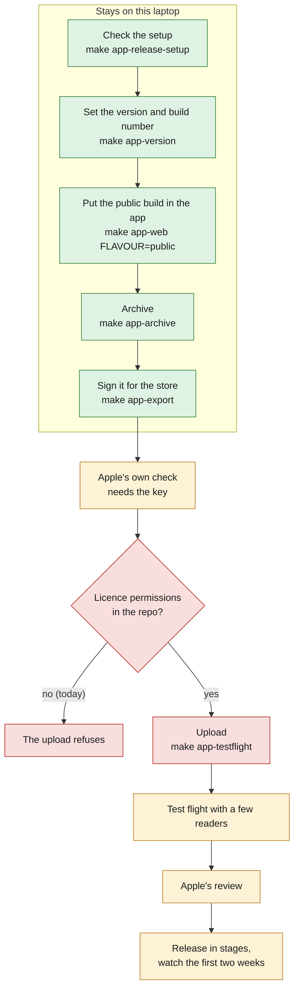

# Releasing the app: from a version number to readers

How a build of the iPad, iPhone and Mac app gets from this laptop to people's devices through
the App Store, what has to be set up before the first one, and what each step guards against.
The commands are in the `release-app` skill; the account IDs are in `app-setup`.

*Last checked: 2026-11-16.*

## The short version

1. **Check the setup:** `make app-release-setup` says what is missing and where to fix it.
2. **Set the version:** `make app-version VERSION=1.0.0`, or `NEXT_BUILD=1` for another build.
3. **Put the public build in the app:** `make app-web FLAVOUR=public`.
4. **Archive:** `make app-archive` builds the store copy and checks the app inside it.
5. **Sign it for the store:** `make app-export`.
6. **Apple's own check:** not built yet; needs the App Store Connect key.
7. **Upload:** `make app-testflight`, locked until the licence permissions arrive.
8. **Test flight, review, release:** not built yet.

Steps 1 to 5 stay on this laptop. Only steps 6 and 7 send anything to Apple.

## The whole thing, as a story

Apple lets an app into its store only when it knows three things: who made it, that nobody
changed it on the way, and that it follows Apple's rules. Every setup step answers one of those.

First you **join Apple's developer programme**, a yearly fee.[^program] That makes you a
*team*: someone Apple will accept apps from. Then you **register the app's ID**,
`com.bytesofpurpose.hifth`, the name Apple knows the app by for ever, and say which phone
features it uses.[^app-id] Then you **open the app's record in App Store Connect**, Apple's
website for everything after the build: the store listing, test flights, reviews, crash
reports.[^asc]

On the laptop, **Xcode is signed in to your account**, so it can act for the team. When it
builds the app it puts a **seal** on it, a certificate, which proves the app came from you and
was not changed since.[^certs] There are two seals. The *development* one is for your own iPad
and iPhone. The *App Store* one is for the copy meant for the store, and Apple keeps that one
itself and stamps the app for us when we ask.[^cloud]

A release then goes like this. The agent sets the **version number**, puts the **public build**
of the app inside (never the private one made for the pitch),[^flavour] and makes an
**archive**: the finished app, packed and sealed. Then it **exports** it, re-sealed with the
App Store seal.[^distribute] All of that stays on this laptop.

To hand that copy to Apple, the laptop needs a **pass**: the App Store Connect key.[^key] It
lets the agent's commands ask Apple to check the app and to take delivery of it, without anyone
typing your password. That is the step we are on.

One more gate is our own, not Apple's. The app carries data other people made, and they have
not yet said yes to the store. So the upload stays **locked** until their written permission is
in the repo.[^licence] After that: a **test flight** with a few readers,[^testflight] **Apple's
review**,[^review] and a **release in stages** while we watch the first two weeks.[^phased]

[^program]: Apple Developer Program, what membership gives and costs:
    <https://developer.apple.com/programs/>. Ours was done on 2026-11-08; the team is named in
    the `app-setup` skill.
[^app-id]: Registering an app ID and choosing its features (Apple calls them capabilities):
    <https://developer.apple.com/help/account/identifiers/register-an-app-id/>. Which features
    ours ticks, and why each is there, is in the `app-setup` skill.
[^asc]: App Store Connect help, the whole site: <https://developer.apple.com/help/app-store-connect/>.
    Our record, made 2026-11-09, is one record for iOS and macOS; its link is in the
    `app-setup` skill.
[^certs]: Apple's certificate types, and which one signs what:
    <https://developer.apple.com/support/certificates/>.
[^cloud]: Cloud-managed certificates: with Xcode's automatic signing the App Store certificate's
    private part stays at Apple, and Xcode asks Apple to sign:
    <https://developer.apple.com/help/account/certificates/cloud-managed-certificates/>. Seen
    here on 2026-11-16: the export was signed, and this laptop's keychain held no App Store
    certificate. That is why the setup check also accepts a store-signed export.
[^flavour]: The guard is the `app-store-flavour` step in `native/Makefile.native`, with its
    tests in `scripts/native-store-flavour.test.mjs`. The release check that proves no
    debug-only code reached the build is `.claude/skills/walk-app/scripts/release-check.mjs`.
[^distribute]: Archiving and exporting for the store, Apple's guide:
    <https://developer.apple.com/documentation/xcode/distributing-your-app-for-beta-testing-and-releases>.
    Our export settings are `native/ExportOptions.plist`.
[^key]: Making an App Store Connect API key:
    <https://developer.apple.com/documentation/appstoreconnectapi/creating-api-keys-for-app-store-connect-api>.
    What each access level may do (we use App Manager):
    <https://developer.apple.com/help/app-store-connect/reference/role-permissions>.
[^licence]: Why the upload waits: `docs/decisions/native-testflight-licence.md`. The two
    permission emails, drafted and not sent: `docs/design/store-permission-emails.md`. The
    lock itself: `scripts/testflight-allowed.mjs`.
[^testflight]: TestFlight, Apple's way to hand a build to a few testers before release:
    <https://developer.apple.com/testflight/>.
[^review]: The rules Apple reviews against: <https://developer.apple.com/app-store/review/guidelines/>.
    Our notes for the reviewer, including what makes the app more than a website (rule 4.2),
    are drafted in `docs/design/store-listing.md`; each claim there names the test that holds it.
[^phased]: Releasing an update in stages over seven days:
    <https://developer.apple.com/help/app-store-connect/update-your-app/release-a-version-update-in-phases>.
    Apple's page describes it for updates. Whether a first version can use it is not checked
    yet; the launch plan lists it for the research pass.

## Who does what

- **You** (the owner): anything that needs your Apple password, your account's settings, or a
  file only Apple hands you once.
- **The agent** (Claude, on this laptop): every command, and the checks after each of your
  steps. The agent never sees a key file's contents, a password or a certificate's private part.

## What has to be in place first

Do these once per Apple account and once per laptop. The check script reads each one and says
`ok`, `missing` or `later`.

| what | who | where | status (2026-11-16) | the check |
|---|---|---|---|---|
| A paid Apple Developer membership | you | <https://developer.apple.com/account#MembershipDetailsCard> | done 2026-11-08 | not checked by the script; a free team fails the device install |
| The app's ID registered, with its features | you | <https://developer.apple.com/account/resources/identifiers/list> | done 2026-11-09 | not checked by the script |
| The App Store Connect record (iOS and macOS) | you | <https://appstoreconnect.apple.com/apps> | done 2026-11-09 | not checked by the script |
| Xcode, XcodeGen, Node 22 | agent | Mac App Store; `brew install xcodegen`; `nvm use` | done | `Xcode`, `XcodeGen`, `Node 22 or newer` |
| Xcode signed in to your Apple account | you | Xcode, Settings, Accounts, +, Apple ID | done | `Xcode signed in to the Apple account` |
| The development certificate | made by Xcode on the first device build | <https://developer.apple.com/account/resources/certificates/list> | done | `Development certificate in the keychain` |
| The App Store certificate | made by Xcode on the first export, with your yes | the same certificates page | done 2026-11-16 | `App Store certificate` |
| The App Store Connect key | you | <https://appstoreconnect.apple.com/access/integrations/api> | made 2026-11-16 (`hifth-upload`, App Manager) | `App Store Connect key file`, `App Store Connect key ID and issuer ID` |
| The reviews key, for after the release | you | the same keys page | made 2026-11-16 (`hifth-reviews`, Customer Support, Finance and Marketing) | `The reviews key`, reported but never holding a release back |
| The vendor number, for the download reports | you copy it | <https://appstoreconnect.apple.com/itc/payments_and_financial_reports> (the number at the top) | **not saved yet** | `The vendor number`, reported but never holding a release back |
| Written permission from the two data owners | they give it; you send the emails | `docs/design/store-permission-emails.md` | **waiting** (launch items ③ and ④) | `The licence answer allows an upload` |

### Setting up the App Store Connect key

Apple's tools use this key to check and upload the app without your password. Apple shows the
key file **once**, so download it the moment it is made.

**What the key is for.** It lets the agent's commands on this laptop talk to App Store Connect
in your name, without your password, and only for this team's own work (what you agree to when
you request access). The plan uses it for:

| use | command | built? |
|---|---|---|
| Apple's own check of the signed copy, before any upload | the release's check step | not yet; first use |
| Uploading a build to TestFlight | `make app-testflight` | not yet; locked on the licence |
| Seeing whether Apple has finished processing an upload, and adding it to a test group | part of the release command (launch item ㉒) | not yet |
| Reading and answering store reviews | the store-feedback skill, on the **second** key (see below) | yes, 2026-11-17 |
| Counting downloads, updates and downloads again | the store-numbers skill, on the second key | yes, 2026-11-17 |
| Reading what Apple collects from readers' devices (hangs, slow launches, test-flight crash reports) | the crash command (launch stage 4) | not yet; which of these the key can reach is not checked yet |
| Sending a build for review and starting the release | the release command (launch stage 8) | not yet |

It is never used to change your account or add people, and with App Manager access it cannot:
those need Admin. App Manager can do more than this list;[^key] the commands only do what is
listed. The reviews and the download numbers are not this key's job: they run on the second
key, below, so this one never needs more access.

#### Which access to give the key

When you make the key, Apple asks for its **access**: one or more of the roles a person on the
team can have. You can tick several, but **a key's access cannot be changed once it is made**.
To change it, you make a new key and revoke the old one. Apple's full list is on its roles
page.[^roles] In plain words:

| access | what it lets the key do | for this key? |
|---|---|---|
| **App Manager** | Upload builds,[^upload-cert] run test flights (inside and outside the team), edit the store listing, prices and privacy answers, send a version for review, read reviews | **yes**: every job in the table above, and nothing to do with your account |
| Admin | All of App Manager, plus add and remove people, make more keys, remove the app from sale | no: a leaked key could add people to your account |
| Developer | Upload builds,[^upload-cert] test with people inside the team, read reviews; cannot send for review or run outside test flights | not needed: App Manager covers it. Apple greyed it out once App Manager was picked, most likely for that reason (not confirmed) |
| Marketing | Make a new version and edit its listing, test inside the team, read reviews; cannot upload or send for review | not needed: App Manager covers it, and it was greyed out the same way |
| Customer Support | Read reviews **and answer them** | not now (see below) |
| Finance | Sales, payments, tax and bank details, how many people download the app | no: nothing to do with releasing |
| Sales and Reports | Sales and download numbers | no: the same |

**What App Manager cannot do, and what that means:**

- **Answer a review.** Only Admin and Customer Support can. That is why there is a second key.
- **See download numbers, or sales.** Only Finance and Sales and Reports can. The second key
  has Finance.
- **Add people or make keys.** On purpose: those stay with you.

### The second key: reviews and download numbers

You made it on 2026-11-16, on the same keys page, named `hifth-reviews`, with **Customer
Support, Finance and Marketing** access. It cannot upload a build or send one for review, so
a leak of it cannot ship anything. Its file sits next to the first one, and its id is saved as
`ASC_REVIEWS_KEY_ID` (`make env-set NAME=ASC_REVIEWS_KEY_ID`). The two skills that use it:

| skill | what it does with the key | what it never does |
|---|---|---|
| store-feedback | pulls reviews and ratings into a folder git ignores; posts an answer only after you say yes to its exact words | puts a reviewer's name or words in the repo |
| store-numbers | pulls Apple's daily download report into the same ignored folder and prints counts | collects anything inside the app; these are Apple's store counts |

The download reports also need the account's **vendor number**: the number at the top of
*Payments and Financial Reports* in App Store Connect. Copy it and save it with
`make env-set NAME=ASC_VENDOR_NUMBER`. It is not secret either, and nothing prints it.

`make app-release-setup` lists both, as `later` until they are in place. Neither one ever holds
a release step back.

[^roles]: Apple's roles, with a tick for each thing each one may do:
    <https://developer.apple.com/help/account/access/roles>. The same for App Store Connect
    alone: <https://developer.apple.com/help/app-store-connect/reference/role-permissions>.
    Read on 2026-11-16.
[^upload-cert]: Apple's table marks uploading for App Manager and Developer as allowed only
    when the person also has access to certificates, identifiers and profiles. For a key, the
    first real upload is what will show whether that applies. If it is refused, a new key is
    made, since access cannot be changed afterwards.

Nothing about readers goes *to* Apple through the key. It sends our build and our listing, and
it reads back what Apple already holds. A reader's own report still goes only by the mail they
choose to send.

1. Open <https://appstoreconnect.apple.com/access/integrations/api>. It is **Users and Access**,
   then the **Integrations** tab, then **App Store Connect API** under *Keys* on the left.
2. **The first time only:** the page says "Permission is required to access the App Store
   Connect API" with a **Request Access** button. Click it. A box opens listing what the API is
   for; tick the box agreeing to use it within your team only, and click **Submit**. For a
   one-person team it was approved at once (2026-11-16): the page then says "Your request to
   access the App Store Connect API was approved."
3. Stay on the **Team Keys** tab, not *Individual Keys*: a team key keeps working whoever on
   the team runs the release. Click **Generate API Key** (or the **+** beside *Active (0)*).
   Name it `hifth-upload`. Access: **App Manager**, the least that can upload and manage test
   flights. Click **Generate**.
4. Click **Download** beside the new key. Apple never offers it again. You get a file named
   `AuthKey_<key ID>.p8`.
5. In your own terminal, move it into place and make it readable only by you:
   ```
   mkdir -p ~/.appstoreconnect/private_keys
   mv ~/Downloads/AuthKey_*.p8 ~/.appstoreconnect/private_keys/
   chmod 600 ~/.appstoreconnect/private_keys/AuthKey_*.p8
   ```
6. Save the **key ID** (the column beside the key's name; it is also in the file's name) and
   the **issuer ID** (the long id above the keys list) in the repo's encrypted settings:
   `make env-set NAME=ASC_KEY_ID`, then `make env-set NAME=ASC_ISSUER_ID`, pasting each at the
   hidden prompt. Neither is secret, but keeping them with the other settings means a new
   laptop gets them with the rest (`make env-keys-pull`, then `make env-bootstrap`). The agent
   can save them for you from the clipboard; copy one, say so, then the other.
7. The agent runs `make app-release-setup`, and both key lines should say `ok`.

Never put the `.p8` file in the repo, a chat, a commit or the clipboard. The repo's
`.gitignore` leaves out every `.p8` file, so git will not pick one up by accident. If the file
is lost, revoke the key on the same page and make a new one; a lost file cannot be downloaded
again.

**Why the key file is not in the encrypted settings too.** The two ids are, so why not the file?

- **This repo is public.** An encrypted copy would sit in its history for good, and one leaked
  decryption key would open it. The ids are harmless without the file; the file is the part
  that lets someone upload as you.
- **Apple's tools read a file anyway**, from the folder above, so a copy in the settings would
  only be a backup.
- **Losing it costs a few minutes**: revoke it and make a new one on the same page.

For a backup on another laptop, keep the file in your password manager instead, never in git.

## The whole road



Green steps work today. Amber ones are not built yet. Red is the licence lock.

## Each step, and what it guards against

| step | what it refuses | why it matters to a reader |
|---|---|---|
| Check the setup | nothing; it reports | a release that fails halfway, on a missing key, wastes the build and says little |
| Set the version | a version lower than today's, or one Apple would refuse (letters, leading zeros, more than three numbers) | Apple refuses an upload whose build number is not higher than the last one |
| Put the public build in | nothing on its own; it stamps the build `public` | the private pitch build carries The Study Quran's commentary and must never reach the store |
| Archive | any web build but the public one; no Xcode sign-in; a release build with the walk-capture code, without Apple's privacy file, or with a private folder; and it checks the app **inside the archive** a second time | the archive is what would be uploaded, so it is the one that has to be clean |
| Sign it for the store | an archive that does not exist | only a copy signed for the App Store can go to Apple; the export stays on the laptop |
| Apple's own check (not built) | whatever Apple refuses: missing icons, a wrong ID, a bad privacy file | finding it here costs minutes; finding it after upload costs a review round |
| Upload | anything while the licence decision is open, checked **before** anything is built | the data owners have not yet allowed the store; their permission comes first |

## Where things end up

| what | where | leaves the laptop? |
|---|---|---|
| The version and build number | `native/project.yml`, committed with the release | yes, in the repo |
| The archive | `native/build/store/Hifth.xcarchive` | no (ignored by git) |
| The store-signed copy | `native/build/store/export/Hifth.ipa` | no, until the upload |
| The App Store Connect key | `~/.appstoreconnect/private_keys/AuthKey_<id>.p8` | never |
| The key's two ids | `ASC_KEY_ID` and `ASC_ISSUER_ID` in the repo's encrypted settings (`.env.encrypted`) | yes, encrypted, in the repo; neither is secret |
| The reviews key | its `.p8` next to the first; its id as `ASC_REVIEWS_KEY_ID`, and the vendor number as `ASC_VENDOR_NUMBER`, in the same settings | the file never; the two values encrypted, in the repo |
| Store reviews and the download reports | `.store/reviews/` and `.store/numbers/` | no (ignored by git) |
| The App Store certificate | in your Apple account; Xcode signs with it at Apple, so this laptop's keychain holds none | no |

## Where it stands (2026-11-16)

- The version is 0.1.0, build 1.
- The archive and the export both ran clean today. The app inside the export is signed for the
  App Store, is the public build, carries the privacy file and has no private folder.
- The App Store Connect key was made today (`hifth-upload`, App Manager access), and its file is
  in place, readable only by you. Its two ids are saved in the encrypted settings.
- **Waiting on you:** the two permission emails (launch items ③ and ④).
- **Not built yet:** Apple's own check, the upload itself, one command for the whole release
  (launch item ㉒), the Mac's sandbox and store signing (⑧), and the iPhone and iPad list of
  what the app may do (⑨).

The open rows: `make issues LAUNCH=1`. The launch page: `docs/design/app-store-launch.md`.

## When a step fails

| it says | what it means | the fix |
|---|---|---|
| `only the public build` | the app holds the private pitch build | `make app-web FLAVOUR=public`, then archive again |
| `no Apple Development identity in the keychain` | no development certificate on this laptop | one device build with Xcode signed in makes it; `make app-release-setup` says which part is missing |
| `Xcode has no Apple account signed in` | Xcode's account was signed out | Xcode, Settings, Accounts, +, sign in (you) |
| the release check names a sign of the walk capture | debug-only code reached a release build | the `walk-app` skill's release-check row says what each sign is |
| the export fails on a certificate | the App Store certificate was revoked or the team changed | ask the owner before a run makes a new one; check the certificates page |
| `Not yet. A build goes to anyone outside…` | the licence lock, working as meant | nothing to fix; it opens when the permissions are in the repo |
| `missing  App Store Connect key file` | no key on this laptop | the key steps above |

## Why it is shaped this way

- **Only the upload waits on the licence.** An archive and an export stay on this laptop, so
  they can be proven now and the upload is the only thing held back (2026-11-16;
  `docs/decisions/native-testflight-licence.md`).
- **The release check runs twice.** Once on a release build it makes itself, and once on the
  app inside the archive, because the archive is what Apple would get.
- **The team is never written in the export settings.** Xcode reads it from the archive, which
  was signed with the team from the keychain; `native/ExportOptions.plist` has no team line.
- **Xcode does not change the build number on export.** The one in `native/project.yml` is the
  one sent, so the repo always says what Apple has.
- **The licence lock is checked before anything is built**, so a locked upload costs seconds,
  not a ten-minute build.
