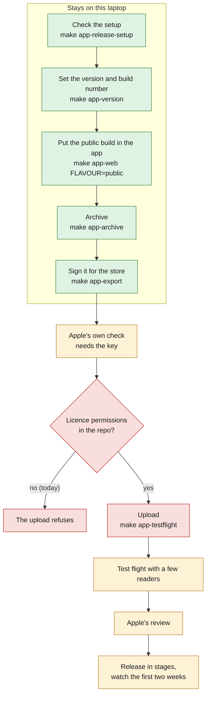

# Releasing the app: from a version number to readers

How a build of the iPad, iPhone and Mac app gets from this laptop to people's devices through
the App Store, what has to be set up before the first one, and what each step guards against.
The commands are in the `release-app` skill; the account IDs are in `app-setup`.

*Last checked: 2026-11-16.*

## The short version

1. **Check the setup:** `make app-release-setup` says what is missing and where to fix it.
2. **Set the version:** `make app-version VERSION=1.0.0`, or `NEXT_BUILD=1` for another build.
3. **Put the public build in the app:** `make app-web FLAVOUR=public`.
4. **Archive:** `make app-archive` builds the store copy and checks the app inside it.
5. **Sign it for the store:** `make app-export`.
6. **Apple's own check:** not built yet; needs the App Store Connect key.
7. **Upload:** `make app-testflight`, locked until the licence permissions arrive.
8. **Test flight, review, release:** not built yet.

Steps 1 to 5 stay on this laptop. Only steps 6 and 7 send anything to Apple.

## Who does what

- **You** (the owner): anything that needs your Apple password, your account's settings, or a
  file only Apple hands you once.
- **The agent** (Claude, on this laptop): every command, and the checks after each of your
  steps. The agent never sees a key file's contents, a password or a certificate's private part.

## What has to be in place first

Do these once per Apple account and once per laptop. The check script reads each one and says
`ok`, `missing` or `later`.

| what | who | where | status (2026-11-16) | the check |
|---|---|---|---|---|
| A paid Apple Developer membership | you | <https://developer.apple.com/account#MembershipDetailsCard> | done 2026-11-08 | not checked by the script; a free team fails the device install |
| The app's ID registered, with its features | you | <https://developer.apple.com/account/resources/identifiers/list> | done 2026-11-09 | not checked by the script |
| The App Store Connect record (iOS and macOS) | you | <https://appstoreconnect.apple.com/apps> | done 2026-11-09 | not checked by the script |
| Xcode, XcodeGen, Node 22 | agent | Mac App Store; `brew install xcodegen`; `nvm use` | done | `Xcode`, `XcodeGen`, `Node 22 or newer` |
| Xcode signed in to your Apple account | you | Xcode, Settings, Accounts, +, Apple ID | done | `Xcode signed in to the Apple account` |
| The development certificate | made by Xcode on the first device build | <https://developer.apple.com/account/resources/certificates/list> | done | `Development certificate in the keychain` |
| The App Store certificate | made by Xcode on the first export, with your yes | the same certificates page | done 2026-11-16 | `App Store certificate` |
| The App Store Connect key | you | <https://appstoreconnect.apple.com/access/integrations/api> | **not made** (`testflight-upload-key`) | `App Store Connect key file`, `App Store Connect key ID and issuer ID` |
| Written permission from the two data owners | they give it; you send the emails | `docs/design/store-permission-emails.md` | **waiting** (launch items ③ and ④) | `The licence answer allows an upload` |

### Setting up the App Store Connect key

Apple's tools use this key to check and upload the app without your password. Apple shows the
key file **once**, so download it the moment it is made.

1. Open <https://appstoreconnect.apple.com/access/integrations/api>. It is **Users and Access**,
   then the **Integrations** tab, then **App Store Connect API**. The first time, Apple asks you
   to request access; accept it.
2. Under **Team Keys**, click **+**. Name it `hifth-upload`. Access: **App Manager**. Click
   **Generate**.
3. Click **Download** beside the new key. Apple never offers it again. You get a file named
   `AuthKey_<key ID>.p8`.
4. In your own terminal, move it into place and make it readable only by you:
   ```
   mkdir -p ~/.appstoreconnect/private_keys
   mv ~/Downloads/AuthKey_*.p8 ~/.appstoreconnect/private_keys/
   chmod 600 ~/.appstoreconnect/private_keys/AuthKey_*.p8
   ```
5. Tell the agent the **key ID** (the column beside the key's name) and the **issuer ID** (the
   long id above the keys list). Neither is secret. The agent writes them to
   `~/.appstoreconnect/hifth.json`, outside the repo.
6. The agent runs `make app-release-setup`, and both key lines should say `ok`.

Never put the `.p8` file in the repo, a chat, a commit or the clipboard. The repo's
`.gitignore` leaves out every `.p8` file, so git will not pick one up by accident. If the file
is lost, revoke the key on the same page and make a new one; a lost file cannot be downloaded
again.

## The whole road



Green steps work today. Amber ones are not built yet. Red is the licence lock.

## Each step, and what it guards against

| step | what it refuses | why it matters to a reader |
|---|---|---|
| Check the setup | nothing; it reports | a release that fails halfway, on a missing key, wastes the build and says little |
| Set the version | a version lower than today's, or one Apple would refuse (letters, leading zeros, more than three numbers) | Apple refuses an upload whose build number is not higher than the last one |
| Put the public build in | nothing on its own; it stamps the build `public` | the private pitch build carries The Study Quran's commentary and must never reach the store |
| Archive | any web build but the public one; no Xcode sign-in; a release build with the walk-capture code, without Apple's privacy file, or with a private folder; and it checks the app **inside the archive** a second time | the archive is what would be uploaded, so it is the one that has to be clean |
| Sign it for the store | an archive that does not exist | only a copy signed for the App Store can go to Apple; the export stays on the laptop |
| Apple's own check (not built) | whatever Apple refuses: missing icons, a wrong ID, a bad privacy file | finding it here costs minutes; finding it after upload costs a review round |
| Upload | anything while the licence decision is open, checked **before** anything is built | the data owners have not yet allowed the store; their permission comes first |

## Where things end up

| what | where | leaves the laptop? |
|---|---|---|
| The version and build number | `native/project.yml`, committed with the release | yes, in the repo |
| The archive | `native/build/store/Hifth.xcarchive` | no (ignored by git) |
| The store-signed copy | `native/build/store/export/Hifth.ipa` | no, until the upload |
| The App Store Connect key | `~/.appstoreconnect/private_keys/AuthKey_<id>.p8` | never |
| The key's two ids | `~/.appstoreconnect/hifth.json` | never |
| The App Store certificate | in your Apple account; Xcode signs with it at Apple, so this laptop's keychain holds none | no |

## Where it stands (2026-11-16)

- The version is 0.1.0, build 1.
- The archive and the export both ran clean today. The app inside the export is signed for the
  App Store, is the public build, carries the privacy file and has no private folder.
- **Waiting on you:** the App Store Connect key (`testflight-upload-key`), then the two
  permission emails (launch items ③ and ④).
- **Not built yet:** Apple's own check, the upload itself, one command for the whole release
  (launch item ㉒), the Mac's sandbox and store signing (⑧), and the iPhone and iPad list of
  what the app may do (⑨).

The open rows: `make issues LAUNCH=1`. The launch page: `docs/design/app-store-launch.md`.

## When a step fails

| it says | what it means | the fix |
|---|---|---|
| `only the public build` | the app holds the private pitch build | `make app-web FLAVOUR=public`, then archive again |
| `no Apple Development identity in the keychain` | no development certificate on this laptop | one device build with Xcode signed in makes it; `make app-release-setup` says which part is missing |
| `Xcode has no Apple account signed in` | Xcode's account was signed out | Xcode, Settings, Accounts, +, sign in (you) |
| the release check names a sign of the walk capture | debug-only code reached a release build | the `walk-app` skill's release-check row says what each sign is |
| the export fails on a certificate | the App Store certificate was revoked or the team changed | ask the owner before a run makes a new one; check the certificates page |
| `Not yet. A build goes to anyone outside…` | the licence lock, working as meant | nothing to fix; it opens when the permissions are in the repo |
| `missing  App Store Connect key file` | no key on this laptop | the key steps above |

## Why it is shaped this way

- **Only the upload waits on the licence.** An archive and an export stay on this laptop, so
  they can be proven now and the upload is the only thing held back (2026-11-16;
  `docs/decisions/native-testflight-licence.md`).
- **The release check runs twice.** Once on a release build it makes itself, and once on the
  app inside the archive, because the archive is what Apple would get.
- **The team is never written in the export settings.** Xcode reads it from the archive, which
  was signed with the team from the keychain; `native/ExportOptions.plist` has no team line.
- **Xcode does not change the build number on export.** The one in `native/project.yml` is the
  one sent, so the repo always says what Apple has.
- **The licence lock is checked before anything is built**, so a locked upload costs seconds,
  not a ten-minute build.
