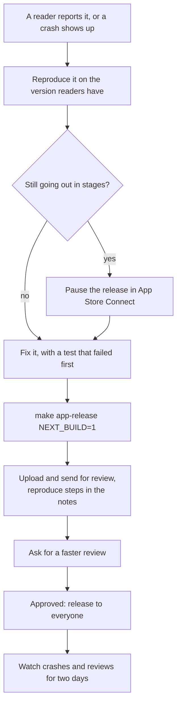

# A bad version is out: fixing it in a hurry

What to do when readers already have a version of the iPad, iPhone or Mac app that is broken,
and a fix has to reach them fast. The app is packed whole inside the store build, so every fix
is a new build through Apple's review. Nothing on this laptop can change what readers have
without one.

The site at hifth.app is different: a broken release of it is put back in seconds, with
`make hifth-app-put-back` (the `deploy-site` skill). That changes only the site and the browser
version, never an app readers installed.

*Last checked: 2026-11-17, against Apple's pages linked below.*

## The short version

1. **Make it fail here.** Reproduce it on the same version readers have, and write the steps down.
2. **Slow it down.** If the bad version is still going out in stages, pause it in App Store Connect.
3. **Fix it with its test.** The test fails before the fix and passes after, like every fix here.
4. **One command for the build:** `make app-release NEXT_BUILD=1` (add `MAC=1` for the Mac).
5. **Upload and send it for review**, with the reproduce steps in the review notes.
6. **Ask Apple for a faster review**, with the text below.
7. **Release it to everyone** once approved, then watch crashes and reviews for two days.

How long it takes: the build and Apple's check, about half an hour on this laptop (not timed
end to end yet); Apple's review
usually under a day (Apple says half in under 24 hours, nine in ten under 48).[^review-time]



## What each lever can and cannot do

| lever | what it does | what it cannot do |
|---|---|---|
| **Pausing a release in stages** | stops the automatic update reaching more readers; up to 30 days in all, as many pauses as needed[^phased] | take the version back from readers who have it, or stop anyone downloading it by hand from the store |
| **Release to everyone** | ends the stages at once, once the version is ready for sale | anything before Apple approves it |
| **A faster review** | Apple may look at the build sooner, "as allowed by availability and demand"[^expedite] | it is never promised, and only a build already sent for review can ask |
| **Taking the app off sale** | stops new downloads in App Store Connect | change the app on any reader's device |
| **The file the app reads at launch** (launch item ㉑) | edit `apps/landing/app-status.json` and release hifth.app: ask readers below a version to update (`lowest`), show a short notice in English and Arabic (`notice`), or switch off writing with the pencil or links from other apps (`off`: `pencil`, `links`). It also switches sign-in on in the store apps (`on`: `sign-in`); taking `sign-in` back out hides the button on the next launch. The release checks the file first. Readers see it on their next launch | fix the bug, reach a reader with no connection, or reach the browser version; and `lowest` cannot be above the version being shipped, so ask for an update only once the fixed version is on the store |

The stages apply to an update, not to a first version: Apple's page offers them "when you
submit a version update".[^phased]

## The request for a faster review, ready to paste

Apple's form is <https://developer.apple.com/contact/app-store/?topic=expedite>. Choose the app
and the platform, and put this in the box, filled in:

> Hifth version X.Y.Z (build N) fixes a critical bug in the version on the store, X.Y.W.
> Readers who [what they do] see [what goes wrong], so they cannot [what it stops them doing].
>
> To reproduce it on X.Y.W:
> 1. …
> 2. …
> 3. …
>
> The new build changes only [the part that was broken]. The same steps on it now [what happens instead].

Put the same reproduce steps in the review notes of the version in App Store Connect too, since
Apple asks for them there as well.[^expedite] Keep the request for real emergencies: Apple asks
that expedite requests be "reserved for matters of genuine urgency".

<details>
<summary>The whole thing, step by step</summary>

### 1. Reproduce it

- Find which version readers have: App Store Connect shows the version beside each review and
  each crash. The app's info panel does not show it yet, so ask a reader who writes in to say
  which day they last updated.
- Check out that version's commit. The archive receipt beside each archive names it
  (`native/build/store/Hifth.xcarchive.receipt.json`), and `native/project.yml` in git says
  which commit set each build number.
- Reproduce it in the simulator or on the iPad (the `native-shell` and `run-app` skills), and
  write down the steps. Those steps go in the test, the review notes and the request.

### 2. Slow it down

In App Store Connect, open the app, the version, and **Pause Phased Release**. Pauses add up to
30 days at most. A reader who already has the version keeps it.

### 3. Fix it, with its test

As every fix here: the test first, watched failing for the real reason, then the fix. Commit
both, on a branch from the commit readers have if main has moved on a long way, or from main if
it is close.

### 4. Build it

```
make app-release NEXT_BUILD=1          # the iPad and iPhone app
make app-release NEXT_BUILD=1 MAC=1    # and the Mac app
```

It refuses uncommitted work, raises the build number, puts in the public build, archives,
signs and sends the build to Apple for its check, stopping at the first step that fails. If a
step fails after the number was raised, fix that and carry on with `make app-release
KEEP_VERSION=1`. Commit `native/project.yml` at the end, so the repo has the number Apple has.
Each step's start and end is logged in `native/build/release/release.log`.

### 5. Upload and send for review

The upload is not built yet, and while the licence question is open it stays locked
(`docs/decisions/native-testflight-licence.md`). Once both are in place, this step is
`make app-testflight` and then sending the version for review in App Store Connect.

### 6. Ask for the faster review

The form and text above. It can only be asked once the version is waiting for review.

### 7. Release and watch

Once approved, **Release to All Users** rather than stages: a fix is wanted everywhere. Then for
two days: new crashes (the `crash-logs` skill), reviews (`make app-store-reviews ARGS=pull`) and
reports to the support address.

</details>

[^review-time]: Apple's App Review page: <https://developer.apple.com/distribute/app-review/>,
    read 2026-11-17.
[^phased]: Releasing an update in stages: <https://developer.apple.com/help/app-store-connect/update-your-app/release-a-version-update-in-phases>,
    read 2026-11-17. Seven days, 1% of readers with automatic updates on the first day to all
    of them on the seventh; anyone can still download the update by hand during the stages.
[^expedite]: Asking for a faster review: <https://developer.apple.com/help/app-review/after-submitting-for-review/request-expedited-review>,
    read 2026-11-17. For a critical bug, Apple asks for the steps to reproduce it on the current
    version, in the review notes.
