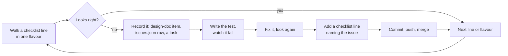

# Walking the app

**The question a walk answers:** what would a reader trip over today, in each way they could hold
the app? **You need:** a running server (`make pitch` for the demo with the notes, `make dev` for
the public site). **How long:** a full walk is an hour or two; a walk of one area is minutes.

1. Pick the flavours to walk (table below); for the pitch, the desktop, the iPad on its side and
   the phone come first.
2. Go down [checklist.md](checklist.md), one `make drive` per line per flavour. **Look at every
   picture yourself.** Measure with `eval=` rather than judging by eye where a number settles it.
3. Off the checklist too: use the app as a scholar would for ten minutes per flavour. The list only
   knows the faults already found.
4. Each fault: write it down, then fix it worst first (the loop below).
5. End by moving finished tasks to `docs/tasks/done.md` and saying what is still open.

To run this over and over on its own, paste the prompt in `.claude/loop-prompts/walk-and-fix.md`
into `/loop`: each pass picks the worst open item, walks it everywhere, fixes and ships it, and
writes down what it found.

## Which flavours are there?

| flavour | how to open it |
| --- | --- |
| private pitch build (the Study Quran notes) | `make pitch`, then `BASE=http://localhost:5173` |
| public site build | `make dev` (5173), or the live site `https://blog.bytesofpurpose.com/hifth` |
| two pages at a desk | `DEVICE=desktop` (1440×900, mouse) |
| a laptop | `DEVICE=laptop` (1280×800, mouse); one page with `?view=one` in the hash |
| an iPad upright / on its side / a big one on its side | `DEVICE=ipad`, `ipad-side`, `ipad-big-side` (finger) |
| a phone upright / on its side | `DEVICE=phone`, `phone-side` (finger) |
| Arabic interface | `LOCALE=ar` (English is `LOCALE=en-US`, the pitch default) |
| Firefox (the owner's browser) | `BROWSER=firefox` |
| Safari's engine | the Playwright `iphone` and `ipad` projects (`make drive` drives Chrome and Firefox only) |
| the Mac and iPad apps | `make app-run-mac` / `make app-run-ipad`, pictures with `make app-shot` (the native-shell skill) |
| the iPad app held sideways | the iPad simulator, turned; the native-shell skill's "Walking the app in the simulator" — the iPad's own WebKit is not Playwright's, so the pitch gets walked here too |
| first visit vs returning reader | leave the hint owed, or `SEEN_COACH=1` |

A swipe is `swipe=x,y>x,y` in `ACT`: a real finger that moves (Chrome only). `drag=` is a
mouse, so a swipe walked with it only shows what a mouse does — on an open book a mouse turns
only from the outer edge, and so does a finger.

A useful hash: `#/hafs-kfqc/2:255` (a verse), `#/hafs-kfqc/p42` (a page), `?view=one` / `?view=two`.

## Scripts — when to use each

| script | what it does | reach for it when | command |
| --- | --- | --- | --- |
| `make drive` (apps/web/e2e/tools/drive.mjs) | opens the running app at a link in a named device, does steps (tap, hold, drag, press, eval), saves a picture | every checklist line | `make drive HASH='#/hafs-kfqc/2:255' DEVICE=phone SEEN_COACH=1 ACT='tap=[data-verse-key="quran/hafs-kfqc/2:255"]; settle=600' OUT=test-results/walk/phone-255.png` |
| `make pitch-e2e` | runs the pitch suite, where most walk faults' tests live; the push check runs it too whenever the private notes are on the machine | after a pitch fix, before pushing | `make pitch-e2e` |
| `make app-shot` | a picture of the real Mac or iPad app at a route | the native-shell flavours | `make app-shot ROUTE=/hafs-kfqc/p45 TARGET=ipad` |
| `LOCALE=ar` or `LOCALE=en` on `app-shot`, `app-walk`, `app-probe` | launches the Mac or iPad app in that language, even where another has been picked with the app's own button (the iPad simulator has Arabic picked), without changing that pick | walking the English interface the people in the room will see, or the Arabic one | `make app-shot ROUTE=/hafs-kfqc/2:48?open=lookalikes TARGET=mac LOCALE=ar` |
| `make app-walk` | opens each of several routes in the iPad app, upright or sideways, and keeps one picture of each in `native/shots/walk/upright/` or `walk/side/`, named after the route | walking many links in the app in one go | `make app-walk ROUTES='/hafs-kfqc/2:48?open=lookalikes /hafs-kfqc/p45' SIDEWAYS=1` |
| `make app-probe` | runs a line of JavaScript inside the real iPad app's page and prints the answer, with the screen size and orientation | the app looks wrong and you need a number, not a picture; and after a layout fix proven only in the browser, to measure it again in the real app (`IPAD='iPad mini (A17 Pro)'` for the small iPad) | `make app-probe TARGET=ipad ROUTE=/hafs-kfqc/p45 EVAL='innerWidth' DELAY_MS=3000`, or a longer question kept in a file: `EVALFILE=probe.js` |
| `scripts/visit-walk.js` | one whole visit inside the app: a note opened and read to its end, a reference followed and come back from, a surah run from its corner with the note open, then paused; prints boxes, verse numbers and button names only, never note words | checking that the features hold together in one sitting, not one at a time, after a change to notes, references or runs | `make app-probe TARGET=ipad SIDEWAYS=1 LOCALE=en ROUTE=/hafs-kfqc/2:48 EVALFILE=.claude/skills/walk-app/scripts/visit-walk.js DELAY_MS=2500 PROBE_TIMEOUT_S=200` |
| `scripts/run-note.js` | a surah played from its corner, then the number of the verse being recited tapped and its note opened while the sound plays; prints, at each change, the verse lit, its box against the note's, whether a Pause is on screen and whether the sound is going, then presses the note's own Pause and checks the same note stays up with the sound stopped (or, with `__mode` "turn", turns the page by a swipe, or by the arrow key with `__turnBy` "key", and checks the sound goes on, saying which verse is heard against the note's; or, with `__mode` "light", opens no note and watches, for `__watch` ms, which page shows and which verse is lit or ringed as the run jumps and turns), never note words | after a change to runs, to choosing a verse, or to the note, when what matters is that the recitation goes on through the note | `make app-probe TARGET=ipad LOCALE=en "ROUTE=/hafs-kfqc/p2?view=one" EVALFILE=.claude/skills/walk-app/scripts/run-note.js DELAY_MS=2500 PROBE_TIMEOUT_S=200` |
| `scripts/fresh-look.js` | what the first launch shows: how long until the page painted, which pages are up, whether anything lies over them, and the names of what the app has stored; numbers, page numbers and setting names only | the first thirty seconds a visitor meets, right after taking the app off the simulator (`xcrun simctl uninstall <iPad id> com.bytesofpurpose.hifth`), then the visit and gap walks on the same fresh install | `make app-probe TARGET=ipad SIDEWAYS=1 LOCALE=en ROUTE= EVALFILE=.claude/skills/walk-app/scripts/fresh-look.js DELAY_MS=2500 PROBE_TIMEOUT_S=200` |
| `scripts/gap-walk.js` | holds the surah corner, presses Play and times the silence from each verse's end to the next one sounding, five gaps, then pauses; it also times the press to the first verse sounding and says whether that verse came from a copy; the page can set the pause before the press, the number of gaps and where Play is pressed (`__gapPause`, `__gapCount`, `__gapFrom = "tools"` for the chosen verse's tools, shutting its note first); each gap names the file it waited for ("held" when it played from a copy in hand) and how long the verse before it ran; numbers only | checking the pause between verses of a run in the iPad or Mac app, where the browser engine differs from Chromium's, after a change to how runs fetch their files | `make app-probe TARGET=ipad SIDEWAYS=1 LOCALE=en ROUTE=/hafs-kfqc/p600 EVALFILE=.claude/skills/walk-app/scripts/gap-walk.js DELAY_MS=2500 PROBE_TIMEOUT_S=200` |
| `scripts/note-handoff.mjs` | opens the note across the foot of an upright iPad, then does one thing that takes its place (Close, a page-turn key, Back, a long press and a menu item, a verse number's menu, a look-alike chip, the note's grip, a hop from one of its references, a swipe, a pinch) and prints, frame by frame, the sliding copy of the note, the live note, any menu and the page's top; boxes and numbers only, pictures only with `--shots` into scratch; with `--run` it first plays the page's surah from its corner and opens the note on the verse being heard, waits `--wait` ms (a verse's length lets the recitation move past the note's verse, the moment a presenter actually turns), says which verse is heard against the note's, read off the recitation's Pause, and at the end whether the sound is still going, and which verse a number pressed belonged to | after any change to how the note leaves, rises or hands over to a list or menu; walk every `--mode` once, and `--lang ar` once, and again with `--run` after a change to runs (a page route, `/p2?view=one`); pinch needs `--engine chromium` (real touches) | `node .claude/skills/walk-app/scripts/note-handoff.mjs --mode chip --route '/hafs-kfqc/2:49?view=one'` |
| `scripts/gap-throttle.mjs` | runs the gap walk in Chromium at home speed, slow wifi and poor wifi, once for each way of making the next verse ready and each pause before the press, each in a fresh browser | comparing the next-verse settings, or checking a slow connection, without a device; point it at a local build with `--url`, and at another surah's page with `--route`; `--pause 600,2000` tries each pause before the press and `--gaps 0` times only the first verse; `--from tools --route /hafs-kfqc/2:255` presses Play on that verse's tools instead of the corner | `node .claude/skills/walk-app/scripts/gap-throttle.mjs --url http://localhost:5197/` |
| `make app-test ONLY=` | one simulator test, which can turn the iPad and measure the web view's own picture | pinning an app-only fault, watched failing first | `make app-test ONLY=SmokeTests/testLandscapeOpensTheBookFullSize` |

The step words `ACT=` takes are listed at the top of drive.mjs. `EXPECT='<css>'` makes a step that
silently missed fail instead of handing back a picture of the wrong screen. Inside `make`, a `$`
in a selector must be written `$$`; a full verse key avoids it.

## When a walk finds a fault

Each fault gets, in the same change as its fix:

- **an item** in the design doc it belongs to (pitch faults: `docs/design/knowledge-graph-commentary.md`,
  numbered, its heading a question a stranger could answer, marked **open** or **fixed**);
- **a row** in `docs/issues.json` with its `closedBy` test, then `make -s tasks-doc issues-doc` and
  `pnpm gate:issues`;
- **a task** while it is open, moved to `docs/tasks/done.md` when merged;
- **a test written first and watched failing** — a Playwright test when a reader would see it;
- **a line in [checklist.md](checklist.md)** under its surface, naming the flavours and the issue.
  If the fault is a new *kind* (a new surface, a new flavour), add the heading or the flavour too.

A fault you cannot act on (the owner's call, a fix blocked on someone) still gets its row and its
checklist line, marked **open**, and is said out loud at the end of the walk. A check only a person
can make (a real phone, a week of use) goes to the manual-testing skill's list, not here.

Never put text from The Study Quran in a checklist line, an issue row, a test or a commit: describe
where the fault is, not what the note says.
