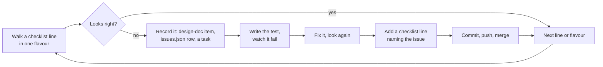

# Walking the app

**The question a walk answers:** what would a reader trip over today, in each way they could hold
the app? **You need:** a running server (`make pitch` for the demo with the notes, `make dev` for
the public site). **How long:** a full walk is an hour or two; a walk of one area is minutes.

1. Pick the flavours to walk (table below); for the pitch, the desktop, the iPad on its side and
   the phone come first.
2. Go down [checklist.md](checklist.md), one `make drive` per line per flavour. **Look at every
   picture yourself.** Measure with `eval=` rather than judging by eye where a number settles it.
3. Off the checklist too: use the app as a scholar would for ten minutes per flavour. The list only
   knows the faults already found.
4. Each fault: write it down, then fix it worst first (the loop below).
5. End by moving finished tasks to `docs/tasks/done.md` and saying what is still open.

To run this over and over on its own, paste the prompt in `.claude/loop-prompts/walk-and-fix.md`
into `/loop`: each pass picks the worst open item, walks it everywhere, fixes and ships it, and
writes down what it found.

## Which flavours are there?

| flavour | how to open it |
| --- | --- |
| private pitch build (the Study Quran notes) | `make pitch`, then `BASE=http://localhost:5173` |
| public site build | `make dev` (5173), or the live site `https://blog.bytesofpurpose.com/hifth` |
| two pages at a desk | `DEVICE=desktop` (1440×900, mouse) |
| a laptop | `DEVICE=laptop` (1280×800, mouse); one page with `?view=one` in the hash |
| an iPad upright / on its side / a big one on its side | `DEVICE=ipad`, `ipad-side`, `ipad-big-side` (finger) |
| a phone upright / on its side | `DEVICE=phone`, `phone-side` (finger) |
| Arabic interface | `LOCALE=ar` (English is `LOCALE=en-US`, the pitch default) |
| Firefox (the owner's browser) | `BROWSER=firefox` |
| Safari's engine | the Playwright `iphone` and `ipad` projects (`make drive` drives Chrome and Firefox only) |
| the Mac and iPad apps | `make app-run-mac` / `make app-run-ipad`, pictures with `make app-shot` (the native-shell skill) |
| the iPad app held sideways | the iPad simulator, turned; the native-shell skill's "Walking the app in the simulator" — the iPad's own WebKit is not Playwright's, so the pitch gets walked here too |
| first visit vs returning reader | leave the hint owed, or `SEEN_COACH=1` |

A swipe is `swipe=x,y>x,y` in `ACT`: a real finger that moves (Chrome only). `drag=` is a
mouse, so a swipe walked with it only shows what a mouse does — on an open book a mouse turns
only from the outer edge, and so does a finger.

A useful hash: `#/hafs-kfqc/2:255` (a verse), `#/hafs-kfqc/p42` (a page), `?view=one` / `?view=two`.

## Scripts — when to use each

| script | what it does | reach for it when | command |
| --- | --- | --- | --- |
| `make drive` (apps/web/e2e/tools/drive.mjs) | opens the running app at a link in a named device, does steps (tap, hold, drag, press, eval), saves a picture | every checklist line | `make drive HASH='#/hafs-kfqc/2:255' DEVICE=phone SEEN_COACH=1 ACT='tap=[data-verse-key="quran/hafs-kfqc/2:255"]; settle=600' OUT=test-results/walk/phone-255.png` |
| `make pitch-e2e` | runs the pitch suite, where most walk faults' tests live; the push check runs it too whenever the private notes are on the machine | after a pitch fix, before pushing | `make pitch-e2e` |
| `make app-shot` | a picture of the real Mac or iPad app at a route | the native-shell flavours | `make app-shot ROUTE=/hafs-kfqc/p45 TARGET=ipad` |
| `LOCALE=ar` or `LOCALE=en` on `app-shot`, `app-walk`, `app-probe` | launches the Mac or iPad app in that language, even where another has been picked with the app's own button (the iPad simulator has Arabic picked), without changing that pick | walking the English interface the people in the room will see, or the Arabic one | `make app-shot ROUTE=/hafs-kfqc/2:48?open=lookalikes TARGET=mac LOCALE=ar` |
| `make app-walk` | opens each of several routes in the iPad app, upright or sideways, and keeps one picture of each in `native/shots/walk/upright/` or `walk/side/`, named after the route | walking many links in the app in one go | `make app-walk ROUTES='/hafs-kfqc/2:48?open=lookalikes /hafs-kfqc/p45' SIDEWAYS=1` |
| `make app-probe` | runs a line of JavaScript inside the real iPad app's page and prints the answer, with the screen size and orientation | the app looks wrong and you need a number, not a picture; and after a layout fix proven only in the browser, to measure it again in the real app (`IPAD='iPad mini (A17 Pro)'` for the small iPad) | `make app-probe TARGET=ipad ROUTE=/hafs-kfqc/p45 EVAL='innerWidth' DELAY_MS=3000`, or a longer question kept in a file: `EVALFILE=probe.js`; add `PROBE_SHOT=<scratch>/x.png` for a picture of the page as the question left it |
| `scripts/lookalike-walk.js` | in the iPad or Mac app, on the verse a route opens: what the route opened (the look-alike list or the note), every row's reason, the first or last row opened and whether it stays in sight under the title, a passage row's named verse and where its hop lands, the Share card and the look-alike buttons on both iPad sizes, the tajweed key scrolled to its end; a settings line ahead of it picks the step (`window.__step`, `window.__dir`); boxes, counts and verse numbers only | walking the "Roots and look-alikes" section in the apps, after any change to the look-alike list, Share or the tajweed key; `IPAD='iPad mini (A17 Pro)'` for the mini | `make app-probe TARGET=ipad LOCALE=en "ROUTE=/hafs-kfqc/2:48?open=lookalikes" EVALFILE=.claude/skills/walk-app/scripts/lookalike-walk.js DELAY_MS=2500 PROBE_TIMEOUT_S=200` |
| `scripts/pen-walk.js` | in the iPad or Mac app, the page tools in whichever home the pen setting gives them: their box against both pages and the bars, any tool cut off at the screen's edge; then each tool picked in turn, and the ones that mark by a tap (select, bookmark, note, harakat, word, mistake) tapped on a verse, saying what each left (a card, a pin, a mistake mark); then the eraser beside Undo picked up, one mark the pens left tapped off, and Undo pressed, saying whether the mark went, the eraser stayed on and the mark came back (`window.__erase = false;` skips it); the drag tools (highlight, crop, jump) are only picked, since a made-up pointer cannot start a drag (the browser tests drag them); it copies the reader's marks and settings first and puts them back at the end; `window.__mark = false;` on a line ahead of it only says where the tools sit; boxes, counts and the tools' own names only | walking "Pens, bookmarks" in the apps, after a change to the tools or where they live; set each home first with a one-line probe that writes the pen setting, and clear it after | `make app-probe TARGET=ipad SIDEWAYS=1 LOCALE=en ROUTE=/hafs-kfqc/p7 EVALFILE=.claude/skills/walk-app/scripts/pen-walk.js DELAY_MS=2500 PROBE_TIMEOUT_S=200` |
| `scripts/settings-walk.js` | in the iPad or Mac app: opens settings and prints how many pages the screen shows, the sheet's box, how many lines sit under its title, and which choices it offers (by their own ids); then scrolls it to the end and says whether the last choice is in sight and whether anything runs off its sides; boxes, counts and ids only | walking "Open settings and scroll to the end" in the apps, after adding or hiding a choice; a choice about two facing pages or where the pen tools sit belongs on a screen at least 1024 wide and 775 tall (the upright 13-inch iPad counts, and can open two pages), and not on the iPad mini | `make app-probe TARGET=ipad LOCALE=en ROUTE=/hafs-kfqc/p7 EVALFILE=.claude/skills/walk-app/scripts/settings-walk.js DELAY_MS=2500 PROBE_TIMEOUT_S=200` |
| `scripts/intro-walk.js` | the surah introduction opened from the surah's name, or (with `window.__from = "deep";` on a line before the script) from 2:255's number menu; prints the pages' boxes, the card's box and the side of the book it lies on, whether the introduction is in it, the surah name's box against the toolbar and the card, and whether the verse's tools are up; boxes and interface names only | after a change to the introduction, the note's card or where the card lies, upright and on its side, English and Arabic | `make app-probe TARGET=ipad SIDEWAYS=1 LOCALE=en ROUTE=/hafs-kfqc/p293 EVALFILE=.claude/skills/walk-app/scripts/intro-walk.js DELAY_MS=2500 PROBE_TIMEOUT_S=200` |
| `scripts/corner-cards.js` | on a screen where the note and the lists stand as cards in a corner of the page (an iPad mini on its side): opens the note and reads it to its end, then the roots list and reads it to its end, then each look-alike list, then the share card, in turn; for each prints the cards' boxes, the page's box, how much of the lit verse is under a card, how many lit lines run past the screen's edge, and whether a look-alike button meets the page or a close button; boxes and counts only | after a change to where a card stands or where the page moves for it, on the mini on its side and the large iPad both ways, in both languages; on a phone either way up, with `window.__wide = true;` on a line before the script (as with the intro walk's `__from`), so the cards across the foot count | `make drive BASE=http://localhost:5191 HASH=/hafs-kfqc/2:48 DEVICE=ipad-side VIEWPORT=1133x744 SEEN_COACH=1 "ACT=settle=2500;evalfile=.claude/skills/walk-app/scripts/corner-cards.js"`, or in the app: `make app-probe TARGET=ipad SIDEWAYS=1 "IPAD=iPad mini (A17 Pro)" LOCALE=en ROUTE=/hafs-kfqc/2:48 EVALFILE=.claude/skills/walk-app/scripts/corner-cards.js DELAY_MS=2500 PROBE_TIMEOUT_S=200` |
| `scripts/mistake-ask-walk.js` | in the iPad or Mac app: picks the Mistake pen (from the bar, the bottom home, or the tray a smaller screen has instead), taps a word near each corner and the middle of every page in sight, and for each tap prints the question's box, whether all of it is on the screen, how many buttons it has and how many run off the screen or are drawn over by something else, whether it covers the tap and how far below or above it stands; a tap that asks nothing says what was under it; a spot under the bars at the screen's foot steps up to the lowest line in sight; each question is closed with Escape, so nothing is marked, and the reader's settings are put back; boxes and counts only | walking confusion-points item 8 again, after a change to where the question stands, to the pens, or to anything standing over the page's edges; both iPad sizes (`IPAD='iPad mini (A17 Pro)'`), both ways up, both languages; a made-up drag cannot move the page, so the mini's last lines on its side are left to the browser test | `make app-probe TARGET=ipad SIDEWAYS=1 LOCALE=en ROUTE=/hafs-kfqc/p7 EVALFILE=.claude/skills/walk-app/scripts/mistake-ask-walk.js DELAY_MS=2500 PROBE_TIMEOUT_S=200` |
| `scripts/pencil-walk.js` | in the iPad or Mac app: hands the page a pencil squeeze near two corners of the screen, then a pick, then the double-tap swap, then the colour palette setting, as the iPad app does; prints where the pens stand, whether they are whole on the screen and off the tip, how many pens they offer, and which tool is in hand; boxes, counts and tool names only | after a change to the pens, the tools or the pencil, both ways up, on both iPad sizes, in both languages; the real pencil is manual testing 19 | `make app-probe TARGET=ipad SIDEWAYS=1 LOCALE=en ROUTE=/hafs-kfqc/p7 EVALFILE=.claude/skills/walk-app/scripts/pencil-walk.js DELAY_MS=2500 PROBE_TIMEOUT_S=200` |
| `scripts/playto-walk.js` | in the iPad or Mac app: holds a verse, picks Play to and taps the verse two on (`window.__from`, `window.__to`, default 2:39 to 2:41 on page 7), then prints at each change the verse heard, the verse lit and the verse ringed, and at the end which verse is lit and whether anything still sounds; with `window.__mode = "listen";` it taps the verse, shuts its note and presses Listen instead; the sound plays quietly, never silent; it aims at a point the page says is the verse's own; verse numbers and button names only | walking the Play to and Listen lines in the apps, after a change to runs or the run mark; for the ring, save the run-mark setting as "ring" in a launch of its own first, and take it off after | `make app-probe TARGET=ipad SIDEWAYS=1 LOCALE=en ROUTE=/hafs-kfqc/p7 EVALFILE=.claude/skills/walk-app/scripts/playto-walk.js DELAY_MS=2500 PROBE_TIMEOUT_S=200` |
| `scripts/visit-walk.js` | one whole visit inside the app: a note opened and read to its end, a reference followed and come back from, a surah run from its corner with the note open, then paused; prints boxes, verse numbers and button names only, never note words | checking that the features hold together in one sitting, not one at a time, after a change to notes, references or runs | `make app-probe TARGET=ipad SIDEWAYS=1 LOCALE=en ROUTE=/hafs-kfqc/2:48 EVALFILE=.claude/skills/walk-app/scripts/visit-walk.js DELAY_MS=2500 PROBE_TIMEOUT_S=200` |
| `scripts/ref-turn-walk.js` | on its side with a note open: follows the note's first reference, waits for the probe's UI test to turn the iPad upright, presses the note's Back, and waits for the turn back on its side; after each step prints the address, the pages shown, the verses lit on the screen, the note's box, how much of the lit verse the note covers, how many lit lines run off the screen, and whether a Back button is up; boxes, verse numbers and button names only | after a change to references, Back, the note's place or what a turn does to them; both iPad sizes, both languages, and once with `field=dark` in the route | `make app-probe TARGET=ipad SIDEWAYS=1 LOCALE=en "ROUTE=/hafs-kfqc/2:48?open=commentary" EVALFILE=.claude/skills/walk-app/scripts/ref-turn-walk.js DELAY_MS=2500 TURNS=14,30 PROBE_TIMEOUT_S=200` |
| `scripts/thread-walk.js` | a thread followed inside the app: from a note, a reference whose own note has references, a second reference from there, then Back twice; prints at each step the verse lit, the pages, the note's box, how much of the lit verse is under the note and whether Back is offered; verse numbers, boxes and button names only | after a change to references, the way back, or where the note stands, both iPad sizes on their side, both languages | `make app-probe TARGET=ipad SIDEWAYS=1 LOCALE=en "ROUTE=/hafs-kfqc/2:48?open=commentary" EVALFILE=.claude/skills/walk-app/scripts/thread-walk.js DELAY_MS=2500 PROBE_TIMEOUT_S=240` |
| `scripts/run-note.js` | a surah played from its corner, then the number of the verse being recited tapped and its note opened while the sound plays; prints, at each change, the verse lit, its box against the note's, whether a Pause is on screen and whether the sound is going, then presses the note's own Pause and checks the same note stays up with the sound stopped (or, with `__mode` "turn", turns the page by a swipe, or by the arrow key with `__turnBy` "key", and checks the sound goes on, saying which verse is heard against the note's; or, with `__mode` "light", opens no note and watches, for `__watch` ms, which page shows and which verse is lit or ringed as the run jumps and turns), never note words. The app probe has no page to set the settings from, so write them on one line ahead of the script into a scratch file, e.g. `window.__mode = "light"; window.__watch = 26000; window.__rate = 3;`, and pass that file as `EVALFILE`; to walk the ring, run a one-line probe that sets the run-mark setting to "ring" first (the app reads it as it starts) and one that removes it after | after a change to runs, to choosing a verse, or to the note, when what matters is that the recitation goes on through the note | `make app-probe TARGET=ipad LOCALE=en "ROUTE=/hafs-kfqc/p2?view=one" EVALFILE=.claude/skills/walk-app/scripts/run-note.js DELAY_MS=2500 PROBE_TIMEOUT_S=200` |
| `scripts/heard-keep-walk.js` | turns on "Also once I have heard it all", plays the first surah name a finger could touch from its corner to the end, and waits for that surah to be kept; prints how many verses ended, whether the run finished, which surah was newly kept and its bytes, then puts the setting back; the surah stays kept, so remove it (or take the app off the simulator) to walk it again; numbers and surah numbers only | checking in the iPad or Mac app that a surah heard through is kept by itself, where the player is the device's own and the browser test only fakes it; upright page 604 plays Al-Ikhlas, on its side Al-Kafirun | `make app-probe TARGET=ipad LOCALE=en ROUTE=/hafs-kfqc/p604 EVALFILE=.claude/skills/walk-app/scripts/heard-keep-walk.js DELAY_MS=2500 PROBE_TIMEOUT_S=200` |
| `scripts/kept-play-walk.js` | in the iPad or Mac app: refuses every fetch of a recitation file, plays the surah whose name a finger can touch to its end, and counts the verses that played from the copy kept on the device against those from the network; numbers and surah numbers only | checking that a kept surah needs no network in the app (the simulator cannot go offline by itself), after a change to keeping or to how a run fetches its files; keep the surah first | `make app-probe TARGET=ipad LOCALE=en ROUTE=/hafs-kfqc/p604 EVALFILE=.claude/skills/walk-app/scripts/kept-play-walk.js DELAY_MS=2500 PROBE_TIMEOUT_S=200` |
| `scripts/ref-walk.js` | in the iPad or Mac app, on a verse whose note is open: counts the references the note offers as buttons, any right after a Bible book's name, and those to the verse `window.__want` names; presses that one, says where it went and whose note is up, then presses Back; verse numbers and counts only | after a change to how a note's references are read or linked, in both languages, both ways up; a line ahead of it sets `window.__want` | `make app-probe TARGET=ipad SIDEWAYS=1 LOCALE=en "ROUTE=/hafs-kfqc/4:94?open=commentary" EVALFILE=<file: window.__want = "4:86"; then this script> DELAY_MS=2500 PROBE_TIMEOUT_S=120` |
| `scripts/another-walk.js` | in the iPad or Mac app: the Mistake pen's question on a word, then "Went into another verse…" pressed; prints the question's kinds and how many are pressed, the verse picker's box, whether it is whole on screen, its buttons cut off or drawn over, whether it covers the tap, red marks left, words saying "slip", and whether Escape closes it; `window.__leaveUp = true;` ahead of it leaves the picker up; boxes and counts only | walking the Mistake pen's "another verse" line in the apps, after a change to the question, the picker or the pens; both iPad sizes, both ways up, both languages | `make app-probe TARGET=ipad SIDEWAYS=1 LOCALE=en ROUTE=/hafs-kfqc/p7 EVALFILE=.claude/skills/walk-app/scripts/another-walk.js DELAY_MS=2500 PROBE_TIMEOUT_S=200` |
| `scripts/hand-turn-walk.js` | the iPad handed across a table: the probe's UI test turns the iPad at the seconds `TURNS` names while this watches; after each turn it prints the screen, the note's box, the lit verse's lines, how many sit wholly on the screen and how many the note covers, and the zoom; after the second turn it presses Zoom in up to 150% (`window.__zoom`, 0 skips it; the mini has no zoom buttons and says so); ends with how many turns it saw; with `window.__hop = "/hafs-kfqc/2:46";` and `window.__zoom = 0;` on a line ahead of it, it opens that verse after the first turn, so the page is one opened upright; boxes, counts and the zoom only | after a change to what a turn does to the page, the note or the zoom; both iPad sizes (`IPAD='iPad mini (A17 Pro)'`), both languages; the start line and the line after each turn back on its side should agree, and with `__hop` the third turn should show the page at the size it opened at | `make app-probe TARGET=ipad SIDEWAYS=1 LOCALE=en "ROUTE=/hafs-kfqc/2:255?open=commentary" EVALFILE=.claude/skills/walk-app/scripts/hand-turn-walk.js DELAY_MS=2500 TURNS=12,22,34,44 PROBE_TIMEOUT_S=200` |
| `scripts/turn-top-walk.js` | on an upright iPad, opened on a verse low on its page: prints at the start, after a turn forward and after a turn back the page in sight, its top and bottom, the lowest edge of the bars across the top, the zoom, and how far the red ribbon stands from the page's bound edge; turns by the Next and Previous page buttons, or the arrow keys where there are none; page numbers, edges and the zoom only | after a change to turns, the page's opening size or the red ribbon, upright, on both iPad sizes and in both languages; forward should land just under the bars, back at the foot, and the ribbon's start and back numbers should agree | `make app-probe TARGET=ipad LOCALE=en ROUTE=/hafs-kfqc/2:46 EVALFILE=.claude/skills/walk-app/scripts/turn-top-walk.js DELAY_MS=8000 PROBE_TIMEOUT_S=200` |
| `scripts/zoom-starts-walk.js` | on an iPad on its side: presses Zoom in to 200% and 300% on the open book, turns to the next opening at 200%, zooms back to 100%, then shows one page at 400%; each time prints the right-hand page's right edge and the left-hand page's against the screen, and whether the starts of the lines are on it; copies the reader's settings first and puts them back; page numbers, edges and the zoom only | after a change to zooming or to how the book slides over, on its side, in both languages | `make app-probe TARGET=ipad SIDEWAYS=1 LOCALE=en ROUTE=/hafs-kfqc/p8 EVALFILE=.claude/skills/walk-app/scripts/zoom-starts-walk.js DELAY_MS=2500 PROBE_TIMEOUT_S=200` |
| `scripts/fresh-look.js` | what the first launch shows: how long until the page painted, which pages are up, whether anything lies over them, and the names of what the app has stored; numbers, page numbers and setting names only | the first thirty seconds a visitor meets, right after taking the app off the simulator (`xcrun simctl uninstall <iPad id> com.bytesofpurpose.hifth`), then the visit and gap walks on the same fresh install | `make app-probe TARGET=ipad SIDEWAYS=1 LOCALE=en ROUTE= EVALFILE=.claude/skills/walk-app/scripts/fresh-look.js DELAY_MS=2500 PROBE_TIMEOUT_S=200` |
| `scripts/gap-walk.js` | holds the surah corner, presses Play and times the silence from each verse's end to the next one sounding, five gaps, then pauses; it also times the press to the first verse sounding and says whether that verse came from a copy; the page can set the pause before the press, the number of gaps and where Play is pressed (`__gapPause`, `__gapCount`, `__gapFrom = "tools"` for the chosen verse's tools, shutting its note first); each gap names the file it waited for ("held" when it played from a copy in hand) and how long the verse before it ran; numbers only | checking the pause between verses of a run in the iPad or Mac app, where the browser engine differs from Chromium's, after a change to how runs fetch their files | `make app-probe TARGET=ipad SIDEWAYS=1 LOCALE=en ROUTE=/hafs-kfqc/p600 EVALFILE=.claude/skills/walk-app/scripts/gap-walk.js DELAY_MS=2500 PROBE_TIMEOUT_S=200` |
| `scripts/note-handoff.mjs` | opens the note across the foot of an upright iPad, then does one thing that takes its place (Close, a page-turn key, Back, a long press and a menu item, a verse number's menu, a look-alike chip, the note's grip, a hop from one of its references, a swipe, a pinch) and prints, frame by frame, the sliding copy of the note, the live note, any menu and the page's top; boxes and numbers only, pictures only with `--shots` into scratch; with `--run` it first plays the page's surah from its corner and opens the note on the verse being heard, waits `--wait` ms (a verse's length lets the recitation move past the note's verse, the moment a presenter actually turns), says which verse is heard against the note's, read off the recitation's Pause, and at the end whether the sound is still going, and which verse a number pressed belonged to | after any change to how the note leaves, rises or hands over to a list or menu; walk every `--mode` once, and `--lang ar` once, and again with `--run` after a change to runs (a page route, `/p2?view=one`); pinch needs `--engine chromium` (real touches) | `node .claude/skills/walk-app/scripts/note-handoff.mjs --mode chip --route '/hafs-kfqc/2:49?view=one'` |
| `scripts/gap-throttle.mjs` | runs the gap walk in Chromium at home speed, slow wifi and poor wifi, once for each way of making the next verse ready and each pause before the press, each in a fresh browser | comparing the next-verse settings, or checking a slow connection, without a device; point it at a local build with `--url`, and at another surah's page with `--route`; `--pause 600,2000` tries each pause before the press and `--gaps 0` times only the first verse; `--from tools --route /hafs-kfqc/2:255` presses Play on that verse's tools instead of the corner | `node .claude/skills/walk-app/scripts/gap-throttle.mjs --url http://localhost:5197/` |
| `make app-test ONLY=` | one simulator test, which can turn the iPad and measure the web view's own picture | pinning an app-only fault, watched failing first | `make app-test ONLY=SmokeTests/testLandscapeOpensTheBookFullSize` |

The step words `ACT=` takes are listed at the top of drive.mjs. `EXPECT='<css>'` makes a step that
silently missed fail instead of handing back a picture of the wrong screen. Inside `make`, a `$`
in a selector must be written `$$`; a full verse key avoids it.

## When a walk finds a fault

Each fault gets, in the same change as its fix:

- **an item** in the design doc it belongs to (pitch faults: `docs/design/knowledge-graph-commentary.md`,
  numbered, its heading a question a stranger could answer, marked **open** or **fixed**);
- **a row** in `docs/issues.json` with its `closedBy` test, then `make -s tasks-doc issues-doc` and
  `pnpm gate:issues`;
- **a task** while it is open, moved to `docs/tasks/done.md` when merged;
- **a test written first and watched failing** — a Playwright test when a reader would see it;
- **a line in [checklist.md](checklist.md)** under its surface, naming the flavours and the issue.
  If the fault is a new *kind* (a new surface, a new flavour), add the heading or the flavour too.

A fault you cannot act on (the owner's call, a fix blocked on someone) still gets its row and its
checklist line, marked **open**, and is said out loud at the end of the walk. A check only a person
can make (a real phone, a week of use) goes to the manual-testing skill's list, not here.

Never put text from The Study Quran in a checklist line, an issue row, a test or a commit: describe
where the fault is, not what the note says.
