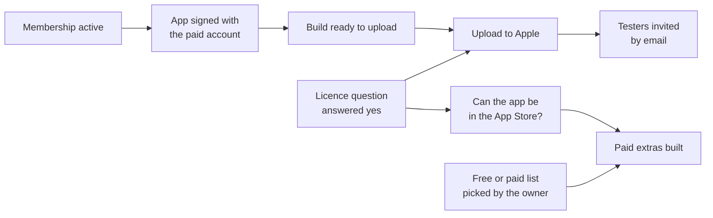

# Getting the app to people: testers first, then paid extras

*Started 2026-11-08. This page is the one place to start. It points at the three plans below and
lists every step in order. The steps themselves are tracked in the backlog, so this page never
holds a second copy of their status.*

## The short version

**Where we are:** the paid Apple Developer membership is bought (one year, 2026-11-08). Nothing
has been sent to Apple yet. The Qur'an itself will never be behind a payment.

**What comes first:** getting Hifth onto a tester's iPad through TestFlight, Apple's app for
trying a build before it is in the App Store. **What comes after:** paid extras inside the app,
such as sharing, which can only be sold once the app is in the App Store.

## The three plans

| Plan | The question it answers | Open steps |
|---|---|---|
| [TestFlight plan](design/testflight-plan.md) | How do we get the app onto a tester's iPad? | nine |
| [Paid features](design/paid-features.md) | Which parts of the app could be paid for, and which stay free? | four |
| [Publisher name](design/publisher-account.md) | Who does the App Store show as Hifth's publisher? | none: decided |

**Decided (2026-11-08):** Hifth is published under "Omar Eid", the membership we already have.
Bytes of Purpose is not a registered company yet, and only a registered company can be shown.

## What is the one rule already settled?

Reading the Qur'an, turning its pages, finding a verse and listening to its recitation stay free
for everyone, always (owner, 2026-11-08). Paid extras are the things around the reading: sending
a verse, a page or a revision record to someone, and perhaps a specific text such as a commentary,
if the people who own it agree.

## Every step, in order

Each line links to the step in its plan. Whose turn it is and whether it can start are in the
plan and the [backlog](backlog.md).

1. Check the membership is active and note the team ID: [TestFlight ①](design/testflight-plan.md#open-questions-and-what-would-answer-each)
2. Register the app's name and ID with Apple: TestFlight ②
3. Sign the app with the paid account: TestFlight ③
4. Build an archive ready to upload, with the upload still locked: TestFlight ④
5. Write the licence brief, asking about testers **and** about selling in the App Store: TestFlight ⑤, Paid features ③
6. A qualified reader answers it, and the decision record moves to "a test with named people is fine": TestFlight ⑥
7. Make the key that lets this laptop upload to Apple: TestFlight ⑦
8. Add the upload step: TestFlight ⑧
9. Invite the testers by email: TestFlight ⑨
10. Draft the free or paid list for every feature, for the owner to pick: [Paid features ①](design/paid-features.md#open-questions-and-what-would-answer-each)
11. Ask whether a specific text could be sold inside the app; part of the collaboration pitch: Paid features ②
12. Build the purchase, and one switch that shows or hides each paid extra: Paid features ④

**Next for the pitch:** step 5, the licence brief, because it unlocks both the testers and the
App Store question at once.
