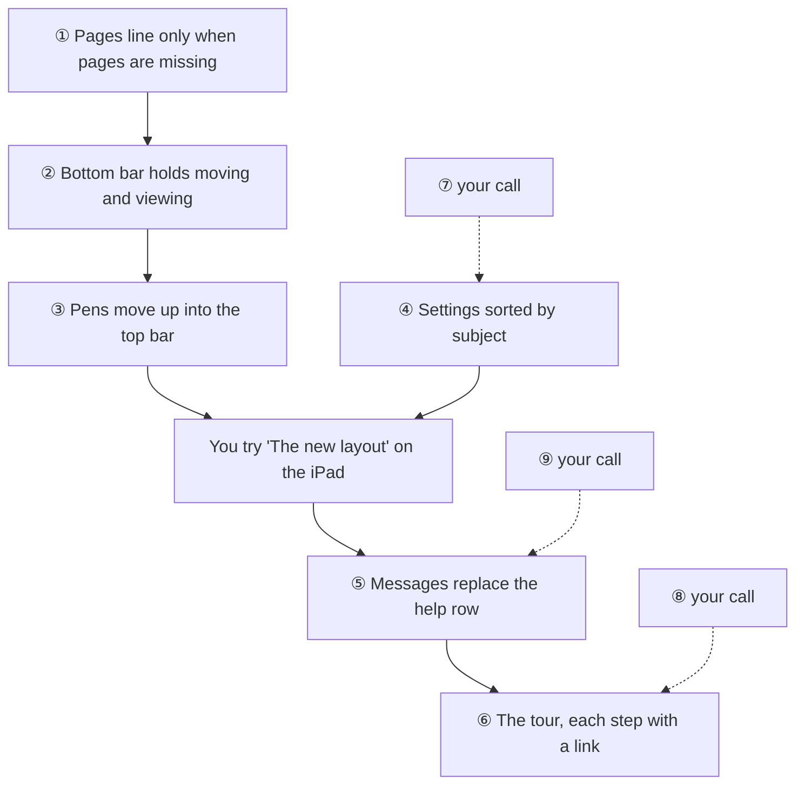

# Where should the app's buttons, settings and help live?

*Written 2026-11-16, from six comments the owner left on the app's page that day, and three older ones about the mistake picker, the calendar and the share menu. This is a plan, not a build: nothing in the app has changed yet. Each numbered item below has a row in the backlog.*

## The short version

- **What:** the app's controls sit in four rows plus a banner, its settings are 47 groups in one panel eleven screens tall, and its help is a line of text in two places. The plan is three moves: **one bar to move through the book, one place to set things, one voice that speaks only when it has something to say.**
- **What it changes for a hafiz:** the page gets two rows of height back on a computer and an iPad. Everything about *where am I and how big is it* is under one thumb at the bottom. A switch is found by its subject, not by scrolling. Nothing on screen talks unless something happened.
- **What is already built:** more than half of what the comments ask for exists as an option that is switched off, or was built on 2026-11-12 and waits for a pick. The table below says which.
- **What you need to do:** make three calls (⑦ ⑧ ⑨ below), each with a recommendation. Nothing waits on them to start; items ① to ③ go ahead without them.

> [!tip] Recommended first step
> Build ① to ③ behind one switch, "The new layout", so the whole arrangement can be tried at once on the iPad instead of five switches one at a time.

## A few words, defined once

- **The page bar:** the control along the bottom that you drag through all 604 pages.
- **The top bar:** the row with the app's name, the page number and the reading controls.
- **The tool row:** the row of pens under the top bar (Read, Select, Highlight, Bookmark, Note, Mistake, Crop, Jump, Eraser).
- **The info panel:** the panel that opens from the app's name. Today it holds every setting and the app's notes about itself.
- **The trail:** the beads that appear after you jump to a look-alike verse, so you can step back.
- **A message:** a short line that slides in at the edge of the app, says one thing, and goes away by itself.

## What did the comments ask, and what already exists?

| The comment | Already built | Already decided | What is new |
| --- | --- | --- | --- |
| "604 pages should always be available, why do we even need this" | The line is drawn on purpose: a mus'haf that arrives part-finished would show fewer. It is also what a screen reader hears. | Yes, held by a test of the page bar. | Show it only when pages are missing (①). |
| "Page navigation should be with the page bar at the bottom, along with zoom, one page or two" | The page bar, its arrows, the zoom steps and the one-or-two switch all exist, in two different rows. | Four choices about the page bar's look and feel. None is reopened; the slider itself does not change. | Move the controls onto the bar (②). |
| "I like these arrow buttons more, should we make these the buttons on the bottom bar" | The two arrows in the top bar are pictures of keyboard keys, not buttons. The triangles at the ends of the page bar are the real buttons. | No. | Draw the real buttons in the key style, and drop the pictures (②). |
| "I'm expecting an iOS-settings-like button: which mus'haf, tajweed on or off, language" | Two tries, both switched off: a settings drawer under the top bar, and a settings page reached from icons along the bottom. | [The settings page](app-pages.md) ① is still open: does the icon row earn its height? | Sort the 47 groups by subject and give the everyday ones a first screen (④). |
| "Is this whole bar adding value? Turn its alerts into macOS-style notifications" | On a computer the row holds one line of help. On a phone it also holds the pen switch and Full screen. After a jump it holds the trail. | No. | The row shows only when it has the trail; help becomes messages (⑤). |
| "Do we need a guided wizard, with an option to disable it, that supports our links for step 1 … step n" | Three tips, opened from the info panel. A setting that hides the help line beside the tool row. Links that open a page, a verse, a pen or a panel. | On 2026-09-25 you chose that tips wait until asked for, so a first open goes straight to the page. | A tour over the real app, each step with its own link (⑥). Whether it starts by itself is your call (⑧). |
| Mistake picker: choose the kind, then the mistake | Three layouts, built 2026-11-12. | Waiting on your pick. | Nothing. [Pick here](mistake-ask.md). |
| The calendar should look better | Four looks, built 2026-11-12 and 13. | Waiting on your pick. | Nothing. [Pick here](calendar-look.md). |
| The share menu is too plain | Three looks, built 2026-11-12. | Waiting on your pick. | Nothing. [Pick here](share-look.md). |

Eight more comments are about the front page of hifth.app (the tagline, the features list, the device tabs, the lettering for the name, a language bar). They belong to the front-page work and are not in this plan; ⑩ below keeps them from being lost.

## What does the screen look like today?

On a computer, 1440 wide. Five strips of controls around the page:

```
+----------------------------------------------------------------------------------+
| Hifth        Page 7  (go to) (mus'haf) [Tajweed] (i)  [One|Two] [- 100% +] [ع|EN] [<][>] Pages  [/] Go to |
+----------------------------------------------------------------------------------+
| Install Hifth so it works offline                               [Install]  Hide  |
+----------------------------------------------------------------------------------+
|              [Read Select Highlight Bookmark Note Mistake Crop Jump Eraser] (undo)(redo)(full)   Click a verse to open… |
+----------------------------------------------------------------------------------+
|                                                                                  |
|                        left page          |          right page                  |
|                                                                                  |
+----------------------------------------------------------------------------------+
|                                            Click an ayah on the page to select it |
+----------------------------------------------------------------------------------+
|   <  ================================o===================================  >      |
|                          604 of 604 pages available                              |
+----------------------------------------------------------------------------------+
```

Measured in the running app: the info panel has 47 groups of settings, 118 controls, and is 10,886 points tall, about eleven screens on a laptop. Language is the first group; tajweed and one-or-two pages are not in it at all, they are in the top bar.

## What would it look like?

**The idea in one line:** the top is for *what you do to the page* (the pens), the bottom is for *where you are in the book and how you see it*, and settings are one button.

### On a computer and an iPad on its side

```
+----------------------------------------------------------------------------------+
| Hifth      [Read Select Highlight Bookmark Note Mistake Crop Jump Eraser] (undo)(redo)      (record) (settings) |
+----------------------------------------------------------------------------------+
|                                                                                  |
|                                                                                  |
|                        left page          |          right page                  |
|                                                                                  |
|                                                              +----------------+  |
|                                                              | Bookmark kept  |  |
|                                                              | Undo           |  |
|                                                              +----------------+  |
+----------------------------------------------------------------------------------+
| [<]  Page 7, Al-Baqarah, Juz 1   ===========o=====================  [>]   [One|Two]  [-] 100% [+]  (full) |
+----------------------------------------------------------------------------------+
```

Two strips instead of five. The page label on the bar is a button: pressing it opens Go to. The arrows are drawn like the keyboard keys the owner liked, and their labels name the key. The slider between them is today's slider, untouched.

### On an iPad held upright

```
+--------------------------------------------------+
| Hifth   [pens, as icons]   (undo)(redo) (settings)|
+--------------------------------------------------+
|                                                  |
|                    the page                      |
|                                                  |
+--------------------------------------------------+
| [<]  Page 7, Juz 1  ======o=========  [>]  [-][+] |
+--------------------------------------------------+
```

One page only, so the one-or-two switch is not drawn. The surah's name leaves the label first when room is short; the page prints it already.

### On a phone

```
+------------------------------+
| Hifth              (settings)|
+------------------------------+
|                              |
|           the page           |
|                              |
+------------------------------+
| (pen)                 (full) |
| [<] Page 7  ===o======  [>]  |
+------------------------------+
```

The phone keeps its pen switch and Full screen just above the bar, where they are today, without the line of help. Zoom stays a pinch. Tajweed and language move into settings.

### Settings

On a phone, a list that pushes in, the way the phone's own Settings does. On an iPad and a computer, the same list with the chosen subject open beside it.

```
+--------------------------------------------------------------+
| Settings                                   (search)      (x) |
+----------------------+---------------------------------------+
| Mus'haf        Hafs  |  Reading                              |
| Tajweed colours  On  |                                       |
| Language    English  |  Pages side by side            [ On ] |
|                      |  Page size                     100%   |
| Reading            > |  Turning the page         Flat seam > |
| Verses and         > |  The first two pages        Together > |
|   look-alikes        |                                       |
| Pens and notes     > |  Other ways to do this              > |
| Listening          > |                                       |
| Bookmarks          > |                                       |
| Your record        > |                                       |
| Sharing            > |                                       |
| Help               > |                                       |
| About Hifth        > |                                       |
+----------------------+---------------------------------------+
```

- **The first three rows are the ones the comment named:** which mus'haf, tajweed colours, language. Each shows its current value on the right.
- **Every row shows what it is set to**, so the list can be read without opening anything.
- **Each subject ends with "Other ways to do this"**, folded. That is where the options that lost a choice live (see ⑦).
- **Help holds the tour and the tips switch. About holds the licence and sources.**

### Messages

A small card at the top corner on a computer, at the top on a phone and iPad, clear of the page's first line. One at a time. It names what happened in the words of the button that did it ("Bookmark kept", "Note saved", "Copied the link") and offers Undo where there is one. It leaves after a few seconds, or at once on a tap. The offer to install the app becomes one of these the first time, and a row in settings after that.

## What are the design rules for this?

**Colours.** No new ones. The app's are already drawn from the printed page, and the new pieces reuse them.

| Name | Value | Used for |
| --- | --- | --- |
| Paper | `#f4efe6` | bars and the settings list |
| Raised paper | `#fbf8f2` | the message card, the open subject in settings |
| Ink | `#26201a` | labels |
| Soft ink | `#5c5347` | a row's current value, a message's second line |
| Teal | `#1f6f66` | the one thing that is on, or the one button to press |
| Rule | `#d9cfbe` | the line between rows |

**Type.** The app's one face throughout. Three roles only: the page number on the bar (large), a label (medium), a value or a second line (small, soft ink). Sentence case everywhere. Page numbers keep Western digits, as the app already decided.

**Layout.** The page is the hero; a bar's job is to be thin. Controls line up along the bar's own direction, which follows the book: right to left for the slider. Settings rows are full-width, label at the start, value at the end.

**Principles.**

1. **The page gets the room.** A row that holds one line of text does not earn a row.
2. **One home per control.** Moving a control means taking it out of the old place, not adding a second copy.
3. **A switch says what it is set to** without being opened.
4. **The app speaks when something happened**, and stays quiet otherwise.
5. **Help is something you do, on the real page**, not something you read.

**Checked against the usual look.** A warm paper colour with a serif is what a generated page reaches for by default. Here it stays because it is the mus'haf's own paper and is already the app's look; the plan adds no decoration to it. The settings list was first sketched as cards with shadows; it is now plain rows with a rule between them, because a list of 47 things should read as a list. The bold part is spent in one place: the bottom bar, which becomes the single ruler of the book. Everything else is quieter than it is today.

**Wording.** Buttons say what happens ("Go to a page", "Show the tour", "Skip the tour"). A message uses the same word as the button that caused it. No arrows on buttons, no capitals for labels, no strings of facts joined by dots.

## What do people outside this project do?

**We looked after the first version was written, and it changed some items.** Two researchers, working apart, read the code of 17 open projects with a Mac, an iPhone or a web version (book, PDF and comic readers, three Qur'an apps, a drawing tool, a feed reader and others; most are widely used, one is small, and only two ship on all three). A third reader opened the sources again and wrote [the catalog](../research/influences/catalog.md), which marks each finding as found by both, by one, or resting on something nobody opened. Nobody ran any of the apps, so what it says about position and feel comes from code, not from a screen.

| What the catalog found | How sure | What it changes here |
| --- | --- | --- |
| Reading apps hide their bars and bring them back with one tap on the page | High: both researchers found it in three apps, and one found it in a fourth | This plan had set that aside. It is now a rough build to try (see "What else could be considered") |
| After a jump, the best readers give a way back and never lose the reader's place | High for the way back; medium for a "return to page N" strip (one researcher) | **Adds to ②** |
| A right-to-left book gets a slider that runs right to left, set by the book and not the device | High | Confirms ②: the slider stays as it is |
| Apps pick the narrow or wide arrangement by the window's size, not the kind of device, and say so when they change the view themselves | High for the choice, medium for the message | **Adds to ②** |
| Pens share a top bar on a computer, but on a tablet the same project gives them a bar the reader can move | High | Sharpens the hand check in ③ |
| Everyday view choices sit on the reading screen; the long list has about ten names at its first level, and the most found anywhere is 25 | High for the two levels, medium for the counts | Supports ④, and adds two things to it |
| Short messages leave by themselves in 3 to 5 seconds; one that needs an answer stays and has a close button | High | **Adds to ⑤** |
| Almost no reading app starts a tour by itself; the tours found have Skip, parts that can be started alone, and a limit on asking again | Medium: each tour was found by one researcher | Argues against the tour starting by itself (⑧'s option B); does not choose between the other two. Adds to ⑥ |
| No app gives each tour step its own link | Nobody found one | That part of ⑥ is our own idea, not a borrowed one |

The research found nothing on undo, and almost nothing on what an app shows when a search is empty or a page fails. That is a gap in the research, not a sign that others skip it.

## What did a second design check change?

On 2026-11-16 the owner asked to try Hallmark, an outside design skill (MIT licence, by Together AI) with a written list of rules and a checker that opens the page in a browser. It was run as a report only: no file in the app changed.

**What the checker measured.** On the reader app at 1440 wide it found no failures and raised two soft flags. Both are about the mus'haf page itself, which it mistook for a decorative drawing, so neither counts. On hifth.app's front page it found real faults, listed under ⑩.

**What its rules for a screen you work in say about this plan.**

| Its rule | What this plan says | Keep or change |
| --- | --- | --- |
| A top bar first; a side list only for more than about seven places | Two bars, and a side list only inside settings, which has twelve rows | Keep |
| The accent colour marks only the main action, what is selected, and what is on | Teal for the one thing that is on, or the one button to press | Keep |
| No capitals for labels, no arrows on buttons, no facts joined by dots | The same, under Wording | Keep |
| The screen has one object it is known by | The bottom bar as the single ruler of the book | Keep |
| A window over the page is the last answer, after changing things in place | Settings is drawn as a panel with a close button | **Change ④:** on a phone settings is a page of its own; on a wider screen it opens beside the page, not over it |
| Where you are lives in the address | Not said | **Change ④:** settings, and each subject in it, has its own link, like the app's other links |
| Every part that loads something has four looks: loading, empty, broken, full | Only the full look is drawn | **Change ④ and ⑤:** a search that finds nothing says so and offers to clear it; a page that fails to load says what broke and offers to try again |
| A control is 32 to 40 points tall with at least 44 points to hit | Not said | **Change ② and ③:** a test measures every control on both bars |
| Anything that destroys work can be undone or is confirmed | Messages offer Undo "where there is one" | **Change ⑤:** the eraser and "reset settings" always offer Undo |
| Every colour comes from one named list | A table of six values | **Change:** the new pieces use the app's named colours only; a check refuses a new colour value written in place |
| Movement shows a change, never decorates | A message slides in; the tour lights a control | **Change ⑥:** the tour's light moves only when the reader does the step, with no movement of its own |

**How it differs from the first pass.** The first pass (the frontend-design skill) asked *does this look like us and nobody else*, and gave the plan its one bold move and its wording. Hallmark asks *can each rule be measured*, and gave the plan six things to test. Neither changed the three moves or the order.

**What was left off.** Its optional check on every file save (a settings change) and its picture maker (which sends a request to an outside company) were not installed.

## In what order?



Ranked by what a hafiz gains for the work. ② and ③ give the page its height back, which is felt on every page. ④ is the largest piece of work and the one the settings comment asked for. ⑤ and ⑥ change how the app teaches, and are better built once the controls have stopped moving.

Each item is built as a rough version first, behind a switch, with its test. What the rough build shows is written back here before the choice is recorded.

## Open questions, and what would answer each

### ① Should the "604 of 604 pages available" line show when no page is missing? · **open**

**What it changes for a hafiz:** one line less under the page bar on every screen. On a phone that is about half a line of the page.

Today the line always shows. It exists because a second mus'haf may arrive with some pages still to come, and a reader should know which. With all pages present it says nothing a reader can act on.

*What would answer it:* the line is drawn only when pages are missing. A screen reader still hears the count, since the line is how the slider is described. A test sees no line with all pages, and the line with one page missing.

*What other apps do:* none of the apps read shows a standing count like this, and nobody looked for one, so the research neither supports nor argues against it.

### ② Should moving through the book and how it is shown all sit on the bottom bar? · **open**

**What it changes for a hafiz:** turning, jumping, one page or two, and the size are under one hand, and the top bar stops being a row of small unrelated buttons.

Moves to the bar: the page number (which becomes the button for Go to), the one-or-two switch, the size buttons, Full screen. The two arrows become real buttons drawn in the keyboard-key style. The pictures of keys in the top bar go; each button's label names its key instead.

*What other apps do ([the catalog](../research/influences/catalog.md)):* the best readers put a way back beside the slider, greyed out when there is nowhere to go back to, and keep the reader's place when they jump. So this item now includes a Back button beside the slider, and a rough build of a "return to page N" strip that shows while the reader is away from where they were reading. When the app itself switches between one page and two because the window changed, it says so in a short message.

**What must not change:** the slider itself. Its look, the juz markers, the pull onto a marker and the phone's slow scrub were each chosen by hand and stay as they are.

*What would answer it:* a rough build behind a switch, tried on the iPad and a laptop, in Chrome and Firefox. Tests: every moved control still does what it did; the arrow keys and the Go-to key still work; the bar fits at phone, iPad and laptop widths with nothing cut off; after a jump, Back returns to the page the reader left, and a second jump does not lose it; in Arabic the bar reads right to left; every control on the bar is 32 to 40 points tall and can be hit across 44. The pitch walk is run again on the iPad afterwards.

*What the second rough build taught (2026-11-16):* the whole arrangement is now built, behind one switch in the info panel, "The new layout", off until it is judged. With it on, Go to, Full screen, one page or two and the size buttons sit on the bottom bar, and the top bar keeps the app's name, the page chip that opens the revision map, the tajweed switch, settings and the language.

- **The label is the Go to button.** It reads "Page 7 · Juz 1 · Al-Baqarah" on a laptop, drops the surah's name below 1024 points wide and the juz below 600, so a phone shows "Page 7". The label had to be plain text, not a row of boxes: boxes dropped the space before each dot.
- **One page or two, and the size buttons, show on the bar only on a wide screen** (a laptop, an iPad on its side). An upright iPad pinches to zoom and always shows one page, so it gets Go to and Full screen only. That is an assumption to check by hand.
- **Full screen is on the bar at every width.** On an upright iPad it used to sit in a row above the bar; with the switch on, that button goes, and the way out of full screen is the same as before.
- **The turn buttons are drawn as keys** and say their key when pointed at ("Next page (Left arrow key)"). The pictures of keys in the top bar are gone with the switch on.
- **The bar wraps instead of cutting off.** The slider keeps at least 10 rem, and the pages line takes a row of its own. A test checks the bar at phone, upright iPad and laptop widths.
- **Every control is 32 to 44 points tall**, not 32 to 40 as the design check asked: the app's own touch size is 44, and the bar's buttons kept it. That is for a hand on it to say.
- **Not yet known:** whether the bar feels crowded on a laptop with everything on it, and whether a hafiz finds Go to on the bar without being told.

*What the first rough build taught (2026-11-16):* the Back button came first, as the setting "Back button beside the page slider" in the info panel, off until it is judged. It works with the new layout on or off.

- **What counts as a jump had to be decided, and no list had a row for it.** The build says: a move of more than two pages made with the slider, a juz mark or Go to. A page turn, a hop to a look-alike verse and a link are not jumps, so they never fill the button.
- **The button shows the page number it goes back to**, so the separate "return to page N" strip may not be needed. That is for a hand on it to say.
- **It keeps the first page left.** After 7 → 42 → 582, Back goes to 7. Arriving on that page by any road empties the button.
- **It fits at phone width.** The slider gets shorter by the button's width (about 62 points) and nothing is cut off. The button keeps its width whether or not it shows a number, so the slider does not change length when a jump fills it.
- **Not yet known:** whether one remembered page is enough, or a reader expects Back to step through several.

### ③ Should the pens sit in the top bar, so the tool row is not a row of its own? · **open**

**What it changes for a hafiz:** one more row of height for the page on a computer and an iPad. Nothing on a phone, where the pens are already a single button.

Once ② has emptied the top bar, the pens fit in it. The line of help beside the pens goes with ⑤.

*What other apps do ([the catalog](../research/influences/catalog.md)):* one well-used reader puts page controls, then pens, then other buttons in a single top bar on a computer. On a tablet the same project gives the pens a separate bar the reader can drag to either side or the top, and a drawing tool moves its tools to the bottom on a phone. So the top bar is a fair default on a computer, the iPad is where it may fail, and the existing choices for where the pens stand stay as settings.

*What would answer it:* a rough build under the same switch as ②. To check by hand: whether the pens are still easy to hit with the pencil when they share a row with the app's name and the settings button, and whether the existing choices for where the pens stand (the bottom, a side, in full screen) still make sense. A test measures the pens the same way as the bottom bar's controls in ②.

### ④ Should settings be one list sorted by subject, with the everyday ones first? · **open**

**What it changes for a hafiz:** which mus'haf, tajweed colours and language are the first three rows, each one tap away. Any other switch is found under its subject or by searching, instead of by scrolling eleven screens.

This builds on the settings page that already exists ([the settings page](app-pages.md) ①). What that build showed still holds: there must be one way into settings, not three. So the plan is one settings button in the top bar; the drawer under the top bar and the switches in the info panel are taken out, and the info panel keeps the app's notes about itself, which become "About Hifth" at the foot of the list.

The 47 groups sort into about nine subjects: Reading, Verses and look-alikes, Pens and notes, Listening, Bookmarks, Your record, Sharing, Help, About.

*What would answer it:* a rough build with every one of today's settings reachable and none lost, checked by a test that counts them. Settings is a page of its own on a phone and opens beside the page on wider screens, never as a window over it. Settings and each subject have their own link, and a test opens each. A search that finds nothing says so and offers a way back. New pieces use the app's named colours only, and a check refuses a colour value written in place. To check by hand on the iPad: whether the list with the subject open beside it feels like the iPad's own Settings, and on a phone whether going in and back is quick enough for a switch you flip often. Tajweed is the one to watch: today it is one tap in the top bar, and here it is two.

*What other apps do ([the catalog](../research/influences/catalog.md)):* the readers closest to ours keep everyday view choices in a small menu on the reading screen and the long list elsewhere, which answers the tajweed worry: it can stay one tap away on the page and still have its row in settings. Two more things worth taking: settings reopens where the reader left it, and a row that does not apply (a two-page choice on a phone) is hidden, not greyed. A test checks both.

### ⑤ Should the help row go, with the app speaking through short messages instead? · **open**

**What it changes for a hafiz:** a row of height back on a computer, and a clear sign that something worked (a bookmark kept, a note saved, a link copied) with a way to undo it.

The row stays only for the trail, and only while there is a trail. On a phone the pen switch and Full screen stay where they are. The line "Click a verse…" is said once, by the tour or by a first-use tip, and not printed forever.

Only things a reader can act on or needs to know become messages. Anything else goes to the backlog, as the app's rule already says.

*What other apps do ([the catalog](../research/influences/catalog.md)):* short messages leave by themselves after 3 to 5 seconds and sit away from the bottom bar; a message that needs an answer stays until closed. A drawing tool keeps its line of help only while a tool is in hand, which fits keeping ours only while a pen is. The research found nothing on undo, so that rule stands on its own reasons.

*What would answer it:* a list of every line the app prints today, each marked as a message, a first-use tip, or dropped. Then a rough build. Tests: a message is read out by a screen reader; it never covers the verse just touched; two in a row do not stack; a plain message leaves by itself within 5 seconds and one that asks something stays until answered; with motion turned down it appears without sliding; the eraser and "reset settings" each leave a message with Undo, and Undo puts the work back; a page that fails to load says so and offers "Try again".

### ⑥ Should a tour over the real page replace the three tips? · **open**

**What it changes for a hafiz:** a new reader learns the app by doing each thing once on a real page (turn, jump, tap a verse, follow a look-alike and come back, mark a mistake, drop a bookmark, open the record, open settings) instead of reading three cards and a line of help.

Each step lights the one control it is about, says one sentence, and moves on when the reader does the thing. Every step has "Skip the tour". Settings, under Help, has "Show the tour" and a switch for first-use tips.

**Each step has its own link**, on the web and in the app, so step 4 can be opened from the features page, from the front page, from a message to a friend, or from a test. That adds one more kind of link to the app's list of links, which is kept in step in four places.

Two shapes are worth building, because the difference is felt, not seen: **A,** a spotlight that walks you through in order; **B,** a short checklist ("Getting started") that ticks itself as you do each thing in any order.

*What other apps do ([the catalog](../research/influences/catalog.md)):* most reading apps teach nothing at first open, and teach a hidden gesture at the moment it is first used. Three tours were found, each by one researcher: all have Skip, and the largest (on a Qur'an website) is the checklist shape, with parts that can be started on their own and a limit on how often it offers itself. No app gives each step its own link, so that part is ours to prove. The checklist's parts each being startable is the nearest thing. That is one app found by one researcher, so it is a reason to try B in the rough build, not proof.

*What would answer it:* both built rough and tried by hand. Tests: each step's link opens that step; skipping is remembered; the tour never shows in a build where it was turned off; the steps make sense in Arabic; the light moves only when the reader does the step, never by itself.

### ⑦ Where do the options that lost a choice go, now that settings is a short list? · **open**

**Yours to answer.** Today every option that lost a choice stays as a switch, by your rule, and that is most of the 47 groups.

| | A. Under each subject, folded (recommended) | B. One section of their own | C. Retire the old ones |
| --- | --- | --- | --- |
| **What it is** | Each subject ends with "Other ways to do this" | A last section, "Other ways", holding all of them | Options whose choice was made more than a month ago are removed |
| **For a hafiz** | The switch is next to the thing it changes, but out of the way | Everyday settings stay very short; the rest is one long list again | The shortest settings; a reader who liked a runner-up loses it |
| **Good** | Keeps your rule; search finds everything | Simplest to build | Least to maintain and test |
| **Bad** | Nine folded lists to keep tidy | Moves the eleven screens rather than fixing them | Breaks the rule that nothing built for a choice is thrown away |
| **Commits us to** | Naming a subject for every new option | Nothing new | Reopening that rule, and deleting code and tests |

*What would answer it:* your pick. A is assumed until then.

### ⑧ Should the tour start by itself the first time the app is opened? · **open**

**Yours to answer.** On 2026-09-25 you chose that tips wait until asked for, so a first open goes straight to the page. A tour that starts by itself reverses that.

| | A. Offered once, not started (recommended) | B. Starts by itself | C. Only from settings |
| --- | --- | --- | --- |
| **What it is** | One message on the first open: "New here? Take the two-minute tour", with Start and Not now | The first open is step 1 | As today: nothing until the reader looks under Help |
| **For a hafiz** | A returning hafiz dismisses one line; a new one gets the tour | Every new reader is taught; someone who came to revise is held up | The page at once; most new readers never find the tour |
| **Good** | Keeps the earlier choice's point, and still reaches new readers | Nobody misses it | No change to make |
| **Bad** | One more thing on the first screen | Reverses a choice you made; the pitch demo would open on a tour | The comment that asked for a tour is only half answered |
| **Commits us to** | The message from ⑤ being built first | Changing the earlier record, and a way to keep it out of the pitch demo | Nothing |

*What would answer it:* your pick. A is assumed until then.

### ⑨ Should messages be drawn by the app, or be the device's own notifications? · **open**

**Yours to answer.** "macOS-style notifications" can be read two ways.

| | A. Drawn inside the app (recommended) | B. The device's own notifications |
| --- | --- | --- |
| **What it is** | A small card in the app's corner that looks and behaves like a Mac's banner | Real banners from the Mac, iPad or phone, which also sit in its notification list |
| **For a hafiz** | Seen at once, beside the page, gone in a few seconds | Asked for permission first; may be silenced by Focus; shows even when the app is not in front |
| **Good** | Works the same on the web and in the apps; no permission | Right for things that happen while you are away, such as a revision reminder |
| **Bad** | Only seen while the app is open | Wrong for "Bookmark kept"; a second system to build and test on each device |
| **Commits us to** | One message component | A permission prompt, and Apple's review looking at how it is used |

*What would answer it:* your pick. A is assumed until then. B is worth its own question later, for reminders.

### ⑩ Eight comments on hifth.app's front page have not been answered · **fixed**

Left on 2026-11-12. They ask for:

- a features section that names marking mistakes, notes, look-alike verses, sharing a verse, and links that open the app at a feature;
- the line under the name to read "A memorization toolkit, built by huffaz for huffaz (and aspiring huffaz)";
- the name's Arabic lettering tried in Aref Ruqaa;
- tabs for iPad, iPhone, Mac and the web, with "coming soon" where an app is not out;
- a picture of two pages side by side, and a language choice across the whole site.

The design check of 2026-11-16 added these, measured on the served page:

- the ring that shows which control the keyboard is on is too faint against the page, and one control shows none;
- the edge of the email box is too faint to see where to type;
- "Open Hifth in your browser" breaks onto two lines on an iPad held upright;
- one heading leaves a single word alone on its last line on a phone;
- the copy uses a row of facts joined by dots, and four weights of the type where three would do (it also used long dashes; those are gone and a test refuses them, after the owner's comment of 2026-11-16);
- four shadow colours are written in place instead of coming from the page's named colours.

It also flagged that the page ends on the email sign-up. That is on purpose while the apps are not out, so it is not a fault.

*How it was answered:* all eight comments were built on the front page. The six faults were fixed on 2026-11-19, each with a test that refuses it coming back, and looked at in Chrome and Firefox, light and dark, in English and Arabic. Running the design check again flags only the inside of the spam check. That part is Cloudflare's frame, which draws its own ring and which the check cannot see into. The comment on the device tabs stays open on the page, only in case the owner wants the tabs named or ordered differently.

### ⑪ Should the bars hide while reading, and come back on a tap? · **open**

**What it changes for a hafiz:** the page gets the whole screen while reciting, and one tap brings the slider and buttons back. The risk is the other way round: a control they reach for is not there until they tap.

The first version of this plan set this aside. The research on other apps reversed that: it is the best-supported thing found (see "What do people outside this project do?"). Apps where the reader works on the page with tools keep a bar showing, so the version to try hides the bars while reading and keeps them while a pen is in hand. It would be a switch, off until the rough build is judged.

*What would answer it:* a rough build beside ② and ③, tried on an iPad and a phone: does a tap in the middle of the page still do what it does today, do the bars stay while a pen is held, and does the reader find the slider again without being told. Nobody has run the other apps, so how long they wait before hiding is taken from their code (3 to 5 seconds), not from use.

*What the rough build taught (2026-11-16):* it is built as the setting "Bars while reading" in the info panel, off until it is judged. The bars leave after 4 quiet seconds and a tap brings them back. They stay while a pen is in hand, a verse is chosen, a panel is open, the keyboard is inside a bar or a finger is still down. A swipe or an arrow key turns the page without bringing them back.

- **On a laptop the book grows by half when the bars leave.** At 1280 by 800 with two pages showing, each page goes from 281 to 424 points wide, and shrinks back on a tap. That is the gain, and it is also the cost: the line under the reader's eye moves every time. No list made beforehand had this, and it is the thing to judge first. The other way to build it is for the bars to float over a page that stays the large size.
- **On a phone the page keeps its width and slides up** by the height of the top bar, and its bottom lines, which the bars covered, come into view.
- **The "install" message stays when the bars leave**, and takes more room than the top bar did on a phone. It is a message, not a bar, so the build left it. Whether it should leave too is open.
- **The bars leave 4 seconds after the app opens**, before the reader has touched anything. Waiting for the first page turn may be kinder.
- **A tap on a verse brings the bars back and also does what it does today** (opens the verses like it). Whether the first tap should only bring the bars back is for a hand to say.
- **Still to try on a real iPad and phone:** it is parked on the by-hand list.

## What else could be considered, and why is it not here?

- **A row of page icons along the bottom, like a Mac app.** It is built and switched off. It costs 52 points of height on every screen, and this plan is about giving height back. It stays a switch.
- **Hiding all the bars until the page is tapped.** The first version set this aside because full screen already does it. The research ranks it first: both researchers found it in three reading apps, and one found it in a fourth. Apps where the reader works on the page with tools keep a bar showing, and a hafiz holding a pen is doing that. So this is no longer set aside. It is open item ⑪ above.
- **A separate practice page for the tour.** A real page teaches the real thing; a practice page is one more thing to keep in step.

## What would change the answer?

- If the bottom bar feels crowded on an iPad held upright, the size buttons move into settings and pinch stays the only way there.
- If two taps for tajweed feels slow in real revision, it gets a place on the bottom bar.
- If the pens in the top bar are hard to hit with the pencil, ③ is dropped and the tool row stays.

## What is this not settling?

- The front page of hifth.app: its features list, tagline, device tabs and language bar.
- Which look wins for the calendar, the share menu and the mistake picker. Those are built and wait on your pick on their own pages.
- Reminders to revise. They are a feature of their own.
- Whether settings follow you between devices.
