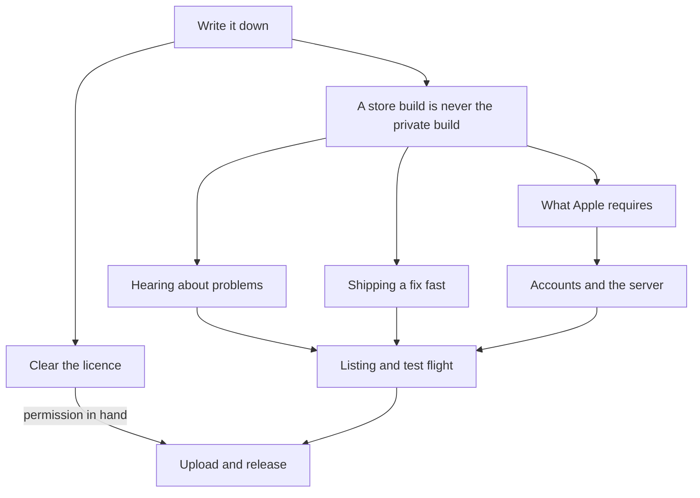

# What stands between Hifth and the App Store, and between a reader's problem and our fix?

*Written 2026-11-15, when the owner asked to harden the app before the App Store and to be ready
to hear about problems and fix them fast. The plan is `.claude/plans/launch-readiness.md`;
the goal and its numbers are `.claude/goals/app-store-launch.md`; what other teams check, with
sources, is [research.md](../research/app-launch/research.md).*

## The short version

- **What:** put Hifth on the App Store for iPad, iPhone and Mac, with optional sign-in, and be
  able to hear about a problem, find its cause and ship a fix within days.
- **What it changes for a hafiz:** the app installs from the store like any other, keeps working
  with no connection, and has a button to tell us when something is wrong. Nothing they write in
  the app leaves the device unless they choose to send it.
- **What blocks it:** two data sources' licences clash with Apple's store terms. We are asking
  both rights holders for written permission. Until they answer, nothing is uploaded; everything
  else goes ahead.
- **What makes fixes slow:** the web part is packed inside the app, so every fix is a new build
  through Apple's review (half are reviewed within a day). The only fast levers are a small
  settings file the app reads at launch, and a release path we have practised.

Each open item below has a row in the backlog (`docs/issues.json`, tagged `"launch": true`).

## Words used here

- **Hafiz** (plural *huffaz*): someone who has memorised the Qur'an.
- **The private build:** the one made for the pitch, with The Study Quran's notes. It never goes
  to the store.
- **The public build:** the one with no held text, the same as the public site.
- **Staged release:** Apple offers an update to a growing share of readers over seven days, and
  it can be paused. A pause does not take the update back from those who have it.

## What does the work look like, in order?

## Open questions, and what would answer each

### ① A build for the store could be the private build · **fixed**

The command that packs the web part into the app builds the private flavour unless told
otherwise, and nothing stopped an archive of it. A store build carrying The Study Quran's notes
would publish them.

*What answered it (2026-11-16):* the archive step now refuses anything but the public build, in
two places. Before anything else runs, it reads the one-word file the copy step leaves in the web
folder and stops if that does not say "public". Later, the check on the built release app reads
the same file from inside the app, the thing that would be uploaded, and also refuses a private
folder there whatever the file says. Tests try to archive a private build and watch it fail with
that message, not with the licence lock's.

*Still true:* building for the owner's own iPad keeps accepting the private build, as it must.
A private build for named testers, if that is ever chosen, would need a command of its own.

### ② No page names every source with its licence and a link back · **open**

The credits sit in the colophon and in our source files. Apple's reviewers and the rights holders
will both look for one place that names them all.

*What would answer it:* a citations page in the app and on hifth.app, listing every source the
source and licence files name, with a check that refuses a source left off.

### ③ The word-root data's owners have not given permission for the store · **blocked**

Their licence is the GPL, and its terms cannot sit beside Apple's store terms without the owners'
added permission. Only they can give it.

*What would answer it:* their written permission, kept in the repository. The owner sends the
email; the draft is email 1 in [store-permission-emails.md](store-permission-emails.md).

### ④ The tajweed colouring data's author has not given permission for the store · **blocked**

Its licence forbids the copy protection Apple puts on every store app.

*What would answer it:* the author's written permission, or leaving that data out of the store
build. The owner sends the email; the draft is email 2 in
[store-permission-emails.md](store-permission-emails.md).

### ⑤ Nobody has read the page artwork's own terms · **open**

The mus'haf page artwork comes from the King Fahd Complex. Its terms have never been read for a
store app.

*What would answer it:* the terms read, quoted in the source file, and the reading recorded here.

### ⑥ The recitation audio comes from another site with no licence note · **open**

*What would answer it:* that site's terms found and recorded, and the source added to the
citations page; or the recitation switched off in the store build.

### ⑦ The app has no privacy file · **fixed**

Apple refuses an upload without a privacy file, and refuses one that uses certain system features
(saved settings, file dates, the time since start-up, free disk space, the keyboard list) without
saying why.

*What answered it (2026-11-16):* the iPad, iPhone and Mac apps now carry the file. It says the
app tracks nobody, names no tracking address and collects nothing. This page used to say the
shell uses saved settings; a search of the shell's code found none of the five features, so the
file lists none. The web part keeps its settings in the web view's own storage, which Apple does
not count. A store build's release check fails if the file is missing, says the app tracks people,
names a tracking address, or lists a feature with no reason. Apple's own check of the file runs
on the first real archive, so it belongs to ⑪.

### ⑧ The Mac app is not sandboxed or signed for the store · **open**

The Mac store accepts only sandboxed apps signed by a paid team.

*What would answer it:* the sandbox on, the app signed by the team, and a walk of the Mac app
that finds nothing the sandbox broke (opening and saving files, links, the web part).

### ⑨ The iPad and iPhone app has no list of what it is allowed to do · **open**

Sign in with Apple and links from hifth.app that open the app both need it.

*What would answer it:* the file added, and a link on hifth.app opening the app on a device.

### ⑩ The version is fixed at 0.1.0, build 1 · **fixed**

Every upload needs a higher build number.

*What answered it (2026-11-16):* `make app-version` says the version and build number.
`VERSION=1.0.0` sets the version and raises the build number; `NEXT_BUILD=1` raises the build
number alone. A version lower than today's, or one Apple would refuse, is refused and nothing is
written. It lives in the new release skill, which the rest of the release joins as it is built.
Raising the build as part of the archive comes with ⑪.

### ⑪ The commands to make and upload a store build only print an error · **fixed**

*What would answer it:* a real archive and export that runs clean, and Apple's own check of it
(the privacy file from ⑦ included) passing, with the upload step still locked until ③ and ④
are answered.

*Where it stands (2026-11-16):* the archive is real. `make app-archive` makes an Xcode archive
of the public build, signed with the team's development certificate, and then runs the release
check again on the app inside the archive, since that is what would be uploaded. Its first run
passed: the public build, no walk capture, the privacy file in place. The archive stays on the
laptop, so it no longer waits on the licence answer; only the upload does, and the upload now
checks the licence before it builds anything. Tests hold both.

`make app-export` signs the archive for the App Store. The owner said yes to its first run on
2026-11-16, which had Xcode make the team's App Store certificate in the Apple account, and it
passed: the app inside the export is signed for distribution, is the public build, carries the
privacy file and has no private folder. The export stays on the laptop.

*2026-11-17:* the export and the upload now take only an archive `make app-archive` made. Once
every check has passed, the archive command writes a receipt beside the archive: the commit it
was built from, whether that work was all committed, and one fingerprint of every file in the
app. The export reads the receipt first, and the upload reads it again just before sending. An
archive made by hand in Xcode, an older one, or one with any file changed, added, removed or
renamed after the checks is refused. The archive left on the laptop from 2026-11-16 predates
the receipt and is refused, as it should be. On the real app (2,834 files) the fingerprint takes
under half a second.

*What answered it (2026-11-17):* Apple's own check passed on the first try, "no errors", on a
fresh archive and export of the public build. Whether the check counts as an upload was the
owner's call, item ㊷; the owner said yes the same day, since it makes no build anyone can
install, puts nothing in the review queue and uses no build number. `make app-store-check` runs
it, and refuses an export older than the archive's receipt. The upload command runs the same
check before it would send anything, and stays locked until ③ and ④ are answered.

Two things learned on the way. The export signs with Apple's online store certificate through
Xcode's own sign-in; the store key cannot, as it has no right to that certificate. That sign-in
expires, and the release setup check only sees that an account is listed, so an export stopped
by an expired sign-in now says in plain words to sign in again in Xcode's settings.

### ⑫ A recitation may be silent when the phone's silent switch is on · **fixed**

*What answered it (2026-11-16):* the iPad and iPhone app now tells the phone at launch that its
sound is media, which the silent switch does not mute, and spoken words, so a call or spoken
directions pause it instead of being talked over. Setting this starts no sound and leaves other
apps' music alone until a verse plays. A test on the Mac holds the choice, and the iPad app in
the simulator reports it back. The simulator has no silent switch, so hearing it on a real
device is on the by-hand checks list; if it turns out silent, this item reopens.

### ⑬ Nothing yet shows Apple's reviewers the app is more than a website · **fixed**

Apple turns down apps that only wrap a website. Hifth does more (it works offline, takes the
pencil, opens from links in other apps, saves files), but the review notes did not say so, and a
first launch with no connection had not been checked.

*What answered it (2026-11-16):* the review notes are drafted in
[store-listing.md](store-listing.md), and each claim in them names the test or code that holds
it. A browser test opens the app with every outside address refused and still sees a page drawn
and a verse selected. It found one outside request, on purpose: selecting a verse fetches its
recitation ahead so Play starts at once. With no connection that fails quietly and only the
sound is missing. A fresh install in the iPad simulator agreed: three pages drawn, every file
inside the app, and that one recitation request. The notes say so plainly. A first launch in
Airplane Mode on a real device goes in the store-build walk.

### ⑭ A link inside the app might open any website inside it · **fixed**

Apple's age questions ask whether the app can reach any page on the web. It should not.

*What answered it (2026-11-16):* it was already true, and now a test holds it. Only the app's
own pages and a blank page load inside it. Every other address leaves the app. Of those, only web
pages and mail open in the browser or the mail app; a file, a script, a phone number or another
app's address is dropped. A window the page opens goes the same way, and the web part has no
embedded frames. So the store answer to "can the app reach any web page" is no.

### ⑮ An error the page does not catch leaves a blank screen · **fixed**

Only one part of the page caught its own errors.

*What answered it (2026-11-16):* the whole page now sits inside one catcher. If any part throws
while drawing, the reader sees a card: the page stopped working, their notes and marks are kept
on this device, and a button opens the page again. A browser test breaks the built page on
purpose, sees the card, presses the button and sees the mus'haf come back. With the catcher taken
out, the same test saw an empty page, so it checks the real thing. Errors nothing else catches
are kept in memory, the last twenty, for the reader's own report; nothing is stored or sent. In
the apps, if the system ends the process that draws the page, the app loads it again instead of
staying blank, and a test holds that. The card also has the "Report a problem" button from ⑱.

### ⑯ Nobody has used the apps with the screen reader · **open**

*What would answer it:* a walk with VoiceOver on iPad, iPhone and Mac, its faults fixed with
tests, and the by-hand parts parked on the manual-testing list.

### ⑰ We cannot see crashes on readers' devices · **open**

Today a crash is read only from a device on a cable.

*What would answer it:* the app keeps Apple's daily crash and performance reports on the device,
so they can go into a reader's report, and a command lists the crashes Apple has collected. A
crash forced on a test device shows up in that list.

### ⑱ A reader has no way to tell us something is wrong · **fixed**

*What answered it (2026-11-16):* a "Report a problem" button in the info panel and on the error
card. It shows the reader the whole report and the address it goes to, and only then offers to
open their own mail app with it filled in, or to copy it. The report names the app and version,
the build, the device, the screen, the language, the time and the last five errors. It never
holds their notes, marks or a list of the pages they read; a browser test puts a made-up note on
the device and checks it is not in the report or the mail. The [design page](report-a-problem.md)
has the picture and the reasons. "The last few steps by name" waits on ⑲, the app's own log.

### ⑲ The shell writes its log with bare prints, and the web part keeps none · **open**

*What would answer it:* the shell writes to the system log, the web part keeps a short log in
memory for the report, and each line carries the app version and the build's commit.

### ⑳ There is no support page · **open**

Apple requires a support address with working contact details.

*What would answer it:* a support and known-issues page at hifth.app/support, linked from the
app, with its own entry in hifth.app's safety settings, which list each page by name. (Takes
over the landing page's support-page row.)

### ㉑ Once a bad version is out, we cannot stop it or warn readers · **open**

The store has no undo, and a pause only stops an update spreading.

*What would answer it:* a small public file at hifth.app that the app reads at launch, with the
lowest version still allowed, a message to show, and switches for risky features. With no
connection the app carries on as before. A test changes the file and sees the message.

### ㉒ There is no one command to release, and no written fix-in-a-hurry page · **open**

*What would answer it:* one release command, from version to a checked build, and a page that
says how to reproduce, patch, build, upload and ask Apple for a faster review, with the request
text ready to paste.

### ㉓ A bad publish of the site cannot be put back · **open**

*What would answer it:* a "put the previous release back" command in the site-publishing skill,
tested by publishing, putting back and checking the live commit.

### ㉔ The browser version never says a new version is ready · **open**

A page cached from before an update can ask for files the update removed, and break.

*What would answer it:* a "new version ready" prompt, the previous release's files kept for one
release, and a test that loads an old page after an update.

### ㉕ A test that passes only on its second try still counts as a pass · **open**

*What would answer it:* the push reports every test that needed a second try, so each one is
fixed rather than hidden.

### ㉖ Sign-in waits on three choices · **blocked**

The sign-in page sets out what sign-in unlocks first, where reader accounts live, and whether a
reader's copy is locked so we cannot read it.

*What would answer it:* the owner's three choices, then sign in with Apple through Apple's own
sheet.

### ㉗ A reader could not delete their account inside the app · **open**

Apple requires it for any app with accounts, and the deletion must also cancel the Apple sign-in.

*What would answer it:* a "delete my account" button that removes the account and everything
stored with it, cancels the Apple sign-in, and says when it is done; and a place to see what is
stored. Waits on ㉖.

### ㉘ Nothing that holds reader data is backed up, and no restore has been tried · **open**

*What would answer it:* a backup on a schedule, kept off the database's own host, a message when
one fails, and a restore into a scratch database with its rows counted.

### ㉙ The apps have no privacy policy of their own · **open**

The privacy pages cover the notify-me list only.

*What would answer it:* a policy that says what stays on the device, what an account stores, what
the recitation fetch sends, and what a reader's report holds, linked from the app and the store.

### ㉚ The store's questions are not answered yet · **open**

Privacy labels, age questions, the export question, the EU trader question, the description and
the review notes.

*What would answer it:* every answer drafted in the repository, the EU trader answer from the
owner, and the labels checked against what the app really sends.

### ㉛ There are no screenshots at Apple's sizes · **open**

*What would answer it:* a command that takes the public build's screenshots at Apple's iPhone,
iPad and Mac sizes, in English and Arabic.

### ㉜ Nothing reads what readers write about the app in the store · **open**

The owner made one App Store Connect key for this, `hifth-reviews` (Customer Support, Finance
and Marketing), on 2026-11-16. One key, two skills: this one and ㉝.

*What would answer it:* a store-feedback skill whose command lists new reviews and ratings into
a folder git ignores, since reviewers' names and words never reach the public repo, and drafts
an answer to each. An answer is posted only after the owner says yes to it.

### ㉝ Nothing counts downloads and sales · **open**

*What would answer it:* a store-numbers skill whose command pulls the daily download and sales
reports with the same key, keeps them in a folder git ignores, and prints a short summary for
the launch goal's numbers.

### ㉞ The release page and the setup check know only the upload key · **open**

*What would answer it:* the release page names both keys and what each is for, and the setup
check confirms the reviews key's file is in place and its ID is saved, printing names and
dates, never the key itself.

### ㉟ Nobody has walked the store build as Apple's reviewer would · **fixed**

The first walk, on 2026-11-17 on an iPad simulator with the Release build, found three things
and fixed them: the review notes' steps described a row of links an iPad never shows; the
tajweed badge said "beta" and three settings said "A rough build to try", which Apple's rule on
betas and demos turns down; and the problem report did not name the device.

*What would answer it:* the same walk on the iPhone and the small iPhone, a first launch with no
connection, swipe page turns, rotation, split view, larger text, and the Mac by picture. The
steps are in the walk-app skill's checklist, under "The store build, as Apple's reviewer".

*Walked 2026-11-17, the same day, on the Release build.* A fresh first open on the iPad, the
iPhone and the small iPhone opens page 7, with no "Left off" ribbon and nothing read aloud. A
first launch with no connection is held by the browser test that refuses every outside request,
and the app serves its own files. On its side the iPad shows two pages with nothing spilling. A
finger swipe turns the page forward and back on both phones. Split view found one fault: the
English top bar does not fit at 320 px ㊶. The largest system text size changes nothing in the
app, which is now part of the accessibility item ⑯. The Mac's fresh first open waits for the
Mac sandbox ⑧: no Mac store copy exists before it, and the laptop's copy keeps earlier saved
data.

### ㊱ The store copy still answers the walk tools' launch settings · **fixed**

Only someone starting the app from a Mac can set them, so no reader or reviewer can reach them.

*What would answer it:* the archive step leaves them out, and the release check refuses an
archive that has them.

*Fixed 2026-11-17.* The archive step now builds with a store switch that leaves out the page
probe, the walk of steps, the picture, the forced light or dark look, and the page and language
a test starts the app at. A plain Release build keeps them, because the reviewer walk drives
one. The check on the archive refuses one that still has the long setting names; it found all
six in the archive made before the change. The page and language names are too short to find
in a built app, so a test reads the app's code instead and refuses any read of a launch setting
the store build would keep. The Mac app is not archived yet; when it is, it takes the same
switch.

### ㊲ Should the store build show the tajweed colours at all? · **open**

Its data's permission (④) is not in hand, and its badge says "unchecked". Leaving it off takes
one permission off the upload's path; leaving it on keeps a feature huffaz use. The owner's
call.

### ㊳ A "Left off" ribbon appears on the first open, though nothing has been read · **fixed**

*What would answer it:* no ribbon until the reader has turned a page, with a test.

*Fixed 2026-11-17.* The fix found a worse fault behind this one. The app opens on the same page
at every launch, so a reader who left off on page 110 lost that place after six seconds of
looking at the first page. Now the page the app opens on by itself is not taken as a place until
the reader turns a page or follows a link. A saved place still shows where it was.

### ㊴ In English, the sources list still names its sources in Arabic · **fixed**

*What would answer it:* an English name beside each source's own, with a test.

*Fixed 2026-11-17.* With English chosen, each source keeps its Arabic row and gains a smaller
English line under it: what the source gives the app, who made it, and its terms. The English
words live in the sources record beside the Arabic ones, and the check that binds the screen
to that record now covers them too, including the rule against a "non-commercial" claim the
record has not signed off. Tests in the panel, in the check, and in a real browser.

### ㊵ Nobody has seen a problem report arrive · **open**

The address has mail servers, and the report card offers Copy when there is no mail app.

*What would answer it:* one test report sent from the simulator and seen in the inbox.

### ㊶ In English, on a 320 px phone, the top bar spills off the screen · **fixed**

Found while fixing the Arabic tag's fit. In English at 320 px wide the row needs 333 px in
Chrome's engine and 337 px in Safari's, so the ⓘ button is cut off at the edge. The line under
the name breaks onto two lines, and the bar grows from 69 to 82 px. Two reasons: the tajweed
button is 70 px wide in English and 49 px in Arabic, and "Navigation for huffaz" is much wider
than its Arabic.

It hits the website on the oldest small phones. The store app needs iOS 17, so its phones are
at least 375 px wide, but it still reaches the store app on an iPad: the app does not ask for
the whole screen, and when a reader puts it beside another app in a third of the screen, the
window is 320 px wide on every iPad but the largest. (First written as "website only"; the
reviewer walk found the iPad case on 2026-11-17.)

Tried on the live page: a smaller "unchecked" tag alone fits the row at exactly 320 px in
Chrome, with nothing to spare, and the bar is still 82 px tall. A shorter line under the name
alone fixes the height but not the spill. Both together just fit in Chrome and would still
spill in Safari.

*What would answer it:* a narrow-phone layout for the English bar that fits in both engines
with room to spare.

*Fixed 2026-11-17.* In English, on any screen 440 px wide or less, the line under the name is
left out; checked every 5 px, it had wrapped not only at 320 to 380 px but again at 405 to
415 px. Below 360 px the mus'haf button steps aside too, and the info panel gained "Choose the
mus'haf", so the picker is still one step away. The bar is now 69 px with nothing spilling at
every width from 320 to 520 px. The top-bar test runs in English with no known-fault mark, also
at 340 px (the narrow side of iPad split view), in both engines, and a second test opens the
picker from the info panel at 320 px. The name button keeps its spoken name, so a screen reader
still hears "Navigation for huffaz".

### ㊷ May the app be sent to Apple for its check before the licence is answered? · **answered**

*Answered by the owner, 2026-11-17: yes, check now,* so the store-only faults are found early and
the rest of the launch work can be done backwards from a passing check. The lock now reads "no
build anyone can install, and nothing in Apple's review queue", not "nothing leaves the laptop".
The check makes no build in the store's listing, nothing a tester or reviewer can see, and uses
up no build number, so it cannot make the later review harder; passing it also does not mean
the review will pass, since a reviewer judges what the app does, not its packaging.

Apple can check an exported app (its signing, its icons, its privacy file, its permissions)
without it becoming a build anyone can install. That catches a refusal weeks before the real
upload. But the check sends the whole app to Apple's servers, and the upload lock (③ ④) was put
there so the app, with the data whose licence is still being asked about, goes nowhere outside
this laptop until the rights holders answer.

| choice | what it buys | what it costs | what it commits to |
|---|---|---|---|
| Check now | Apple's refusals found weeks early, while the licence wait runs anyway | the app reaches Apple's servers before the licence answer | the lock is read as "no build anyone can install", not "nothing leaves the laptop" |
| Wait for the licence answer | the lock means exactly what it says | Apple's refusals are found only on the first real upload | nothing; the check runs the day the lock opens |

*What would answer it:* the owner's choice, written into ⑪.

## Which of these could get the app turned down, and which matter once readers have it?

Sorted on 2026-11-17, after the first walk as Apple's reviewer. Open items only.

- **Stops the upload itself** (nothing goes to Apple until these close): the licence items ②
  ③ ④ ⑤ ⑥. (The archive, the export and Apple's own check ⑪ are fixed; only the upload
  command itself waits on these.)
- **Can get the app turned down at review:** the Mac sandbox ⑧ and the iPad and iPhone
  permissions file ⑨ (the upload checks both); the support page ⑳ and the privacy policy ㉙
  (Apple requires a link to each); the store's questions ㉚ and screenshots ㉛; sign-in ㉖ and
  deleting an account ㉗ (once sign-in ships, deletion must be in the app); the tajweed
  question ㊲ (it can read as unfinished). (The reviewer walk ㉟, the walk tools' settings ㊱
  and the English top bar at 320 px ㊶ are fixed.)
- **Matters once readers have it** (Apple will not check these, readers will): the screen
  reader ⑯, readers' crashes ⑰, the app's log ⑲, the off-switch ㉑, the release command ㉒,
  the site's undo ㉓, the "new version" prompt ㉔, the retry report ㉕, backups ㉘, store
  reviews ㉜ and numbers ㉝, both keys on the release page ㉞, and a report seen to arrive ㊵.

## What does this leave alone?

- The pitch build and its walk: the pitch goal still governs them.
- Sending a build to named testers: that is its own open item on the native-shell page.
- The first upload of hifth.app: the landing-page work owns it.
