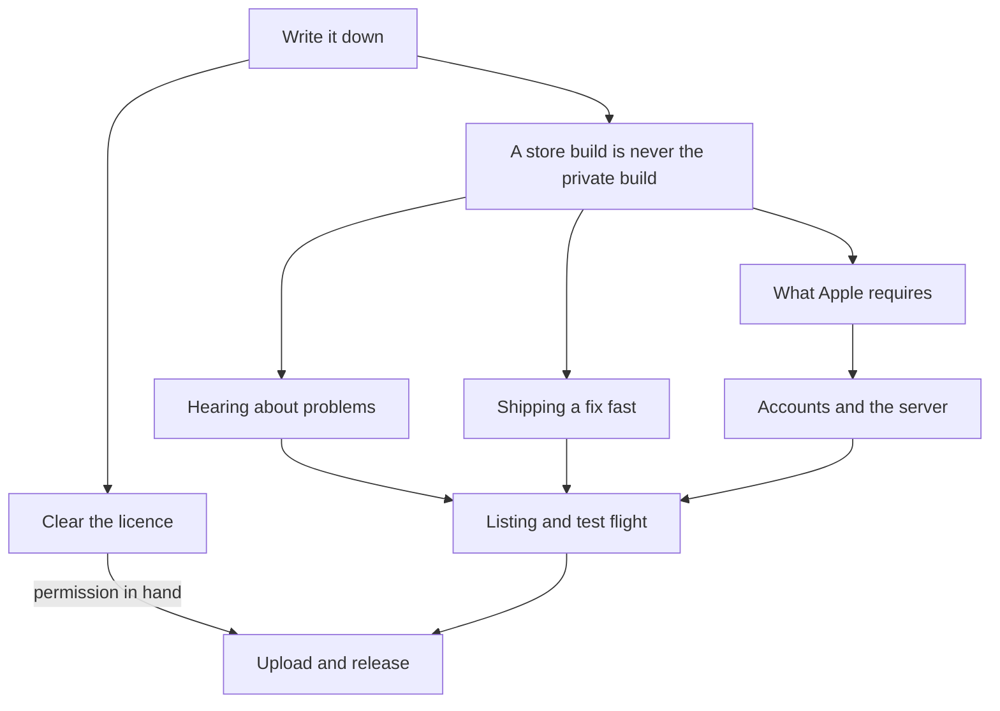

# What stands between Hifth and the App Store, and between a reader's problem and our fix?

*Written 2026-11-15, when the owner asked to harden the app before the App Store and to be ready
to hear about problems and fix them fast. The plan is `.claude/plans/launch-readiness.md`;
the goal and its numbers are `.claude/goals/app-store-launch.md`; what other teams check, with
sources, is [research.md](../research/app-launch/research.md).*

## The short version

- **What:** put Hifth on the App Store for iPad, iPhone and Mac, with optional sign-in, and be
  able to hear about a problem, find its cause and ship a fix within days.
- **What it changes for a hafiz:** the app installs from the store like any other, keeps working
  with no connection, and has a button to tell us when something is wrong. Nothing they write in
  the app leaves the device unless they choose to send it.
- **What blocks it:** two data sources' licences clash with Apple's store terms. We are asking
  both rights holders for written permission. Until they answer, nothing is uploaded; everything
  else goes ahead.
- **What makes fixes slow:** the web part is packed inside the app, so every fix is a new build
  through Apple's review (half are reviewed within a day). The only fast levers are a small
  settings file the app reads at launch, and a release path we have practised.

Each open item below has a row in the backlog (`docs/issues.json`, tagged `"launch": true`).

## Words used here

- **Hafiz** (plural *huffaz*): someone who has memorised the Qur'an.
- **The private build:** the one made for the pitch, with The Study Quran's notes. It never goes
  to the store.
- **The public build:** the one with no held text, the same as the public site.
- **Staged release:** Apple offers an update to a growing share of readers over seven days, and
  it can be paused. A pause does not take the update back from those who have it.

## What does the work look like, in order?

## Open questions, and what would answer each

### ① A build for the store could be the private build · **fixed**

The command that packs the web part into the app builds the private flavour unless told
otherwise, and nothing stopped an archive of it. A store build carrying The Study Quran's notes
would publish them.

*What answered it (2026-11-16):* the archive step now refuses anything but the public build, in
two places. Before anything else runs, it reads the one-word file the copy step leaves in the web
folder and stops if that does not say "public". Later, the check on the built release app reads
the same file from inside the app, the thing that would be uploaded, and also refuses a private
folder there whatever the file says. Tests try to archive a private build and watch it fail with
that message, not with the licence lock's.

*Still true:* building for the owner's own iPad keeps accepting the private build, as it must.
A private build for named testers, if that is ever chosen, would need a command of its own.

### ② No page names every source with its licence and a link back · **fixed**

The credits sat in the app's info panel and in our source files. Apple's reviewers and the rights
holders will both look for one place on the web that names them all.

*What answered it (2026-11-17):* a sources page on hifth.app, in English at /sources.html and in
Arabic at /ar/sources.html, linked from every page's footer. It names each source the app is built
on, what it gave, who made it, its terms and a link to its own page: the same list the app shows
in its info panel. A check holds both pages to the sources record row for row, and refuses a source
the licence file names that the page leaves out. The release refuses a folder missing either page.

*Still true:* the page goes live with hifth.app's first upload, which waits on the owner. The
check reads the licence file's short names only; a source it mentions only in prose is not caught.

### ③ The word-root data's owners have not given permission for the store · **blocked**

Their licence is the GPL, and its terms cannot sit beside Apple's store terms without the owners'
added permission. Only they can give it.

*What would answer it:* their written permission, kept in the repository. The owner sends the
email; the draft is email 1 in [store-permission-emails.md](store-permission-emails.md).

### ④ The tajweed colouring data's author has not given permission for the store · **blocked**

Its licence forbids the copy protection Apple puts on every store app.

*What would answer it:* the author's written permission, or leaving that data out of the store
build. The owner sends the email; the draft is email 2 in
[store-permission-emails.md](store-permission-emails.md).

### ⑤ Nobody has read the page artwork's own terms · **fixed**

The mus'haf page artwork comes from the King Fahd Complex. Its terms have never been read for a
store app.

*What would answer it:* the terms read, quoted in the source file, and the reading recorded here.

*Done 2026-11-17:* two researchers read the terms on their own and a third pass re-opened the
sources ([the combined write-up](../research/2026-11-17-store-terms.md)). The Complex allows free
use in websites and computer programs, inside and outside the Kingdom; only printing in the
Kingdom and importing for sale are held back. So a free store app may show the pages, with a
fairer credit. The credit now names the Complex first, says quran-svg converted and adapted the
pages, and says the Complex has not approved the app. The old line "commercial printing reserved
to the Complex" said more than the terms do, and is gone. The same words are in the app, the
source file and both hifth.app sources pages, and a test fails if the app's row loses any of
them. The page text was then traced to the Complex's own drawing files, not its font; only the
verse-number rings are still open: ㊺.

### ⑥ The recitation audio comes from another site with no licence note · **fixed**

*What would answer it:* that site's terms found and recorded, and the source added to the
citations page; or the recitation switched off in the store build.

*Read 2026-11-17* (same write-up as ⑤): Quran.com's terms allow personal use only, and showing
its content anywhere else needs written consent. Apple's rules ask for that permission on
request. So the store build has no right to stream the recitation today. The credit no longer
says "free to listen". What remains is the switch that leaves recitation out of the store
build, with a test that the store build holds no address of the recitation's server. The
private build keeps it. Getting it back into the store is route 2 in the write-up: register
with Quran Foundation, whose developer terms cover audio. The website is ㊻.

*Fixed 2026-11-17:* the store build now leaves the recitation out. It is built with the
recitation switched off, so no verse has a sound address, and no listen button, play option,
keep-for-offline offer, play setting or recitation credit shows. The copy into the app then
refuses any file that still holds the recitation server's address. The website and the private
build keep it. The review notes, the privacy answers and the hifth.app privacy page now say the
store apps fetch nothing.

### ⑦ The app has no privacy file · **fixed**

Apple refuses an upload without a privacy file, and refuses one that uses certain system features
(saved settings, file dates, the time since start-up, free disk space, the keyboard list) without
saying why.

*What answered it (2026-11-16):* the iPad, iPhone and Mac apps now carry the file. It says the
app tracks nobody, names no tracking address and collects nothing. This page used to say the
shell uses saved settings; a search of the shell's code found none of the five features, so the
file lists none. The web part keeps its settings in the web view's own storage, which Apple does
not count. A store build's release check fails if the file is missing, says the app tracks people,
names a tracking address, or lists a feature with no reason. Apple's own check of the file runs
on the first real archive, so it belongs to ⑪.

### ⑧ The Mac app is not sandboxed or signed for the store · **open**

The Mac store accepts only sandboxed apps signed by a paid team.

*What would answer it:* the sandbox on, the app signed by the team, and a walk of the Mac app
that finds nothing the sandbox broke (opening and saving files, links, the web part).

*Where it stands (2026-11-17), half answered:* the sandbox is on in the Mac Release build, which
asks only for the network and the files the reader picks. The release check now reads the Mac
app and refuses it if a permission is missing or one nobody chose is there. The walk found
nothing broken so far: a fresh first open lands on page 7 with no "Left off" ribbon, and the
recitation reaches the network. Saving, loading and links wait on a person's hands (the by-hand
list). The store archive is now made and signed by the team (owner's yes, 2026-11-17), and so
is its installer package; the same checks pass on the app inside each. Left: Apple's own check
of the package, which waits on the owner adding the Mac to the app's store record.

### ⑨ The iPad and iPhone app has no list of what it is allowed to do · **open**

Sign in with Apple and links from hifth.app that open the app both need it.

*What would answer it:* the file added, and a link on hifth.app opening the app on a device.

*Where it stands (2026-11-17, the owner said yes to both):* the iPad and iPhone app is signed
with a permissions file asking for Sign in with Apple and hifth.app links, and nothing else. The
store release check reads the signed app's permissions and refuses a missing one, a wrong one or
one nobody chose. The app takes a link to the reader on hifth.app and opens the same place the
site would; any other address is not taken.

The other half is a small file on hifth.app that tells Apple which links open the app. It has
to name the Apple team the app is signed by, so the release writes it from this laptop's
signing setup each time; the team's id is never written into the repo. The release refuses a
folder without it, the site serves it as JSON and never from a cache, and the look at the live
site after an upload checks that it answers directly, since Apple follows no redirect. The file
claims only the reader's addresses with a mus'haf place in them, the same ones the app takes,
and a test holds the two lists together.

Left: the file goes live with hifth.app's first upload, which the owner runs. Then a link has
to open the app on a real iPad; Apple can take up to about a day to read a new file. That
check is on the by-hand list. The team's id becomes public in that file, which is how Apple
asks for it; it is not a secret, but it is new on a public page. The Mac half waits on the
owner adding the Mac to the app's store record.

### ⑩ The version is fixed at 0.1.0, build 1 · **fixed**

Every upload needs a higher build number.

*What answered it (2026-11-16):* `make app-version` says the version and build number.
`VERSION=1.0.0` sets the version and raises the build number; `NEXT_BUILD=1` raises the build
number alone. A version lower than today's, or one Apple would refuse, is refused and nothing is
written. It lives in the new release skill, which the rest of the release joins as it is built.
Raising the build as part of the archive comes with ⑪.

### ⑪ The commands to make and upload a store build only print an error · **fixed**

*What would answer it:* a real archive and export that runs clean, and Apple's own check of it
(the privacy file from ⑦ included) passing, with the upload step still locked until ③ and ④
are answered.

*Where it stands (2026-11-16):* the archive is real. `make app-archive` makes an Xcode archive
of the public build, signed with the team's development certificate, and then runs the release
check again on the app inside the archive, since that is what would be uploaded. Its first run
passed: the public build, no walk capture, the privacy file in place. The archive stays on the
laptop, so it no longer waits on the licence answer; only the upload does, and the upload now
checks the licence before it builds anything. Tests hold both.

`make app-export` signs the archive for the App Store. The owner said yes to its first run on
2026-11-16, which had Xcode make the team's App Store certificate in the Apple account, and it
passed: the app inside the export is signed for distribution, is the public build, carries the
privacy file and has no private folder. The export stays on the laptop.

*2026-11-17:* the export and the upload now take only an archive `make app-archive` made. Once
every check has passed, the archive command writes a receipt beside the archive: the commit it
was built from, whether that work was all committed, and one fingerprint of every file in the
app. The export reads the receipt first, and the upload reads it again just before sending. An
archive made by hand in Xcode, an older one, or one with any file changed, added, removed or
renamed after the checks is refused. The archive left on the laptop from 2026-11-16 predates
the receipt and is refused, as it should be. On the real app (2,834 files) the fingerprint takes
under half a second.

*What answered it (2026-11-17):* Apple's own check passed on the first try, "no errors", on a
fresh archive and export of the public build. Whether the check counts as an upload was the
owner's call, item ㊷; the owner said yes the same day, since it makes no build anyone can
install, puts nothing in the review queue and uses no build number. `make app-store-check` runs
it, and refuses an export older than the archive's receipt. The upload command runs the same
check before it would send anything, and stays locked until ③ and ④ are answered.

Two things learned on the way. The export signs with Apple's online store certificate through
Xcode's own sign-in; the store key cannot, as it has no right to that certificate. That sign-in
expires, and the release setup check only sees that an account is listed, so an export stopped
by an expired sign-in now says in plain words to sign in again in Xcode's settings.

### ⑫ A recitation may be silent when the phone's silent switch is on · **fixed**

*What answered it (2026-11-16):* the iPad and iPhone app now tells the phone at launch that its
sound is media, which the silent switch does not mute, and spoken words, so a call or spoken
directions pause it instead of being talked over. Setting this starts no sound and leaves other
apps' music alone until a verse plays. A test on the Mac holds the choice, and the iPad app in
the simulator reports it back. The simulator has no silent switch, so hearing it on a real
device is on the by-hand checks list; if it turns out silent, this item reopens.

### ⑬ Nothing yet shows Apple's reviewers the app is more than a website · **fixed**

Apple turns down apps that only wrap a website. Hifth does more (it works offline, takes the
pencil, opens from links in other apps, saves files), but the review notes did not say so, and a
first launch with no connection had not been checked.

*What answered it (2026-11-16):* the review notes are drafted in
[store-listing.md](store-listing.md), and each claim in them names the test or code that holds
it. A browser test opens the app with every outside address refused and still sees a page drawn
and a verse selected. It found one outside request, on purpose: selecting a verse fetches its
recitation ahead so Play starts at once. With no connection that fails quietly and only the
sound is missing. A fresh install in the iPad simulator agreed: three pages drawn, every file
inside the app, and that one recitation request. The notes say so plainly. A first launch in
Airplane Mode on a real device goes in the store-build walk.

### ⑭ A link inside the app might open any website inside it · **fixed**

Apple's age questions ask whether the app can reach any page on the web. It should not.

*What answered it (2026-11-16):* it was already true, and now a test holds it. Only the app's
own pages and a blank page load inside it. Every other address leaves the app. Of those, only web
pages and mail open in the browser or the mail app; a file, a script, a phone number or another
app's address is dropped. A window the page opens goes the same way, and the web part has no
embedded frames. So the store answer to "can the app reach any web page" is no.

### ⑮ An error the page does not catch leaves a blank screen · **fixed**

Only one part of the page caught its own errors.

*What answered it (2026-11-16):* the whole page now sits inside one catcher. If any part throws
while drawing, the reader sees a card: the page stopped working, their notes and marks are kept
on this device, and a button opens the page again. A browser test breaks the built page on
purpose, sees the card, presses the button and sees the mus'haf come back. With the catcher taken
out, the same test saw an empty page, so it checks the real thing. Errors nothing else catches
are kept in memory, the last twenty, for the reader's own report; nothing is stored or sent. In
the apps, if the system ends the process that draws the page, the app loads it again instead of
staying blank, and a test holds that. The card also has the "Report a problem" button from ⑱.

### ⑯ Nobody has used the apps with the screen reader · **open**

*What would answer it:* a walk with VoiceOver on iPad, iPhone and Mac, its faults fixed with
tests, and the by-hand parts parked on the manual-testing list.

### ⑰ We cannot see crashes on readers' devices · **open**

*What answered it (2026-11-17):* a store build's crash never reaches Apple's server for us, so
the apps keep it themselves. After a crash or a freeze, Apple's system hands the app a short
report the next time it opens; the app keeps the last five, and the problem report lists them
under the errors, never the words the system wrote about the crash. A second command lists
what Apple's server does have: test builds' crashes, and every build's freezes and slow
launches. It never asks for a tester's comment or email.

*Still owed:* a crash forced on a test device shows up in the problem report and in that list.
That needs the first test build, and the upload key's ids saved.

### ⑱ A reader has no way to tell us something is wrong · **fixed**

*What answered it (2026-11-16):* a "Report a problem" button in the info panel and on the error
card. It shows the reader the whole report and the address it goes to, and only then offers to
open their own mail app with it filled in, or to copy it. The report names the app and version,
the build, the device, the screen, the language, the time and the last five errors. It never
holds their notes, marks or a list of the pages they read; a browser test puts a made-up note on
the device and checks it is not in the report or the mail. The [design page](report-a-problem.md)
has the picture and the reasons. Since 2026-11-17 it also lists the last steps by name (⑲).

### ⑲ The shell writes its log with bare prints, and the web part keeps none · **fixed**

*What would answer it:* the shell writes to the system log, the web part keeps a short log in
memory for the report, and each line carries the app version and the build's commit.

*Done 2026-11-17:* the page keeps the reader's last twenty steps in memory, by name only ("turned
to another page", "chose a verse", "opened a link"), with repeats folded into one line and a
count. The report shows the last ten. No step says which page or verse it was on; a test checks
the pages turned to never reach the report. The apps write their own lines to the system log,
where Console on a Mac and a device's shared diagnostics can read them, and every line starts
with the event, the version and the build's commit. The first line of each run says the app
opened. The walk and probe tools still print, on purpose: they are only in test builds and the
laptop's scripts read what they print. The [design page](report-a-problem.md) says what a step
is and why it carries no page.

### ⑳ There is no support page · **fixed**

Apple requires a support address with working contact details.

*What would answer it:* a support and known-issues page at hifth.app/support, linked from the
app, with its own entry in hifth.app's safety settings, which list each page by name. (Takes
over the landing page's support-page row.)

*Done 2026-11-17:* hifth.app/support in English and Arabic says where to write, how to send a
problem report from the app (naming the buttons by the words the app shows; a test fails if one
is renamed), the problems we know about, and what happens to a reader's marks. Every page of the
site links it, and a release missing it is refused. It goes live with hifth.app's first upload.
The app's info panel links it and the privacy page since the same day (item ㊸).

### ㉑ Once a bad version is out, we cannot stop it or warn readers · **fixed**

The store has no undo, and a pause only stops an update spreading.

*What would answer it:* a small public file at hifth.app that the app reads at launch, with the
lowest version still allowed, a message to show, and switches for risky features. With no
connection the app carries on as before. A test changes the file and sees the message.

*Done 2026-11-17:* the iPad, iPhone and Mac apps ask hifth.app for `app-status.json` once each
launch, after the page is up, so it never slows the first page. The request sends no cookies and
nothing about the reader; the app compares versions itself. The file can ask readers below a
lowest version to update, show a short notice in English and Arabic (which the reader can
close), and switch off writing with the pencil or links from other apps. With no file, a broken
file or no connection, the app carries on as before. The release refuses a file the apps could
not read, and a lowest version above the one being shipped, so the file can never tell every
reader to update to a version that does not exist yet. The privacy page says what is asked for,
in both languages. What it cannot do: fix a bug itself, reach a reader with no connection, or
reach the browser version, which does not read it. The real drill, changing the file and
relaunching, waits on hifth.app's first upload; until then the tests use a made-up file.

### ㉒ There is no one command to release, and no written fix-in-a-hurry page · **fixed**

*What would answer it:* one release command, from version to a checked build, and a page that
says how to reproduce, patch, build, upload and ask Apple for a faster review, with the request
text ready to paste.

*Fixed 2026-11-17:* `make app-release VERSION=…` (or `NEXT_BUILD=1`) now runs every step from
the setup check to Apple's own check, in order. It refuses work that is not committed, stops at
the first step that fails and says how to carry on, and ends before the upload while the
licence keeps it locked. The fix-in-a-hurry page is in the processes skill, with the request
for a faster review ready to paste and what pausing a staged release can and cannot undo,
checked against Apple's own pages. It has been run as a dry run; a real run raises the build
number, so it waits for the first real release.

### ㉓ A bad publish of the site cannot be put back · **blocked**

*What would answer it:* a "put the previous release back" command in the site-publishing skill,
tested by publishing, putting back and checking the live commit.

*Built 2026-11-17:* `make hifth-app-put-back` points hifth.app at the upload before the live one,
then checks the live app carries that upload's commit. Cloudflare keeps every upload, so nothing
is copied and it takes seconds. It is tested against a made-up Cloudflare. Against the real
account, its list found the site with no uploads yet, so the real drill (publish twice, put back,
check, publish again) waits on the first upload.

### ㉔ The browser version never says a new version is ready · **fixed**

A page cached from before an update can ask for files the update removed, and break.

*What would answer it:* a "new version ready" prompt, the previous release's files kept for one
release, and a test that loads an old page after an update.

*Fixed 2026-11-17:* a new release of the browser version now waits instead of taking over. The
line above the page says "A new version of Hifth is ready", and Reload starts it on the same
page; the reader's marks stay as they are. Hiding the line lasts the visit only, and a juz
already lost from the phone is still told first. Other open tabs are told once one switches,
never reloaded under the reader. Each hifth.app upload first copies the live release's script
and style files into the new one, so a page left open from before still finds them, and the
upload stops rather than go ahead if any of them will not come. A browser test makes a new
release, sees the line, presses Reload and checks the new version is running; it fails on the
build from before. The very first upload has nothing live to keep, so it runs with
`ARGS=--no-carry`; the real check of the kept files is the second upload. The store apps do not
need any of this: their pages are packed inside them.

### ㉕ A test that passes only on its second try still counts as a pass · **fixed**

*What would answer it:* the push reports every test that needed a second try, so each one is
fixed rather than hidden.

*What was built, 2026-11-18:* after every browser run in the push, pass or fail, the push now
prints each test that failed first and passed on its retry, with its browser, its file and line,
and what went wrong the first time. It keeps a short history on the laptop, so a test that keeps
needing a second try says how often ("3 of the last 20 runs"), and `make second-tries` lists the
worst ones. The push still passes or fails on the tests themselves. The testing skill says what
to do with a name. The first push to try it named two tests, and both are fixed: the Back
button's tests in Firefox, and the look-alike chips beside a magnified page.

### ㉖ Sign-in is not built yet · **open**

The sign-in page sets out what sign-in unlocks first, where reader accounts live, and whether a
reader's copy is locked so we cannot read it. The owner settled all three (2026-11-17 and
2026-11-18): the reader's marks follow them; accounts are kept by our own small code on
hifth.app's Cloudflare account with its free database; and the copy is not locked at first, with
the button saying we could read it.

*What would answer it:* sign in with Apple through Apple's own sheet, built as the sign-in page's
steps lay out.

### ㉗ A reader could not delete their account inside the app · **open**

Apple requires it for any app with accounts, and the deletion must also cancel the Apple sign-in.

*What would answer it:* a "delete my account" button that removes the account and everything
stored with it, cancels the Apple sign-in, and says when it is done; and a place to see what is
stored. Waits on ㉖.

### ㉘ Nothing that holds reader data is backed up, and no restore has been tried · **open**

*What would answer it:* a backup on a schedule, kept off the database's own host, a message when
one fails, and a restore into a scratch database with its rows counted.

*Built 2026-11-19, still open:* `make hifth-app-backup` copies the list (and accounts, once
sign-in is merged) to this laptop. Each copy is checked whole, with its rows matched against a
count asked of the store itself. The copies are kept owner-only outside any repo, with the newest
30 runs kept. Only readers' rows are copied: the site's key and sign-in sessions stay out.
`make hifth-app-backup-drill` practised the whole round trip on made-up rows: 3 people on the
list, and 2 accounts with 1 Apple ticket from the sign-in branch's tables. Each was put back into
an empty database and counted. `make hifth-app-backup-status` says how old the last copy is.
Every table in each store is named as copied or left out, with the reason, and a copy stops on
a table that is on neither list. A practice with a made-up extra table was refused by name. The
steps for putting a real copy back are in the deploy-site skill.

Left, and waiting on the owner:
- the first real copy, which needs the database password in the saved keys (the session address
  on port 5432, not the pooler on 6543). It is also the first run of the real path, so it runs
  with the owner watching;
- where copies live (this laptop only, or also a second place), and how long they are kept,
  because a reader who leaves the list stays in older copies until those are pruned;
- whether copies are locked with a password;
- switching the schedule on, which will also add the "too old" warning at session start.

### ㉙ The apps have no privacy policy of their own · **fixed**

The privacy pages cover the notify-me list only.

*What would answer it:* a policy that says what stays on the device, what an account stores, what
the recitation fetch sends, and what a reader's report holds, linked from the app and the store.

*Done 2026-11-17:* both privacy pages now cover the apps: what stays on the device, the recitation
fetched from Quran.com's library, what the problem report holds and never holds, Apple's opt-in
crash reports, and that there are no accounts yet (the page will say what an account stores
before sign-in opens). A test keeps the English and Arabic pages to the same sections. Apple's
privacy file inside the app is settled with the store's questions ㉚.

### ㉚ The store's questions are not answered yet · **open**

Privacy labels, age questions, the export question, the EU trader question, the description and
the review notes.

*What would answer it:* every answer drafted in the repository, the EU trader answer from the
owner, and the labels checked against what the app really sends.

*Drafted 2026-11-17* on the [listing page](store-listing.md): the name, subtitle, keywords,
promotional line and description in English; the category (Education, then Reference); the
privacy answer, "Data Not Collected", with why each thing that leaves the device does not count
under Apple's definition; the age answers, giving 4+; the export answer; the support and privacy
addresses. `make app-store-listing` checks every field against Apple's limits and against the
app's name, category, privacy file and export setting, with a test that breaks each one in turn.
Writing the privacy answer showed the policy did not say the sound is asked for before Play, so
both privacy pages now say so and name the setting that stops it, held by a test. **Still open:**
the EU trader answer, the price and the copyright line (the owner's); the "rights to the content"
answer, which waits on the permissions; the listing in Arabic.

### ㉛ There are no screenshots at Apple's sizes · **fixed**

*What would answer it:* a command that takes the public build's screenshots at Apple's iPhone,
iPad and Mac sizes, in English and Arabic.

*What answered it (2026-11-17):* `make app-store-shots` takes 32 pictures of the public build
(iPhone 6.9 and 6.3 inch, iPad 13 inch, Mac; English and Arabic), refuses the private build, and
refuses any picture of a size the store does not take. Two faults found on the way are fixed with
tests: the Mac window opened at the wrong height (written up in
`docs/issues/mac-store-shot-window-size.md`), and a picture run read the laptop's own saved
reading place, so the Mac pictures showed a "Left off" ribbon; a picture run now starts from an
empty, throwaway store. Every picture was looked at. The strip where the clock and battery sit,
empty at first on the iPhone pictures, now shows them (㊹).

### ㉜ Nothing reads what readers write about the app in the store · **fixed**

The owner made one App Store Connect key for this, `hifth-reviews` (Customer Support, Finance
and Marketing), on 2026-11-16. One key, two skills: this one and ㉝.

*What answered it (2026-11-17):* the store-feedback skill. One command keeps every review in a
folder git ignores, since reviewers' names and words never reach the public repo, and prints
only counts. An answer is drafted there, and is sent only after the owner says yes to those
exact words: if the words change after the yes, it refuses and asks again. Run live the same
day: Apple let the key in and listed no reviews, which is right before the first release.

### ㉝ Nothing counts downloads and sales · **fixed**

*What answered it (2026-11-17):* the store-numbers skill. One command fetches Apple's daily
download reports with the same key into a folder git ignores, and another counts first
downloads, updates and downloads again, by device and country. It has not fetched a report
yet: that needs the vendor number, a number only the owner can copy from App Store Connect.
Until it is saved, the command stops and says which setting is missing.

### ㉞ The release page and the setup check know only the upload key · **fixed**

*What answered it (2026-11-17):* the release page names both keys and what each is for, and
says where to find the vendor number. The setup check confirms the reviews key's file is in
place, that its ID is saved, and that it is not the upload key, and says whether the vendor
number is saved. It prints states only, never a key, an ID or the number, and neither of the
two ever holds a release back.

### ㉟ Nobody has walked the store build as Apple's reviewer would · **fixed**

The first walk, on 2026-11-17 on an iPad simulator with the Release build, found three things
and fixed them: the review notes' steps described a row of links an iPad never shows; the
tajweed badge said "beta" and three settings said "A rough build to try", which Apple's rule on
betas and demos turns down; and the problem report did not name the device.

*What would answer it:* the same walk on the iPhone and the small iPhone, a first launch with no
connection, swipe page turns, rotation, split view, larger text, and the Mac by picture. The
steps are in the walk-app skill's checklist, under "The store build, as Apple's reviewer".

*Walked 2026-11-17, the same day, on the Release build.* A fresh first open on the iPad, the
iPhone and the small iPhone opens page 7, with no "Left off" ribbon and nothing read aloud. A
first launch with no connection is held by the browser test that refuses every outside request,
and the app serves its own files. On its side the iPad shows two pages with nothing spilling. A
finger swipe turns the page forward and back on both phones. Split view found one fault: the
English top bar does not fit at 320 px ㊶. The largest system text size changes nothing in the
app, which is now part of the accessibility item ⑯. The Mac's fresh first open waits for the
Mac sandbox ⑧: no Mac store copy exists before it, and the laptop's copy keeps earlier saved
data.

### ㊱ The store copy still answers the walk tools' launch settings · **fixed**

Only someone starting the app from a Mac can set them, so no reader or reviewer can reach them.

*What would answer it:* the archive step leaves them out, and the release check refuses an
archive that has them.

*Fixed 2026-11-17.* The archive step now builds with a store switch that leaves out the page
probe, the walk of steps, the picture, the forced light or dark look, and the page and language
a test starts the app at. A plain Release build keeps them, because the reviewer walk drives
one. The check on the archive refuses one that still has the long setting names; it found all
six in the archive made before the change. The page and language names are too short to find
in a built app, so a test reads the app's code instead and refuses any read of a launch setting
the store build would keep. The Mac app is not archived yet; when it is, it takes the same
switch.

### ㊲ Should the store build show the tajweed colours at all? · **open**

Its data's permission (④) is not in hand, and its badge says "unchecked". Leaving it off takes
one permission off the upload's path; leaving it on keeps a feature huffaz use. The owner's
call.

### ㊳ A "Left off" ribbon appears on the first open, though nothing has been read · **fixed**

*What would answer it:* no ribbon until the reader has turned a page, with a test.

*Fixed 2026-11-17.* The fix found a worse fault behind this one. The app opens on the same page
at every launch, so a reader who left off on page 110 lost that place after six seconds of
looking at the first page. Now the page the app opens on by itself is not taken as a place until
the reader turns a page or follows a link. A saved place still shows where it was.

### ㊴ In English, the sources list still names its sources in Arabic · **fixed**

*What would answer it:* an English name beside each source's own, with a test.

*Fixed 2026-11-17.* With English chosen, each source keeps its Arabic row and gains a smaller
English line under it: what the source gives the app, who made it, and its terms. The English
words live in the sources record beside the Arabic ones, and the check that binds the screen
to that record now covers them too, including the rule against a "non-commercial" claim the
record has not signed off. Tests in the panel, in the check, and in a real browser.

### ㊵ Nobody has seen a problem report arrive · **open**

The address has mail servers, and the report card offers Copy when there is no mail app.

*What would answer it:* one test report sent from the simulator and seen in the inbox.

### ㊶ In English, on a 320 px phone, the top bar spills off the screen · **fixed**

Found while fixing the Arabic tag's fit. In English at 320 px wide the row needs 333 px in
Chrome's engine and 337 px in Safari's, so the ⓘ button is cut off at the edge. The line under
the name breaks onto two lines, and the bar grows from 69 to 82 px. Two reasons: the tajweed
button is 70 px wide in English and 49 px in Arabic, and "Navigation for huffaz" is much wider
than its Arabic.

It hits the website on the oldest small phones. The store app needs iOS 17, so its phones are
at least 375 px wide, but it still reaches the store app on an iPad: the app does not ask for
the whole screen, and when a reader puts it beside another app in a third of the screen, the
window is 320 px wide on every iPad but the largest. (First written as "website only"; the
reviewer walk found the iPad case on 2026-11-17.)

Tried on the live page: a smaller "unchecked" tag alone fits the row at exactly 320 px in
Chrome, with nothing to spare, and the bar is still 82 px tall. A shorter line under the name
alone fixes the height but not the spill. Both together just fit in Chrome and would still
spill in Safari.

*What would answer it:* a narrow-phone layout for the English bar that fits in both engines
with room to spare.

*Fixed 2026-11-17.* In English, on any screen 440 px wide or less, the line under the name is
left out; checked every 5 px, it had wrapped not only at 320 to 380 px but again at 405 to
415 px. Below 360 px the mus'haf button steps aside too, and the info panel gained "Choose the
mus'haf", so the picker is still one step away. The bar is now 69 px with nothing spilling at
every width from 320 to 520 px. The top-bar test runs in English with no known-fault mark, also
at 340 px (the narrow side of iPad split view), in both engines, and a second test opens the
picker from the info panel at 320 px. The name button keeps its spoken name, so a screen reader
still hears "Navigation for huffaz".

### ㊷ May the app be sent to Apple for its check before the licence is answered? · **answered**

*Answered by the owner, 2026-11-17: yes, check now,* so the store-only faults are found early and
the rest of the launch work can be done backwards from a passing check. The lock now reads "no
build anyone can install, and nothing in Apple's review queue", not "nothing leaves the laptop".
The check makes no build in the store's listing, nothing a tester or reviewer can see, and uses
up no build number, so it cannot make the later review harder; passing it also does not mean
the review will pass, since a reviewer judges what the app does, not its packaging.

Apple can check an exported app (its signing, its icons, its privacy file, its permissions)
without it becoming a build anyone can install. That catches a refusal weeks before the real
upload. But the check sends the whole app to Apple's servers, and the upload lock (③ ④) was put
there so the app, with the data whose licence is still being asked about, goes nowhere outside
this laptop until the rights holders answer.

| choice | what it buys | what it costs | what it commits to |
|---|---|---|---|
| Check now | Apple's refusals found weeks early, while the licence wait runs anyway | the app reaches Apple's servers before the licence answer | the lock is read as "no build anyone can install", not "nothing leaves the laptop" |
| Wait for the licence answer | the lock means exactly what it says | Apple's refusals are found only on the first real upload | nothing; the check runs the day the lock opens |

*What would answer it:* the owner's choice, written into ⑪.

### ㊸ The app does not link the support and privacy pages · **fixed**

hifth.app now has a support page and a privacy page (⑳ ㉙), but nothing inside the app leads
to them. Apple asks for the privacy policy to be linked inside the app as well as on the store
listing, so a reviewer who looks for it in the app and cannot find it can turn the app down.

*What would answer it:* two links in the info panel, to the support and privacy pages in the
reader's language, with their words in each language's message list. Inside the iPad and Mac
apps they need hifth.app's full address, since only web addresses leave the app. A test fails
if either link goes missing.

*Done 2026-11-17:* under "Report a problem" in the info panel sit two links, "Help and support"
and "Privacy policy", each opening hifth.app's page in the reader's language (the Arabic copy
for an Arabic reader) in the browser. They carry the full hifth.app address everywhere, so they
work inside the iPad and Mac apps and on a copy of the app served from anywhere else. They show
on the settings page too. Tests fail if either link goes missing, points at the wrong language,
or loses its full address inside the apps, and a browser test fails if the two links and the
report button are drawn touching (they were, on the first build). Looked at in Chrome at 1280
and 390 wide in both languages, and the browser test runs in Chrome, Firefox and the iPhone's
Safari engine. Not yet looked at inside the iPad app itself. The pages answer once hifth.app's
first upload is made.

### ㊹ The iPhone store pictures have an empty strip where the clock and battery sit · **fixed**

Found while looking at the pictures ㉛ takes. The app photographs its own page, so the strip at
the top of an iPhone picture, where a real phone shows the time and battery, is one flat band.
Apple takes the pictures as they are, but they look less finished than a phone in a hand.

*What answered it (2026-11-19):* on the iPhones and the iPad, the store pictures are now of the
whole simulator screen. The simulator's clock is set to Apple's usual 9:41, with full signal and
a full battery, and put back afterwards. The app still takes its own picture first, as the sign
the page is ready and settled, then stays open while the whole screen is photographed. The check
at the end now refuses a phone or tablet picture whose top strip is one flat colour, and names
one whose pixels it cannot read. Tried on the 6.9 inch iPhone and looked at: the time, signal,
Wi-Fi and battery sit above the Hifth bar. The first try showed a charging bolt on the battery,
so the battery is now set as full and unplugged, the way Apple's own pictures show it.

### ㊺ Where did the verse-number rings on our pages come from? · **open**

Found by the third pass on the terms (⑤). The Complex's free-use terms cover its digital
mus'haf. Its fonts carry a stricter licence: no changes without written approval. Our record of
the page files called them shapes from the font, and the files we pinned in July do not say where
they came from. If our pages came from the font, ⑤'s answer becomes "needs permission".

*Answered for the text, 2026-11-17:* the page text comes from the Complex's own drawing files,
not its font. quran-svg's first note (February 2026, before our pin) names the Complex's
Illustrator files as its source, and no note of theirs ever mentions a font; the "font" wording
was ours. Then we checked it ourselves on pages 2, 7, 300 and 604. We laid each page as we
pinned it over the same page in the Complex's free 1441H Hafs drawing files, with no fitting or
nudging, and every letter landed in place. The drawing files hold no font at all; every letter
is already a drawn shape. So the text is under the digital mus'haf terms we already credit.

*Still open: the verse-number rings.* quran-svg says it redrew them, and they do not match the
Complex's own. Each is drawn the way a font's letter is, and quran-svg does not say where they
came from. If they come from the Complex's font, the strict licence covers that one small
decoration.

*What we found, 2026-11-18:*

- **The numbers inside the rings are the Complex's.** They landed in place with the text.
  Only the ring around each number is in question.
- **The ring is not the end-of-verse sign from the font quran-svg's notes mention** (the
  Douri font's): its outline has a different size and shape. Its source is still not named.
- **quran-svg's newer pages swap the ring for one taken from the Complex's page fonts.**
  That is the strict licence, so moving our pin forward would make the question worse. We did
  not.
- **Every page has exactly one ring per verse number**: 6236 of each across all 604 pinned
  pages. Pages 1 and 2 draw each ring twice, one on top of the other, and smaller.
- **The Complex's own drawing files have a pale green medallion at each verse end, where our
  ring is.** One medallion, taken from page 7's drawing file, placed from each verse number by
  one straight-line rule, lands on the drawing's own medallion as closely as an exact copy
  does. We checked pages 1, 2, 7, 176 (a prostration verse), 177 (a surah heading), 300 and
  604. On each, about 5% of our green falls off the drawing's, which is the same 5% that two
  renderers drawing the very same file disagree by. Pages 1 and 2 need their own rule and a
  smaller medallion (0.81 times). Pages 176 and 177 were not used to make the rule.
- **So the copy step would need no drawing files.** It needs only that one shape, the page it
  came from with the file's fingerprint, and the two rules. The 466 MB of drawing files stay
  out of the repo.

*What would answer it:* the owner picks the look. Either the Complex's own medallion (pale
green, as in its printed page, from its free-use drawing files), or a ring we draw ourselves.
Both remove the unnamed source. The copy step then swaps the ring as a declared, checked step,
every page is copied again, and the page pictures the tests compare against change, which the
owner sees before they are replaced. The scripts behind every number above are in the
mushaf-reference skill's scripts folder.

*Built, switched off, 2026-11-18:* the swap is now a step in the copy step, with a switch in the
page record that picks the ring we have today, the Complex's medallion, or our own ring. It is
set to today's ring, so no page has changed. Every copy now counts the rings (6248, the doubled
ones included), and with a swap on it also checks that each ring sat on its own verse number and
that every one was replaced. Run through the real copy step on the same seven pages, the
medallion lands as closely as before (5.4% to 6.0%), and by eye each number sits on top of its
medallion with none run together. Our own ring was looked at the same way. Once the owner picks,
what is left is flipping the switch, copying every page again and showing the owner the changed
page pictures.

### ㊻ Should the website keep playing the recitation? · **open**

Quran.com's terms (⑥) cover the website as much as the store app: personal use only. The store
build leaves recitation out; the website at hifth.app/read still streams it. Whether to switch
it off there too, or keep it while route 2 is built, is the owner's call. It does not hold up
the store upload.

*What would answer it:* the owner's choice, recorded here and in the source file.

### ㊼ Our copy step moves some words off where the Complex drew them · **open**

Found by the check behind ㊺. When we copy the pages in, we shrink each file by rounding its
shapes to one decimal place and rewriting its curves. On most pages the result is a hairline.
On some it is not: on page 604 whole lines sit about 2 of the page's 345 units off, and the
letters change shape a little too. Laid over the Complex's drawing, 28% to 56% of the ink
differs across the four pages checked, where the pages we pinned differ almost nowhere. It is
our change to the Complex's artwork, and a reader comparing with a printed copy could notice
it on those pages.

*What would answer it:* a test that draws each copied page over the page we pinned and sets a
ceiling on the difference, then a copy step that keeps more precision (or leaves the curves
alone), checked by that test. Every page is copied again, so the marks drawn on the page must
be checked against the new pages too.

*Measured, 2026-11-18:* rounding to two decimal places instead of one removes the drift. On
page 7 the copied page then differs from the pinned one by about 3 pixels, and on page 604 by
about 2; at
one decimal place it was about 43,000 and 45,000. Three places gains nothing more. The cost is
size: page 7 grows from 40 KB to 66 KB as sent over the network, so all pages together grow by
about 1.6 to 2 times. Whether that size is worth it is the owner's call. It rides with the ring
swap (㊺), since both copy every page again.

### ㊽ A link to a verse the app cannot find does nothing at all · **fixed**

Found while building ⑨. Once hifth.app links open the app, a mistyped verse in one reached the
app and was dropped without a word: the app stayed where it was, and the reader could not tell
the link had done anything. The website did the same with a link it could not read.

*Where it stands (2026-11-19):* fixed. Such a link now shows one line under the top bar, "This
link does not point to a page or verse", with Hide. The reader stays on the page they were
reading. In the app, the link is handed to the page instead of dropped; a link that names no
place at all still only opens the app. The browser tests cover the line on a computer, a phone
and Firefox, in English and Arabic, and the app's own tests failed with the old code put back.

### ㊾ The bars, buttons and panels stay the same size when the phone's text is made larger · **open**

Found on the reviewer walk (2026-11-17), split out of ⑯ on 2026-11-19. With the iPhone SE set
to its largest text size, nothing outside the page grew. The page has its own size control, but
a reader with weak eyes cannot grow the controls around it. Apple's accessibility questions in
the store ask about this, so the answer has to match what the app does.

*Where it stands (2026-11-19):* open. Next, build the main ways roughly (follow the phone's size
everywhere, only in the panels, or a size setting of our own) so the owner can choose with a
hand on each.

### ㊿ Some screens have never had the automatic accessibility scan · **open**

Split out of ⑯ on 2026-11-19. The scan runs on the page, a chosen verse, the look-alikes list,
the record, the shelf, the tips and the info panel, in Arabic and English, on the phone
browsers. It has not looked at the bookmark drawer, the note box, the mistake picker, the
drawer's tools, the account section once opened, or the computer layout.

*Where it stands (2026-11-19):* open. Notes and mistakes open only in the computer-layout
tests, so the scan needs a run there too.

## Which of these could get the app turned down, and which matter once readers have it?

Sorted on 2026-11-17, after the first walk as Apple's reviewer. Open items only.

- **Stops the upload itself** (nothing goes to Apple until these close): the licence items ②
  ③ ④ and where the verse-number rings came from ㊺ (the page text is settled). (The archive, the export and Apple's own check ⑪ are
  fixed; only the upload command itself waits on these. The citations page ② is built, the
  artwork's terms ⑤ are read, and the store build leaves the recitation out ⑥; those rows
  closed.)
- **Can get the app turned down at review:** the Mac sandbox ⑧ and the iPad and iPhone
  permissions file ⑨ (the upload checks both); the store's questions ㉚ and screenshots ㉛;
  sign-in ㉖ and deleting an account ㉗ (once sign-in ships, deletion must be in the app); the
  tajweed question ㊲ (it can read as unfinished). (The reviewer walk ㉟, the walk tools'
  settings ㊱, the English top bar at 320 px ㊶, the support page ⑳, the privacy policy ㉙
  and the app's links to both ㊸ are fixed.)
- **Matters once readers have it** (Apple will not check these, readers will): the screen
  reader ⑯, larger text ㊾, the screens the scan has not seen ㊿, readers' crashes ⑰, the app's log ⑲, the off-switch ㉑, the release command ㉒,
  the site's undo ㉓, the "new version" prompt ㉔, the retry report ㉕, backups ㉘, store
  reviews ㉜ and numbers ㉝, both keys on the release page ㉞, a report seen to arrive ㊵,
  whether the website keeps the recitation ㊻, and the words our copy step moves ㊼. (A link
  to a verse the app cannot find ㊽ is fixed.)

## What does this leave alone?

- The pitch build and its walk: the pitch goal still governs them.
- Sending a build to named testers: that is its own open item on the native-shell page.
- The first upload of hifth.app: the landing-page work owns it.
