# How should the calendar show a day?

*Asked 2026-11-12, from the owner's comment on the front page: the calendar should be more appealing to look at. Today every day you opened anything is the same flat colour, so a day of two verses and a day of forty-five look alike. There are now four looks, all built into the app; the fourth, dots, was added 2026-11-13 from the owner's picture of the Mac's menu-bar calendar. Pick one in the info panel under "How the calendar shows a day", use it for a while, then tell Claude which one.*

> [!tip] Recommended
> **Shades.** It answers "which days were light?" before you read a single number, and it keeps the month as short as it is today, so the day you tap still shows below it without scrolling. Rings look the most like a status widget, but they make the month a row taller on a phone.

Until you pick, the app uses **shades**.

---

## A few words, defined once

- **The record** — the sheet that opens from the book icon at the top, "What you have opened". It has three views: Map, Month and Days.
- **A day's step** — how much you opened that day, in four steps: a few verses (1–4), about a page (5–14), up to two pages (15–29), more (30 or more). A page of the mus'haf is about fifteen verses.

## What changes for a hafiz?

> [!important] For a hafiz mid-revision
> Revision lives on not letting days go thin. A month where a light day looks the same as a full one hides exactly that. Each look makes the light days stand out from the full ones at a glance. Shades, rings and cards keep the red number on a day (mistakes marked); dots swaps it for a small red ring, and the count shows when you tap the day.

## The four looks, side by side

A made-up month on a phone, today's look first:

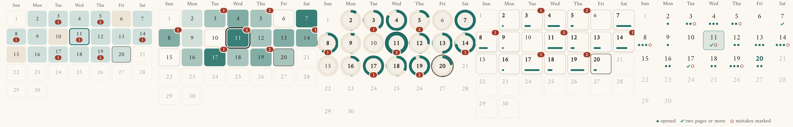

| | Today | Shades | Rings | Cards | Dots |
| --- | --- | --- | --- | --- | --- |
| Phone | 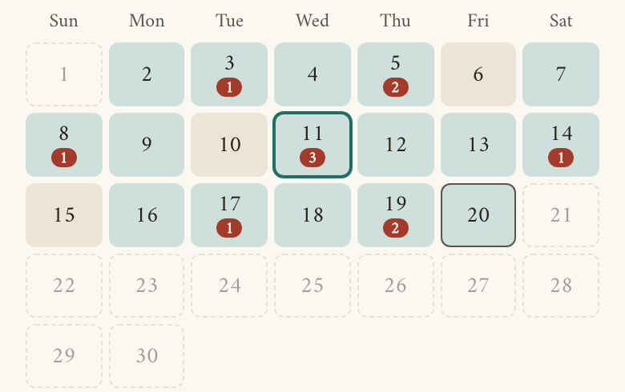 | 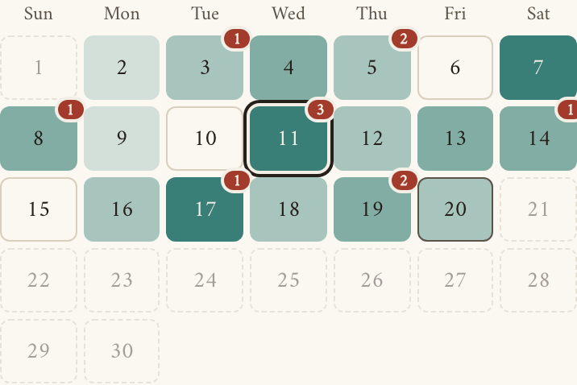 | 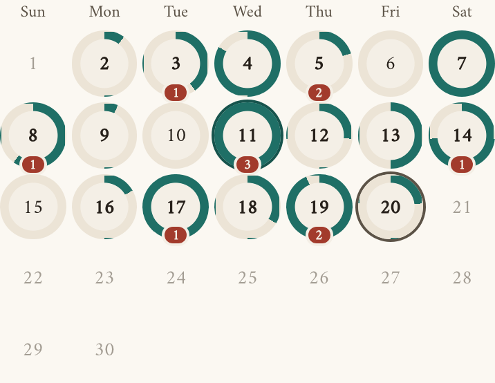 | 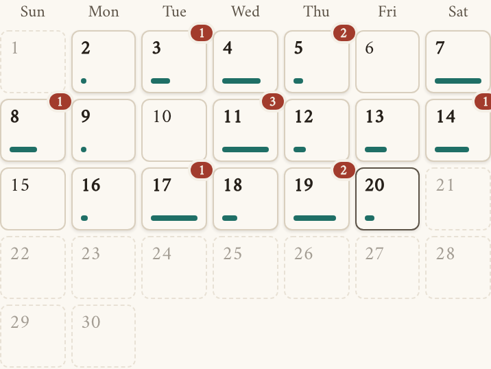 | 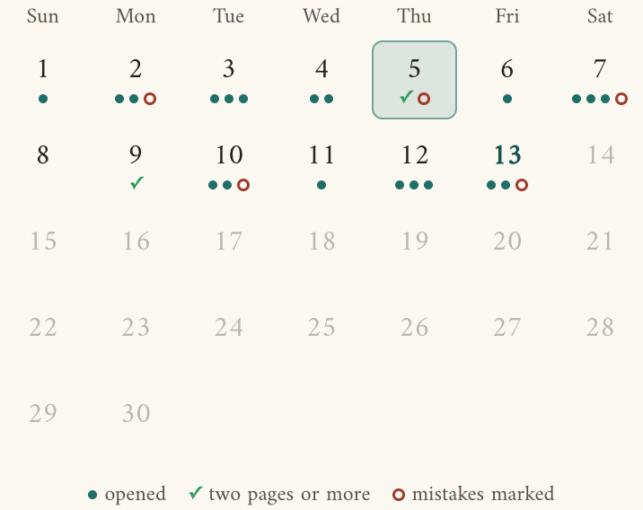 |
| How much was opened | Not shown; every day is the same colour | The deeper the teal, the more you opened | A ring round the date fills; full at two pages | A bar along the bottom grows; full at two pages | One to three dots under the date; a green tick at two pages |
| Mistakes | A red number under the date | A red number in the corner | A red number under the ring | A red number in the corner | A small red ring after the dots; no number |
| Height on a phone | Same as today | Same as today | One row taller | A little taller | A little taller, plus a one-line key under the month |
| *For a hafiz* | A light day hides among full ones. | Light days stand out at a glance; the exact amount is four steps, not a count. | The most exact at a glance, and the most like a phone's activity rings. Busier to look at. | Calm and tidy; the bar is small, so how much is the last thing you notice. | The calmest: the month reads like the calendar on your Mac or phone, and a mistake day stands out by its red ring. The count waits for a tap. |

> [!note]- The whole sheet, on an iPad and a computer
> | | Shades | Rings | Cards | Dots |
> | --- | --- | --- | --- | --- |
> | iPad | 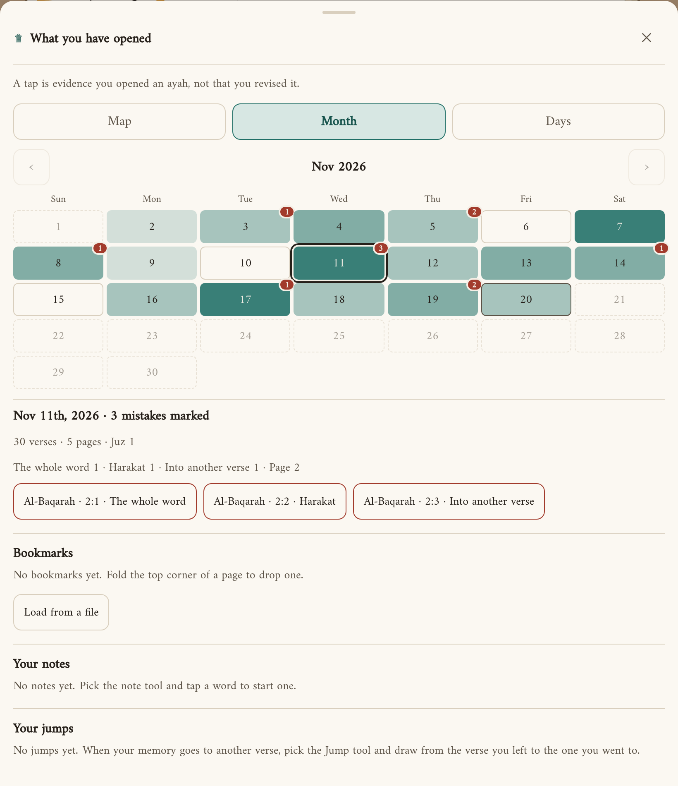 | 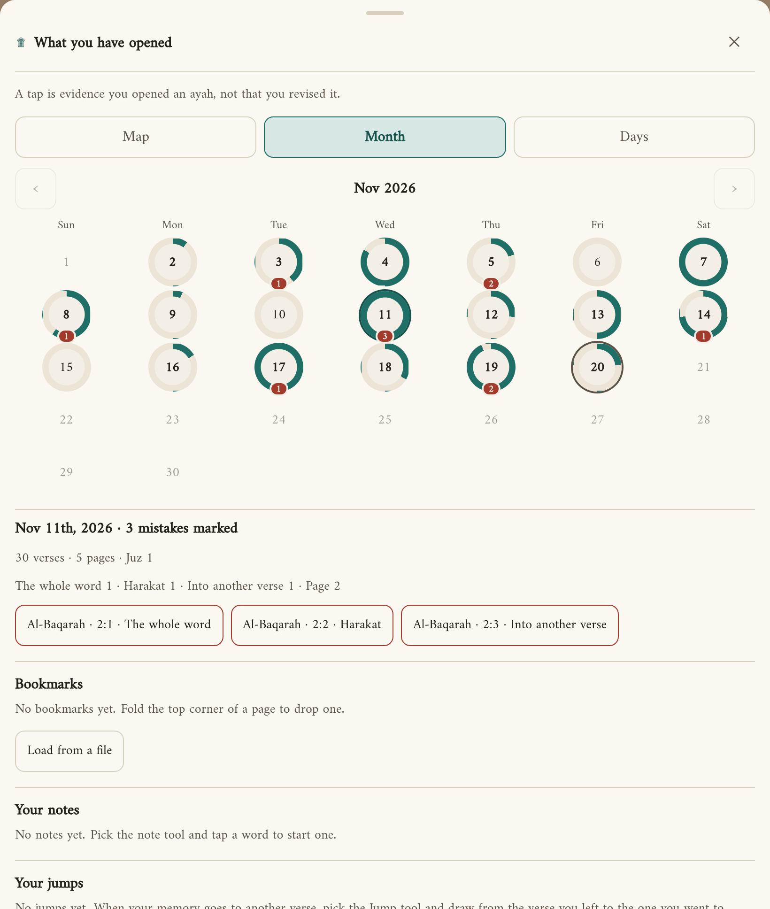 | 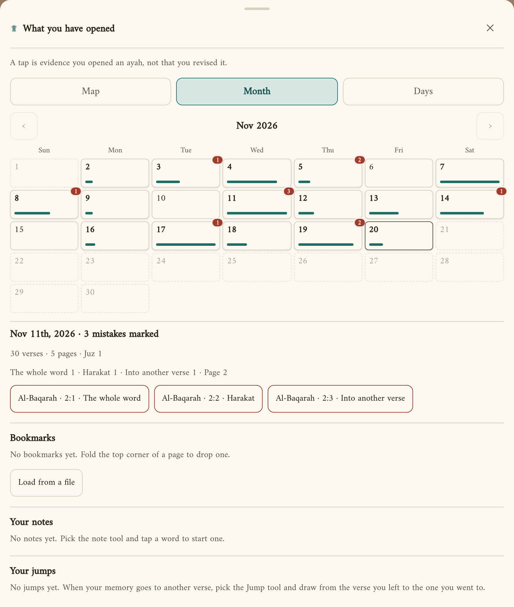 | 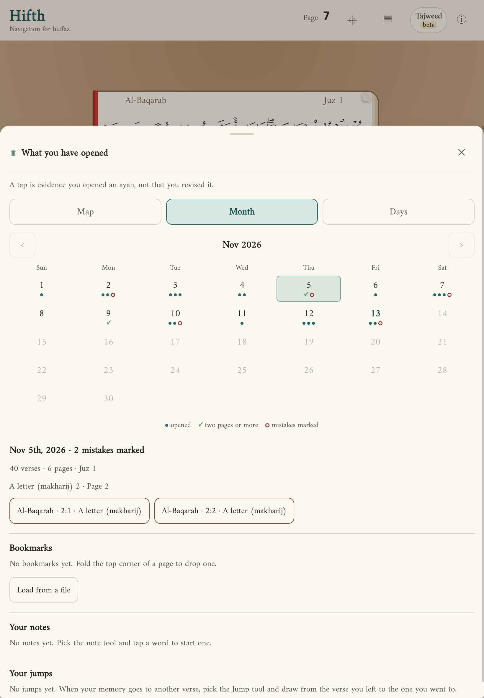 |
> | Computer | 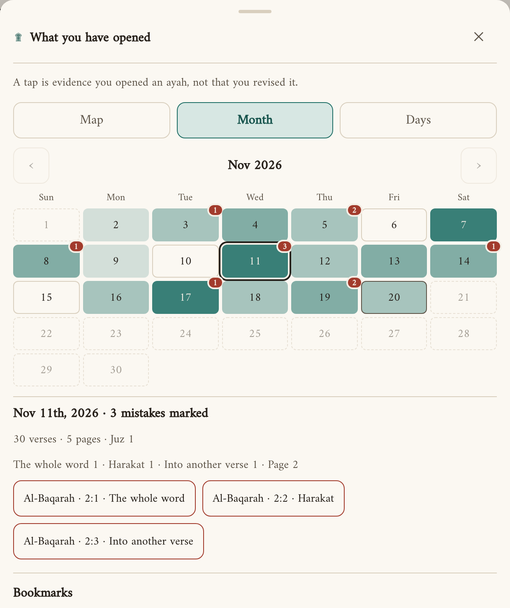 | 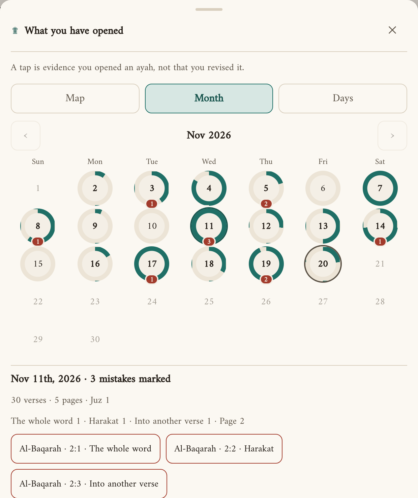 | 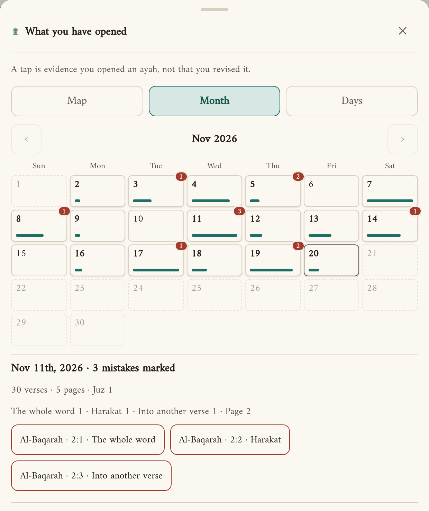 | 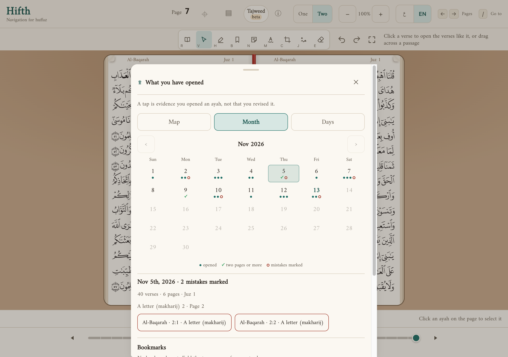 |
>
> Before: [phone](calendar-look/phone-before.png), [computer](calendar-look/wide-before.png).

## What did building it show?

- **The picked day lost its outline on the deepest shade.** The outline was the same teal as the day. It is now a paper gap with an ink ring, so it shows on any shade.
- **White numbers only work on the deepest step.** On the third step, white numbers were hard to read, so only the deepest step has them.
- **Dots need a key.** A dot, a tick and a ring mean nothing until someone says so, so this look alone has a one-line key under the month. The menu-bar calendar it comes from can do without one, because its dots are your own calendars' colours.
- **Dots leave out the week numbers.** The Mac's calendar has a column of week numbers; a hafiz counts revision by days and pages, not by week of the year, so they are not here.
- **Four dots would be one too many.** The fullest step is a tick, not a fourth dot, so a full day reads as done rather than as a longer row, and a day with mistakes still fits its ring on a phone.
- **Rings need square cells.** A ring in a wide cell is still a circle, so on a phone each row grows to the width of a column. That is where the extra row of height comes from.

## What else could we have tried?

- **A count in every day** ("12 v"). Exact, but a month of numbers is harder to scan than a month of colours, and the mistake count is already a number.
- **Colour by juz or by surah.** It would show *where* you revised, but the Map view already does that.
- **A streak line across the week.** Pleasing, but it rewards opening something every day over revising well, and the record says plainly that a tap is not a revision.

## What would change the answer?

- If the owner reads the month mostly on a computer, where height is free, rings lose their cost.
- If light days turn out not to matter and mistakes do, a look that puts the red number first would win.
- If the owner wants the month to look like the calendar they already use every day, dots would win over shades.

## What is this not settling?

- **The Days list** (the third view) is not restyled here. It is already words and numbers, and it got a count of each kind of mistake when the mistake pen started asking the kind.
- **The Map view** is unchanged.

## Where it lives

- The setting: `apps/web/src/calendar-look.ts` (the key `hifth.record.calendarLook.v1`), offered in the info panel by `apps/web/src/components/Colophon.tsx`.
- The looks: `apps/web/src/components/RevisionDays.module.css`, keyed on `data-look` on the month and `data-level` on each day. The dots look's marks come from `dayMarks` in `apps/web/src/calendar-look.ts` and are drawn by `Marks` in `apps/web/src/components/RevisionDays.tsx`.
- The tests: `apps/web/src/calendar-look.test.ts`; `apps/web/e2e/record-days.spec.ts`, "the month shows how much each day held, in the look chosen in the info panel".
- The pictures are a made-up month (no real record), taken from the dev server at 390 × 844, 820 × 1180 and 1280 × 900.
