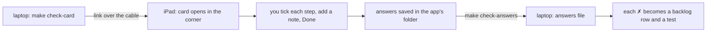

# A link that opens a check card in the app

*Written 2026-11-12 for the owner's ask of that day: "i want a custom x-callback check that
pops up a check widget that has instructions on what to check".*

## The short version

- **The laptop sends one link to the iPad.** A small card opens in the corner of the app with
  the steps to check, one line each, and what you should see.
- **You answer each step with ✓ or ✗**, add a note if you like, and press Done. The card
  closes.
- **Your answers are saved on the iPad** in the app's own folder. The laptop copies them off
  over the cable, the same way it copies crash logs, and turns each ✗ into a backlog row and
  a test.
- **Only the build installed from this laptop shows the card.** A release build answers the
  link with an error and shows nothing.



## Why

Until now the steps for a check on the iPad were typed into the chat, and the answers came
back the same way. The steps were easy to lose under other messages, and the answers had no
fixed shape. The manual-testing list (`docs/validation/ledger.json`) already writes every
check as steps, each with what to do and what you should see. The card shows those steps
where the check happens: in the app, on the device.

## What the link looks like ①

```
hifth://x-callback-url/check?id=<name>&title=<one line>&step=<do this>&see=<you should see>&step=…
```

- `step` can repeat. Each `see` belongs to the `step` just before it, and is optional.
- `id` names the check, so the saved answers can be matched to it. `title` is the card's
  heading.
- At most 12 steps, so the card stays small.
- A link of at most 2,000 characters. iOS cuts a link that opens an app at 2,048
  characters, and the step it cuts through never reaches the card: in the iPad
  simulator on 2026-11-12, a 15-step check sent 12 steps in a 2,523-character link
  and only 9 arrived. The laptop script fills each card only until the next step
  would pass 2,000 characters, and prints where the next card starts.
- `x-success`, if given, is opened when you press Done, with `id` and `result` (`pass` when
  every step got ✓, otherwise `fail`).
- A link with no step, or more than 12, is refused with `bad-check`.

The full contract, with examples a test runs through the real parser, is the same file as
the other links: `docs/design/app-url-scheme.openapi.json`.

## Open questions, and what would answer each

### ① Can a link from the laptop open a card of steps in the app on the iPad? · **open**

The link, the card and the saved answers are described above. None of it has run on the real
iPad yet, and sending any link to the running app over the cable has not been tried either.

**What would answer it:** the screenshot check for walk-feedback-capture, sent as a card with
`make check-card`, answered on the iPad, and its answers copied back with `make check-answers`.

## How the card behaves

- **It sits in the top corner and does not block the page.** Touches outside it reach the app,
  so you can do each step while the card is open. It folds down to one small button, and
  unfolds again when you tap it.
- **A new link replaces the card on screen.** The answers already given on the old card are
  saved first, so nothing is lost.
- **Saved as** `Documents/checks/<id>-<time>.json`, one file per Done: the steps, each one's
  answer (✓, ✗ or not answered), your note, the time and the page that was showing.

## On the laptop

| Command | What it does |
| --- | --- |
| `make check-card ID=<name> DEVICE=…` | builds the link from that check in the manual-testing list and sends it to the iPad |
| `make check-card FILE=<path> DEVICE=…` | the same, from a small JSON file of steps (for a one-off check that is not in the list) |
| `make check-card … SIM=1` | sends it to the simulator instead |
| `make check-card ID=<name> FROM=13 …` | one card holds 12 steps in a link of at most 2,000 characters; a longer check prints the `FROM=` that sends the rest as a second card |
| `make check-answers DEVICE=…` | copies the saved answers off the iPad into `native/shots/checks/` (ignored by git) |

The script calls Apple's device tool directly, with the link as one argument, so a step with
an apostrophe or an `&` in it cannot break the command.

## Assumptions made without asking

- **One look, a corner card.** A full-height sheet is the other obvious way. It is not built
  yet, because a sheet covers the page being checked. If the corner card turns out too small
  on the iPhone, the sheet becomes a setting.
- **Answers stay on the device until the laptop copies them.** Nothing is sent over the
  network.
- **The card never shows the book's text.** Its steps come from the laptop, and they are
  written by us.
