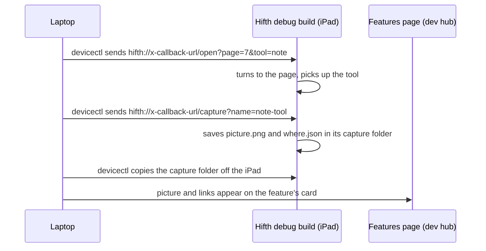

# Opening and checking every feature from a link

*Written 2026-11-12 for the owner's ask: "can we not have x-callback urls that we can set up to
test all our features", then "create a design.md on how to set all this up and a hub page with
component screenshot and deep link to access, make sure this is part of our development hub".
Its sister note is [Walking the iPad together](walk-together.md): this note is how the laptop
opens a place on the iPad and gets a picture back; that one is how the two of us look at it and
trade comments.*

## The short version

- **Most of the app can already be opened by a link.** A link names the page, the verse, the
  tool in your hand, the panel that opens and one page or two. The web address and the app's
  `hifth://` link reach the same screen, because both are turned into the same address.
- **What is missing is the round trip on the real iPad.** The laptop can send a link to the
  simulator, but nobody has tried sending one to the iPad. And nothing comes back: no picture,
  no "where the app ended up".
- **Recommendation:**
  1. send links to the iPad with Apple's install tool, which says it can (`devicectl … --payload-url`);
  2. add one debug-only link, **capture**, that saves a picture and the app's position to a
     folder the laptop already knows how to copy off the iPad;
  3. build a **features page in the development hub**: one card per feature, with a picture,
     the web link and the iPad link.
- **Pictures for the page come from the public build only.** The public build drops the private
  commentary layer: the switch that turns it on is read in one file, the pitch layer, and the
  private data folder is deleted from every build that is not the pitch one. The guide's
  committed screenshots are already made this way. Pictures from the pitch build are never
  committed, sent or published.
- **First step, under an hour:** send one link to the real iPad and see whether the app turns
  the page. Then draw the hub page from public-build pictures taken in a browser on the laptop.

What exists today, measured (read in the code, 2026-11-12)

**The two ways into a place**

| Way in | Example | Where it is read |
| --- | --- | --- |
| The web address (the part after `#`) | `http://localhost:7122/#/hafs-kfqc/p7?tool=note` | the router in `packages/core/src/router.ts`, owned on the page by `apps/web/src/useHashRouter.ts` |
| The app's link | `hifth://x-callback-url/open?page=7&tool=note` | `native/Hifth/Route/XCallback.swift`; the shell's `open(_:)` in `native/Hifth/Web/ShellModel.swift` line 161 |

The app's link is turned into the same web address (`XCallback.swift` lines 178-229), so the two
always land on the same screen. Both are held to one contract,
[app-url-scheme.openapi.json](app-url-scheme.openapi.json), and its page
[app-url-scheme.html](app-url-scheme.html).

**The app's link has two actions** (`XCallback.swift` lines 158-170): `open` turns to a place;
`current` answers with where the app is. Anything else is refused as an unknown action. The
answer goes to another app's address on the iPad, never to the laptop, and the app refuses to
answer to its own address or to file, script or data addresses (line 241).

**What a link can name** (`XCallback.swift` lines 35-48, `docs/query-params.md` lines 71-161):

- a page (`page=7`), a verse (`verse=2:255`), a surah (`surah=18`, which also opens the
  surah's context panel) or words inside a verse (`words=`);
- a tool in hand, one of 9: read, select, highlight, bookmark, note, harakat, word, mistake,
  crop;
- a panel open on arrival, one of 11: jump, about, record, shelf, key, editions, tips,
  lookalikes, roots, and two that exist only in the pitch build, commentary and context;
- one page or two (`view=one|two`);
- the web-only settings before the `#`: language, the phone bar, sharing.

The tool, the panel and the layout are read once and then dropped from the address
(`query-params.md` lines 121-124), so a reload does not reopen them.

**Sending a link from the laptop**

| To | How | Tried? |
| --- | --- | --- |
| the simulator | `make app-open ROUTE=…` (`native/Makefile.native` line 254) | yes |
| the Mac app | the same target with `TARGET=mac` | yes |
| the real iPad, app running | `xcrun devicectl device process launch --payload-url <link> com.bytesofpurpose.hifth` | **no**: its help lists the option, nobody has run it |
| the real iPad, at launch | the install step's page to open on (`native/Makefile.native` lines 342-352) | yes, but every new page is a restart |

**Getting files back.** `xcrun devicectl device copy from --domain-type appDataContainer
--domain-identifier com.bytesofpurpose.hifth --source Documents/<folder> --destination <dir>`
copied the throwaway check's folder off the real iPad on 2026-11-12. The walk capture plan
(`.claude/plans/refactored-bouncing-cerf.md`) builds on that: a `walk-captures/` folder on the
iPad, a `where.json` beside each picture, and `make walk-pull`, `walk-gallery` and `walk-list`
on the laptop.

**Pictures made today.** `make shots` (`Makefile` line 810) takes the guide's screenshots from
the public build in Playwright into `docs/validation/shots/`, and they are committed. That is
the precedent the features page follows.

## What can a link not do yet?

- press, hold or drag: drawing, the mistake pen, a page turn halfway through;
- change a setting in the info panel, such as switching to a runner-up option;
- tell the laptop where the app is without a capture (`current-to-file` now writes it to a file the laptop copies off);
- clear notes and marks, so each check starts clean;
- show which words a link picked (`?w=3-7`) in a way a capture can read, so the word-range card
  is checked for its verse only.

## Which debug-only links should the app answer?

Each is added only when Swift's debug switch is on. The release build answers them with
`not-in-this-build`, naming the link, as it already does for a check card; a unit test checks
that, and the release check fails if the code behind them is in a release build.

| Link | What it does | Why a hafiz's app needs it checked |
| --- | --- | --- |
| `capture?name=…` (**built** 2026-11-13) | saves a picture and `where.json` (page, verse, tool, panel, settings, build) to the capture folder, as a screenshot does, after the page has shown; no note banner | the laptop sees what the reader would see, without a person holding the camera |
| `current-to-file` (**built** 2026-11-13) | writes the `current` answer to `current.json` in the capture folder; `make walk-current` copies it off and prints it | the laptop can tell "the link worked" from "the link was ignored" |
| `set?key=…&value=…` | changes one info-panel setting | the runner-up options stay reachable and checked |
| `reset` | clears notes, marks and mistakes | each check starts from the same page |
| `point?x=…&y=…` | outlines a spot on the screen | shared with [walking the iPad together](walk-together.md) |

Presses and drags stay with the simulator walk (`pitch-walk.mjs`), which already has them. A link
is for reaching a place, not for playing a gesture.

## What is on the features page?

A page in the development hub, served by the dev server only, at `/dev-hub/` (the hub entry
`hifth-dev-hub`, runner `hifth`, port 7122). This branch adds it to `hub.yaml`, with a local
entry for the design pages beside it; the landing-page session agreed on 2026-11-12, since its
branch merges later.
It follows the landing branch's pattern for a page served only by the dev server: a small
plugin in `apps/web/vite.config.ts` that applies only while serving, so no build carries it.

- **One card per feature**: its name, one line on what a hafiz uses it for, a picture, the web
  link, the iPad link, and a copy button for the laptop command that sends that link to the iPad.
- **Grouped the way the app is**: places (page, verse, surah, words), tools (9), panels
  (9 public), layout (one page, two pages), settings.
- **Links are relative**, never starting with `/`. After the landing branch merges, the app also
  lives under `/read/` on hifth.app, so the page builds every link from one base it is given.
- **The page is generated** from the contract file and the lists in `XCallback.swift`, so a new
  tool or panel gets a card or the check fails. Its script lives in the `walk-app` skill's
  folder (`.claude/skills/walk-app/scripts/feature-links.mjs`), with a line in that skill's
  "when to use each" table, and a make target, `make feature-links`.
- **Pictures** are written to a git-ignored folder and only the public-build set may be
  committed.

The cards, one line each

| Feature | What a hafiz uses it for | Web link (dev server) | iPad link |
| --- | --- | --- | --- |
| A page | open the page you are revising | `#/hafs-kfqc/p7` | `open?page=7` |
| A verse | jump to the verse you are stuck on | `#/hafs-kfqc/2:255` | `open?verse=2:255` |
| A surah | start a surah, with its context | `#/hafs-kfqc/18:1?open=context` | `open?surah=18` |
| Two pages | revise a spread as the mus'haf lies open | `#/hafs-kfqc/p7?view=two` | `open?page=7&view=two` |
| Note tool | write a note against a verse | `#/hafs-kfqc/p7?tool=note` | `open?page=7&tool=note` |
| Mistake pen | mark a mistake, by its kind | `#/hafs-kfqc/p7?tool=mistake` | `open?page=7&tool=mistake` |
| Look-alikes | see the verses that sound like this one | `#/hafs-kfqc/p7?open=lookalikes` | `open?page=7&open=lookalikes` |
| Jump | go to a page, juz or surah | `#/hafs-kfqc/p7?open=jump` | `open?page=7&open=jump` |

The rest of the tools and panels follow the same shape. Each iPad link starts
`hifth://x-callback-url/`. The surah card opens the context panel, which is pitch-only, so its
public picture shows the page alone.

## Where do the pictures come from?

| | A. Public build in a browser on the laptop (recommended first) | B. Public build in the iPad simulator | C. The real iPad, through the capture link |
| --- | --- | --- | --- |
| **How** | Playwright opens each web link on the public build, at iPad size, and takes a picture, as `make shots` does | `make app-open` per link, then the simulator's screenshot | `devicectl` sends the link, then `capture`, then copies the folder |
| **Pros** | works today; fast; runs in the same checks as the rest | the real shell and its fonts | the real device, the real Pencil, what the owner sees |
| **Cons** | not the shell: the iPad's own bars and safe areas are missing | slow; iPad WebKit is not Playwright's | needs the iPad on the cable and unlocked; slowest |
| **Commits us to** | nothing new | the simulator already set up | the capture link and the iPad flavour being public for any picture we keep |

**Why A first:** it fills every card today with no Swift. C replaces a card's picture once the
capture link exists, and only for a public-flavour install. B is not worth building on its own,
because C covers the same ground on the real device.

## What must stay out?

- **No pitch pictures in git.** The pitch build shows the book's commentary beside the page.
  Pictures for the page come from the public build (`FLAVOUR=public`, or the plain web build).
  A capture from a pitch install goes to the git-ignored `native/shots/walks/` and stays on the
  laptop, never sent or published.
- **The book's text never appears on the page.** Cards name places by number, never by quoting
  a verse or a note.
- **No device ID in any checked-in file.** The command on a card names the device the way the
  install step does, from the laptop's own settings.
- **Debug only.** The capture, set, reset and point links exist only in the debug build. The
  walk capture plan's release check also fails if it finds them.

## In what order?

1. **Send one link to the real iPad** (under an hour, no app change). Run
   `devicectl … --payload-url "hifth://x-callback-url/open?page=7"` with the app open, and write
   down whether the page turns, whether the app restarts, and whether `--terminate-existing` is
   needed.
2. **The features page, pictures from A.** The generator script, its make target, the dev-server
   route under `/dev-hub/`, and a test that every tool and panel in the app's lists has a card.
3. **The capture link**, sharing the walk capture's folder and `where.json`, plus
   `current-to-file`. A test checks the release build refuses both. **Done 2026-11-13**: both
   wait for the page an `open` just asked for, and a simulator test sends each link and reads
   what landed. Not yet run on the real iPad.
4. **`make feature-check`**: for each card, send the link, capture, copy back, and check
   `where.json` says the app is where the link said. The result goes on the card as a tick or a
   cross with the date. **Built 2026-11-13.** One card at a time: close the app, send the card's
   link, send a capture link named after the card, wait for that capture to be finished, and
   compare. The place is checked by its address, a tool by the tool in hand, a panel by the name
   its sheet carries (each panel a link opens now says its own link name), one or two pages by
   how many show. The features page reads the last results and marks each card. Results so far
   are in the backlog row for ①. Not yet run on the real iPad.
5. **`set` and `reset`**, then cards for the info-panel settings.

## Open questions, and what would answer each

### ① How should the laptop open and check every feature on the real iPad? · **open**

The plan above says: send a link with Apple's install tool, have a debug-only capture link save
a picture and the app's position, copy it back, and show it on the features page. Nothing of it
has run on the real iPad yet.

**What would answer it:** step 1 above, then step 4 run once over every card. If sending a link
to the running app does not work, the fallback is the install step's page to open on, one
restart per card.

### ② Does sending a link restart the app? · **open**

Apple's tool starts the app to hand it the link. If it restarts a running app, the notes and the
page in hand are lost between checks.

**What would answer it:** step 1, run once without and once with `--terminate-existing`, with a
note on the page beforehand.
