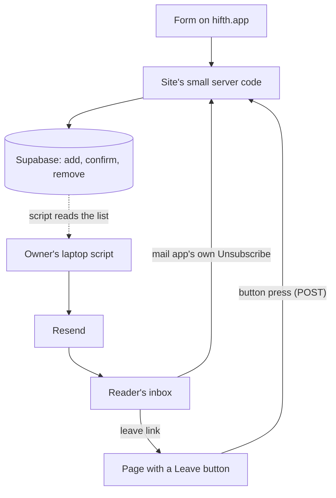

# The "tell me when the Mac app is out" list: where it lives and what sends its emails

> [!tip] Recommended
> Keep the list in Supabase, as the owner decided on 2026-11-12, and send its emails with Resend's free plan from a separate address under news.hifth.app.
> The sign-up form calls three small, locked-down functions in the database, so the site never holds a key that can read the list.
> Each person gets one confirmation email, then one launch email with their own leave link, and the owner's Apple mail on hifth.app is left exactly as it is.
> Free up to 100 emails a day; a bigger launch day is spread over a few days or costs $20 for one month.

What the owner has to do:

1. Make a Resend account on the free plan, and add news.hifth.app as its sending domain.
2. Add the three records Resend shows under news.hifth.app, plus one new "watch only" mail-checking record (DMARC) at the root, in Cloudflare's DNS. The table below says which.
3. Pick a postal address to print at the foot of each email: a US Post Office box or a private mailbox service both count.
4. Put the Resend key and the Supabase values in through `make env-set`, then send them on with `make push-secrets`. When to push is the owner's call.
5. Say which way the open choice below goes (what sends the emails), or let the recommendation stand.

For a hafiz: barely. This is the page someone reaches before the app, not the app. What a reader feels is that signing up asks once, writes twice, and leaving takes one press.

The rendered page, with the diagram drawn, is checked in as [hifth-app-mailing-list.html](hifth-app-mailing-list.html) and served at https://blog.bytesofpurpose.com/hifth/docs/design/hifth-app-mailing-list.html.

## Words used here

- **The list**: the email addresses of people who asked, on hifth.app, to hear when the Mac app ships.
- **Confirmation email (double opt-in)**: after signing up, the person gets one email with a button; only those who press it get the launch email.
- **Leave link**: the link in every email that takes the person off the list.
- **One-click leave**: two lines hidden in an email's header that let Gmail or Apple Mail show their own "Unsubscribe" button, which works without opening a page.
- **Sender record (SPF), signing key (DKIM), mail-checking record (DMARC)**: three DNS records receiving mail servers read to decide whether an email really came from hifth.app.

## How does a sign-up travel, and how does an email go out?

## Does Cloudflare do mailing lists?

No. Cloudflare's own sending service is a public beta, needs the $5-a-month Workers plan, and its FAQ answers "No" when asked whether it may be used for marketing or bulk mail.

Its free "send to a verified address" option only reaches addresses the owner has proved they own, and it hangs off Cloudflare's mail-receiving service, which cannot be switched on while Apple holds hifth.app's mail (it fails with error 2008).

So Cloudflare stays where it is good: it runs the site, its DNS, and a daily timer.

## Can the owner's Apple mail (iCloud+) send it?

Not the launch email. iCloud+ allows 1,000 messages a day and 500 people per message, but Apple's terms say the service is "designed and intended for personal use on an individual basis" (section IV.A), forbid "unsolicited or unauthorized email … advertising, promotional" (V.B.7), and forbid "accessing the Service through any automated means, like scripts" (V.B.10).

One message to many people also cannot carry each person's own leave link or the one-click leave lines.

It stays the owner's inbox: every launch email sets its reply address to the owner's hifth.app address, so replies land there.

## What sends the launch email?

**Recommended:** A, Resend's free plan, sending one email per person from news.hifth.app, driven by a short script on the owner's laptop. The list never leaves Supabase.

| | **A. Resend free, list stays in Supabase** (recommended) | **B. Amazon's mail service (SES)** | **C. A newsletter service (Kit, Brevo, Buttondown, or Resend's own "Broadcasts")** | **D. Cloudflare's paid sending** | **E. The owner's Apple mail** |
| --- | --- | --- | --- | --- | --- |
| **Pros** | Free: 100 a day, 3,000 a month. Ten-minute setup. Tracking off by default. Its records sit under news.hifth.app, so Apple's mail is untouched. Each email carries that person's own leave link. | Cheapest at any size: 10 cents per 1,000. No daily cap once approved. | A ready editor, hosted leave page and archive. Resend's Broadcasts send to up to 1,000 people at once on its free plan. | Same company as the site; 3,000 a month included. | Already set up; costs nothing. |
| **Cons** | Over 100 on launch day means spreading over days or paying $20 for one month. Resend keeps message logs in the US. | An AWS account, a review to leave its trial mode (answered within 96 hours), more DNS records. | Holds a second copy of the list, with its own "has left" list that drifts from Supabase. Some free plans add their footer. | Not free ($5 a month). Still a beta. Its FAQ says no marketing mail. | Apple's terms forbid it, and it has no per-person leave link. |
| **Commits us to** | One new account, a send script, and naming Resend on the privacy page. | A second cloud account to look after for a few emails a year. | Copying the list over before each send and copying leavers back; the owner decided the list lives in Supabase. | $5 every month, and Cloudflare's beta rules. | Nothing; it is ruled out. |

Kept in reserve: if launch day is between 100 and 1,000 people and neither waiting nor $20 is wanted, Resend's free Broadcasts can send it in one go from a temporary copy, deleted straight after. That copy is the one exception to "the list lives only in Supabase", so it is a fallback, not the plan.

If the list grows past about 3,000, or regular updates start, the send script hands the mail to Amazon's service instead; the list and the script's shape do not change.

## Where does the list live, and who can read it?

In Supabase, on the hifth.app project. The owner decided this on 2026-11-12, in place of Cloudflare's database.

- **The table** sits in its own section of the database that Supabase's web interface does not serve, so nothing can list it from outside.
- **Three small database functions** do the only things the site may do: add an address, confirm it, remove it. Each runs with fixed rights and returns nothing about anyone else.
- **The site holds only the public ("publishable") key.** That key can call the three functions and nothing more. Supabase's secret key is never put on the site: it gets past every rule in the whole project, including the privately held outside library.
- **The laptop script reads the list** with the database password the existing load scripts already use, so no new all-powerful key is made. It is just as powerful as the secret key, so it stays on the laptop, never in a file the repository tracks.
- **What a row keeps:** the address, when it signed up, when it confirmed, which language page it came from, and its leave code. Rows never confirmed are deleted after 7 days.
- **Supabase's free plan pauses a project after 7 quiet days**, and a paused project answers every call with a "paused" error until the owner resumes it by hand. A daily timer on a small separate Cloudflare Worker pokes it awake and, in the same run, deletes unconfirmed rows. (Cloudflare's free plan allows five timers; the site's own server code cannot hold one.)
- **If Supabase is paused anyway**, the form says "please try again later", never "you are on the list".

## What changes on hifth.app's DNS?

All in Cloudflare's DNS, all set to "DNS only" (not proxied).

| Record | Where | Value, in words | Why |
| --- | --- | --- | --- |
| Mail server (MX) | send.news.hifth.app | Resend's bounce server, as Resend shows it | Bounced mail goes back to Resend, which stops sending to dead addresses |
| Sender record (SPF, TXT) | send.news.hifth.app | The line Resend shows, naming its servers | Lets a receiver check Resend may send for news.hifth.app |
| Signing key (DKIM, TXT) | resend._domainkey.news.hifth.app | Resend's public key, as Resend shows it | Every email is signed, so it cannot be forged and the one-click leave lines are covered |
| Mail-checking record (DMARC, TXT) | _dmarc.hifth.app (new) | "Watch only" to start (p=none), with reports to an address the owner reads | There is none today. One record at the root covers Apple's mail and news.hifth.app; tighten after a few clean weeks |
| Root sender record (SPF), one part | hifth.app (edit, optional) | Remove the registrar's old forwarding include | Left over from before Apple; check the registrar's forwarding is off first. It uses lookups toward the limit of 10 |
| Apple's two mail servers, Apple's key, Apple's ownership record, Apple's part of the root sender record | hifth.app | Unchanged | The owner's own mail keeps working as it does today |

## What happens to the form, the leave link and the privacy page?

- **The form's server code still writes to Cloudflare's database.** It has to call the Supabase "add" function instead. Until it does, the form keeps no address.
- **The form's answer gives away who is on the list.** Today a second sign-up with the same address answers "already". It should always say "check your inbox", whatever happened.
- **The form promises "Nothing else".** With a confirmation email, the promise becomes: one email to confirm, then one when the app ships. The English and Arabic pages both need the new wording.
- **The language the form already sends is thrown away.** Keep it, so the launch email goes out in the reader's language.
- **The leave link deletes on a plain visit.** Some mail systems open every link in a message to scan it, which would remove people who never clicked. The link should open a page with a "Leave the list" button that sends a POST, and the one-click leave lines point at a separate address that takes a POST directly, with no redirect. The confirm link works the same way, so a scanner cannot confirm anyone.
- **The privacy page names Cloudflare's database.** It must name Supabase, name Resend as what sends the mail and where it keeps logs (the US), and list what a row keeps (address, two dates, language). It already says the list is used only for the launch; keep that.

## What does it cost at 100, 1,000 and 5,000 people?

| People on launch day | Resend free (recommended) | Resend, one paid month | Resend Broadcasts (fallback) | Amazon SES | Cloudflare paid sending |
| --- | --- | --- | --- | --- | --- |
| 100 | $0, same day | not needed | $0 | about 1 cent | $5 a month (and not allowed for this) |
| 1,000 | $0, spread over about 10 days | $20 once, same day | $0, same day, temporary copy | about 10 cents | $5 a month (not allowed) |
| 5,000 | $0, over about 50 days across two months (3,000 a month cap) | $20 once, same day | $40 a month (its free plan holds 1,000) | about 50 cents, plus setup | about $5.70 (not allowed) |

Around all of these: Supabase free $0, the timer Worker $0, and the postal address (a PO box or mailbox service, price not looked up). Confirmation emails share Resend's 100-a-day cap.

## What do the rules (US, EU, UK) ask of us?

- **US (CAN-SPAM).** Say who it is from. Carry a postal address in every launch email: a PO box registered with the US Postal Service, or a private mailbox at a registered mail-receiving business, counts. Keep the leave link working for at least 30 days and honour it within 10 business days (ours is at once). The fine is up to $53,088 per email.
- **UK (PECR and the regulator's guidance).** Consent must be specific and given by a clear action, and we must keep a record of who agreed, when and how. The confirmation press is that record.
- **EU (GDPR, Article 7).** We must be able to show each person agreed, and leaving must be as easy as joining. Nothing we read requires a confirmation email by name, but it is the plainest proof.
- **Gmail and Yahoo.** Above 5,000 a day they demand one-click leave; we add it from the first email anyway.

## Where the two researchers agreed and disagreed

The raw work is in [researcher A's findings](../research/2026-11-12-mailing-list-a-findings.md) and [design](../research/2026-11-12-mailing-list-a-design.md), and [researcher B's findings](../research/2026-11-12-mailing-list-b-findings.md) and [design](../research/2026-11-12-mailing-list-b-design.md). The checker re-opened the sources behind the claims that decide something.

**Agreed, and the source holds:** Resend free from a news subdomain; the list stays only in Supabase; narrow database functions behind the publishable key; a separate Worker to keep Supabase awake; Apple's mail ruled out; a confirmation email worth doing though no law names it; a leave address that takes a POST; a public TestFlight link in our own email, so no addresses go to Apple; Amazon SES as the route for a big list; DMARC at the root; the registrar's include probably left over.

Where they disagreed, and how it was settled:

| Question | A said | B said | What the source shows, and what we do |
| --- | --- | --- | --- |
| Does Cloudflare's sending allow marketing mail? | Its FAQ says no | Its pages are silent on announcements | Cloudflare's FAQ answers "No" (re-fetched). A is right. |
| How does the send script read the list? | A Supabase secret key kept on the laptop | The database password the load scripts already use | Both keys get past every rule. B's way makes no new key, so we take B's. |
| How long do unconfirmed rows stay? | 30 days | 7 days | No source decides it. We take 7: an address nobody confirmed is someone who has not agreed, and signing up again costs nothing. |
| Is the confirm link a button? | Did not say how the link behaves | A page with a button that sends a POST | B marked this as its own reasoning, not a source, and A is silent. We take it, for the same reason as the leave link. |
| Is Resend's free Broadcasts a route? | Rejected: it needs a copy of the list at Resend | A row in the size table | Both found the same fact (1,000 people free, held at Resend), which re-checks. We keep it as a fallback only. |

Only one found:

- **Only A:** keep the language the form sends; an unticked "also send me updates" box (not taken now, see below).
- **Only B:** the form should always answer "check your inbox"; what a paused Supabase project answers (an error, which the form must read as "try again later"); Apple's "automated means, like scripts" clause (re-checked, section V.B.10); that the database password avoids a new key.

Still resting on a snippet, or not checked at all:

- Whether Resend signs the one-click leave lines when they are added to each email. Its pages do not say; one test email to the owner's own inbox settles it.
- How Resend's Broadcasts add their own leave lines, and whether Amazon SES signs added leave lines.
- That the database functions return nothing on a repeat sign-up, and what read rights they need: designed, not yet run against Supabase.
- The locked-down database setup exists only on an unmerged branch so far.
- That Cloudflare's site code cannot hold a timer: one settings page and one forum answer.
- EU rules beyond Article 7, including whether Germany expects a confirmation email: snippets only.
- The prices of a PO box, Supabase's paid plans, and whether Resend's free plan adds a footer: not looked up.
- How others keep a free Supabase project awake: snippets only.

## What would change the answer?

- **More than about 3,000 people, or regular updates:** move the sending to Amazon SES; the list stays put.
- **The owner wants a newsletter, not one announcement:** a newsletter service earns its second copy of the list.
- **Resend does not sign the added leave lines:** send through Amazon SES instead, once a test shows it signs them (not looked up).
- **Supabase moves to a paid plan:** the keep-awake timer goes; the nightly tidy stays.
- **Cloudflare's sending leaves beta and allows announcements:** it becomes worth a look, since it is the same account.

## What is this not settling?

- The words of the launch email itself, and whether it goes out in both languages or the reader's own.
- An "also send me updates" box. Not now: the list is for one launch.
- Whether the launch is a TestFlight beta or an App Store release. The link goes in the email either way.
- Who answers replies, and how fast.
- The privacy page's full rewrite; this names what it must say, not its words.

## Open questions, and what would answer each

### ① The form's server code still writes to Cloudflare's database · **open**

Answered by moving it to call the Supabase "add" function with the publishable key, with a test that a paused project answers "try again later".

### ② The leave link removes someone on a plain visit · **open**

Answered by a page with a "Leave the list" button that sends a POST, a separate POST address for one-click leave, and a test that a plain visit removes nobody.

### ③ The privacy page names Cloudflare's database · **open**

Answered by naming Supabase and Resend, where each keeps data, and what a row holds, in both languages.

### ④ No mail-checking record (DMARC), and a leftover include in the sender record · **open**

Answered by the owner adding a "watch only" DMARC record at the root and, once the registrar's forwarding is confirmed off, removing its include.

### ⑤ The form promises "Nothing else" · **open**

Answered by wording that says one email to confirm, then one when the app ships, on the English and Arabic pages.

### ⑥ A repeat sign-up shows the address is already on the list · **open**

Answered by the form always saying "check your inbox", with a test that a repeat sign-up gets the same answer as a new one.
