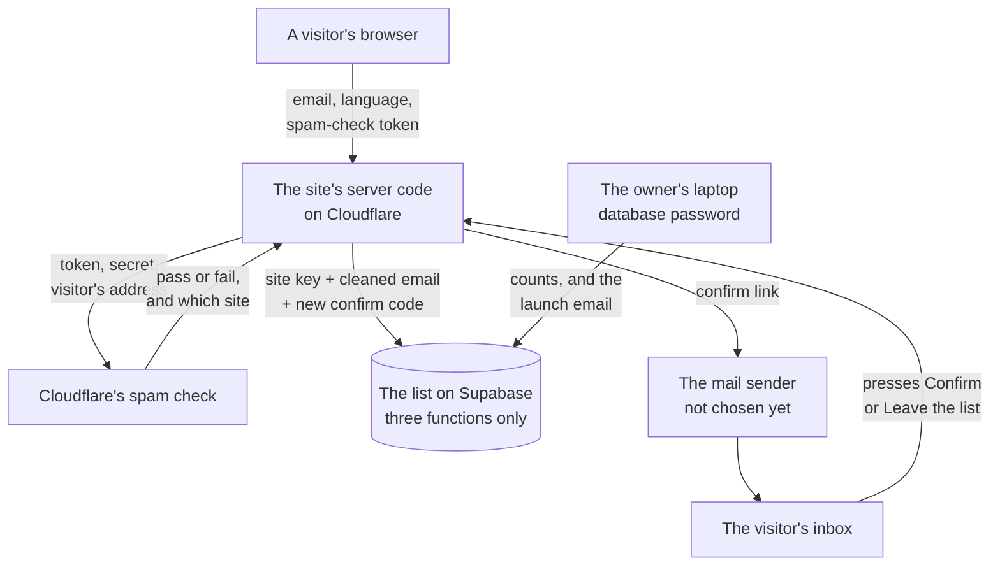

# How is hifth.app kept safe?

*Written 2026-11-14, after a security review of the site the same day. It covers the front page,
the privacy page, and the "tell me when the Mac app is out" email list. The reading app under
`/read/` is covered for the rules the browser is told to keep (since 2026-11-15), not for its own
data.*

## The short version

- **The site trusts nothing a visitor sends.** Every value from a browser is checked or cleaned
  before it is used, and anything that fails is turned away with the same plain answer.
- **The email list can't be read from the internet by anyone.** Not by us through the site, and
  not by a visitor. The site can only do three things to it: add an address that is waiting to
  be confirmed, confirm one, and remove one. Each needs a secret key that only the site's server
  holds.
- **No secret ever reaches a browser.** The keys live encrypted on the owner's laptop and as
  secrets on Cloudflare. The pages hold only the spam check's public key.
- **The pages tell the browser what they may do.** They load scripts only from this site and
  Cloudflare's spam check, they can't be put in a frame on another site, and the browser may not
  guess a file's type.
- **What is still open:** old copies of the database's
  name sit in the repository's history, commits carry the owner's personal email, and the spam
  check still uses Cloudflare's test key until the owner gives the key the right permission.

## What words does this page use?

- **Server code**: the small program Cloudflare runs when the form is sent, or when a link in the
  email is opened. It runs on Cloudflare, never in the visitor's browser.
- **Spam check**: Cloudflare Turnstile, the box under the form that tells a person from a script.
  It hands the browser a one-time token, and the server asks Cloudflare whether that token is good.
- **The list**: the table of email addresses on Supabase, a hosted database.
- **Site key**: a long secret the server sends with every change to the list. The database keeps
  only its fingerprint (a SHA-256 hash), so even reading the database does not give it away.
- **Publishable key**: Supabase's public key. It lets a caller ask for the three list functions
  and nothing else. It is not secret, so on its own it opens nothing.

## What can a visitor send, and what happens to each part?

Nothing here is trusted. Each row says where the value comes from and what is done before it is
used. The code is `apps/landing/lib/notify.mjs` unless the row says otherwise.

| What | Comes from | Checked or cleaned how | If it fails |
|---|---|---|---|
| The email address | the form | Spaces trimmed, lower-cased, at most 254 characters, must look like `name@place.tld` (`cleanEmail`). The database checks the same shape and length again before storing it. | "That doesn't look like an email address." Nothing is stored. |
| The page's language | the form | Only `en` or `ar` is kept; anything else becomes `en`. The database does the same. | Treated as English. |
| The spam-check token | the form, made by Cloudflare's box | Sent once to Cloudflare's check, with no retry, because a token works only once. The answer must say it passed, and the site it was made on must be hifth.app (`TURNSTILE_HOSTNAMES`). | "That didn't go through." Nothing is stored. |
| The confirm code | the link in the email | Must be exactly 48 lower-case hex characters before the database is asked. The database confirms only a code it made in the last 7 days. | The same "that link has expired" page for a wrong code and an old one. |
| The leave code | the link in the email | Must be exactly 64 lower-case hex characters before the database is asked. | The same "you're off the list" page whether or not it matched. |
| How the request was made | the browser | Only a press of the button (POST) changes the list. Opening a link (GET) shows a page with the button, because mail scanners open every link in an email. | Opening a link changes nothing. |
| What kind of answer the browser wants | the browser's Accept header | JSON for the page's own script, a plain page otherwise. Either way the answer is built from fixed sentences, never from what was sent. | — |
| The visitor's network address | Cloudflare (`CF-Connecting-IP`) | Passed to the spam check only, to help it judge. Never stored, never logged. | — |
| The page address in the answer | the request | The address a button posts to is escaped before it is written into the page (`escapeAttr`), so a crafted address can't add anything to the page. | — |

Two rules hold across all of them:

- **An answer never says who is on the list.** A new address and one already there get the same
  answer. A leave link that matched and one that didn't get the same answer. So the form can't
  be used to test whether someone signed up.
- **No email address is ever written in an answer or a log.** The laptop's stand-in mailer logs
  the confirm link only, never the address.

## What does the site trust, and why?

| What | Why it is trusted | Where it lives |
|---|---|---|
| The spam check's secret | Only Cloudflare and the server know it. | A Cloudflare secret (`TURNSTILE_SECRET`), and encrypted on the laptop. |
| Cloudflare's answer to the spam check | It comes from Cloudflare's own address over HTTPS, in answer to the server's own question. | — |
| The site key | Only the server and the database's fingerprint of it know it. | A Cloudflare secret (`LIST_KEY`), and encrypted on the laptop. |
| The database address and publishable key | Not secret, but kept out of the repository so the project isn't named in public. | Cloudflare secrets (`SUPABASE_URL`, `SUPABASE_PUBLISHABLE_KEY`). |
| The three list functions | They check the site key, the email's shape and the code's shape themselves, so a mistake in the server code can't skip them. | `supabase/migrations/20261113000001_notify_list.sql`, with its tests in `supabase/tests/notify_list.test.sql`. |
| The owner's laptop | The only place with the database password, which is the only way to read the list. | — |

## Who can read the list, add to it, or delete from it?

- **Read it:** only someone with the database password, which is the owner. The table sits in its
  own corner of the database that the internet-facing door doesn't serve, and every right on it
  is taken away from the public roles. The laptop's counting script prints two numbers (how many
  are on the list, how many still have to confirm) and refuses an answer that holds anything else.
- **Add an address:** only the site's server, because adding needs the site key. Without the key,
  someone with the public key could skip the spam check and add addresses they don't own. An
  added address stays unconfirmed until its owner presses the button in the email, and an
  unconfirmed one is deleted after 7 days.
- **Confirm an address:** only someone holding that address's email, since the 48-character code
  is random (24 bytes from a strong random source) and is sent only there. Signing up
  again replaces the code, so only the newest email's link works.
- **Delete an address:** only someone holding that address's leave link, a separate random
  64-character code made by the database. Nobody can delete by guessing an email.
- **Change it any other way:** nobody through the site. There is no function that edits or lists.

## Where do the keys live, and who can see them?

- **On the laptop:** encrypted in `.env.encrypted` with dotenvx. The key that opens it is kept in
  the owner's password manager. Scripts read them through dotenvx and never print them.
- **On Cloudflare:** as secrets on the site project, set once by the owner. The server code reads
  them; nothing serves them.
- **In the browser:** only the spam check's public key, which is meant to be public.
- **Never:** in the repository, a page, a log, a commit or a pull request. Two checks stand behind
  that rule:
  - **The secret scan** (gitleaks, `.gitleaks.toml`) runs before each commit and each push. It
    uses the standard rules and two of our own: a Supabase project's address, and a project ID
    given to its command line. GitHub's own secret scan and push block are on as a second net.
  - **The release check** refuses a database address in the site settings and reads every file
    it would upload (see below).

## What do the pages tell the browser?

Every address on the site, the app's included, sends:

- **No framing:** another site may not show a hifth.app page inside a frame (`X-Frame-Options:
  DENY`), so a visitor can't be tricked into pressing a button they can't see.
- **No guessing file types** (`X-Content-Type-Options: nosniff`), so an uploaded-looking file
  can't be run as a script.
- **A link to another site carries only "hifth.app"**, never the page it came from
  (`Referrer-Policy: strict-origin-when-cross-origin`).

The front page and the privacy page, in English and Arabic, also say where everything may come
from (`Content-Security-Policy`): scripts only from this site and Cloudflare's spam check, frames
only the spam check's, and pictures, styles and fonts only from this site. Nothing is written into
the pages themselves, so the rule needs no exceptions for inline code. These live in
`apps/landing/_headers`.

The reading app at `/read/` has a rule of its own (since 2026-11-15): scripts only from this
site, plus the one short script written into the app's page, which starts fetching the reader's
language early. That script changes with every build, so the release writes its fingerprint into
the rule, and refuses to upload a folder where the fingerprint is missing or does not match. The
recitation may come from verses.quran.com, and nothing else from another site; no frames at all.
It was tried in Chrome and Firefox with the rule on: the pages, the recitation, the offline
worker and the early language download all worked, and the browser refused nothing. The iPad and
Mac apps load the same files from inside the app, without the site's headers, so the rule does not
reach them.

The pages the server code makes (the "check your inbox", confirm and leave pages) set their own,
stricter rules, because Cloudflare doesn't add `_headers` to them: no scripts at all, no framing,
no address sent to other sites, and never kept in a cache.

The tests that hold all of this still: `apps/landing/lib/pages.test.mjs`,
`apps/landing/lib/notify.test.mjs`, and for the app's fingerprint
`.claude/skills/deploy-site/scripts/shipped.test.mjs` and `release-hifth-app.test.mjs`.

## What runs only on the laptop, and what stops it reaching the live site?

Some pieces exist only so the owner can try the site at home:

- **The stand-in mailer**, which logs the confirm link instead of sending an email. It works only
  when told to by name and only on a laptop address (`localhost` or `127.0.0.1`). Anywhere else
  the server says the list isn't open yet.
- **The side bar and the Comment button**, written into each page on the laptop copy.
- **The laptop copy leaves the script rule out**, because the rule would block the side bar and
  the Comment button.
- **Cloudflare's always-pass spam-check keys.**

The release check (`.claude/skills/deploy-site/scripts/release-hifth-app.mjs`, lists in
`shipped.mjs`) reads the exact folder it would upload. It refuses: the side bar's marker, the
comment button, the development server's live reload, the spam check's test key, any `localhost`
or `127.0.0.1` address, the design pages, the pitch build, debug copies of the source, hidden
files, and the server's own code. It also refuses the "keep other tabs away" header, which would
stop readers carrying their marks from the old address. After an upload, the live-site check asks
for each development address and expects an error every time.

## What is still open?

| Gap | What it risks | What closes it | Whose |
|---|---|---|---|
| Old copies of the database's name are in the repository's history | Someone reading old commits can learn which Supabase project holds the list. The name alone opens nothing, since every change needs the site key and reading needs the password. | Rewriting history and asking GitHub to purge it. | owner |
| Commits carry the owner's personal email | Anyone can read it from the public commits. | Set the commit email to GitHub's no-reply address, and turn on GitHub's block on pushes that show a personal email. | owner |
| The spam check still uses Cloudflare's test key | Every token passes, so the form would take scripts. The release check refuses it, so it can't go live like this. | Give the Cloudflare key the "Turnstile, Edit" permission, then make the real check. | owner |
| On the laptop, the server's own pages block the Comment button | Only the owner, only at home: comments can't be left on the confirm and leave pages. | Nothing yet; noted so nobody thinks it is a fault in the live site. | — |

## What is this page not covering?

- The reading app's own data (marks and notes kept on the reader's device), which never leaves the
  device unless the reader saves a file.
- The iPad and Mac apps.
- The mail sender's own safety (records that prove the mail is ours), which waits on choosing the
  sender: see [the notify list's design](hifth-app-mailing-list.md).

Related: [the site's design and its open questions](hifth-app-site.md) ·
[the notify list's design](hifth-app-mailing-list.md).
