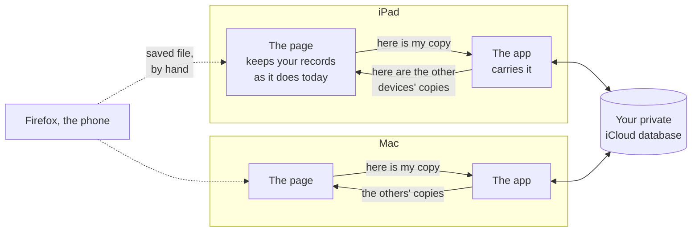

# What should follow a reader between their iPad and Mac, through their own iCloud?

*Started 2026-11-08, the day the paid Apple Developer membership was bought (team 76NHKA839A).
The owner asked: "how can we better integrate with CloudKit?" CloudKit is Apple's database inside
each person's iCloud account. This page builds on a choice already made, and does not re-make it:
the usage counts will keep the iPad and Mac in step through the owner's private iCloud database,
with Apple's ready-made sync loop ([feature-usage ②](feature-usage.md#-keep-the-ipad-and-mac-counts-in-step-through-my-own-icloud--blocked)).
This page asks which of the reader's other records should take the same road. The start page for
getting the app to people: [design.md](../design.md).*

> [!tip] Short version
> **What it is:** your bookmarks, notes, mistake marks, the jumps your memory makes, where you left
> off, and a few reading choices would follow you from the iPad to the Mac and back, through your own
> iCloud. Nothing goes to us, and nothing goes to a server we run.
>
> **Recommended:** carry each kind of record the way the usage counts will go: Apple's ready-made
> sync loop, with one copy per device per kind, holding the same file the reader can already save
> (option A below).
>
> **What it needs from you:** five answers (below), most importantly whether the record of what you
> have opened should go too, and whether deleting a bookmark on one device should delete it on the other.
>
> **When:** the parts that do not touch Apple can be built and tested now. Trying it for real waits on
> the app being signed with the paid team ([TestFlight plan ③](testflight-plan.md#open-questions-and-what-would-answer-each)).

## Words used here

- **Your private iCloud database:** a space inside your own Apple account that only this app, signed
  in as you, can read and write. The developer cannot see what is in it. It uses your iCloud storage,
  not ours.
- **Apple's ready-made sync loop:** a piece of Apple's code (its name is CKSyncEngine) that decides
  when to send and fetch changes, retries when the network drops, and waits while you are signed out.
  It does not decide what happens when two devices changed the same thing. That part is ours.
- **The app** means the iPad or Mac app that wraps the web page. **The page** is the reading app
  inside it, the same one a browser opens.
- **The bridge:** the way the page and the app pass messages to each other.
- **A saved file:** the file *Save my bookmarks and notes* writes today, which carries bookmarks,
  notes, notes about passages and memory jumps in one go.
- **Advanced Data Protection:** an iCloud setting a person can turn on so that Apple itself cannot
  read most of what they keep in iCloud.

## What does it change for a hafiz?

**Mid-revision, one thing is felt:** you mark a mistake on the iPad in the evening, and the next
morning at the Mac it is already on the page, on the same word. You open the Mac and it can offer
the page where the iPad stopped, rather than where the Mac was last week.

**What must never happen mid-revision:** the page moving under you because another device changed
something; a banner saying "syncing"; a mark disappearing because the two devices disagreed. An
arriving change lands quietly. If it is on the page you are reading, it simply appears, the way a
note appears when you write it.

**For anyone who is not the owner:** nothing changes until they have two Apple devices and turn it
on. *Each device on its own* stays as a setting in the info panel, following the rule that a built
runner-up becomes a setting.

## How would it work?

1. **The page stays the owner of what you see.** Your records keep living where they live today, in
   the page's own storage on each device. The app cannot read that storage directly, so it never
   becomes a second place that holds the truth.
2. **The app is a courier.** When a record changes, the page hands the app the whole record for this
   device, written all at once (the rule the app already keeps). The app sends it to your private
   iCloud database and fetches the other devices' copies.
3. **Each device writes only its own copy.** The iPad writes "the iPad's bookmarks", the Mac writes
   "the Mac's bookmarks". Two devices never write the same record, so iCloud never has to pick a
   winner between them. Each page reads every other device's copy and folds it into its own with the
   same rules it already uses when you load a saved file.
4. **In a browser nothing changes.** Firefox and the phone have no app around the page, so there is no
   courier. They keep the saved file: save on one, load on the other. That is how they join the usage
   counts too.

What the bridge carries, in full

The page already tells the app three things (ready, the page it is showing, share this). Two new
messages and one call back:

| direction | what | when |
|---|---|---|
| page → app | **my copy:** which kind (bookmarks and notes, usage counts, reading choices, where I left off), this device's id and name, and the whole record as the same versioned text the saved file uses | after every change, and once after the page says it is ready |
| page → app | **sync on or off:** the reader's choice in the info panel | when it changes |
| app → page | **the others' copies:** a list of every other device's copy of one kind, with its device name and when it was written | after a fetch brings something new, and once after ready |

The call back goes through the same safe call the app already uses to turn the page, with the
values passed as values, never pasted into a script.

The device's id is the one the page already makes for memory jumps: random, never taken from
anything about the hardware, with a name the reader can change. That id is not itself synced; it is
what tells one device's copy from another's.

The app keeps, on its side, only three things: the last copy it sent, the last copies it fetched (so
the page can be answered at once on launch, before the network), and the sync loop's own bookkeeping,
which Apple says the app must save between launches.

## What does the app keep on the device today, and what should follow you?

Measured from the code on 2026-11-08. "Folds in" says what happens today when a saved file is
loaded; that same rule is what sync would use.

| kind of record | kept today | size | follow you? | when two devices both changed it |
|---|---|---|---|---|
| Bookmarks (the ribbons) | the page's database, one set written whole | a few KB | **yes** | both kept; the same bookmark keeps the copy that has seen more (longer history). **A bookmark deleted on one device comes back from the other** (question ②) |
| Notes, mistake marks, notes about a passage | the same database, written whole | a few KB to tens of KB | **yes** | both kept; the same note keeps the copy edited last. **If one note was edited on both devices while offline, the earlier edit is lost without a word**, and a deleted note comes back (question ②) |
| Memory jumps (where your memory slipped from one verse to another) | the same database | a few KB | **yes** | matched by their two verses; the times from both devices are joined, and the later state wins. Never deletes |
| Where you left off | the same database, one page and when it moved | under 100 bytes | **ask** (question ③) | the later one wins |
| Usage counts | their own database, one record per day | a few KB | **yes, already chosen** | the larger number for each device, day and feature |
| The record of what you have opened | its own database, one record per day, kept 400 days | under 1 MB a year, by the code's own estimate | **ask** (question ①) | no rule exists yet; one would be written (days joined) |
| Reading choices: language, pen colours, which tools show, how the page turns, the look-alike settings, the tips already seen | small saved settings, about 25 | under 2 KB | **yes** (question ④) | the latest change to each one wins |
| How this device is laid out: where the pens and rail sit, sizes, zoom, the page bar's magnifier | small saved settings, about 15 | under 1 KB | **no**: these differ *because* an iPad and a Mac differ | — |
| This device's id and name | the page's database | under 100 bytes | **no**: it is what tells the copies apart | — |
| Juz kept for offline reading | the page's database | megabytes | **no**: it can be fetched again, and each device chooses its own | — |
| Recitations kept for offline listening | the page's audio store | megabytes | **no**: too big, and fetched again on demand | — |
| A commentary loaded from a file | its own database | megabytes | **never**: held text the app may not copy anywhere | — |
| The developer's comparison overlay | a small setting | bytes | **no**: a tool for building the app, not for reading | — |

Not traced for this page: whether a highlighted passage is kept with the notes or on its own. It is
checked before building, and added to the table then.

The reading choices and the device's layout, sorted (a first sort, to be checked with you)

**Follow you:** the language; the highlighter's pen and the pen for held words; which mark tools,
the mistake pen and the eraser show; how the page turns and where it lands; the look-alike list's
arrows, compare and preview; the jump arrows; the related-verses list; passage rows and passage hop;
long verses; what a note does on leaving; how a note about a passage looks; the opening text; where
the cards make room; the verse gestures; the reading-run choices (ahead, follow, mark); upright
again; the bookmark ribbon's length; when recitations are kept; the tips already seen.

**Stay on the device:** whether the pens float, where they rest and which side; where the rail rests;
the opening size; zoom across pages and where zoom anchors; the page bar's magnifier; the cards'
edge; which recitations this device has kept and heard (they belong to this device's audio store);
the developer's comparison overlay.

## How could the records travel?

The usage counts already chose the first column. The question here is whether the other records take
the same road or a different one.

| | **A. Apple's ready-made sync loop, one copy per device per kind (recommended)** | B. Apple's database mirror | C. Hand-written calls to the iCloud database | D. Apple's small settings box | E. One file per device in the app's iCloud Drive folder |
|---|---|---|---|---|---|
| How | the app hands each device's whole record to Apple's sync loop, which sends and fetches; the page folds the others in | a second copy of every record kept in Apple's on-device database on the app side, which Apple mirrors to iCloud by itself | the app makes every send, fetch, retry and change notice itself | a small shared box of named values that Apple keeps in step across devices | each app writes its saved file into its own iCloud Drive folder; the others read the files there |
| Pros | already the road the usage counts take, so one piece of code carries everything; two devices never write the same record, so no clashes in iCloud; reuses the saved file's layout and fold-in rules unchanged; the database's layout stays a handful of fields; works on the app's lowest iPad and Mac versions | the least sync code on the app side; Apple handles clashes field by field | full control | the least code of all; built for preferences | the files show in Files and Finder, so Firefox on the Mac could load them by hand; covered end-to-end by Advanced Data Protection |
| Cons | we write the fold-in for each kind (most already exist) and the removal marks (question ②); timing is up to Apple, usually within a minute but not promised | every record lives twice, in the page and in the app, and the two must be kept in step by hand, which is where bugs breed; Apple owns the database's layout, and a database it owns cannot later be used by A or C | the most code, rewriting what Apple's loop already does, for no gain on these devices | Apple says not to keep personal information in it, because it is kept on the device unencrypted; 1 MB and 1,024 names at most; only fits the reading choices | a file may not have downloaded yet when the app looks, so the app has to wait for it and handle half-arrived files; more moving parts than A for the same result |
| Implications | the record layout can only grow once it is live (see below); the same road could later carry anything else the reader owns | picking it now closes the door on A for the same container | none beyond the cost | if used, it would sit beside A as a second road, for settings only | a step toward the storage model's "your own cloud file", but in iCloud Drive rather than a database |

**Recommendation: A, for everything that should follow you, including the reading choices as one
more record, so there is one road to build, test and explain.**

Two things hold under any option:

- **Records about your worship go in encrypted fields.** Apple's database can mark a field as
  encrypted with a key held in your iCloud Keychain. With Advanced Data Protection on, Apple says
  those fields, and only those, are end-to-end encrypted, so Apple cannot read them. Without it,
  Apple can, as with the note-fixes copy already kept in iCloud Drive. Notes, mistake marks, memory
  jumps and (if chosen) the record of what you have opened all go in encrypted fields.
- **The layout can only grow once it is live.** Once the database's layout is published for the
  App Store and TestFlight, record kinds and fields can be added but never removed or changed. Option
  A keeps that layout to a few fields (which kind, which device, when, and one encrypted field
  holding the versioned saved-file text), so the layout of the records themselves can keep changing
  inside that text, the way the saved file already moves from version 1 to 3.

What else was looked at, and why it is not an option here

- **Reaching iCloud from Firefox with Apple's web library.** Looked at for the usage counts and set
  aside: a sign-in to Apple in each browser at least every two weeks, and no current evidence it
  works in Firefox ([usage-sync research](../research/usage-sync-consolidated.md)).
- **A server of ours.** The storage model's "your own cloud file once there is sign-in" is still the
  road for browsers someday. It needs an account the app does not have, and it is a different
  decision.
- **Syncing whole web storage under the hood.** The page's storage is not something the app can read
  or replace safely, and doing so would bypass every fold-in rule.

## Does this fit the rule that the reader's record stays theirs?

The rule, as the owner sharpened it on 2026-11-08: nothing leaves the device unless it is in the
reader's interest and under their control. A copy in the reader's own iCloud, which they can turn
off, is the shape that rule allows. Two concrete changes are owed if this is built:

- The privacy check names who may read the memory-jump record, the usage counts and the record of
  what you have opened. The bridge's "my copy" message becomes a named, written-down reader of each
  record that syncs. It is not slipped past the check.
- The [storage model](../decisions/storage-model.md#what-would-change-the-model) says the cloud half
  could be "replaced by whatever a reader's own cloud drive can hold". This would be that, and the
  record gets a line saying so once the owner answers the questions below.

Whether the record of what you have opened goes too is the owner's call, question ①.

## What needs the paid signing first?

Everything that touches Apple, because the iCloud database will not open for an app signed the way
it is signed today. In order, all after [TestFlight ②](testflight-plan.md#open-questions-and-what-would-answer-each)
(the app's ID registered with iCloud turned on) and ③ (signed with the paid team):

1. Make the iCloud container for the app, and add the iCloud and push-notice permissions to both
   apps. The iPad app has no permissions file yet; the Mac's is empty, and the Mac app moves from its
   stand-in signature to the team's.
2. Run it on the owner's iPad and Mac against the test copy of the database.
3. Publish the database's layout before any tester gets a build. Forum posts (not Apple's own
   pages) say TestFlight builds always use the live database, not the test one, so this step comes
   before [TestFlight ⑧](testflight-plan.md#open-questions-and-what-would-answer-each), the upload.

## What can be built and tested before then?

All of the parts that do not talk to Apple:

- **The fold-in rules, with removal marks**, in the shared code, tested by the same kind of unit test
  the saved file has. Including the case that bites first: a note edited on both devices.
- **The record each device hands over**, with its device id and name, and the per-device usage counts
  already planned.
- **Both new bridge messages**, on the page side and the app side, each with its test, the same way
  the share message was added.
- **A stand-in iCloud** on the app side: the courier talks to a stand-in that keeps records in
  memory, so the whole loop (iPad page → app → stand-in → app → page) runs in the simulator and in a
  browser test, including "an arriving note on the open page does not move the page".
- **The setting** in the info panel: *Keep in step through iCloud* or *Each device on its own*.
- **The privacy check's named exception**, so the build fails if anything else starts reading the
  records.

## What would change the answer?

- **If the owner wants the browsers in step too, automatically,** the road is a server of ours with a
  sign-in, not iCloud: a separate decision.
- **If records grow past 1 MB** (Apple's limit for one record's data, files aside), the record of what
  you have opened would go as a file attached to the record. It is under that by the code's own
  estimate; it is measured before building.
- **If a record is ever shared between two people** (teacher and student), that is not this page.
  Everything here is one reader's own, across their own devices.

## What is this not settling?

Sending anything to anyone else; an account or sign-in; the browsers syncing on their own; the
App Store question; and how The Study Quran's commentary is carried, which never syncs.

Sources, and whether each was actually read

Read in full through Apple's documentation text pages on 2026-11-08:

- Apple's ready-made sync loop: <https://developer.apple.com/documentation/cloudkit/cksyncengine-5sie5>.
  iPad 17 and Mac 14 onwards (the app's lowest versions); "requires the CloudKit and Remote
  notifications entitlements"; "it's your responsibility to persist that state"; "`CKSyncEngine`
  does *not* handle errors that require application-specific logic"; if signed out, "the sync engine
  stays dormant". Links Apple's sample project.
- Apple's small settings box: <https://developer.apple.com/documentation/foundation/nsubiquitouskeyvaluestore>.
  "Don't store personal or sensitive information in the key-value store. The system stores the
  information on disk in an unencrypted format." 1,024 keys, 1 MB in all.
- Encrypted fields: <https://developer.apple.com/documentation/cloudkit/encrypting-user-data>.
  Keys in the user's iCloud Keychain; a keychain reset loses the encrypted data and the app must
  re-upload from the device.
- Advanced Data Protection: <https://support.apple.com/en-us/102651>. With it on, "third-party app
  data stored in iCloud Backup and CloudKit encrypted fields and assets are end-to-end encrypted";
  iCloud Drive is end-to-end too.
- Publishing the database's layout: <https://developer.apple.com/documentation/cloudkit/deploying-an-icloud-container-s-schema>.
  "you can't delete record types or fields that are already in production".
- Apple's database mirror: <https://developer.apple.com/documentation/swiftdata/syncing-model-data-across-a-persons-devices>
  (read in full) and <https://developer.apple.com/documentation/coredata/mirroring-a-core-data-store-with-cloudkit>
  (read, but the page is short): "Existing CloudKit containers aren't compatible with this schema."
- One record's size: <https://developer.apple.com/documentation/cloudkit/ckrecord>. "the data that a
  record stores must not exceed 1 MB. Assets don't count toward this limit".

Seen only as search snippets:

- TestFlight builds using the live database: developer forum threads only (for example
  <https://developer.apple.com/forums/thread/707098>). Apple's own entitlement page, read in full,
  says only "The development or production environment to use". Checked for real at step 2 above.
- Private data counting against the user's own iCloud storage: a snippet here, but read in full in
  the earlier research ([findings](../research/usage-sync-a-findings.md)), from Apple's private
  database page.

Not looked at: how iCloud Drive reports a file that has not downloaded yet (option E is not
recommended, so it was not needed).

## Open questions, and what would answer each

### ① Should the record of what you have opened follow you through your own iCloud? · **open**

Yours. **For:** it is the record a hafiz would least like to lose, and the phone's system can clear
it after a week unopened; a copy in iCloud would bring it back. **Against:** it is a log of when you
read and what you kept returning to; Apple can read it unless Advanced Data Protection is on, even in
an encrypted field. **What it commits to:** a new merge rule (days joined), and the privacy check
naming the bridge as a reader of it. **Recommended:** yes, off until you turn it on, in an encrypted
field. What would answer it: your pick.

### ② When you delete a bookmark or note on one device, should it go from the other too? · **open**

Yours. Today loading a file never deletes, which suits a one-off load and not a sync: a bookmark you
remove on the iPad would come back from the Mac. **Option 1, a removal mark** (recommended): a
deleted item leaves a small "removed on this day" note behind for 400 days, so the other device
removes it too; restoring it still works. **Option 2, deleting is per device:** simplest, but deleted
things keep coming back, which reads as the app not listening. **Option 3, the newest copy of the
whole set wins:** no marks, but whatever the other device added since is lost. Same choice decides
the note edited on both devices offline: keep both versions side by side, or keep the later one.

### ③ When you open the Mac, should it offer the page where the iPad left off? · **open**

Yours. **Offer it** (recommended): the app opens where the Mac last was, and the bookmark fold shows
where the iPad left off, one tap away. **Go there:** opens straight on the iPad's page, but the page
you open on is no longer the one you left on this device. **Keep each device's own:** nothing
changes. What would answer it: your pick, then a walk on both devices.

### ④ Which settings should follow you? · **open**

Yours. **Reading choices only** (recommended): the language, pens, tools, how the page turns and
the like follow; where the pens and rail sit and the sizes stay per device, since an iPad and a Mac
differ. **Everything:** one look everywhere, but the Mac's layout would be pushed onto the iPad.
**Nothing:** each device set up by hand. The first sort is in the folded list above.

### ⑤ Should every record take Apple's ready-made sync loop, one copy per device per kind? · **open**

Yours. This is option A above, the road the usage counts already take. Picking it means one road to
build and the database layout kept to a handful of fields; it rules out Apple's database mirror for
the same container. What would answer it: your pick from the table.

### ⑥ Build the parts that do not touch Apple: fold-in rules, removal marks, the bridge, a stand-in iCloud, the setting · **open**

The agent's. Can start now for the usage counts, which are already chosen; the other records follow
as ② to ⑤ are answered. Each part ships with its test.

### ⑦ Turn on iCloud for both apps and try it on the owner's iPad and Mac · **blocked**

The agent's, once the app is signed with the paid team (TestFlight ③): the container, the iCloud
and push-notice permissions, the Mac moving to the team's signature, then a real run against the
test copy of the database.

### ⑧ Publish the database's layout before the first TestFlight build · **blocked**

Yours, in Apple's CloudKit console, once ⑦ works: a one-way step, since published fields can never
be removed. It must come before the TestFlight upload (TestFlight ⑧), because testers use the live
database.
