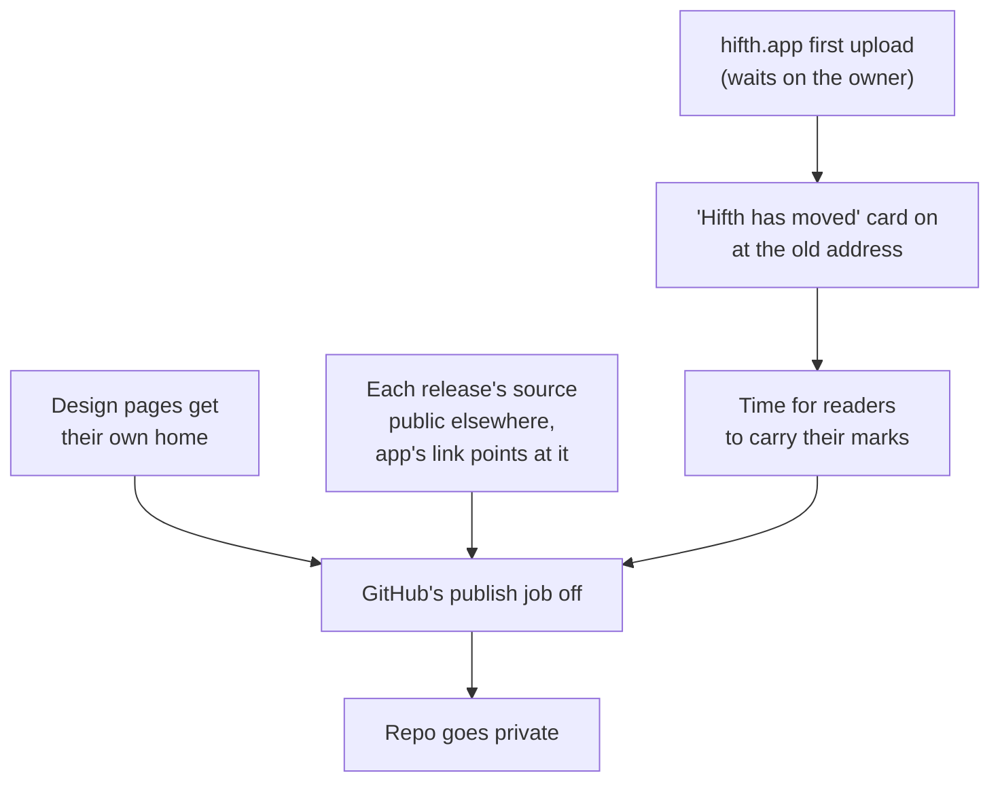

# Publishing from the laptop, and a private repo

*Written 2026-11-17. Both choices were made by the owner on that day.*

**The short version.** GitHub stops publishing anything. The reading app already has a new
home, hifth.app/read, sent up from this laptop (decided 2026-11-11). What is still homeless is
the design pages and the old address, blog.bytesofpurpose.com/hifth. The repo goes private
last, once readers have had time to carry their marks across, the design pages have a new home,
and every release's source is public somewhere else.

## Where should the site be published from?

**Decided: from this laptop (B).** The owner chose it on 2026-11-17, over A, which kept GitHub
publishing on each merge.

- **A, GitHub publishes.** About one minute of GitHub's time per merge. No work, and it works
  with the laptop shut.
- **B, the laptop publishes.** GitHub runs nothing. A publish needs the laptop on, and a merge
  stays unpublished until someone runs the command.

After the choice, we found that the repo was public. GitHub does not charge for jobs on public
repos run on its standard machines (its billing page, "About billing for GitHub Actions"). So
A was costing nothing. The owner was told and kept B, then chose to make the repo private,
where A would cost minutes again.

## Should the repo be private?

**Decided: yes, once nothing would break (owner, 2026-11-17).** There were three choices:

| Choice | What it buys | What it costs |
|---|---|---|
| **Private, the laptop publishes to Cloudflare (chosen)** | History, branches and pull requests hidden, including the old commits that held pictures of the book. GitHub runs nothing. | About a day of work, and an address change for the design pages unless the blog's Cloudflare account can serve the old path. |
| Private, pay for GitHub Pro | Same addresses with no move | About $4 a month; publishing on GitHub uses minutes again |
| Stay public | Nothing breaks | Code and old commits stay visible |

**What "private" does not hide.** The word-root data comes from the Quranic Arabic Corpus,
which is under the GPL. Each build we publish, on the site or in the App Store, has to offer
the full source of that build to whoever runs it. So the code of every release stays public.
What a private repo hides is everything else: the history, the branches and the pull requests.

## What has to be true before the repo goes private?

1. **Readers have had time to carry their marks.** A reader's marks live in their browser,
   under the old address. Only a page served from that address can read them, so the old
   address has to keep answering, with the "Hifth has moved" card switched on (backlog row
   `carry-marks-switched-off`), for a while after hifth.app/read is live. A private repo on
   GitHub's free plan serves nothing, so the old address goes dark the moment the repo goes
   private.
2. **The source link points at a public copy.** The app's colophon links to the source of the
   very build it is running, at this repo, by commit. A private repo would make that a dead
   page. It moves to the public source copy below, linked by release, and the source-offer
   check passes when run as a stranger, after the switch, not before.
3. **The design pages have a new home**, and the rule that every design is public names it.
4. **No other link points at the repo.** Today: the front page and its privacy page (English
   and Arabic), the trust page, and the app's source link.
5. **No one has forked it.** Public forks stay public. Checked 2026-11-17: no forks.
6. **GitHub's publish job is off**, so a merge does not try to publish to a site that no longer
   exists.

## Where do the design pages go?

The hifth.app release leaves them out on purpose: that site holds only what a reader needs.
So they get a Cloudflare site of their own on the hifth account, sent from the laptop, with
its address kept in one place so a later move is a one-line change. Keeping the old address
instead would need a rule on bytesofpurpose.com, which is in a Cloudflare account this laptop
does not sign in to (its name servers differ from both accounts here; checked 2026-11-17), and
it is the owner's other site. That is the owner's call.

## Where does each release's source go?

**A public repo that holds only the files of each release, with no history.** The owner's pick
was a download on the site, but it does not fit: the release's files come to about 107 MB, and
Cloudflare takes files of at most 25 MiB each (its "Limits" page). A second repo, pushed from
the laptop at each publish, holds one commit per release, tagged with the main commit it came
from. It never holds the history, so the old pictures never reach it, and GitHub runs no job
for it. This is a change from the owner's pick, so it is on the owner's list until they say
yes; until then it is built and tested against a repo on this laptop.

Two conditions before the app's source link is switched to that repo:

- **The source goes up before the build it belongs to.** Each release sends its source first,
  for the very commit it built (`make hifth-app-source TO=… COMMIT=<that commit>`), and only
  then uploads the build. Otherwise a reader could open the link in a new build and find
  nothing there yet.
- **The owner says which folders stay out.** The copy today holds every file of the commit,
  which includes the agents' notes, the page-comment threads and the locked secrets file
  (locked, but still there). Leaving folders out is one more step in the script; which ones is
  the owner's call, since the licence asks for the full source of the program and those
  folders are not the program.

## How does the laptop know the build holds nothing private?

The laptop keeps the pitch build's private folder, which git ignores. GitHub's publish built
from a fresh copy, which is what proved the site never held that folder. The laptop command
keeps that: it makes a clean copy of the released commit in a scratch folder (which has no
private folder), runs the same site checks there, and only then sends the result. It refuses
anything that is not on main as GitHub has it.

## What else was considered?

**A new public repo under the old name, serving the old address from GitHub.** The blog's own
site is a GitHub site, so a public repo called hifth, holding only the built site and the
release source, would keep every address with no Cloudflare step. Not chosen by default,
because GitHub runs a job on every push to it (the owner chose against GitHub running jobs),
and every checkout on this laptop pushes to that name today: one push from a session that
missed the change would send the whole history, old pictures included, to a public repo. It is
on the owner's list as an option.

## Open questions, and what would answer each

### ① What has to be true before the repo goes private? · **open**

The list under the same question above. What answers it: each item done and checked, in that
order, with the private switch last. Backlog row `laptop-publish`.

### ② How do checks and publishing go back to GitHub when another developer joins? · **open**

Until then the laptop checks every push and publishes. A second developer's pushes would not
pass through our hooks, so the plan is: run the push checks on GitHub for each pull request,
require them before a merge, and put the publish job's push trigger back, sending to
Cloudflare with a saved key. What answers it: a second developer being given write access.
Backlog row `ci-when-others-join`.

## Where things stand

- Backlog row `laptop-publish` holds the work; `ci-when-others-join` holds the plan for moving
  checks and publishing back to GitHub when other developers join.
- Waiting on the owner: hifth.app's first upload (its own row, `hifth-app-first-release`); a
  yes to the source repo; whether to keep the old address for the design pages.
