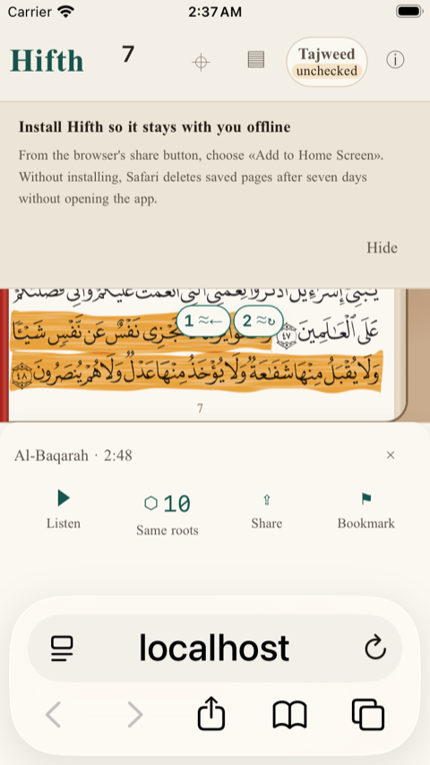
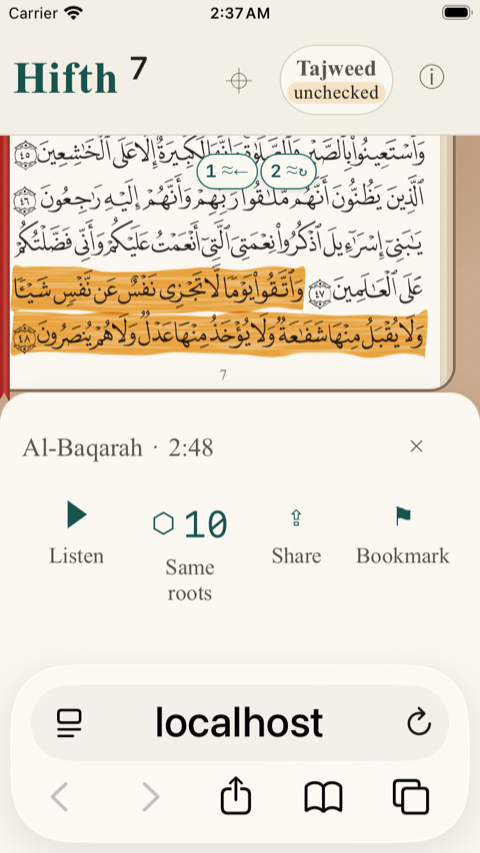
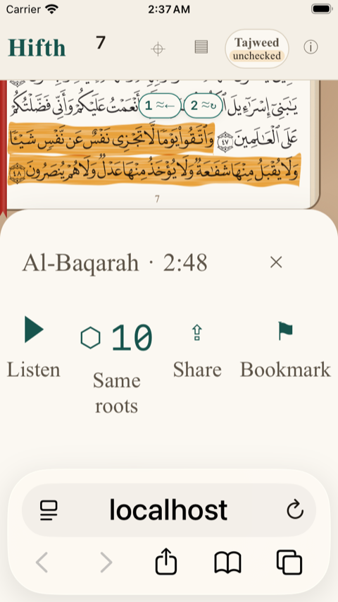
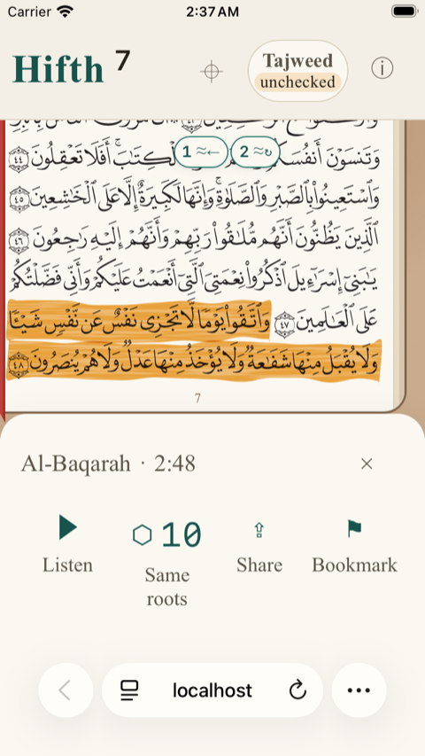

# When a reader makes their phone's text larger, what in Hifth should grow with it?

*Asked 2026-11-20 by the launch loop, for the owner. Three ways are built in a separate build of the app, so they can be tried by hand on a phone; the ordinary app has none of it yet. The pictures are the iPhone SE simulator, in English, with verse 2:48 chosen.*

*This note is the record. Its page is [larger-text-options.html](larger-text-options.html), on the site at <https://blog.bytesofpurpose.com/hifth/docs/design/larger-text-options.html>, rebuilt from this note by `scripts/build-design-note.mjs`. The pictures are remade by `larger-text-options/shoot.sh`.*

> [!tip] Short version
> **What differs:** today the mus'haf page has its own size control, but the bars, buttons and panels around it never grow, even when the phone's text is set to its largest. The three ways differ in what grows and who sets the size.
> **Recommended: follow the phone (A) as the default, with "our own size" (C) kept as a setting in the info panel.** A reader who already made their phone's text larger gets bigger controls without looking for anything; a reader on a computer, or one who wants only Hifth bigger, can pick a size.
> **What none of them does yet:** Apple's "Larger Text" label in the store asks for text that reaches twice its size through the common tasks. The top bar stops at 1.25 times on a small phone, so whichever way wins, the store's answer stays "no" until that is solved (see the last section).

## What do the words on this page mean?

- **The bars**: the strip across the top (the app's name, the page number, the tajweed button, the info button) and the strip across the bottom.
- **The panels**: what rises over the page: the chosen verse's tools drawer, the info panel, the look-alikes list.
- **The phone's text size**: the setting in the iPhone's Settings, under Display, or Accessibility for the largest sizes. Most apps grow their words with it.
- **Mus'haf page**: the printed page itself. It is never touched by any of this; it already has its own size control.

## What changes for a hafiz?

> [!important] For a hafiz mid-revision
> A hafiz with weak eyes revising from the phone can already make the page bigger, but then squints at the tools around it: the verse's Listen and Same roots buttons, the page number, the look-alikes count. Bigger controls mean fewer missed taps mid-recitation and less leaning in to read "2:48". It touches only readers who have made their text larger; for everyone else, nothing moves.

## Why is this being asked now?

The launch walk as Apple's reviewer (2026-11-17) set the iPhone SE to its largest text and nothing outside the page grew. Apple's store listing asks whether the app supports larger text, and the answer has to match the app. The three ways were built rough on 2026-11-19 and walked on the simulator on 2026-11-20; the faults that walk found are fixed (the words not growing on iPhone Safari, the info button pushed off the screen, the drawer covering the verse, the Same roots count dropping under its icon).

## What happens if nobody decides?

The app stays as it is: the controls never grow. The store's larger-text answer is "no", which is honest. Nothing else is blocked, but the rough build cannot ship as it is: the app is at its size limit and the chosen way needs a trim to fit (backlog row text-grow-needs-a-trim), and that trim waits on knowing which way to keep.

## What do the three ways look like?

The phone's text at its largest size for A and B; for C the phone is at its normal size and the reader picked 1.5 times in Hifth.

| Today | A. Follow the phone | B. Only the panels | C. Our own size (1.5) |
| --- | --- | --- | --- |
|  |  |  |  |
| Nothing grows. (Safari's own install notice shows here; with a way picked it waits while the drawer is open.) | The top bar grows to 1.25 times, the most a 375-wide phone fits; the drawer grows as far as the room under the verse allows. | The top bar stays as it is; the drawer grows twice over, as large as the room allows. | The same as A, at a size picked in Hifth rather than in the phone's settings. |

C at its smaller step, 1.25 times: [own-125.png](larger-text-options/own-125.png).

## A. Follow the phone as the default, with our own size kept as a setting — recommended

The bars and the panels grow with the phone's text size. On a computer, the browser's own text setting counts the same way.

> [!important] For a hafiz
> Nothing to find: a reader who already set their phone large gets larger controls the first time they open Hifth.

- **Gets:** the way every well-made iPhone app behaves; no new setting to learn.
- **Costs:** on a small phone the top bar loses its tagline and the ▤ mus'haf button (the info panel's "Choose the mus'haf" is still there). A reader who wants large text everywhere except Hifth cannot say so.
- **Commits to:** testing every new bar and panel at the largest size.

## B. Only the panels follow the phone

The tools drawer and the panels grow; the bars stay as they are.

> [!important] For a hafiz
> The verse's tools and the lists are easy to read; the page number and the top buttons stay small.

- **Gets:** the top bar keeps every button and the tagline on a small phone; the panels get the most room to grow.
- **Costs:** half an answer. The page number, the thing a hafiz looks at most, stays small.
- **Commits to:** a store answer of "no", since the bars are part of the common tasks.

## C. Our own size, picked in Hifth

A setting in the info panel: normal, 1.25 times or 1.5 times. The phone's setting is ignored.

> [!important] For a hafiz
> The one way that works the same on the iPad, a computer and a phone, and the one way that makes Hifth larger without making every other app larger too.

- **Gets:** control for the reader; the same size everywhere they read.
- **Costs:** a reader has to know to look for it; the one who set their phone large and expects apps to follow gets nothing until they find it.
- **Commits to:** a setting with steps we choose. Past 1.5 the drawer stops growing on a small phone because the room under the verse runs out.

## What else could be considered, and why is it not here?

- **Grow the mus'haf page too.** Left off: the page already has its own size control, and growing it with the text would fight that control.
- **Follow the phone, and also offer our own size (A plus C).** This is the recommendation: the project keeps a built runner-up as a setting rather than deleting it.
- **Rebuild the bars to wrap onto two lines** so the top bar can reach twice its size. Not an option for this choice; it is the follow-up the store answer needs, whichever way wins.

## What have we already decided that touches this?

- **ayah-drawer**: the verse's tools sit in one drawer that rises from the bottom and must leave the verse in sight. That is why the drawer here grows only as far as the room under the chosen verse allows.

## What do others do?

- Apple's "Larger Text" label in the App Store asks that text can be made at least twice as large through an app's common tasks, and suggests following the phone's setting (Dynamic Type) as the usual way. *Seen in a search summary of Apple's 2025 talk on accessibility labels ([WWDC25 session 224](https://developer.apple.com/videos/play/wwdc2025/224)) and the store's page on the labels; the full criteria page was not opened.*
- Other mus'haf apps: not looked at this time.

## What would change the answer?

- If walking with the owner's own phone shows the panels covering what they are about at the largest sizes, B or C (with its cap at 1.5) gets more attractive than A.
- If most readers use Hifth on a computer or iPad, where no phone setting applies, C matters more than A.

## What is this not settling?

- **The store's larger-text answer.** No way reaches twice the size today: the top bar stops at 1.25 times on a small phone, and C stops at 1.5. Answering "yes" needs the bars rebuilt to wrap, and that is a separate piece of work after this choice.
- **The trim** that lets the chosen way fit in the app's size limit (backlog row text-grow-needs-a-trim).
- **Arabic.** Walked on the simulator only with A at the largest size; B and C were drawn in English only.

## How do I try it by hand?

From the repository: `make text-grow-serve PORT=5795`, then open the address it prints on the phone with `?grow=phone`, `?grow=panels`, `?grow=own&size=1.5` or `?grow=off`. The choice is kept on that phone until another link changes it.

## So what is being decided?

Which way should the app ship with as the default, and which of the others stay as a setting: **A. follow the phone**, **B. only the panels**, **C. our own size**, or **D. nothing grows, as today**.
