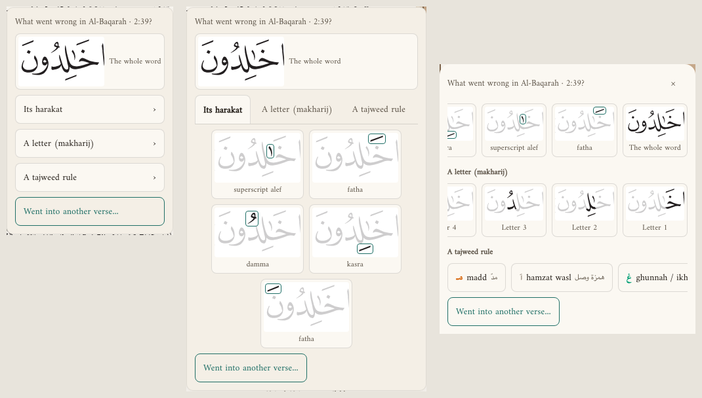
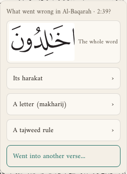
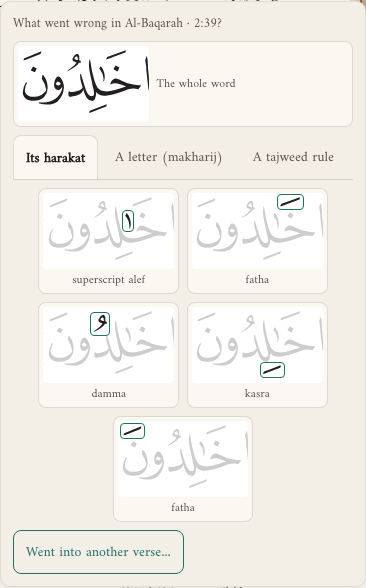
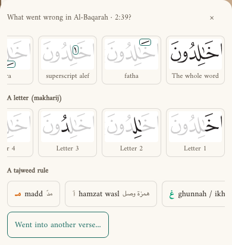
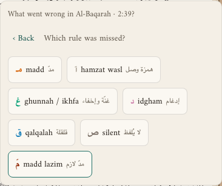
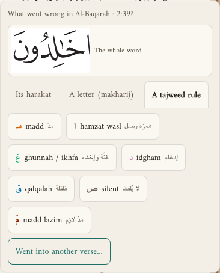
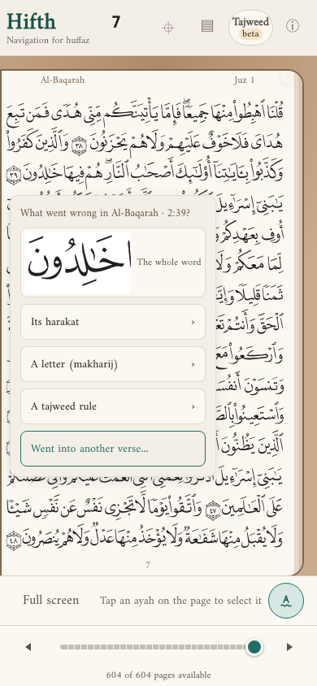
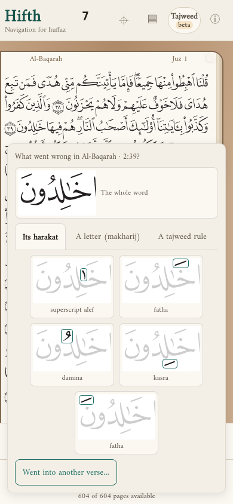
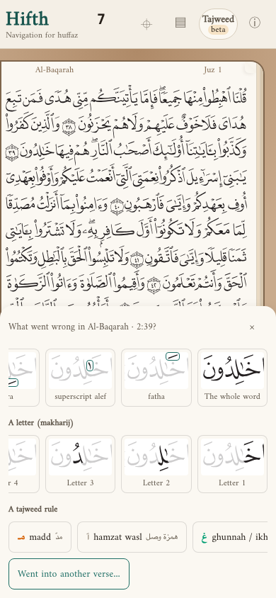

# How should the Mistake pen ask what kind of mistake it was?

*Asked 2026-11-12, from the owner's comment on the front page: a mistake is not only a wrong harakah or a hop into another verse. It can be a letter said from the wrong place (makharij) or a tajweed rule left out. The app now asks the kind as well as where, and there are three ways to lay out that question. All three are built into the app. Pick one in the info panel under "How the Mistake pen asks", use it for a while, then tell Claude the letter.*

> [!tip] Recommended
> **A — kind first, then which.** It is what the owner asked for. The first screen is five short lines, so it covers the least of the page. The cost is a second tap for every kind except the whole word and another verse.

Until you pick, the app uses **C, everything at once**, because no answer is more than one tap away.

---

## A few words, defined once

- **Harakah** (plural *harakat*) — a vowel mark on a letter: fatha, kasra, damma, sukun, shadda, the superscript alef.
- **Makharij** — where in the mouth or throat a letter is said from. A makharij mistake is a letter said wrong.
- **Tajweed rule** — madd, ghunnah and ikhfa, idgham, qalqalah, hamzat wasl, a silent letter, madd lazim.
- **The Mistake pen** — the tool you pick (or press M) to mark where you slipped while reciting.

## What changes for a hafiz?

> [!important] For a hafiz mid-revision
> Marking *what kind* of slip it was shows, over weeks, whether your weak spots are words, vowels, letters or rules. The calendar's day view now counts letters and rules too. The layout decides how many taps that costs, and how much of the page the question covers while you mark.

## The three ways, side by side

The first thing you see after tapping a word with the Mistake pen, on a phone:

| | A — kind first, then which | B — kinds as tabs | C — everything at once |
| --- | --- | --- | --- |
| First screen |  |  |  |
| After choosing "A tajweed rule" |  |  | already shown |
| Taps to mark a rule | 2 | 2 | 1 |
| *For a hafiz* | Calm: five lines, then only the choices you need. Back returns to the kinds. | The harakat are open from the start, so a vowel slip is still one tap. The card is tall and covers most of a phone page. | Every answer one tap away, in a strip at the bottom. The rows scroll sideways, so some choices start off-screen. |

> [!note]- What each looks like over the whole page
> | A | B | C |
> | --- | --- | --- |
> |  |  |  |

## What did taking the pictures show?

- **A and B float as a card over the page; C rises from the bottom.** C keeps the top of the page visible; A and B keep the verse you tapped visible but cover the lines under it.
- **B's harakat cards wrapped to one side**, leaving an empty column on the left. Fixed: the cards are now centred, with a test that checks it.
- **On a phone, every row of C fits** once the page's own comment bar is out of the way: the rules and "Went into another verse…" are both on screen without scrolling up.

## What else could we consider?

- **Ask the kind after marking**, not before: mark the word at once and ask later. The existing "mark at once" setting already does half of this.
- **Remember the last kind**, so a run of rule mistakes opens on the rules. Not built yet; worth trying once one layout is picked.

## What would change the answer?

Using it on the iPad with the pencil. If A's second tap feels slow mid-recitation, C wins; if C's strip feels crowded, A wins.

## What is this not settling?

Which tajweed rules are on the list, and whether a mark can hold two kinds at once. Today a mark holds one kind, and choosing another replaces it.
