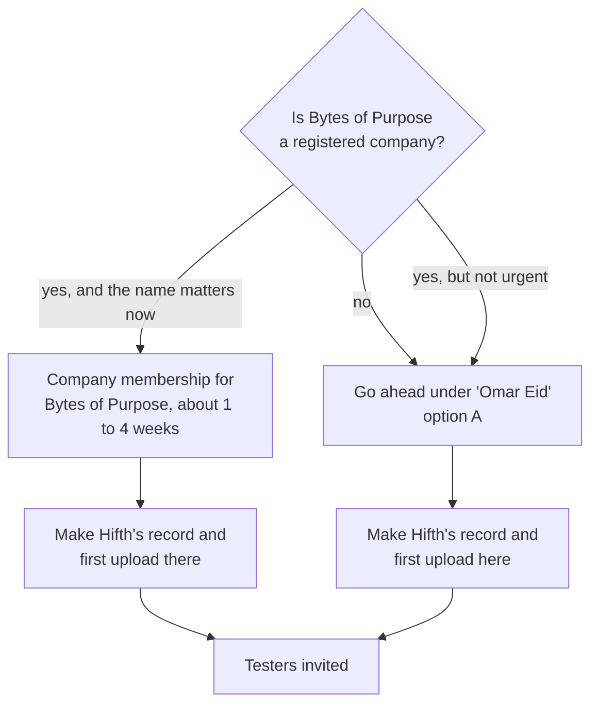

# How do we get Hifth shown as published by Bytes of Purpose?

*Started 2026-11-08, the day the owner bought the paid Apple Developer membership. Apple shows
it as "Omar Eid - 76NHKA839A": a membership for a person, not a company (76NHKA839A is the team
ID). The owner wants Hifth to appear under Bytes of Purpose, the name the site and the app's ID
already use. The same membership also holds the older Prayer Buddy app and its watch app. The
start page for testers and paid extras: [design.md](../design.md). The plan this page changes:
[testflight-plan.md](testflight-plan.md).*

## The short version

**Decided (owner, 2026-11-08): Hifth is published under "Omar Eid", the membership we already
have (option A).** Bytes of Purpose is not a registered company yet, and only a registered
company can be the name Apple shows. Prayer Buddy stays as it is. So the TestFlight plan goes
ahead on team 76NHKA839A with nothing held back, and testers will see "Hifth, by Omar Eid".

**What this rules out:** the name shown under Hifth is fixed when its App Store Connect record is
made, so if Bytes of Purpose is registered later, Hifth may keep showing "Omar Eid". Apple can
move an app to another membership only after it has been released in the App Store once, so a
move is still possible after a release, just not before.

**How the answer was reached:** a membership for a person always shows the person's legal name.
Three steps in the TestFlight plan tie Hifth for good to whichever membership does them first:

1. making Hifth's record in App Store Connect (the name shown under it is fixed when the record
   is made);
2. uploading the first build (after that, the app's ID can never be used by another record);
3. making the iCloud storage box for the usage-count sync (it can never be deleted).

So the question that decided it was the owner's: is Bytes of Purpose a registered company? It is
not, so all three are done in the personal membership.

## What does it change for a hafiz, and for the testers?

For a hafiz using the app: nothing. The pages, the marks and the recitation are the same under
either name.

For a tester on The Study Quran team: the invite and the TestFlight app show the app as
**"Hifth, by Omar Eid"** or **"Hifth, by Bytes of Purpose"**. A person's name reads as a
personal project; a company name reads as a publisher they could sign an agreement with. For a
pitch about a collaboration, the second is the stronger first impression, but it is not what
decides the collaboration.

For you: a company membership is a second yearly fee (99 US dollars), a few documents, and a
wait of days to weeks before anything can be uploaded.

## What does Apple show for each kind of membership?

| | Membership for a person (what you have) | Membership for a company |
|---|---|---|
| Name in the App Store | your legal name, "Omar Eid" | the company's legal name |
| Can a different name be set? | no | yes, a registered trade name of the company, set when an app's record is first made |
| Name testers see in TestFlight | "Omar Eid", we expect (see below) | the company's name, we expect |
| What you need | an Apple account and the fee | a registered company, a D-U-N-S number, a website on the company's own address, a work email on that address, the right to sign for the company |
| Fee | 99 US dollars a year | 99 US dollars a year |
| How long to approve | usually a day or two | the D-U-N-S number up to 5 working days, then 2 more before Apple sees it, then Apple's own check (no stated time) |

What these rest on:

- *Your legal name is the seller for a person; the company's legal name for a company; a sole
  trader must join as a person; trading names are not accepted as the company:* Apple's
  enrolment help page, **read in full** ([developer.apple.com/support/enrollment](https://developer.apple.com/support/enrollment/)).
- *The name under the app defaults to your legal name; only a company can set a different one,
  and only when the record is first made, never edited after:* Apple's "Set your developer name"
  page, **read in full** ([link](https://developer.apple.com/help/app-store-connect/create-an-app-record/set-your-developer-name)).
- *The D-U-N-S number is free, up to 5 working days, then 2 more for Apple:* Apple's D-U-N-S
  help page, **read in full** ([link](https://developer.apple.com/help/account/membership/D-U-N-S/)).
- *What testers see:* a developer's forum post, **read in full**, shows the invite reads
  "[app] By [company name] for iOS" ([thread](https://developer.apple.com/forums/thread/768981)).
  We did **not** find an Apple page that says which name a person's membership shows in
  TestFlight; "Omar Eid" is our inference from the name rule above, not something we have seen.
- *Approval time for a company:* only other developers' reports, from search snippets, ranging
  from 1 day to several weeks. We did not find an Apple figure.
- *What it costs to register Bytes of Purpose as a company* (state fees for an LLC, say): we did
  **not** look.

## Can this membership be changed into a company one?

Yes, by asking Apple; there is no button for it. What we found:

- **Apple says to contact them** to change a person's membership into a company one: the
  enrolment page, **read in full**.
- **The team ID stays the same**, says an Apple Developer Support reply on the forum, **read in
  full** ([thread](https://developer.apple.com/forums/thread/853310)). It is a forum reply, not
  a help page. So the signing settings, the app IDs and Prayer Buddy stay where they are.
- **But apps already made may keep your personal name.** A developer converted in January 2026
  and their existing apps still showed their personal name; two more reported the same through
  October 2026; Apple has not answered ([thread](https://developer.apple.com/forums/thread/813734),
  **read in full**). Combined with "the name is set when the record is first made and cannot be
  edited", this means: **if Hifth's record is made before the change, it may stay "Omar Eid"
  for good.**
- **It can take a long time, and can block uploads while it runs.** Reports on two forum
  threads, **read in full**, range from one day to over six months, and one developer was locked
  out of TestFlight while waiting ([thread](https://developer.apple.com/forums/thread/740208),
  [thread](https://developer.apple.com/forums/thread/773949)). Nine more threads with the same
  story we only saw as search titles.
- **Prayer Buddy goes with it.** Changing the membership changes it for every app it holds, so
  Prayer Buddy would also become a Bytes of Purpose app (or keep your name, per the report above).

## Could a second, company membership take Hifth over later?

Not by Apple's app transfer, not while Hifth is only on TestFlight:

- **A transfer needs the app to have been released in the App Store at least once**: Apple's
  transfer rules, **read in full** ([link](https://developer.apple.com/help/app-store-connect/transfer-an-app/app-transfer-criteria)).
  Hifth is not aiming at the App Store (backlog: app-store-not-a-target).
- **TestFlight builds and testers do not travel**: Apple says to remove them before a transfer
  ([overview](https://developer.apple.com/help/app-store-connect/transfer-an-app/overview-of-app-transfer), **read in full**).
- **Once a build is uploaded, the app's ID is used up**: removing the record does not free
  com.bytesofpurpose.hifth for anyone else: Apple's "Remove an app" page, **read in full**
  ([link](https://developer.apple.com/help/app-store-connect/create-an-app-record/remove-an-app)).
  An Apple engineer on the forum says the same holds once App Store Connect has seen the ID at
  all (search snippet only).
- **The iCloud storage box can never be deleted**: Xcode's help page, **read in full**
  ([link](https://help.apple.com/xcode/mac/current/en.lproj/devcae40ccb9.html)). That its name
  is then taken for every other membership too we saw only in search snippets.

So a second membership can take Hifth only if Hifth's record, its first upload and its iCloud
box are made **there first**. Otherwise the company version would need a new app ID, a fresh
record and testers invited again.

## Can TestFlight go ahead now and move later without losing anything?

No, not cleanly. A TestFlight-only app cannot be transferred, the ID cannot be reused after an
upload, and the name under the app is fixed when the record is made. Testing now under "Omar
Eid" is fine **if you are content for Hifth to stay under your name**, and converting this
membership later would then be the only route to Bytes of Purpose, with the name risk above.

The upload is not ready anyway: it waits on the licence reading and on the archive step
([testflight-plan.md](testflight-plan.md) ④ to ⑥), so deciding this first does not slow the
testers down unless the company membership itself takes longer than the licence reading.

## What are the options?

| | A. Stay a person now, change later | B. Change this membership to a company now | C. A second, company membership; move Hifth later | D. Hold three steps; if Bytes of Purpose is a company, start Hifth in its own company membership |
|---|---|---|---|---|
| **What it buys** | Testers sooner; no papers; one fee | One membership, same team ID, Prayer Buddy and signing untouched | Prayer Buddy stays under your name; Hifth's membership is clean | Hifth shows Bytes of Purpose from its first invite; nothing permanent is done under the wrong name |
| **What it costs or risks** | Testers see "Omar Eid"; the name may never change for Hifth even after a later change | Needs a registered company; Apple's wait is unknown and has blocked TestFlight for others; Hifth may still keep your name if its record already exists, or if Prayer Buddy already fixed the account's name | **Does not work for a TestFlight-only app**: no transfer without an App Store release, and the ID and iCloud box are used up | Needs a registered company; a second 99 dollar fee; days to weeks of waiting before the first upload |
| **What it commits you to** | Hifth's record, ID and iCloud box live in your personal membership for good | Prayer Buddy becomes a Bytes of Purpose app too; one more Apple support case to chase | A new app ID for Hifth (com.bytesofpurpose.hifth is lost to the old membership) and testers invited again | Two memberships to renew; the TestFlight plan's ① and ② move to the new membership's team ID |
| **For testers** | "Hifth, by Omar Eid" | Probably "by Bytes of Purpose", once the change lands | A second invite to a different app | "Hifth, by Bytes of Purpose" from the start |

**Recommended: D if Bytes of Purpose is a registered company, A if it is not**, because the
three permanent steps cost nothing to hold while the licence reading is still out, and D is the
only route where the name is right from the first invite.

Other routes we looked at and left out

- **Test under a throwaway app ID now** (say com.bytesofpurpose.hifth.preview) in your personal
  membership, keeping the real ID free for the company. It works, but testers would have to be
  invited again to the real app later, and the preview's iCloud box would be wasted. Worth it
  only if the company membership turns out to take months.
- **Show "Bytes of Purpose" as a trading name on a person's membership.** Apple does not allow
  it: trading names are accepted only for companies, and only as a second name on top of the
  company's legal name.

## What would change the answer?

- If Bytes of Purpose is not a registered company and you do not plan to make it one, the
  answer is A, and the rest of this page is a footnote.
- If the licence reading comes back yes in days while the company membership takes weeks, it
  may be worth testing under your name (A) and accepting it.
- If Apple support confirms in writing that a converted membership can rename an existing app's
  developer name, B becomes as good as D and saves the second fee.

## What this page is not settling

It does not decide whether Bytes of Purpose is, or should become, a registered company; that is
yours, and possibly a question for an accountant. It does not change the licence question or
the App Store question; those stay in the TestFlight plan and the backlog.

## Open questions, and what would answer each

### ① Is Bytes of Purpose a registered company (an LLC or similar), or a name you trade under? · **answered**

Not yet (owner, 2026-11-08). So Apple cannot show it as the seller, and Hifth goes out under
"Omar Eid" (option A).

### ② Does the name testers see matter enough to wait for a company membership? · **answered**

No wait: with no registered company there is nothing to wait for. Testers will see "Hifth, by
Omar Eid".

### ③ Hold the App Store Connect record, the first upload and the iCloud box until ① and ② are answered · **answered**

No hold. With ① answered, all three are done in the personal membership, team 76NHKA839A, as
the TestFlight plan already says.

### ④ Is Prayer Buddy in the App Store, and should it stay under your name? · **answered**

It stays as it is, under the owner's name (2026-11-08). That rules out changing this membership
into a company one (option B).

### ⑤ Get a D-U-N-S number and enrol Bytes of Purpose as a company · **answered**

Not now: Bytes of Purpose is not a registered company (①). If it is registered one day, this is
the path, and Hifth could move to it only after an App Store release. It needs the D-U-N-S number
(free, up to 5 working days, then 2 for Apple), the website on bytesofpurpose.com, an email on
that address, and 99 US dollars a year.

### ⑥ Move the TestFlight plan to the company membership's team ID · **answered**

Not needed: the TestFlight plan stays on team 76NHKA839A.
