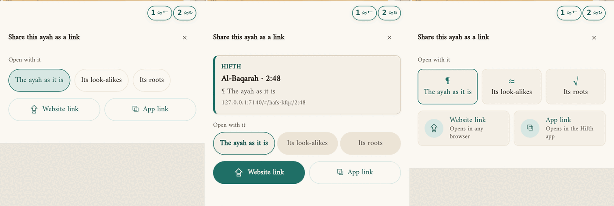
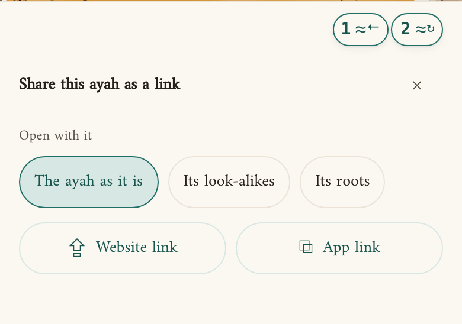
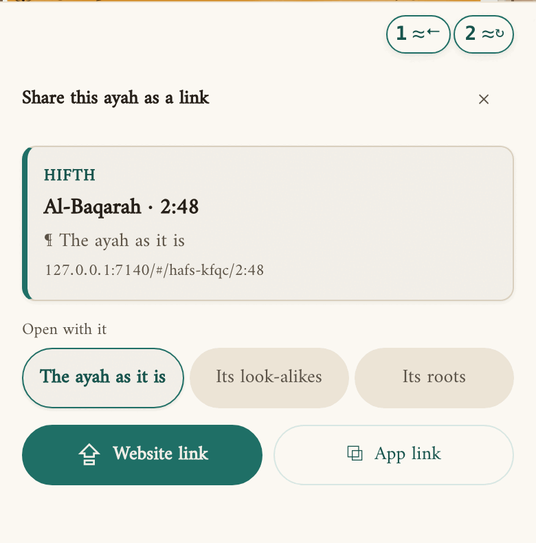
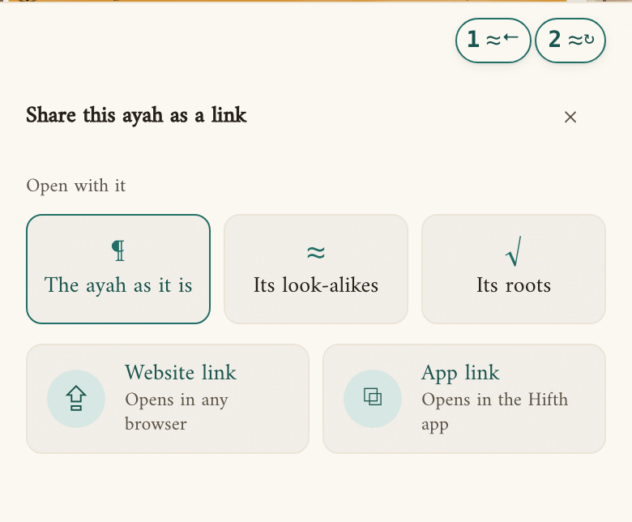
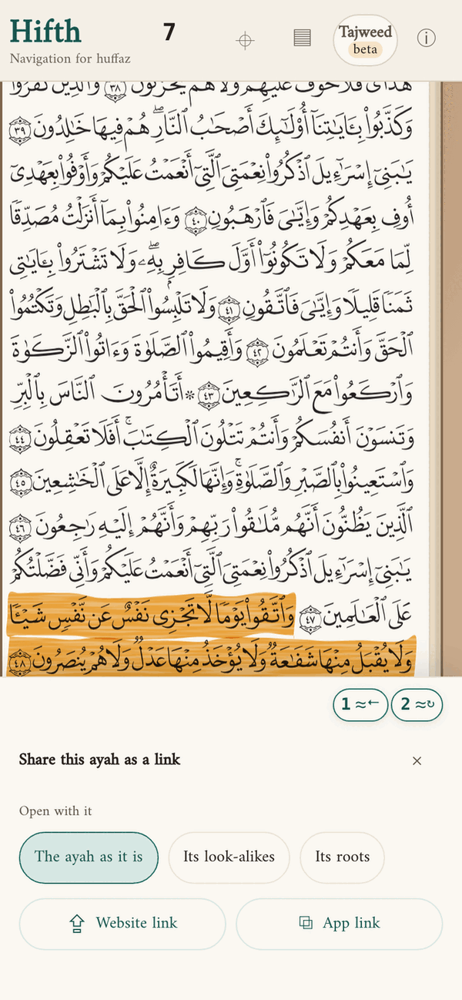
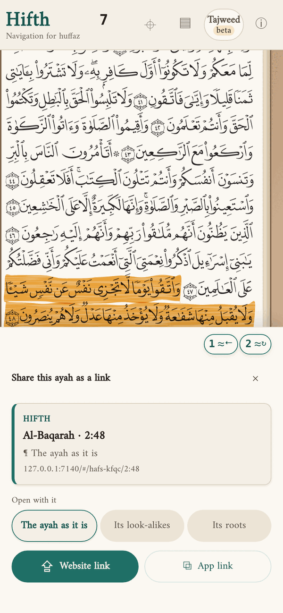
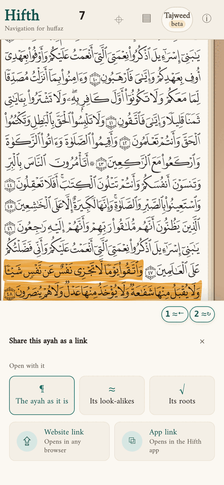
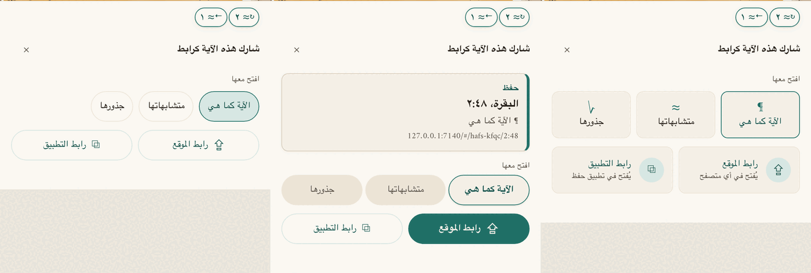
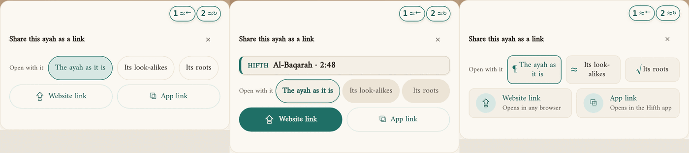
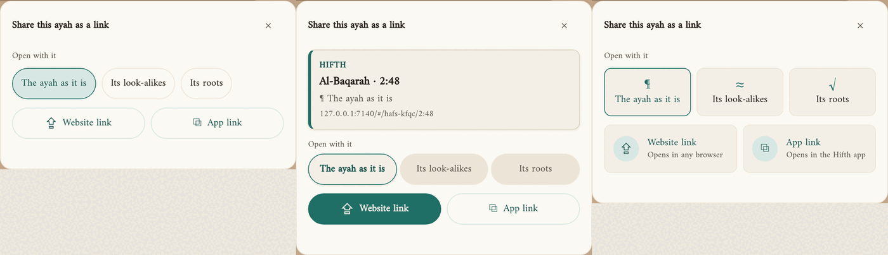

# How should the share menu look?

*Asked 2026-11-12, from the owner's comment on the front page: the share menu is too plain. Today it is three rounded buttons for what the link opens with, and two more for the links, all in the same thin outline. There are now three looks, all built into the app. Pick one in the info panel under "How the share menu looks", share a few verses with it, then tell Claude which one.*

> [!tip] Recommended
> **Preview card.** It shows the link the way a friend will receive it, with the verse's name and what it opens with, before you send it. And it makes one button the obvious one to press. Tiles explain the most, but they make the menu taller and busier for something you do in a few seconds.

Until you pick, the app uses the **preview card**.

---

## A few words, defined once

- **The share menu**: the small card that opens from "Share" under a verse. It has a row of choices for what the link opens with (the verse as it is, its look-alikes, or its roots), and two links.
- **The website link**: opens the verse in any browser. **The app link**: opens it in the Hifth app on a phone, an iPad or a Mac.

## What changes for a hafiz?

> [!important] For a hafiz mid-revision
> Barely, and that is on purpose. Sharing happens between revisions, not during one, and each look keeps the verse you are sharing in view above the card. What changes is confidence: with the preview card you can see which verse, and which view of it, you are about to send, so a wrong verse or the wrong choice is caught before it reaches a teacher or a friend.

The words, the choices and what each link opens are the same in all three. Only how they are drawn changes.

## The three looks, side by side

On a phone, today's look first:

| | Plain (today) | Preview card | Tiles |
| --- | --- | --- | --- |
| Phone |  |  |  |
| What you see first | Three choices in a row | The link as it will arrive: Hifth, the verse's name, what it opens with, the address | Three tiles, each with a sign: ¶ the verse, ≈ look-alikes, √ roots |
| The two links | Two buttons that look the same | The website link is filled in, the main button; the app link is an outline | Two tiles, each saying where it opens ("Opens in any browser", "Opens in the Hifth app") |
| Height on a phone | The shortest | About a card taller | A little taller than plain |
| *For a hafiz* | Quick, but nothing confirms which verse you are sending. | You see the verse's name and the choice before you send. | Says the most about each link; slower to read. |

> [!note]- The whole phone screen, with the verse above the card
> | Plain | Preview card | Tiles |
> | --- | --- | --- |
> |  |  |  |

> [!note]- In Arabic, on a phone held sideways, on an iPad and on a computer
> In Arabic the card reads right to left; the address stays left to right.
>
> 
>
> On a phone held sideways the preview card shrinks to one line, the verse's name, so the buttons stay in sight.
>
> 
>
> 
>
> 

The pictures come from the development server, so the address in the preview card reads 127.0.0.1. On hifth.app it reads hifth.app.

## What did building it show?

- **On a phone held sideways, the full preview card pushed the buttons out of sight.** There is little height there, and the card's address and "opens with" lines took it. Sideways, the card now keeps one line, the verse's name. A test now opens the menu sideways in every look, in English and in Arabic, and fails if any button is cut off.
- **Tiles left empty columns on a wide screen.** Laid out as a grid, the three tiles took only part of the row on a computer. They now stretch to fill it.
- **The inside-the-drawer menu pushed the links out of sight on a verse low on the page.** With "Inside the verse's drawer" on, the drawer's tool panel gets only the room left under the verse, and never less than about 160 pixels. The preview card and the tiles were taller than that, so on Al-Baqarah 2:48 you had to scroll to reach the links. Inside the drawer the card is left out (the drawer's heading already names the verse) and tiles sit one line high. A test now checks every look fits in that smallest room.
- **The menu sometimes reopens on the last choice.** In the iPhone test run, a menu that had picked "Its roots" opened on "Its roots" the next time. The choice is kept while the share button stays on screen and is saved nowhere, so it lasts only until the button is redrawn. Whether a computer does the same is not yet checked; it is on the backlog. It is older than this change and the same in every look. The preview card shows the choice either way, so you see it before sending.

## What else could we have tried?

- **A picture of the verse in the preview**, as a message app would show it. It would look the most like the real thing, but the menu would have to draw the page for every share, and the verse is already in view above the card.
- **The phone's own share sheet only.** Simple, but it cannot ask what the link should open with, and that choice is the reason the menu exists.
- **A QR code** to show a teacher sitting nearby. Useful in a class, but it is a different feature; it belongs on the backlog, not in this choice of look.

## What would change the answer?

- If most shares turn out to be the app link (to your own iPad, say), the preview card's filled website button points at the wrong one, and tiles, which treat both links the same, would win.
- If the menu is mostly opened on a computer, where height costs nothing, tiles lose their cost.

## What is this not settling?

- **What the links open, and their addresses.** That is the share-sheet decision, unchanged here.
- **The share menu inside the verse's drawer** (a setting) uses the same looks, without the preview card and with one-line tiles (see above). It was checked on a phone held upright; it is not pictured here.

## Where it lives

- The setting: `apps/web/src/share-look.ts` (the key `hifth.share.look.v1`), offered in the info panel by `apps/web/src/components/Colophon.tsx`.
- The looks: `apps/web/src/components/ShareSheet.tsx` and `ShareSheet.module.css`, keyed on `data-share-look`.
- The tests: `apps/web/src/share-look.test.ts`; `apps/web/e2e/share-sheet.spec.ts`, "the menu opens as a preview of the link, and the info panel switches its look", and the sideways-phone test, run once per look.
- The pictures were taken at 390 × 844 (phone), 844 × 390 (sideways), 820 × 1180 (iPad) and 1280 × 900 (computer), on page 7 with the verse Al-Baqarah 2:48 picked.
