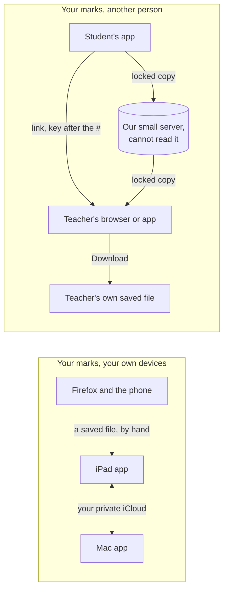

# How could a student send their mistakes to a teacher, and could your marks follow you from iPad to Mac?

*Written 2026-11-08 by the checker, from two separate research passes on the owner's question of
the same day. This is the page to act on. The two passes stay as the record it was built from:
researcher A ([findings](../research/sharing-between-readers/a/research.md),
[design](../research/sharing-between-readers/a/design.md)) and researcher B
([findings](../research/sharing-between-readers/b/research.md),
[design](../research/sharing-between-readers/b/design.md)). Nothing is built and no app code was
changed.*

> [!tip] Short version
> **Two questions, kept apart.** Your marks following you between your own iPad and Mac is one. Sending your marks to another person, such as a teacher, is the other. They need different kinds of consent.
> **Your own iPad and Mac:** yes, through your own private iCloud, on the same road you already picked for the usage counts. It waits on the apps being signed with the paid Apple membership, bought today. Firefox and the phone keep joining by a saved file.
> **Sending to a teacher:** not iCloud sharing. Apple requires every person in a share to have an iCloud account, so a teacher on Android or Firefox is left out.
> **Recommended, in one line:** build the teacher's view of someone else's marks first, fed by the file the app already saves; then turn it into the live, switch-off link you described, which keeps a locked copy our server cannot read, on a web address of its own and Cloudflare's free database; no accounts until a teacher needs all their students in one place.
> **Does it need a separate site?** Yes, a web address of its own (such as `hifth.bytesofpurpose.com`) for the share page, from the first live link. The reading app stays where it is. Once anyone signs in, a separate address is required, not just wise.
> **The record of when you read** never goes with a share by default. If it ever goes, it is a separate tick the student sees each time, and only once you allow it.

## Words used here

- **Hafiz, huffaz:** someone who has memorised the Qur'an, and the plural.
- **Mus'haf:** the printed Qur'an the app shows page for page.
- **Your marks:** what the app keeps for one reader: the words marked with the Mistake pen, the jumps from one verse into a look-alike verse, the notes and the bookmarks. They travel together in one saved file today.
- **The record of when you read:** the app's private log of which pages you opened and when, down to the time of night. It is kept apart from your marks on purpose.
- **The privacy check:** a check that runs before every push and refuses any code that could send your marks or your reading record off the device, unless that way out has been named and given a reason.
- **iCloud:** Apple's online storage tied to your Apple account. Your private part is yours alone; Apple also lets an app share a record from it with another Apple account.
- **A locked link:** a link whose marks sit on our server scrambled. The key to unscramble them is in the last part of the link, after the `#`, which a browser never sends to any server. So the server holds the copy and cannot read it.
- **Sub-address:** a web address of its own under the owner's name, such as `hifth.bytesofpurpose.com`, as opposed to a folder of the blog, such as `blog.bytesofpurpose.com/hifth/`.
- **Sign-in permissions:** what a reader agrees to let the app see when they sign in with Apple or Google. Developers call these "OAuth scopes".

## What does it change for a hafiz?

> [!important] For a hafiz and their teacher
> **Today** the student tells the teacher in words where they keep going wrong, or hands over the iPad. The teacher drills from memory of past lessons.
> **With sharing** the student sends one link before the lesson. The teacher opens it on their own phone or laptop and sees the student's mistakes and look-alike jumps drawn on the real page. The drilling starts at the verses this student keeps falling on. A mistake marked on Tuesday is on the teacher's screen by Thursday. The student can switch it off when lessons end, and the teacher can keep a copy with the download button.
> **What it must never do:** show anyone the student did not choose where that student's memory fails, or send the time-of-night record without the student meaning it.
> **On your own devices:** a mistake marked on the iPad in the masjid is on the Mac at home, with no file to carry.

## Why are these two questions and not one?



The project's rule on where one reader's record lives already covers the left half: the device,
a saved file, and the reader's own cloud copy. It says outright that a record shared between two
people, "teacher and student, say", is "a different decision about identity and consent" and
"starts its own". So the right half is a new decision. It does not reopen an old one. Both
researchers read the rule the same way.

## How do your marks follow you from the iPad to the Mac?

- **The road is already picked.** On 2026-10-11 the owner chose, for the usage counts, that the two Apple apps keep in step through the owner's own private iCloud, and Firefox and the phone join by a file. Your marks can ride the same machinery once it is built.
- **Who can see it:** you, on your devices. The app's maker cannot read your private iCloud.
- **What it waits on:** the apps signed with the paid Apple membership (bought and active 2026-11-08), and the usage-count sync being built.
- **What it needs from you:** a yes, because your mistakes would leave the device for your own iCloud, which the privacy check must be told about (question ①).
- **What it does not reach:** Firefox and Safari on the phone. They keep the saved file, which now works in all four places, including inside the iPad and Mac apps.

## What are the ways a student could send marks to a teacher?

Both researchers drew nearly the same set. Researcher A also drew a link that carries the marks
inside it (no server); researcher B listed it as "a smaller file, not a live link". It is folded
into option A below.

| | A. A file sent by hand | B. Apple's iCloud sharing | C. A live locked link, no accounts | D. Accounts for student and teacher |
| --- | --- | --- | --- | --- |
| **How** | "Copy for my teacher" saves the file the app already makes, without the reading times. The student sends it by AirDrop, message or email. The teacher opens it in Hifth, which shows it apart from their own marks | The student's Apple app shares the marks from their private iCloud with the teacher's Apple account, through Apple's own share screen | The student's app locks a copy, puts it on our small server, and sends a link with the key after the `#`. Each new mark replaces the copy. "Stop sharing" deletes it | Student and teacher each sign in. The student adds the teacher. The teacher sees every student who added them |
| **Reaches** | everyone, today | Apple accounts only. Apple: "each participant must have an active iCloud account" | anyone with a browser | anyone with a browser and an account |
| **Live? Can it be switched off?** | no; a copy, gone once sent | yes, both | yes, both | yes, both |
| **Who can see it on the way** | whatever carries the file | Apple; it counts against the student's iCloud space | our server holds only locked bytes. Anyone the link is forwarded to can read it | our server, readable by us |
| **Pros** | almost nothing to build; no server, no account, no money; the teacher's view built for it is the same one C needs | Apple runs invites, stop and permissions; no server of ours | exactly what the owner described: live, switched off by the student, a download button, any teacher's browser; our server cannot read anyone's mistakes; the same server could later hold the opt-in pool of where most readers go wrong | a teacher's page of all their students; a teacher could write back |
| **Cons** | not live; cannot be taken back | leaves out Firefox, Android and anyone without an Apple account; the browsers cannot start a share | a forwarded link is a forwarded copy; if the student loses the device holding the "stop" code, they cannot switch it off until the link ends by itself | the most work by far; a privacy notice, account deletion, sign-in screens; our server can read every student's mistakes |
| **Implications** | adds "show someone else's marks apart" to the app; no new way off the device beyond the file | couples sharing to Apple; C would still be needed for everyone else | one new named way out in the privacy check; needs a small server and a web address of its own; keeps D possible later | opens identity, consent between two people, and holding readable records of worship, all at once |

**Recommended:** A first, as the first step on the way to C, then C. D only when a teacher needs
all their students in one place. Not B: the owner's own browser is Firefox, and B shuts out every
teacher without an Apple account.

> [!note]- How a live locked link works, step by step
> ```mermaid
> sequenceDiagram
>   participant S as Student's app
>   participant V as Our small server
>   participant T as Teacher's browser or app
>   S->>S: make a random key, lock a copy of the marks
>   S->>V: store the locked copy, with a private "stop" code kept on the device
>   V-->>S: a share number
>   S->>T: send the link: share number, then the key after the # (message, AirDrop, email)
>   T->>V: fetch the locked copy (the key after the # is never sent)
>   T->>T: unlock it, draw the mistakes on the page, offer Download
>   S->>V: a new mistake marked: replace the copy (using the stop code)
>   S->>V: Stop sharing: delete the copy (using the stop code)
>   T->>V: fetch again: gone, "the student stopped sharing"
> ```
> This is how Excalidraw shares drawings ("Anything that's added after the `#` doesn't get sent to the server, but is readable from the client-side JavaScript code", reopened) and how Mozilla's old Firefox Send worked.

## Where did the two researchers agree, and where not?

**They agree on most of it:** keep the two questions apart; your own devices go through your own
iCloud, on the usage-count road; not iCloud sharing for teachers; the live locked link with no
accounts is the destination; accounts come last; Google sign-in cannot run inside the iPad and Mac
apps' built-in web view; the reading app itself should not move, because moving it would strand
every reader's stored marks at the old address.

They disagreed on three things. Each was settled by reopening the source.

| the question | researcher A | researcher B | what the sources support |
| --- | --- | --- | --- |
| **What comes first?** | go straight to the live locked link; try the teacher's view first with a link that carries the marks inside it | a hand-sent "copy for my teacher" file now, the locked link next | **B's order, read as one road, not two.** B found that a loaded file today merges into the teacher's own marks; A's file option also asks for the marks to be "shown apart". So a "show someone else's marks apart" view is needed by every option. The file already works in all four places; the live link waits on choosing a server (question ⑥), and Supabase's free plan "pauses after 1 week of inactivity" (reopened), which would kill a teacher's link. So the file feeds the teacher's view first, and the same view then reads from the live link. A's marks-inside-the-link is a smaller version of the file: too long for some chat apps, and it cannot be switched off |
| **Does it need a separate site?** | not for the link-only version; yes once people sign in | yes, a sub-address from the start | **B, for a reason neither stated in full.** The link-only version could technically run on the blog's address. But the browser keeps one store for every page under one address, whatever the folder (MDN, reopened), so the student's "stop" code, and any unlocked copy the teacher's page keeps, would sit where every blog page's scripts can read them. And a link that opens the app needs Apple's link file at the root of the address; on the blog's address that root is not ours and returns "not found" today (checked). Sign-in then makes it required: Apple sends its answer as a form posted to a server (reopened), GitHub Pages "shouldn't be used for sensitive transactions like sending passwords" (reopened), and a passkey is tied to one address for good (reopened) |
| **Does the record of when you read ever travel?** | the privacy check refuses it, and only the owner can reopen that | never by default; a separate tick the student sees each time | **Both, on different layers.** The check's own heading, written 2026-11-08, says the record "does not leave the device unless it is in the reader's interest and under their control". So the check refuses any way out that has not been named, which only the owner can add (A is right about the mechanism), but the rule it enforces allows a deliberate, controlled way out (B's tick fits it). Anki strips review history when a deck is shared: "Anki will assume that you are sharing the deck with other people" (reopened). The paid-features page names "a revision record to someone" as a possible paid extra, so the question is live |

## What did only one researcher find?

Each was reopened where it could be. A claim that rests on a search snippet is flagged, not
trusted and not dropped.

| found by | the claim | checked? | why it matters |
| --- | --- | --- | --- |
| A | Supabase's free plan pauses a project after a week with no use; the paid plan is from 25 US dollars a month | **confirmed** | a paused project kills a teacher's live link |
| A | Safari deletes a site's stored data after seven days of Safari use without visiting it; a web app added to the Home Screen keeps its own count | **confirmed** | a student sharing from Safari could lose the "stop" code; another reason a link should end by itself (question ⑤) |
| A | Quran Foundation asks a reader's leave in small pieces: bookmarks, notes, publishing notes, reading sessions, streaks, following people | **confirmed** | a model for how narrow each sign-in permission can be |
| A | Excalidraw locks drawings with the key after the `#` | **confirmed** | the locked-link pattern is in real use |
| A | Apple's link file must sit at the root of the address, with no redirect | fetched by A; the blog root's 404 **checked** | the separate-site answer |
| A | Apple's web library's browser sign-in lasts 30 minutes, or two weeks with "keep me signed in" | fetched by A, not reopened | only matters if iCloud sharing is picked |
| A | Google's sign-in-only permissions need no review by Google | **snippet**; Google's own page did not confirm it when reopened | only matters if Google sign-in is offered |
| A | Sign in with Apple trouble in Firefox on Windows | **snippet**, one user report | worth a test before offering it |
| A | Raw iCloud share links fail in non-Apple browsers | **snippet**, forum reports; B saw a similar one | question ⑪ tests it |
| B | Loading someone else's file today merges it into your own marks | **checked** in the repo: the saved-file code merges on load | a teacher's view must show a student's marks apart; it is the first thing to build |
| B | Sign in with Apple, when it asks for name or email, must post its answer as a form to a server | **confirmed** | a site of plain files cannot catch it |
| B | A passkey in Supabase cannot create an account, only be added to one | **confirmed** | passkeys come after another way in, never first |
| B | Anki strips review history when a deck is shared with other people | **confirmed** | the precedent for "mistakes, not times" |
| B | Mofassal, a hifz app, has teacher groups, roles of owner, editor and viewer, sharing a plan with a parent by link, and use as a guest with no account | **confirmed** | what a full teacher's version (D) looks like in a Qur'an app |
| B | Shared iCloud records count against the sharer's iCloud space | fetched by B, not reopened | small; only matters for B |
| B | Apple Notes lets you collaborate only with someone who has an Apple device "in iOS or iPadOS 26 or earlier" | **confirmed**, with a caveat | the wording hints Apple changed this in version 27; neither researcher checked what changed. It does not change iCloud sharing's own rule above |
| B | Whoever serves the page that reads the key could read the key | consistent with Excalidraw's own words above | another reason the share page sits on an address that holds nothing else |
| checker | Cloudflare's small database (free: 5 million rows read and 100,000 written a day, 5 GB) and key store (free: 100,000 reads and 1,000 writes a day, 1 GB) say nothing about pausing an unused project | **fetched** by the checker | answers A's open question on Cloudflare; a free store that does not go dark |

## Does it need a separate site?

**Yes, for the share page, from the first live link. No, for the reading app.**

- **Put the share page on Hifth's own address**: `hifth.app/share`, on the Cloudflare account that holds hifth.app. Omar first chose `hifth.bytesofpurpose.com/share` "for now" (2026-11-09, ⑧); once hifth.app was bought and live, the plan he approved on 2026-11-11 moved it there, before anything was tied to the old name. The server part sits at its own address either way.
- **The reading app moves to `hifth.app/read`** (decided 2026-11-11, the hifth-app-site decision). Moving it would leave every reader's stored marks behind, because the browser's store belongs to the address, so the move comes with a one-time carry: the old address offers to send a reader's marks across, and falls back to saving a file.
- **Why not a folder of the blog:** every page of the blog shares one store with the app; Apple's link file cannot go at the blog's root; and once anyone signs in, the blog's host forbids it and Sign in with Apple needs a server to answer to.
- **Pick the name once.** A passkey, and the links that open the app, are tied to it for good.
- **Nothing public changes.** The share page carries verse numbers, word positions and the reader's own words. No Qur'an text, no held commentary.

> [!note]- What each way of signing in would let us see, if accounts ever come
> | way in | what the reader agrees to let us see | inside the iPad and Mac apps? | catch |
> | --- | --- | --- | --- |
> | Sign in with Apple | a stable id; optionally a name (only on the first sign-in) and an email, which can be a random forwarding address | Apple's own sheet; how its answer reaches the page inside the app is untested | its answer is posted to a server |
> | Google | who you are, your email, your name and picture | only by leaving for the system browser; Google blocks sign-in inside an app's web view | more than we need |
> | An email link | your email address | yes, if the link opens back into the app | the email has to arrive |
> | Passkey | nothing beyond the account it is added to | yes | Supabase's support is "experimental", it cannot create an account, and it is tied to one address for good |
>
> The smallest honest list: Sign in with Apple or an email link, with no name asked for.

## What else was considered, and why is it not an option here?

- **A shared folder in iCloud Drive, Dropbox or Google Drive.** Both side-noted it. For a teacher it means both use the same company's drive, and Google Drive inside the Apple apps hits the web-view sign-in block. The file (A) is simpler.
- **Apple's web library, so a browser could join iCloud sharing.** Unanswered failure reports this year, nothing on Firefox. Kept only as a trial (⑪), worth doing only if iCloud sharing is picked.
- **The Supabase project we already have, as it is.** It holds the held copy of outside Qur'an data. Putting readers' shares beside it means one wrong access rule could expose held text. If Supabase is chosen, it is a new project of its own (question ⑥).

## What would change the answer?

- **Most of the teachers who matter use Apple devices:** iCloud sharing becomes a fair second road for them; the locked link is still needed for the rest.
- **A teacher wants all their students on one page, or to answer back:** accounts (D) become worth their cost.
- **You decide no copy of a student's marks should ever sit on a server we run, even locked:** stop at the file and iCloud sharing.
- **Readers feel a forwardable link is unsafe:** add a short code sent separately, or move to accounts.

## What is this not settling?

- The look of the share button and the teacher's page (question ⑫ starts it).
- The exact fields of a shared copy; the saved file already carries them.
- Any sharing of Qur'an text or of The Study Quran's commentary. Nothing here carries either.
- The timing. The owner said the teacher link comes after the Study Quran demo.

## Open questions, and what would answer each

Each item merges the matching questions from both researchers.

### ① May your mistakes, notes and bookmarks follow you between your own iPad and Mac through your own iCloud? · **open**

Researchers A and B both asked it. A yes adds a named way out to the privacy check, to your own iCloud only. **What would answer it:** your yes or no. The build then rides on the usage-count sync, once the apps are signed with the paid team.

### ② May a student's mistakes be sent to another person at all, and what must the student see before saying yes? · **open**

Asked by A. Sharing between two people starts its own decision record, by the project's own rule. **What would answer it:** your call, from a drawn page showing the share screen and what the teacher would see.

### ③ Which way should a student's mistakes first reach a teacher: a file, a live locked link, or accounts? · **open**

Asked by both. Recommended: the teacher's view fed by the file first, then the live locked link, then accounts only if a teacher needs all their students. **What would answer it:** your pick, written as a new decision record, with a rough build of the teacher's view so you choose by hand.

### ④ Does the record of when you read ever go with a share, or only your mistakes and notes? · **answered**

Asked by both. Suggested: never by default; if ever, a separate tick the student sees each time. **Answered by the owner, 12 November 2026:** the reader decides who sees their data. The record goes only when the reader presses a button that says it is going and to whom, and they can see who has it and take it back (⑮). Each such way out is still named in the privacy check, with its reason.

### ⑮ Where does a reader see who has their data, and take it back? · **open**

Asked by the owner, 12 November 2026, with the rule that the reader decides who sees their data. Every way a reader's marks or record can reach someone else (a carried copy, a teacher's link, their own iCloud) needs one place that lists who has what since when, with a way to stop each. A file already sent cannot be called back, so that place has to say so plainly rather than promise it. **The first live way out** (12 November 2026) is the card at the old address that carries a reader's marks to hifth.app: it sends the revision record only when the reader ticks its own box, and records the date it went. That copy stays in the same browser under the new address and cannot be called back from the old one; forgetting it is done at hifth.app, like any record kept there. The list belongs beside it once a second way out exists. **What would answer it:** a rough build of that list in the info panel, beside the first live way out, judged by hand.

### ⑤ Should a shared link stop working by itself after a while, and should the teacher see new mistakes as they are made or only when they reopen it? · **open**

Asked by A. A link that ends by itself is the main guard against a forwarded link and against a lost "stop" code. **What would answer it:** your call.

### ⑥ Where should the shared copies live: Cloudflare's free database, or a new Supabase project of their own at 25 US dollars a month so it never pauses? · **answered**

Asked by A. Suggested: Cloudflare, since its free tier does not say it pauses, the project already keeps a Cloudflare setup ready, and it keeps readers' shares away from the held copy. **Answered by Omar on 2026-11-09: Cloudflare.** Shared copies live in Cloudflare's free database, apart from the Supabase project that holds the outside library; no new Supabase project and no monthly fee.

### ⑦ What do Cloudflare's small database and key store cost, and do they ever pause? · **answered**

Asked by A, answered by the checker from Cloudflare's own pricing pages: free covers 5 million rows read and 100,000 written a day with 5 GB, or 100,000 reads and 1,000 writes a day with 1 GB; neither page says an unused store pauses. The paid plan's base monthly fee was not on those pages.

### ⑧ Which web address should the share page live on? · **answered**

Asked by both. A sub-address such as `hifth.bytesofpurpose.com` or `share.bytesofpurpose.com`; the reading app stays where it is. The name is a one-way choice once links that open the app, or passkeys, depend on it. **Answered by Omar on 2026-11-09: `hifth.bytesofpurpose.com/share`, "for now".** The share page sits under `/share` on a new `hifth` sub-address, served from Cloudflare; the reading app stays at `blog.bytesofpurpose.com/hifth/`. "For now" is honest only until a passkey or a link that opens the app is tied to the name, so that step re-asks whether this is the name for good (⑬). **Moved on 2026-11-11, before anything was tied to it: the share page lives at `hifth.app/share`**, on the address Hifth now owns, with the reading app beside it at `hifth.app/read`. Nothing had been built at the old name.

### ⑬ Set up `hifth.app/share` on Cloudflare, with its free database behind it · **open**

Follows from ⑥ and ⑧. Needs: a small Cloudflare server answering at `hifth.app/share`, beside the site's notify-me form on the same account, with the free database behind it, and a placeholder page there that carries no Qur'an text and no held commentary. What the page shows waits on ③ (which way) and ⑫ (page or list); nothing a reader sends goes live before ② (may a student's mistakes be sent at all) is answered. The name is settled: hifth.app is the address Hifth owns (⑭).

### ⑭ Move `hifth.app`, bought at Namecheap, to a new Cloudflare account of its own · **blocked**

Omar bought `hifth.app` at Namecheap on 2026-11-10. It moves in two steps, at two times. **Now:** open a new Cloudflare account for Hifth, apart from the one the EarlBear sites use; add `hifth.app` to it; and enter Cloudflare's two nameservers at Namecheap. The cloudflare-onboarding skill walks each step, makes Claude's tokens, keeps them encrypted, and checks the domain. **After about 2027-01-09**, when Namecheap's 60-day lock on a newly bought domain lifts, move the registration itself to Cloudflare; that only changes who bills. Once the domain is live on the new account, two follow-ups. First, ask whether the share page (⑧, ⑬) should live on `hifth.app` instead of `hifth.bytesofpurpose.com`, before any passkey or link that opens the app is tied to either name. Second, point the site's Cloudflare setup at the new account. **What would answer it:** the skill's domain check saying `hifth.app` is active on the new account. **Active since 2026-11-11.** The first follow-up is answered: the share page, and any sign-in, live on `hifth.app`. The second is in hand: the site publishes to the new account, and the old address's Cloudflare job is retired or repointed once the first upload works.

### ⑨ If accounts come, which ways of signing in, and do they work inside the iPad and Mac apps? · **blocked**

Asked by both. Suggested: Sign in with Apple and an email link, tried on a throwaway test project in both apps; Google later through the system browser; passkeys once Supabase's support settles. **What would answer it:** waits on the choice of way (③); the live locked link needs no sign-in.

**What we know so far about Sign in with Apple (2026-11-11, from the hifth.app plan).** Nothing built; written down so the decision starts from it.

- **Nothing needs an account today.** Your own iPad and Mac keep in step through your own iCloud; a teacher's copy is a file first and a link with no account next; the notify-me list needs none. So the front page has no "Sign in" button: a button with nothing behind it promises what the page cannot keep.
- **Where it would live:** `hifth.app`, the address Hifth owns (⑧, ⑭). Apple ties a sign-in to the name it was set up on, so this matters once and is now settled.
- **In the iPad and Mac apps:** Apple's own sign-in sheet, its answer handed to the page through the bridge the apps already have. No sign-in web pages inside the app's built-in browser.
- **In a browser:** Apple's web sign-in for hifth.app. Apple sends its answer back by posting a form to a return address, so there has to be a small server part to receive it: a function on the same Cloudflare account as the notify list, or Supabase's ready-made one.
- **Which server.** Cloudflare's functions and small database sit beside the notify list and never pause. Supabase's sign-in is ready-made, but its free plan pauses a project after a week unused, and it would have to be a new project, never the one holding the outside library.
- **Apple's rules that come with it.** An app that makes accounts must let you delete yours inside the app. If Google sign-in is ever offered, Sign in with Apple must be too. Apple sends the name and email only the first time someone signs in, so they must be kept then.
- **What would answer it, once ③ says accounts:** a throwaway trial in both apps on a test sign-in setup for hifth.app. That waits on the apps being signed with the paid Apple team.

### ⑩ Is sending a share a paid extra, and is opening one always free? · **blocked**

Asked by both. A teacher who has to pay to see a student's mistakes would mostly not look. A purchase on the web would not need the App Store. **What would answer it:** the list of what is paid, on the paid-features page.

### ⑪ Can a teacher with no Apple device open an iCloud share, and does Apple's web library work in Firefox? · **blocked**

Asked by both. Nothing found says yes. **What would answer it:** a test share from the Apple app, opened in Firefox and on an Android phone, once the apps are signed with the paid team. Only worth doing if iCloud sharing is picked.

### ⑫ What should the teacher see when they open a share: the student's mistakes on the real page, or a list? · **open**

Asked by B. The page is the stronger picture for the pitch; a list is quicker to scan across a whole juz. **What would answer it:** build both roughly, open them on an iPad, and keep the one that loses as a setting.
