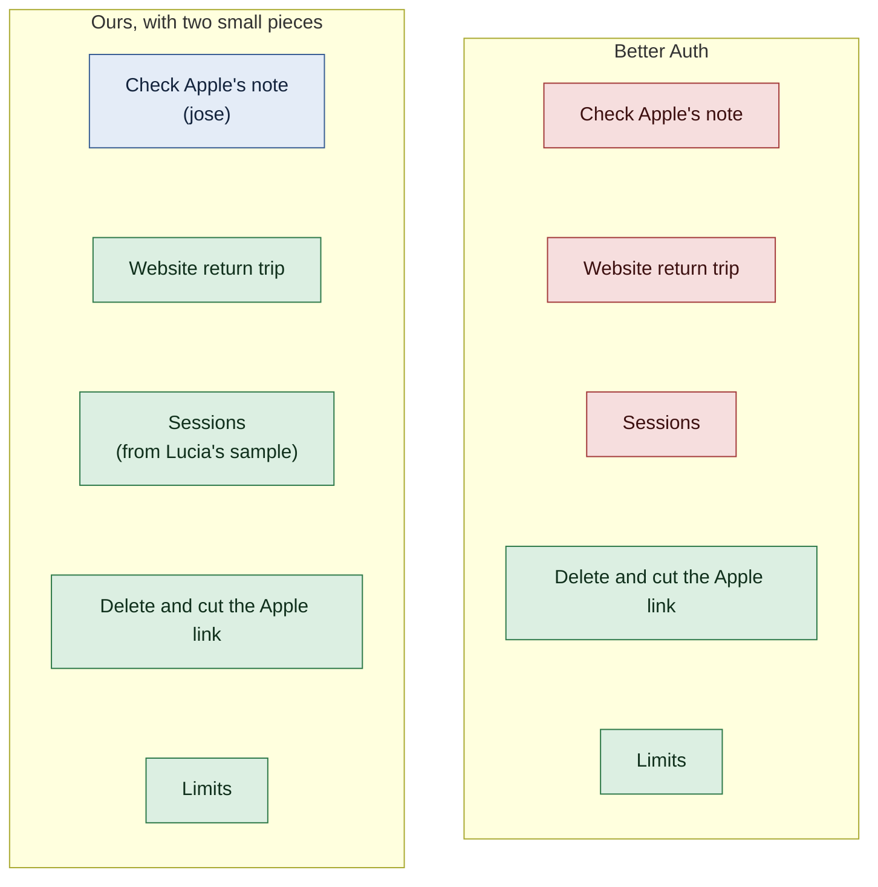

# Should we write sign-in ourselves, or use a ready-made library?

*Written 2026-11-18 for the owner. This is choice ② on the options page ([sign-in-options.md](sign-in-options.md)), between its options A and B, looked at closely. Both keep accounts on hifth.app's Cloudflare account with its free database; the only question is whose code does the signing in. The sources are in the check of the two research passes ([library-check.md](../research/sign-in/library-check.md)), made today. Nothing here was built.*

*This note is the record. Its page is [sign-in-library.html](sign-in-library.html), on the site at <https://blog.bytesofpurpose.com/hifth/docs/design/sign-in-library.html>, and it is rebuilt from this note by `scripts/build-design-note.mjs`.*

> [!tip] Short version
> **Two real choices are left.** Write it ourselves with two small, free pieces (a signature checker and a sample sessions file), or use Better Auth, the one full library still growing. The other libraries we looked at are closed, or in maintenance only, or stalled.
> **The hard parts are ours either way.** Deleting an account so that it also cuts the reader's link with Apple, and the limits against abuse, are not in Better Auth. We write them in both options.
> **What the library saves us:** sessions and the website's return trip from Apple. The fault we had noted in that return trip was fixed in November 2025. The code shows the fix; nobody has run it here.
> **What it costs:** a library that changes very fast (12 releases in the first two weeks of November), breaks something every few months, and may not fit the free plan's computing limit.
> **Recommended: write it ourselves.** The library saves the easier part, and we would still have to read its code to trust it.

## What do the words on this page mean?

- **Sign-in library**: someone else's code, run inside ours, that does the signing in for us.
- **Apple's note**: the signed message Apple hands back after Face ID. It proves "this is the same Apple user as before".
- **Checking the note**: confirming Apple really signed it, it is for Hifth, and it is fresh. Done wrong, anyone could sign in as anyone.
- **Session**: what keeps a reader signed in after the first time, so they do not see Face ID on every visit.
- **The website's return trip**: on the website, Apple sends the reader back to hifth.app by posting a form from Apple's own site. Browsers hold back hifth.app's own cookies on that trip, which is easy to get wrong.
- **Cutting the link with Apple**: when a reader deletes their account, Apple's rules say we must also tell Apple, so "Hifth" disappears from the reader's list of apps using their Apple sign-in.
- **The free plan's computing limit**: Cloudflare's free plan allows 10 thousandths of a second of computing per request. Waiting on the database or on Apple does not count.

## What does sign-in need, and who does each part?

This grid decides the question. Each row is one part of sign-in; each cell says whose code does it.

| Part of sign-in | **Ours, with two small pieces** (recommended) | **Better Auth** |
| --- | --- | --- |
| Checking Apple's note from the app | jose, a small signature checker with no other code it depends on | The library |
| The website's return trip from Apple | Ours. A short, known pattern: turn Apple's form into an ordinary page load first | The library, fixed in Nov 2025; read in its code, not tried |
| Sessions | Ours, starting from Lucia's free sample file (one file, no licence terms) | The library |
| Deleting the account and cutting the link with Apple | **Ours** | **Ours.** The library gives a place to call it from, but does not call Apple |
| Keeping Apple's key to cut the link later (the app's sign-in) | **Ours** | **Ours.** The library's app sign-in does not fetch it |
| Limits against abuse | Ours, with Cloudflare's own tools | Ours with Cloudflare's tools; the library's own limiter was not checked on Cloudflare |
| Fitting the free plan's computing limit | Small, still to be measured | At risk: Cloudflare says sign-in work typically takes 10 to 20 thousandths; must be measured |
| Who keeps it working | Us, plus jose's author, who has kept it up for years | The Better Auth team, part of Vercel since July 2026 |

**The key:** green is code we write · blue is a small outside piece we call · red is the library's code.

## What does each choice mean for a hafiz?

When it works, nothing: the reader taps Sign in, sees Face ID, and their marks are there in Firefox. The two differ only in how it fails and how fast it is fixed.

| | Ours | Better Auth |
| --- | --- | --- |
| **When it breaks** | **If sign-in breaks, the fault is in code we wrote and can read, so it can be fixed the same day.** | **If sign-in breaks inside the library, we wait for their fix or work around it. An upgrade can break sign-in, but only when we choose to upgrade.** |

## The two choices, side by side

### Ours: jose to check Apple's note, Lucia's free sample for sessions, the rest ours (recommended)

| | |
| --- | --- |
| **For a hafiz** | **A fault is ours to read and fix the same day.** |
| Pros | Every line that touches a reader's account is ours to read. Small: nothing runs that we did not ask for. jose has been kept up for years, has no other code it depends on, and lists Cloudflare as supported (version 6.2.17, 9 Nov 2026). Lucia's sample file is free to copy with no terms, and its author wrote it for exactly this after closing the library. Nothing changes under us unless we change it. |
| Cons | We write the website's return trip and sessions too, on top of the deletion and limits that are ours anyway. One mistake in those parts is a security fault, and nobody else is finding it for us. The sample needs one change for us: its guard against forged requests would refuse Apple's return trip unless that route is handled first. |
| What it commits us to | A test for every security part, written first. A short note in the repo saying what each part checks, so a later reader can audit it. |

### Better Auth on hifth.app's Cloudflare, with its free database

| | |
| --- | --- |
| **For a hafiz** | **The same when it works. A fault inside the library waits on its team, or on a patch of ours.** |
| Pros | Sessions, the website's return trip and the app's sign-in come built and used by many projects. Runs on Cloudflare's free database directly (since February 2026). The return-trip fault we had noted was fixed in November 2025 by turning Apple's form into an ordinary page load; later reports had other causes and were fixed too. Add-ons for email codes and passkeys exist if we want them later. |
| Cons | It does not cut the reader's link with Apple on delete, and its app sign-in does not keep the key needed to do so; both are ours to write anyway. It changes very fast: 12 releases in two weeks, and each minor version every three to four months has broken something; version 1.7 required a database change, then took it back. Cloudflare says sign-in work typically takes 10 to 20 thousandths of a second, against a limit of 10 on the free plan, so it may need the paid plan. Its fix for the return trip puts Apple's one-time name and email into the page address, so they can land in request logs. It stores Apple's keys unencrypted unless we add that. |
| What it commits us to | Pinning a version and reading each upgrade's breaking changes before taking it. Measuring computing time on a real deploy before the first testers. Logs that drop the return trip's address. Our sign-in moves when the library does. |

## What did we look at and leave out?

- **Arctic**, a small helper for signing in with other companies, closed on 29 July 2026. Its last version still works, but nothing will be fixed in it.
- **Oslo**, the same author's building blocks, closed the same day, except its text-encoding piece.
- **Lucia**, the same author's sign-in library, closed in March 2025. Its free sample sessions file is what the recommended choice copies.
- **Auth.js**, once popular, became part of Better Auth in September 2025 and gets security fixes only. New projects are told to use Better Auth.
- **OpenAuth** says it is in beta and has had no release since March 2025. It cannot store in Cloudflare's database and cannot take the app's sign-in note.
- **Cloudflare's own sign-in** is for a company's staff, not for the public.
- **Hosted sign-in companies** (a new Supabase project, Firebase, Clerk) are the other options on the options page, not this one.

## Why is "ours" recommended?

The parts that make sign-in proper, and that Apple's review checks, are deleting the account and cutting the Apple link. They are ours in both choices. What Better Auth adds is sessions and the website's return trip. Both are short, with a free sample and a known pattern to start from. Against that, it brings a fast-moving dependency that breaks something every few months, a real chance of going over the free plan's computing limit, and a habit of putting Apple's one-time name into addresses. For one owner and a few testers, code we can read in an afternoon is worth more than a framework.

## What would change the answer?

- **If the owner would rather not own security code,** Better Auth is the right pick, pinned to one version, with the deletion and the Apple link written by us on top.
- **If we later want email codes, passkeys or several sign-in companies,** Better Auth's add-ons start to outweigh its cost. Its tables could be adopted then; a reader would sign in again once.
- **If a measurement shows our own code also goes over the free plan's limit,** the computing limit stops separating the two, and the paid plan (about 5 dollars a month) is needed either way.
- **If the November 2025 fix turns out not to work** when tried, Better Auth's main saving shrinks to sessions alone.

## What is this not settling?

Whether accounts live on Cloudflare at all (that is the rest of choice ②), whether we can read a reader's copy (choice ③), and the design of the recovery code if the copy is locked.
