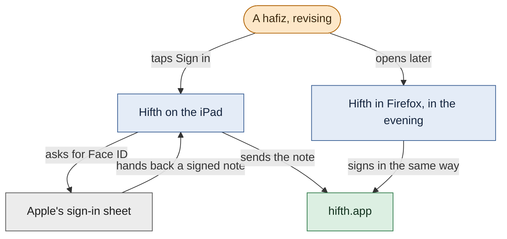
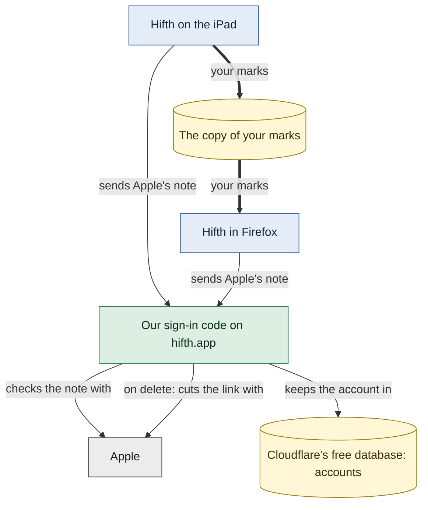
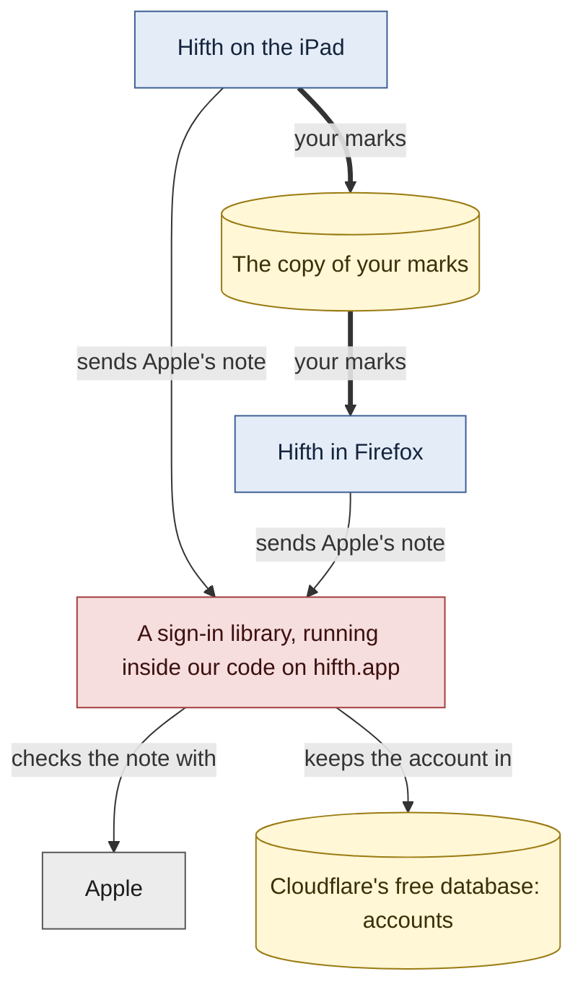
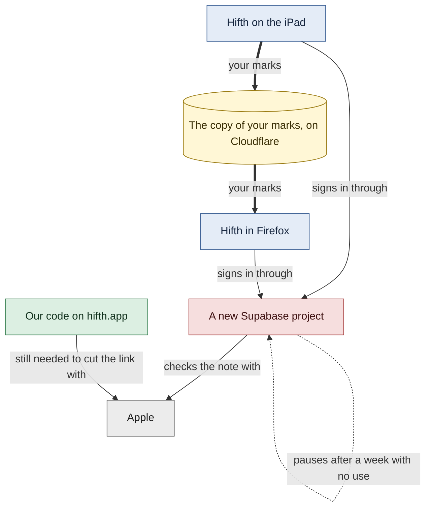
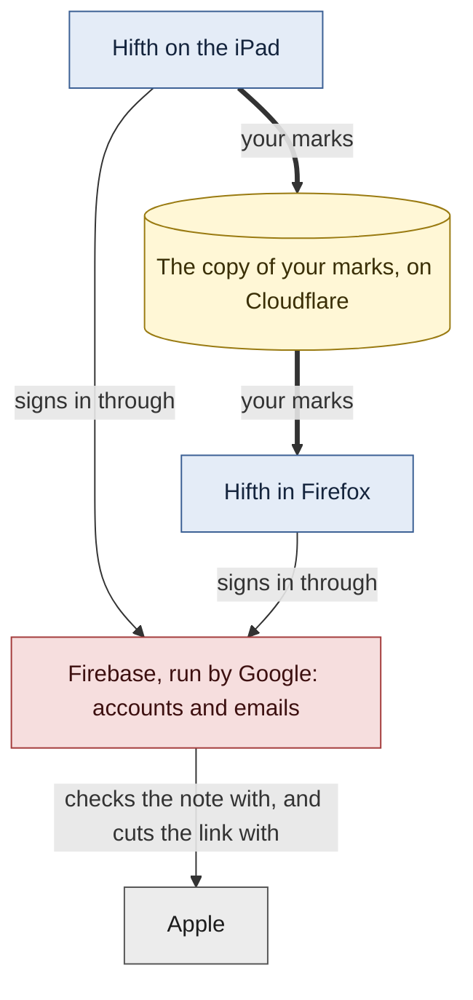
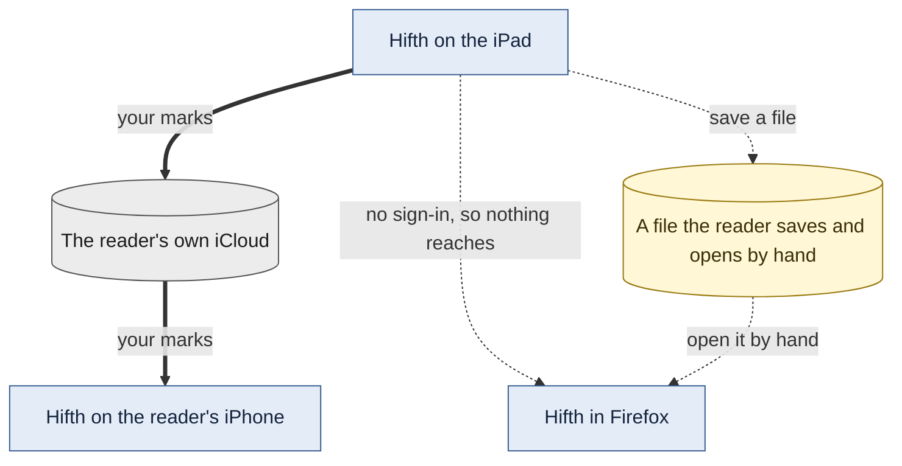
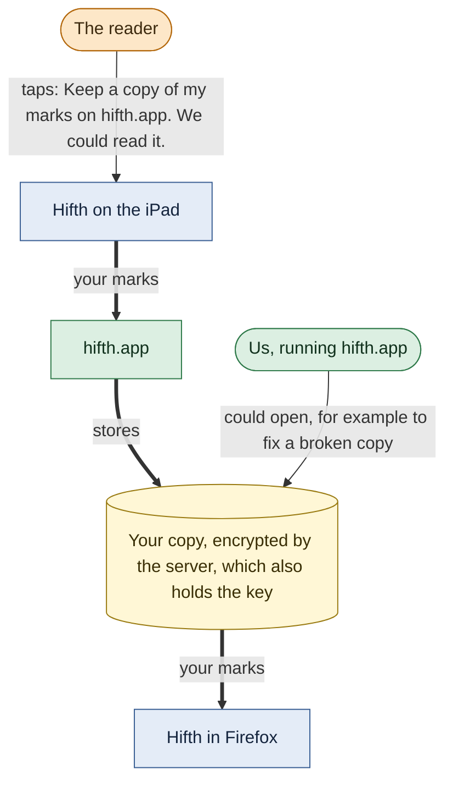
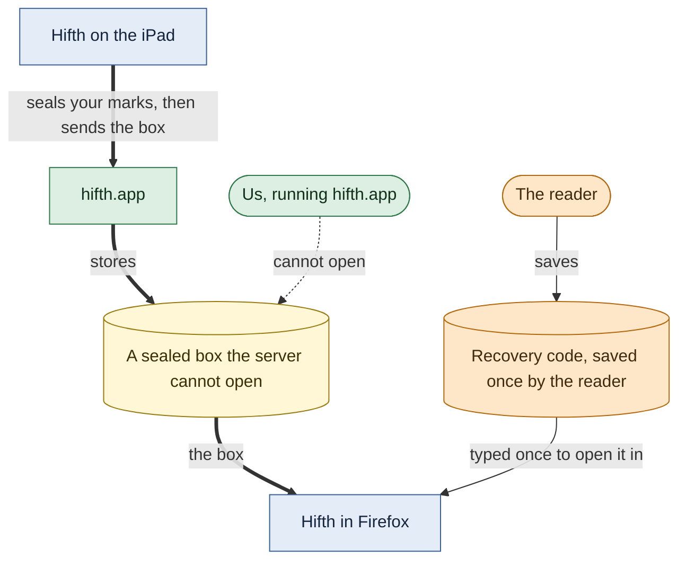

# Where should reader accounts live, and should we be able to read your copy of your marks?

*Drawn 2026-11-17 for the owner, from the sign-in page ([sign-in.md](sign-in.md)), which holds the research, the sources and the full tables. This page only draws the two choices still open, so they can be compared by eye. Nothing here was built.*

*This note is the record. Its page is [sign-in-options.html](sign-in-options.html), on the site at <https://blog.bytesofpurpose.com/hifth/docs/design/sign-in-options.html>, and it is rebuilt from this note by `scripts/build-design-note.mjs`.*

> [!tip] Short version
> **Already settled (2026-11-17):** the first thing sign-in unlocks is one button, "Keep a copy of my marks on hifth.app", so a reader's marks follow them from the iPad to Firefox and a phone.
> **Choice ②, where accounts live.** Recommended: our own small code on hifth.app's Cloudflare account, with its free database. It keeps everything with the one company that already runs the site, and nothing pauses.
> **Choice ③, whether we can read the copy.** Recommended: not locked for the first testers, with the button saying plainly that we could read it; locking can come later without losing anyone's marks. The other way is locked with a recovery code the reader saves once.
> **How to read the drawings.** Every drawing follows the same reader: signing in on the iPad, then opening Firefox in the evening. Moving lines are what happens at each sign-in; the thick line is the reader's marks; a dotted line is something that does not happen, or happens by hand.

## What do the words on this page mean?

- **Marks**: what a reader puts on the mus'haf page: highlights, mistake notes, bookmarks, the place they left off.
- **Account**: the record that says "this Apple sign-in is this reader", so the same marks can be found from another device.
- **hifth.app**: the app's own website, run on Cloudflare, which today hosts the front page and the notify-me list.
- **Apple's sign-in sheet**: the panel with Face ID that every Apple app shows for "Sign in with Apple".

## What is the same in every drawing?

The choices below change only what sits behind hifth.app: who keeps the account, and who can open the copy of the marks.

**The key for every drawing:** orange is the reader · blue is a device the reader holds · grey is Apple · green is ours, on hifth.app's Cloudflare account · red is another company · yellow is stored data.

## ② Where should reader accounts live?

### A. Our own small code on hifth.app's Cloudflare, with its free database (recommended)

| | |
| --- | --- |
| **For a hafiz** | **Invisible when it works. If a daily limit were ever hit, sign-in would fail until midnight UTC, and reading carries on.** |
| Pros | One company, the one already running the site and the notify list. Nothing pauses when nobody uses it. Every line is ours to read. No six-month secret to renew by hand. |
| Cons | We write and own the security parts: checking Apple's note, sessions, deletion, limits. A small, well-known library does the cryptography. |
| What it commits us to | A test for every security part. The sharing work later builds on the same tables. |

### B. The same, with a ready-made sign-in library

| | |
| --- | --- |
| **For a hafiz** | **The same as A, as long as the library behaves.** |
| Pros | Less code to write. Sessions and add-ons come built. |
| Cons | Deletion that really cuts the Apple link is still ours to write. It changes very fast and breaks something every few months, and it may go over the free plan's computing limit. Its website sign-in had a cookie fault, fixed in November 2025. |
| What it commits us to | Our sign-in changes whenever the library's next version does. The library page weighs this against A part by part: [sign-in-library.md](sign-in-library.md). |

### C. A new Supabase project just for readers

| | |
| --- | --- |
| **For a hafiz** | **Invisible, unless the project has paused: then sign-in fails until someone wakes it.** |
| Pros | Sign-in, sessions and email codes come ready-made and widely used. |
| Cons | Free projects pause after a week unused, and a person may have only two. Deleting a reader does not cut their Apple link, so our own code is needed anyway. The website needs a new secret pasted in every six months. Accounts and marks end up with two companies. |
| What it commits us to | Two places to delete a reader from. The existing Supabase project, which holds the notify list, must still never hold accounts. |

### D. Firebase sign-in, run by Google

| | |
| --- | --- |
| **For a hafiz** | **Invisible, but their email address sits with Google.** |
| Pros | Apple and email sign-in come ready-made, including the call that cuts the link with Apple. |
| Cons | A third company holds readers' accounts. The marks would still be on Cloudflare. |
| What it commits us to | The email code later is sent by Google's sender. |

### E. No accounts: each reader's own iCloud only

| | |
| --- | --- |
| **For a hafiz** | **Seamless between their own Apple devices. In Firefox, they carry a file by hand.** |
| Pros | No server, no account, nothing for us to hold. |
| Cons | Does nothing for Firefox, Android or the website, which is the one thing the settled choice ① asked for. |
| What it commits us to | This stays the answer for a reader's own Apple devices whichever option wins. |

## ③ Should we be able to read your copy of your marks?

This choice does not depend on ②: either drawing works with any of A to D.

### Not locked: the server's own encryption, and the button says we could read it (recommended for the first testers)

| | |
| --- | --- |
| **For a hafiz** | **Nothing to save or lose: sign in on Firefox and the marks are there. They are told, on the button, that we could read them.** |
| Pros | Nothing for the reader to keep safe. A broken copy can be repaired. Much less to build before the first testers. |
| Cons | We hold readable copies of what a reader marked while revising, which is personal and religious. If hifth.app were broken into, the copies could be read. |
| What it commits us to | The privacy label and the button must say it in plain words. Locking later means each reader saves a recovery code once; nobody loses marks. |

### Locked: sealed on the device with a recovery code the reader saves once

| | |
| --- | --- |
| **For a hafiz** | **One extra step, once: save a recovery code. Lose it, and the copy on hifth.app is gone; the marks on the iPad itself are never at risk.** |
| Pros | Nobody but the reader can read their marks, including us and anyone who broke into hifth.app. |
| Cons | A recovery code to design, explain and keep safe. No repairing a broken copy. More to build before the first testers. |
| What it commits us to | A design for the recovery code and the sealed file. Every device that opens the copy needs the code once. |

## Why are these the recommendations?

- **② A**, because the parts that make sign-in proper (deletion that really deletes, the button that says who sees what, the privacy check) are ours to write in every option. A library saves the easier part (sessions and the website's return trip) and brings a fast-moving dependency; the library page ([sign-in-library.md](sign-in-library.md)) weighs the two closely. Cloudflare's free plan allows 100,000 requests and 100,000 database writes a day, far beyond a group of testers.
- **③ not locked, first**, because it is the smaller build and can be locked later without losing anyone's marks; going the other way, from locked to readable, would need every reader's code. The cost is honesty on the button, which our own privacy rule already asks for. If the owner would rather testers never hand us readable marks, locked is the answer, and the first unlock waits for the recovery-code design.

## What would change the answer?

- If the owner would rather not write the security parts ourselves, ② C (a new Supabase project) is next best, never the existing one.
- If the first testers include readers who would not hand over readable marks at all, ③ becomes locked from the start.

## What is this not settling?

When sign-in ships, which way a student's marks first reach a teacher, which company sends email, and the design of the recovery code. The sign-in page lists these in full.
