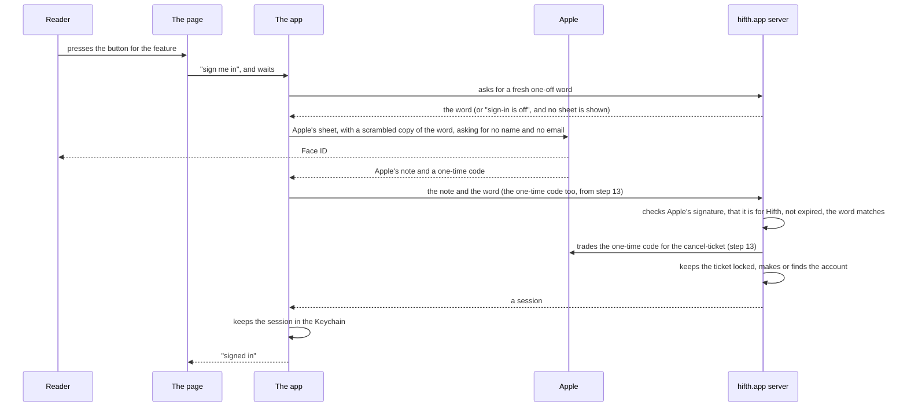
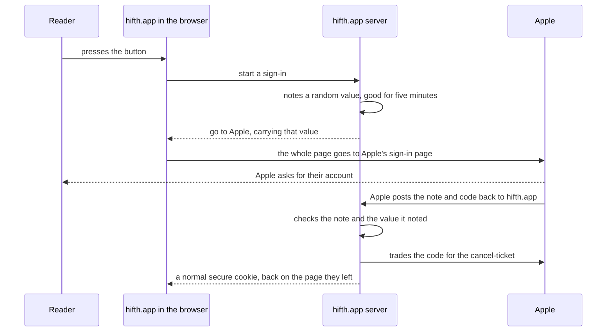
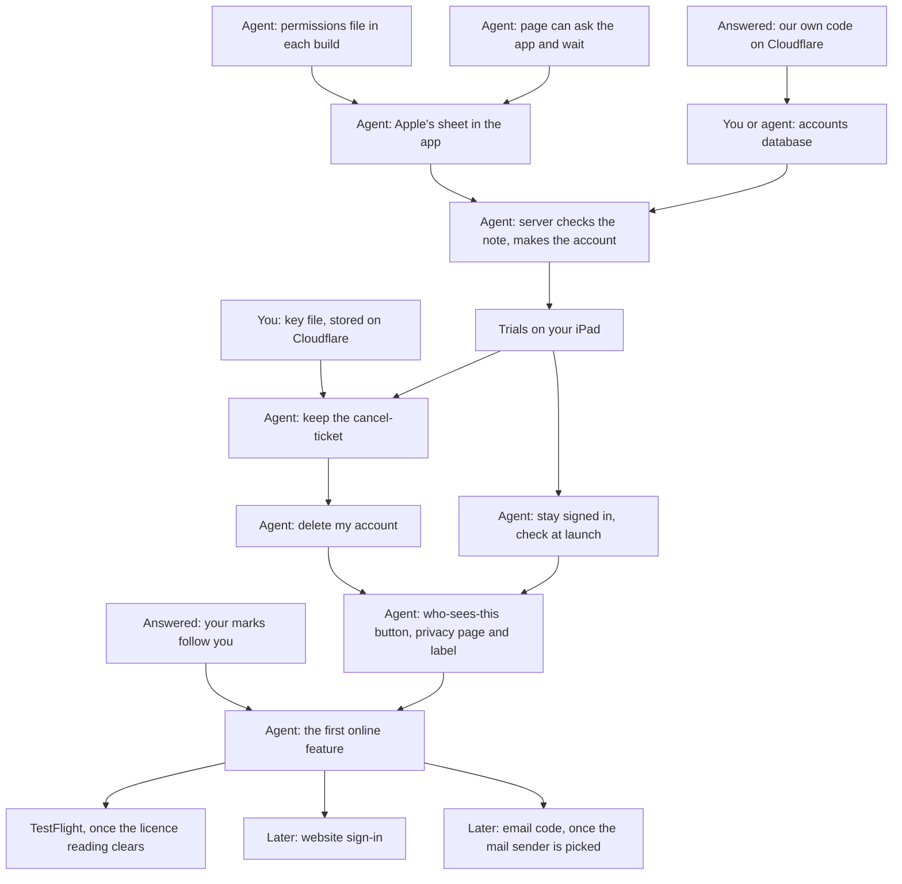

# How close are we to letting a reader sign in with Apple, and how should sign-in be built now that testers are coming?

*Written 2026-11-15 by the checker, from two separate research passes on the owner's question of
the same day: "i want to do proper auth, especially if we open this up for testers ... how close
are we to adding sign in with apple to use the online experience?" This is the page to choose
from. The two passes stay as the record it was built from: researcher A
([findings](../research/sign-in/a/research.md), [design](../research/sign-in/a/design.md)) and
researcher B ([findings](../research/sign-in/b/research.md),
[design](../research/sign-in/b/design.md)). No app code and no Apple, Supabase or Cloudflare
setting was changed.*

> [!tip] Short version
> **Where we are.** Apple's side is mostly ready: the paid membership (2026-11-08), the app's Apple ID with Sign in with Apple switched on (2026-11-09), and the iPad build signed with the paid team (2026-11-10). hifth.app already runs small server functions on Cloudflare. **None of the sign-in code exists yet**: no build asks Apple for permission to show the sign-in sheet, the page inside the app cannot yet ask the app a question and wait for the answer, and there is no server that checks a sign-in or keeps an account.
> **What is left.** 5 steps are done. Two answers are needed from you. Then two milestones: a first working sign-in on your own iPad, hidden from everyone else, is **6 steps and about a week** of agent work plus one 5-minute dashboard step. Ready for testers is **11 more steps and about two weeks**, plus about an hour of your dashboard and Xcode time. Website sign-in and an email code come after that.
> **Testers do not need an account.** TestFlight brings its own invitations and its own feedback button, and testers are held by the licence reading, not by sign-in. So the first question is what sign-in is *for*, not how the button works.
> **Recommended, in one line:** build the hidden plumbing now on your iPad: Apple's own sign-in sheet in the apps, checked by our own small code on hifth.app's Cloudflare account with its free database, keeping Apple's cancel-ticket from the first sign-in so "delete my account" can really cut the link. Website sign-in and an email code follow once you pick what sign-in unlocks first.

## What do these words mean?

- **Hafiz, huffaz:** someone who has memorised the Qur'an, or is memorising it, and the plural.
- **Mus'haf:** the printed Qur'an the app shows page for page.
- **Your marks:** what the app keeps for one reader: mistakes, look-alike jumps, notes and bookmarks, saved together in one file today.
- **The app:** the Swift app on the iPad, iPhone and Mac. It shows Hifth's web page inside itself.
- **The page:** Hifth's web page. Inside the app it is served from the app's own private address, not from an https website. That one fact decides most of the in-app design.
- **Apple's sheet:** the panel Apple draws over an app ("Continue with Apple") with Face ID. Only the app can show it, not the page.
- **Apple's sign-in note:** the short signed note Apple hands back after a sign-in, saying "this is person X, signed in to Hifth, just now". Developers call it the identity token. Our server checks Apple's signature before believing it.
- **The one-off word:** a random value made fresh for each sign-in and written by Apple into the note, so an old note cannot be replayed. Developers call it a nonce.
- **The cancel-ticket:** a long-lived token our server can get from Apple once, within five minutes of a sign-in. Apple needs it to cut the link between a person and Hifth when they delete their account.
- **The key file:** a private key made once in Apple's developer site. Our server uses it to prove to Apple it is Hifth, when it gets or uses a cancel-ticket.
- **The website's Apple name:** Apple's name for a website that uses Sign in with Apple (a "Services ID"). The apps do not need one; hifth.app does.
- **The Keychain:** Apple's locked store for secrets on each device.
- **Cloudflare's free database:** the small database that sits next to hifth.app's server functions (Cloudflare calls it D1).
- **The privacy check:** the check that runs before every push and refuses any code that sends your marks off the device by a way it has not been told about.

## What does it change for a hafiz?

> [!important] For a hafiz
> **Reading and revising: nothing, and it must stay that way.** Every Qur'an app either researcher looked at lets people read with no account. A sign-in wall in front of the mus'haf would cost a hafiz the thing they came for.
> **What sign-in can add is one thing:** something of theirs that lives off their own devices, on purpose. The clearest case: revising on the iPad in the morning and in Firefox on the family laptop at night becomes one revision, not two. iCloud already carries marks between a reader's own Apple devices, but it cannot reach Firefox, Windows or Android.
> **The risk to weigh:** a record of where someone's memory slips in the Qur'an is close to their worship. Apple's privacy label lists religious beliefs under sensitive information. So every new way out is its own button that says what goes and to whom, and the reader can see and take back what they sent.

## Why is this being asked now?

Two things changed in the week before the owner asked: the paid Apple membership arrived on 2026-11-08, and the iPad build was signed with the paid team on 2026-11-10. Sign in with Apple needs both. Testers are next, through TestFlight, once the licence reading clears the upload.

**What happens if nobody decides?** Nothing breaks. Testers can still be invited through TestFlight, and they can send feedback with TestFlight's own button. Your own iPad and Mac keep in step through your own iCloud with no account. The cost of waiting is only that the online features stay unbuilt: marks in Firefox, switching a teacher link off from anywhere, and later sharing between a student and a teacher.

**What have we already decided that limits this?**

- **The storage decision** (row `storage-model` in the decision register) says the reader's own record goes to their own cloud copy, written all at once, "on the day there is sign-in". It also ties *when* sign-in comes to the licensing question, and says "not this year". This page does not reopen that timing; it says what is ready when the owner wants it.
- **The sharing page**, item ⑥ (answered 2026-11-09): Cloudflare's free database for *shared copies*. That answer was about shared copies, not accounts, so where accounts live is still an open question here (② below).
- **The sharing page**, items ⑧ and ⑭: the share page and any sign-in live on hifth.app.
- **The sharing page**, item ⑨: no Sign in button with nothing behind it; in the apps, Apple's own sheet, never a web sign-in page inside the app.
- **The existing Supabase store must never hold accounts.** Its settings keep sign-ups off in three places, and the store check refuses any sign-up. Any Supabase option here is a *new* project.
- **The reader decides who sees their data** (the privacy rule, 2026-11-12): an explicit button naming what goes and to whom, and a place to see and take it back.

## How close are we?

Both researchers counted steps, and their counts differed: A said 6 done and 18 left, B said 3 done and 20 in all. The difference is bookkeeping, not disagreement. A counted three things on our side as done; B counted only Apple's side. Checked against the files on 2026-11-15:

- hifth.app has server functions on Cloudflare checked in (the notify list's three). **Done** as far as the files show; the live site was not looked at, and question ⑦ asks whether the list really works.
- The privacy check exists. **Done**, though it still has to be told about the new way out (step 16).
- "Cloudflare's free database chosen" was chosen for shared copies, not accounts, and no database is connected to hifth.app's server yet. **Not done for accounts**; moved to the owner's question ②.
- B's three "not checked" steps (the key file, the mail sender, the website's Apple name) are steps nobody has done; neither researcher could see Apple's dashboard. They are listed as left.

Averaging the counts would be meaningless, so the table is split by milestone instead. "You" means the owner, in the dashboard named. "Agent" means code in this repository, tried on your own devices.

| # | Step | Done or left | Whose turn | Rough effort |
| --- | --- | --- | --- | --- |
| **Done** | | | | |
| 1 | Paid Apple Developer membership, individual | done 2026-11-08 | — | — |
| 2 | The app's Apple ID registered with Sign in with Apple switched on (also Associated Domains, iCloud and Push) | done 2026-11-09 | — | — |
| 3 | iPad build signed with the paid team | done 2026-11-10 | — | — |
| 4 | hifth.app on Cloudflare, with small server functions for the notify list checked in (the live site was not looked at; see ⑦) | done | — | — |
| 5 | A privacy check that refuses any way off the device it does not name | done | — | — |
| **Your answers first** | | | | |
| A | What sign-in unlocks first (① below) | done 2026-11-17: your marks follow you | — | — |
| B | Where accounts live (② below) | done 2026-11-18: our own code on hifth.app's Cloudflare, free database | — | — |
| **Milestone 1: a first real sign-in on your own iPad, hidden behind a developer setting** | | | | |
| 6 | Give the iPad and iPhone build a permissions file asking for Sign in with Apple, and add the same line to the Mac's | done 2026-11-18: the iPad and iPhone file asks for it (launch item ⑨), and so does the Mac store build's. The two Mac builds signed on the laptop with no profile from Apple cannot carry it (Xcode refuses to build them), so the everyday one asks for nothing and the laptop's Release copy uses the store's file without that line | — | — |
| 7 | Let the page ask the app a question and wait for the answer (before this, messages only went one way, page to app) | done 2026-11-18: works in the Mac app; the iPad tries it in step 11 | agent | half a day, with tests |
| 8 | Show Apple's sheet from the app with a fresh one-off word, and hand the result on | left: built 2026-11-18 and tested with a stand-in sheet and server; the Mac app answers "sign-in is off" when no server is named. The real sheet is first seen in step 11, on your iPad | agent | a day |
| 9 | Connect a free database to hifth.app's server for accounts (⑨ below) | done 2026-11-18 with your yes: made, its tables in place and empty, named in the site's settings. It reaches the live site with your next upload of hifth.app | — | — |
| 10 | Server code on hifth.app: check Apple's note against Apple's published keys, make or find the account, start a session, sign out | done 2026-11-18 on the laptop with made-up keys and a local database copy; switched off on the live site until you switch it on there. The live fetch of Apple's keys is proved by the first real sign-in | — | — |
| 11 | Trials on your iPad: does the page get a waiting answer from the app, and what address does it say it comes from (⑤ below) | left | you hold the iPad, agent runs it | an hour |
| **Milestone 2: ready for people other than you** | | | | |
| 12 | (⑧ below) Make the key file in Apple's developer site, note its ID, store both as hifth.app secrets on Cloudflare. **Needed even with no website sign-in**, because deleting an account needs it | left | you, Apple then Cloudflare dashboards | 20 minutes |
| 13 | Get Apple's cancel-ticket at the first sign-in and keep it locked on the server; take Apple's notices that a reader has left | left | agent | a day |
| 14 | "Delete my account" inside the app: delete everything, cut the link with Apple. App Review requires it | left | agent | a day |
| 15 | Keep the session in the Keychain, so an iPad stays signed in for months; check at each launch that the reader has not cut Hifth off in their Apple settings | left | agent | half a day |
| 16 | A button that says what leaves the device and who sees it, a place to see and take it back, and the new way out named in the privacy check | left | agent | a day |
| 17 | Limit how often anyone can try, reusing the notify list's "are you a person" check | left | agent; you may need to switch on a limit in Cloudflare | half a day |
| 18 | Keep it to testers: an invite code (an email list fails when testers hide their email), and a working test login for Apple's beta reviewers | left | agent | half a day |
| 19 | Privacy page and App Store privacy label updated | left | agent drafts, you approve | half a day |
| 20 | Sign the Mac build with the paid team. Apple says Sign in with Apple does not work in Mac apps sold outside the App Store, so the Mac goes through TestFlight or the Mac App Store | done 2026-11-17: the Mac App Store build is signed with the paid team and archived; its Sign in with Apple line is step 6 | — | — |
| 21 | The first thing sign-in unlocks, behind its own button (depends on ①) | left | agent | three to four days for "your marks follow you" |
| 22 | TestFlight upload and tester invitations | left | **held by the licence reading**, not by sign-in | — |
| **Later, not needed for testers on Apple devices** | | | | |
| 23 | Website sign-in on hifth.app for Firefox: the website's Apple name with its return addresses, then the code | left | you in the Apple dashboard, then agent | 30 minutes, then one to two days |
| 24 | Register the mail sender with Apple, so mail reaches readers who hid their email | left | you in the Apple dashboard and DNS; waits on the mail sender decision | 30 minutes |
| 25 | A second way in for people without Apple: a six-digit code by email | left | agent, after the mail sender is picked | two days |

**Headline: 5 done, both answers in (2026-11-17 and 2026-11-18), then 6 steps to a first real sign-in on your iPad (about a week), 10 more to be ready for testers (about two weeks; step 20 is done), and 3 for later.** Both researchers put the whole build at two to three weeks of agent work; this table agrees.

### What can be built and tried now, on your own devices?

- **Steps 6, 7, 8 and 11 need no decision** and can start today on the iPad that is already signed with the paid team. They run behind a developer setting, not a button readers see, so the rule "no Sign in button with nothing behind it" holds.
- **The server check can run on the laptop**, against a local copy of the database, with tests that use made-up notes. A real note from the iPad can then be checked there too. Answer B was Cloudflare, so nothing here waits; only making the real database on Cloudflare (step 9) touches the live account.
- **Deletion and cutting the link** can be walked end to end on your own Apple account once the key file exists (step 12): sign in, delete, then check that Hifth is gone from your Apple account's list of apps using Sign in with Apple.
- **What cannot be tried on the laptop:** website sign-in, because Apple refuses local addresses and needs a real https address on hifth.app registered with it; and the Mac app, until step 20.
- **What waits on the licence reading:** only step 22, putting the build in front of testers. Everything else can be built and tried first.

## How does one sign-in go?

### How does it go in the iPad, iPhone and Mac apps?

### How does it go on hifth.app, in Firefox or any browser? (later)

Apple's return trip is a form posted from Apple's own site, so the browser does not send hifth.app's ordinary cookies with it. That is why the server notes its own random value instead of relying on a cookie. A popular sign-in library got exactly this wrong, and fixed it in November 2025 (see the agreements section, and the library page, [sign-in-library.md](sign-in-library.md)).

### In what order do the steps go?

## What are the choices?

Two choices are the owner's (what sign-in is for, where accounts live). The rest have a clear answer from the sources, and the recommended one is first in each table.

### What should sign-in unlock first?

| | **Your marks follow you to Firefox and a phone** (recommended) | Switch off a teacher link from any device | Nothing yet: build the plumbing and stop |
| --- | --- | --- | --- |
| What it is | One button, "Keep a copy of my marks on hifth.app". One file per reader, written all at once, readable from another browser, deletable | The live locked link from the sharing page, managed from wherever you are signed in | Steps 6 to 15, hidden; no reader-facing feature |
| Pros | Already the plan in the storage decision; fills the one gap iCloud leaves; one reader, one record, no consent questions between people; the file already exists | Uses the same account and server; useful the day teacher links exist | No new way off the device; nothing to declare; nothing to support |
| Cons | A new way off the device, so it needs its own button and the privacy label; whether we can read the copy is a choice (③) | Waits on which way sharing goes (sharing page ③), and the link may need no account at all | Testers see nothing new; the work is unproven by real use |
| Implications | Settles question ③ before it ships | Sign-in may wait again if the link needs no account | Leaves ① open; costs nothing to pick later |
| For a hafiz | Morning on the iPad and evening in Firefox become one revision | A teacher link can be stopped from the phone when lessons end | No change |

Both researchers picked the first, independently. It is recommended because it is already the plan and touches only one reader's own record.

### Where should accounts live?

| | **Our own small code on hifth.app's Cloudflare, with its free database** (recommended) | The same, with a ready-made sign-in library | A new Supabase project just for readers | Firebase sign-in | No accounts: own iCloud only |
| --- | --- | --- | --- | --- | --- |
| Pros | Next to the notify list and the planned shared copies, so no new company; nothing pauses; every line is ours to read; the key can sign a fresh short note each time, so there is no six-month renewal chore | Less code; sessions and add-ons come built (Better Auth runs on this database) | Sign-in, sessions and email codes ready-made and widely used | Ready-made Apple and email sign-in, with a built-in "cut the link with Apple" call | No server, no account, nothing for us to hold |
| Cons | We write and own the security-critical parts: the note check, sessions, deletion, limits. A small, well-known signature library (jose) handles the cryptography | Its Apple website sign-in had the cookie fault above; a second fix (Nov 2025) is still in its code, read but not tried. It does not cut the Apple link on delete, changes very fast, and may exceed the free plan's computing limit (see [sign-in-library.md](sign-in-library.md)) | Free projects pause after a week unused; at most two free projects per person; deleting a user does not cut their Apple link, so our code is needed anyway; the website needs a new secret pasted in every six months; splits reader data from shared copies | A third company, Google, holds readers' accounts; shared copies would still be on Cloudflare | Does nothing for Firefox, Android or the website |
| Implications | Commits us to tests for every security part; the sharing work can build on the same tables | Ties our sessions to the library's next release | Two vendors to delete from; the existing project still must never hold accounts | Ties the email code to Google's sender | Stays the answer for own Apple devices whichever way this goes |
| For a hafiz | Invisible when it works; if a daily limit is ever hit, sign-in fails until midnight UTC and reading carries on | The same, if the library behaves | Invisible, unless the project pauses: then sign-in fails until someone wakes it | Invisible; their email sits with Google | Seamless on Apple devices; Firefox readers carry a file by hand |

Recommended because the parts that make sign-in "proper" (deletion that really deletes, the who-sees-this button, the privacy check) are ours to write in every option. A library saves the easier part (sessions and the website's return trip) and brings a fast-moving dependency; the library page weighs the two closely. Cloudflare's free plan allows 100,000 requests and 100,000 database writes a day, far beyond a tester group.

### How should the apps sign in?

| | **Apple's sheet, shown by the app, result passed to the page** (recommended by both) | A browser panel the app opens on hifth.app | Apple's web button inside the page |
| --- | --- | --- | --- |
| Pros | Face ID in one tap; the form readers know from every Apple app; no secret in the app | Same code as the website; the route Google would need one day | No app code |
| Cons | New app code and a way for the page to wait for an answer | Asks for the Apple account password even on the reader's own device; feels like a website | **Does not work here**: Apple's return address must be https and the page's is not; a forum report says it broke inside app pages on iOS 17.1 |
| Implications | The server accepts two names for Hifth, the app's and the website's | Two sign-in paths to keep up | Ruled out |
| For a hafiz | One look at the iPad and back to the page they were on | A password prompt mid-revision | Would not work |

### Who should make the one-off word and call the server, the app or the page?

| | **The app makes the word, calls the server, keeps the session** (recommended) | The page makes the word and calls the server; the app only shows the sheet |
| --- | --- | --- |
| Pros | Avoids two things nobody could confirm: whether the page's private address can use the browser's scrambling code, and what address the page says it comes from when it calls hifth.app (it has been seen to say "null"); the session never sits where page code can read it | Same code as the website; less Swift |
| Cons | One more kind of message between page and app ("send this for me") | Rests on those two unconfirmed things; anything running in the page can read the session |
| Implications | Still needs the page to wait for the app's answer, which is unconfirmed too; if that fails, the app pushes "signed in" to the page instead, which it can already do today. Trial ⑤ can move the work to the page later if everything turns out fine | A failed trial means rewriting it the other way |
| For a hafiz | No difference when it works | No difference when it works; a random sign-out if the page's storage is wiped |

This was a real difference between the researchers (A: the app; B: the page). Recommended the app's way because it rests on one unconfirmed thing instead of three, and that one has a fallback that needs no trial. Apple's page for the reply handler, re-read on 2026-11-15, says only that it "returns a reply to your JavaScript code"; it does not say how the page receives it.

### How should "delete my account" cut the link with Apple?

| | **Keep Apple's cancel-ticket from the first sign-in** (recommended) | Ask the reader to sign in once more at deletion, then cut the link |
| --- | --- | --- |
| Pros | What Apple's own technical note says to do; deletion needs no extra step | No long-lived Apple token sits in our database |
| Cons | A long-lived token per reader to keep locked; the key file is used at every first sign-in | Not in Apple's note; one more Face ID at deletion; if it fails, the reader is told to remove Hifth from their Apple settings by hand |
| Implications | If the trade ever fails, fall back to: delete everything, and tell the reader how to remove Hifth themselves (Apple's note says exactly that) | Rests on a third party's documentation, not Apple's |
| For a hafiz | Tap delete, confirm, done | One extra Face ID, once, at the end |

A recommended the second; B the first. Apple's note settles it for the first (see below).

### How should hifth.app sign in, in Firefox? (later)

| | **The whole page goes to Apple and back** (recommended) | Apple's popup window |
| --- | --- | --- |
| Pros | No messages between windows to fail; less for Firefox's tracking protection to block | The page does not reload |
| Cons | One page reload; needs the server's own random value instead of a cookie | Forum reports of popups that never came back; Apple's staff say the popup's return address must be on the same site as the page |
| Implications | The server keeps a short-lived record of each sign-in it started, in its database | Commits us to Apple's sign-in script on hifth.app and to messages between windows |
| For a hafiz | One extra page load, once a month | A window that may do nothing |

No source settled this outright. The full-page trip is the safer default, and a ten-minute trial in Firefox settles it when website sign-in is built.

### What is the second way in, for readers without Apple? (later)

| | **A six-digit code by email** (recommended by both) | A one-time link by email | A passkey | Google |
| --- | --- | --- | --- | --- |
| Pros | Works in every browser, on Android and inside the app's page; nothing has to open the app from Mail; ours, so Apple's rule on other companies' logins does not apply | One tap | No email at all; Face ID or a fingerprint | Familiar to Android readers |
| Cons | Needs a real mail sender (Supabase's built-in one sends 2 an hour, only to team members); each code needs a limit on retries | Workplace and school mail scanners open the link first and use it up; the link must reopen the app, which needs set-up we do not have | The page's private address probably cannot use passkeys, so they would go through the app, and hifth.app would need an Apple link file it does not have today | Google blocks its sign-in inside app pages, so it needs a browser panel; one more company |
| Implications | Shares the mail sender with the notify list (its open sender decision) | — | A good second step a year from now, after a test | Only if Android readers ask for it |
| For a hafiz | Type six digits once, then stay signed in | Tap, unless the school's mail filter got there first | Fastest of all, once it works | Familiar |

Apple's rule that an app offering another company's login must also offer Apple's (or an equal) applies to logins like Google; our own email code is exempt.

### What else could be considered, and why is it not here?

- **Apple's iCloud user number as the account.** No sign-in on Apple devices, but nothing for the website. It is the own-device path, already planned.
- **Clerk and other hosted sign-in companies.** Clerk's free plan lacks Face ID sign-in in apps; the others were not looked at closely.
- **Lucia**, a sign-in library, closed in March 2025. Arctic, Oslo, Auth.js and OpenAuth are covered on the library page, [sign-in-library.md](sign-in-library.md).
- **An email link instead of a code.** Workplace and school mail scanners open the link first and use it up.

## Where did the two researchers agree, and where did they disagree?

The checker re-opened the sources behind every claim that would change the recommendation, every disagreement, and every claim that rested on a search snippet, on 2026-11-15. Quotes from web pages were read through a fetching tool that summarises the page, so a quoted sentence is that tool's reading of the page. Where it mattered, the page was re-read in its raw form.

### What did both of them say?

| What both said | Checked |
| --- | --- |
| In the apps, use Apple's own sheet; Apple's web button inside the page is ruled out | The page is served from the app's own private address (checked in the code); Apple's forum report of the iOS 17.1 failure re-read, with later reports of a fix in 17.2 that conflict |
| No build carries the Sign in with Apple permission today | Confirmed: the iPad and iPhone build has no permissions file; the Mac's is empty |
| Messages between page and app go one way today | Confirmed in the app's code |
| Cloudflare with its free database, our own code, recommended for accounts; never the existing Supabase store | Confirmed: that store's settings keep sign-ups off in three places, and the store check refuses any sign-up |
| Deletion inside the app is required; Supabase does not cut the Apple link | Confirmed: Supabase closed the request as "not planned" on 2023-12-19, saying apps must do it themselves |
| The client secret can be signed fresh for each call; Apple accepts one for six months at most | Not contested; from Apple's page |
| Apple sends the reader's name only at the first sign-in | Not contested; from Apple's page |
| The first unlock: your own marks following you to Firefox and a phone | Independent picks; matches the storage decision |
| A six-digit email code as the second way in | Supabase's built-in mailer sends 2 an hour, only to team members, so any option needs a real sender |
| Google blocks its sign-in inside app pages | Not contested |
| Apple's sign-in note lasts about ten minutes | **Not confirmed on any Apple page.** Both rest on other people's measurements; one library says five minutes |

### Where did they disagree, and what do the sources say?

| Question | A said | B said | What the checker found |
| --- | --- | --- | --- |
| How many steps are done? | 6 done, 18 left | 3 done, 20 in all | Bookkeeping, not disagreement. A's two code-side steps are real (checked in the files); A's "database chosen" was for shared copies, not accounts, and no database is connected yet. Merged as 5 done, split by milestone above |
| How should deletion cut the link with Apple? | Ask the reader to sign in again at deletion, then cut it; "Apple's own technote gives two ways" | Keep Apple's long-lived token from the first sign-in | **Apple's technical note (TN3194, first published 2025-10-03, re-read in full) backs B.** It says to trade the code at sign-in and "securely store the token response". It never mentions signing in again; its fallback, when no token exists, is to delete the data and send the reader to Apple's support page to remove the app by hand. A's route rests on Firebase's documentation, not Apple's |
| Who makes the one-off word and calls the server? | The app, keeping the session in the Keychain | The page, with the app only showing the sheet | Not settled by sources. WebKit's own bug list shows a page on an app's private address was given a secure standing in 2021, but nothing says the browser's scrambling code works there. A second WebKit bug (2021) shows such a page calling a website said it came from "null"; marked fixed, then reported back in a beta, with no later word. Recommended the app's way, with trial ⑤ |
| On the website, a full-page trip or a popup? | Full-page trip | Popup (in its drawing) | Not settled by sources. Apple's staff say the popup's return address must be on the page's own site; the one Firefox failure in that thread was a setup mistake, not Firefox. Full-page trip is the safer default |
| Should the synced copy be locked so we cannot read it? | Yes, locked on the device with a recovery code | It is a separate decision; in its first form we could read it, and the button must say so | A real choice for the owner, not a source question. Question ③ below |

### What did only one of them find?

| Only A | Checked |
| --- | --- |
| The notify list's server code calls Supabase's data door, but the checked-in settings say that door is off, and another design page says nothing uses it | **Confirmed as a contradiction in the files.** The live project was not looked at. Question ⑦ below |
| Better Auth's website sign-in had the cookie fault, closed as fixed and reportedly reverted | Confirmed, and then superseded: the first fix was reverted on 2025-11-04, but a second fix that turns Apple's form into an ordinary page load was merged on 2025-11-05 and is still in the code. Read, not tried; one later "still failing" comment went unanswered. Checked 2026-11-18 in [library-check.md](../research/sign-in/library-check.md) |
| One forum report says the same person gets a different account number in the app and on the website | Apple's developer support says the same number is given when both belong to one team; the contrary forum thread (2019, plus a 2023 "same issue") has no cause or answer. **Unsettled; trial ④** |
| One Apple page says website sign-in needs an existing app in the App Store; another does not | **Confirmed: the two Apple pages disagree.** Unsettled; trial ⑥ |
| Keep only a scrambled copy of each session on the server; sessions renew on use and end after 60 days unused | Not contested; design detail |

| Only B | Checked |
| --- | --- |
| Testers do not need an account: TestFlight brings invitations and feedback | Not contested; the TestFlight plan agrees |
| An invite code to keep it to testers; a working test login for Apple's beta reviewers | Beta-reviewer failures rest on forum snippets; the test login is cheap insurance |
| Safari wipes a website's stored data after 7 days without a visit; whether that also happens inside an app's page is not confirmed | Not re-opened. The Keychain avoids the question either way |
| When a reader deletes their whole Apple account, our server gets a notice from Apple, but the app on the device does not; so the app checks at each launch whether the reader is still signed in | From Apple's page on account changes; A has the launch check too |
| The Mac app must go through TestFlight or the Mac App Store, because Sign in with Apple does not work for Mac apps sold outside the store (A only said to sign the Mac with the paid team) | **Confirmed.** Apple's table of Mac capabilities (raw page read) shows Sign in with Apple only for the paid program, not for outside-the-store distribution; Apple's developer support said "Sign in with Apple is not supported for Developer ID apps" (forum, July 2025). That today's home-signed build cannot use it either is an inference from the same table |
| Cloudflare's per-address limit on the free plan | **Not confirmed.** Cloudflare's pricing page does not mention it; only third parties say it is on the free plan. If not, the "are you a person" check and a database counter do the job |
| The database can be restored to any minute of the last week | Not re-opened |

## What would change the answer?

- **If the first unlock is the teacher link** and that link needs no account, sign-in waits again.
- **If the owner would rather not write the security parts ourselves**, a new Supabase project is next best. Never the existing one.
- **If the owner wants shared copies on Supabase after all**, the Supabase option gets simpler than splitting across two companies.
- **If trial ⑤ shows the page can scramble the word and call hifth.app normally**, the work can move into the page and share more code with the website.
- **If trial ④ shows different account numbers in the app and on the website**, link the two by email the first time, or ask the reader to sign in both ways once.
- **If trial ⑥ shows website sign-in needs an App Store app**, website sign-in waits for the first App Store release.
- **If the Mac app has to ship outside the App Store**, Mac readers sign in through a browser panel on hifth.app instead.
- **If the licence reading keeps testers away for months**, milestone 2 can wait, and iCloud covers your own devices meanwhile.

## What is this not settling?

- **When sign-in ships.** The storage decision ties that to the licensing question.
- **Which way a student's marks first reach a teacher** (sharing page ③).
- **Which company sends the email** (the notify list's open mail-sender decision).
- **The design of the recovery code** and the layout of a locked file, if ③ says locked.
- **Whether to add Google or passkeys** later.
- **Any legal advice.** Both researchers note that European data law treats religious data as a special kind needing explicit consent. That is a starting point for someone qualified.
- **The pitch build.** This is for the shipped app and its testers.

## Open questions, and what would answer each

These are tracked in the issue register, one row each, the way the sharing page's questions are. ①, ② and ③ are also rows in the decision register, and ② and ③ are drawn, one picture per option, on the options page ([sign-in-options.md](sign-in-options.md), served as [sign-in-options.html](sign-in-options.html), and on the site at <https://blog.bytesofpurpose.com/hifth/docs/design/sign-in-options.html>).

### ① What should sign-in unlock first? · **answered**

**Settled 2026-11-17 by the owner: your marks follow you.** Sign-in first unlocks one button that says what goes and to whom, so a reader's marks follow them from the iPad to Firefox and a phone. The alternatives were switching off a teacher link from anywhere, or nothing yet. Steps 6 to 15 are built toward this.

### ② Where should reader accounts live? · **answered**

**Settled 2026-11-18 by the owner: our own small code on hifth.app's Cloudflare account, with its free database.** jose checks Apple's note, sessions start from Lucia's free sample file, and the rest is ours, each security part with a test written first. Step 9 connects the database. What the owner weighed:

Recommended: our own small code on hifth.app's Cloudflare account, with its free database, next to the notify list and the planned shared copies. Alternatives: the same with a ready-made library, a new Supabase project, Firebase, or no accounts. Ours against a library is weighed part by part on the library page ([sign-in-library.md](sign-in-library.md)). The sharing page's ⑥ chose Cloudflare for shared copies only. **What would answer it:** the owner's pick. Then step 9 connects the database.

### ③ Should your copy on our server be locked so that we cannot read it? · **answered**

**Settled 2026-11-18 by the owner: not locked, at first.** The server's own encryption, and the button and the privacy label say plainly that we could read the copy. Locking can come later; each reader would then save a recovery code once, and nobody loses marks. What the owner weighed:

Locked: sealed on the device with a recovery code the reader saves once; the server holds a box it cannot open; lose the code and the synced copy is gone (the marks on the device are never at risk). Not locked: the server's own encryption, with a plain note on the button that we could read it. **What would answer it:** the owner's pick, before the first unlock ships. It does not hold up milestone 1.

### ④ Does one reader get the same account in the app and on hifth.app? · **open**

Apple's developer support says yes for apps and websites under one team; one forum thread says no, with no cause. **What would answer it:** sign in with the same Apple account on your iPad and on a hifth.app preview address, and compare the account numbers. Needs step 23's website setup first.

### ⑤ Can the page inside the app wait for the app's answer, and what address does it say it comes from? · **open**

**Answered on the Mac; the iPad is left.** No Apple page says the page gets a waiting answer from the app; WebKit bugs from 2021 show such a page calling a website said it came from "null". So step 7 did not lean on WebKit's own reply: the page gives each question an id and the app answers by calling back into the page with that id, which it could already do. In the real Mac app on 2026-11-18 the page asked, waited, and got the answer. The address question no longer matters, because the app, not the page, calls hifth.app. **What would finish it:** the same ask on your iPad (step 11), a few minutes.

### ⑥ Does website sign-in work before the app is in the App Store? · **open**

Apple's help page does not require it; Apple's set-up page says an existing App Store app is needed. **What would answer it:** set up the website's Apple name and try a sign-in on a hifth.app preview address.

### ⑦ Does the notify list reach Supabase through a door the settings say is closed? · **suspected**

The notify list's server code calls Supabase's data door with the public key, but the checked-in settings switch that door off, and the Supabase move page says nothing uses it. Either the settings file is out of date or the list does not work. **What would answer it:** the store check, which prints settings and never a row, compared against the settings file; then one test sign-up on the notify form. This matters before anything else is added to that project.

### ⑧ Is the Sign in with Apple key file made and saved on Cloudflare? · **answered**

**Settled 2026-11-18 by the owner: yes.** Step 12. The owner made the key on Apple's site, the file was moved to its own folder outside the repo and made readable by its owner only, and the owner's save sent the key, its ID and the team ID to hifth.app's Cloudflare project as secrets. The check printed "set" for all three. The live site uses them from its first upload; until then sign-in stays off there. It is a different key from the App Store Connect one. Deleting an account needs it to cut the link with Apple, and Apple's review requires deleting an account.

### ⑨ May the accounts database be made on hifth.app's Cloudflare account? · **answered**

**Settled 2026-11-18 by the owner: yes.** Step 9: the free database chosen in ②, made with one command. It was made the same day: its three tables are in place and empty, and the site's settings name it. The release check allows that one database and no other. Sign-in is still off on the live site: nothing was uploaded, and the two switches that turn it on are not set there. Laptop trials keep using a local copy, so nothing in this work writes to the real one.
