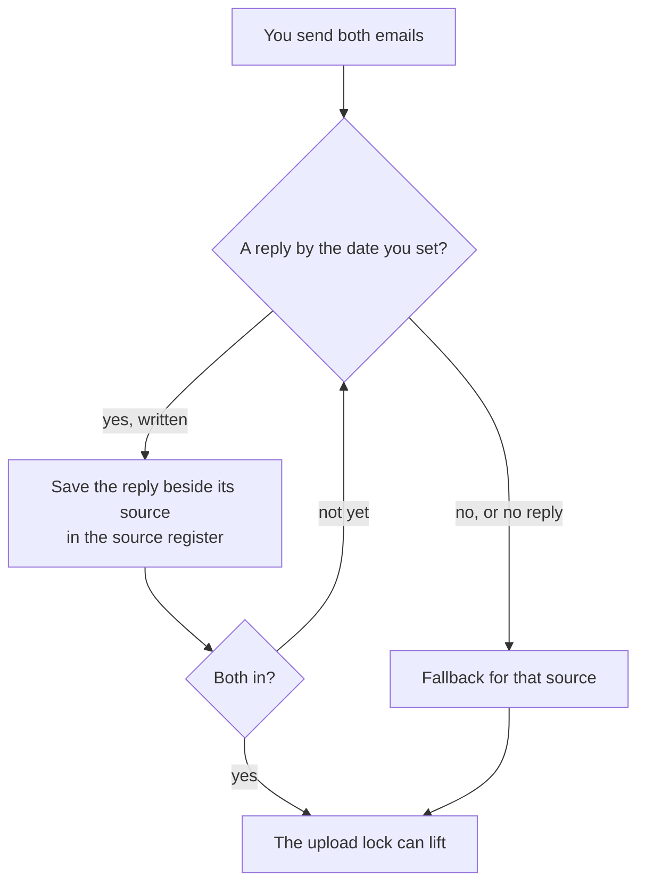

# What do we ask the two rights holders, so Hifth can go on the App Store?

*Drafted 2026-11-15 for the owner to send; nothing here has been sent. It is step ③ and ④ of the
[launch page](app-store-launch.md), and draws on the [licence brief](testflight-licence-brief.md)
and the [source register](../../SOURCES.md). Written by someone who is not a lawyer.*

## The short version

- **What:** two emails, one to each rights holder whose licence clashes with Apple's store terms.
- **What you do:** read each draft, fill in the parts in [square brackets], and send it from your
  own address. About ten minutes each.
- **What happens next:** a written yes goes into the repository beside its source, and the upload
  lock can lift once both are in. If either says no, or there is no answer by the date you set,
  we switch to the fallback below.

| Email | To | What we ask for |
|---|---|---|
| 1 | Kais Dukes, author of the Quranic Arabic Corpus | An added permission under the GPL to ship data built from the corpus in a store app |
| 2 | Collin Fair, author of quran-tajweed | Permission to ship the tajweed colour data in a store app despite Apple's copy protection |

## Where to send each one

The source register names each author, but not an email address. These are the places to find
one. Check them before sending; I did not look up anyone's personal address.

- **Kais Dukes:** the contact or feedback link on corpus.quran.com. The corpus came from the
  University of Leeds, but the licence names him as the copyright holder, so it is his permission
  that counts.
- **Collin Fair:** the contact on his GitHub profile (github.com/cpfair), or an issue on the
  quran-tajweed repository if no address is listed. An issue is public, so email is better if
  there is one.

## Email 1: the Quranic Arabic Corpus

**Subject:** Permission to use the Quranic Arabic Corpus in a free Qur'an revision app on Apple's App Store

> Assalamu alaykum Dr Dukes,
>
> My name is [your name]. I build Hifth, an app that helps people who have memorised the Qur'an
> revise it. It shows the pages of the Madinah mus'haf and points out verses that are easy to
> confuse with each other. One of its features shows which words on a page share a root, and that
> feature is built from your Quranic Arabic Corpus (morphology version 0.4).
>
> **How we use it today.** We keep your file exactly as it came, never edited. When we build the
> app, we read the root and lemma tags from it and save a small table of which words share a
> root. The app carries that table, not your file, and shows no Qur'an text from it. Every page
> that uses it credits the corpus, links to corpus.quran.com, and repeats your licence notice. Our
> own code is public under the GPL, version 3 or later.
>
> **What we would like to do.** Offer the app on Apple's App Store for iPad, iPhone and Mac.
> [It is free / It is free, with optional paid extras later — choose one before sending.]
>
> **Why we are asking.** Apple's store terms add conditions the GPL does not allow a distributor to
> add, such as limits on how many devices a copy may run on, and copy protection. Other GPL
> projects on the store solve this by having the copyright holder grant an added permission, which
> section 7 of the GPL allows. Only you can grant it for the corpus.
>
> **What we are asking for.** Your written permission to distribute data derived from the
> Quranic Arabic Corpus inside Hifth through Apple's App Store, under Apple's standard terms. A
> reply to this email saying so is enough. If you would prefer narrower wording, for example only
> for Hifth, only for the root table, or only while the app stays free, that would still help us.
>
> **What stays the same either way.** The credit, the link to corpus.quran.com, and your licence
> notice stay on every page that uses the data, and on a citations page listing every source the
> app uses. The data stays unchanged, and our code stays public.
>
> If the answer is no, we will leave the root feature out of the store version, and nothing
> changes on our website.
>
> JazakAllahu khayran for the corpus. It has been a pleasure to build on.
>
> [your name]
> [a web address for Hifth, for example https://hifth.app]

## Email 2: quran-tajweed

**Subject:** Permission to use quran-tajweed in a Qur'an revision app on Apple's App Store

> Assalamu alaykum Collin,
>
> My name is [your name]. I build Hifth, an app that helps people who have memorised the Qur'an
> revise it on the pages of the Madinah mus'haf. It colours the tajweed rules on each page, and
> those colours come from your quran-tajweed data.
>
> **How we use it today.** We keep your files unchanged in our repository, at a fixed commit, and
> build the colour layer from them. Every page that shows the colours credits quran-tajweed, links
> to your repository, and says the data is under CC BY 4.0. Our own code is public.
>
> **What we would like to do.** Offer the app on Apple's App Store for iPad, iPhone and Mac.
> [It is free / It is free, with optional paid extras later — choose one before sending.]
>
> **Why we are asking.** CC BY 4.0 says the material may not be shipped with technical measures
> that stop people doing what the licence allows. Apple wraps every store app in its own copy
> protection, which may count as such a measure. We would rather ask than guess.
>
> **What we are asking for.** Your written permission to ship the quran-tajweed data inside Hifth
> through Apple's App Store, even though Apple's copy protection applies to the app. A reply to
> this email saying so is enough. Your data stays freely available from your repository, and
> anyone can still get it there under CC BY 4.0.
>
> **What stays the same either way.** The credit, the link and the licence name stay on every
> page that uses the colours, and on a citations page listing every source.
>
> If the answer is no, we will leave the colours out of the store version, and the website keeps
> them as today.
>
> Thank you for making the data open. It has saved a great deal of work.
>
> [your name]
> [a web address for Hifth, for example https://hifth.app]

## Before you send: three things to choose

1. **Free, or free with paid extras later?** Pick one line in each email. Asking for the wider
   one now saves a second email later, but it may make a yes less likely.
2. **Your name and a web address.** hifth.app has nothing live on it yet. Use the public site if
   that is still true when you send.
3. **The date we stop waiting.** I suggest four weeks after you send. After that we follow the
   fallback below.

## What do we do with each reply?

- **A yes:** save the reply's words, the date and who sent it in the source register, under that
  source. A summary is not enough; keep the words.
- **A no, or no reply by the date:** leave that source's feature out of the store build. The root
  feature goes for email 1, the tajweed colours for email 2. Another fallback is to fetch that
  data from hifth.app after install, so it is not inside the app Apple protects. Whether that is
  enough is its own question, and should be asked before it is built.
- **A question back:** answer it plainly. If it needs a decision from you, it goes on your list.

## What is this not asking?

- **The page pictures.** The King Fahd Complex's terms have not been read for a store app yet.
  That is its own step (⑤ on the launch page), and may need a third email.
- **Tanzil's text inside the corpus file.** The app shows none of it, and we do not change the
  file.
- **The Study Quran's text.** It is never in a store build.
