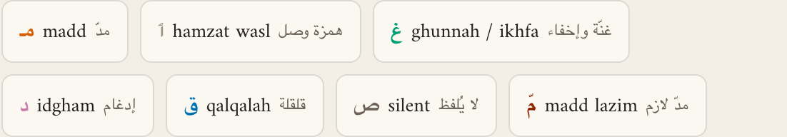
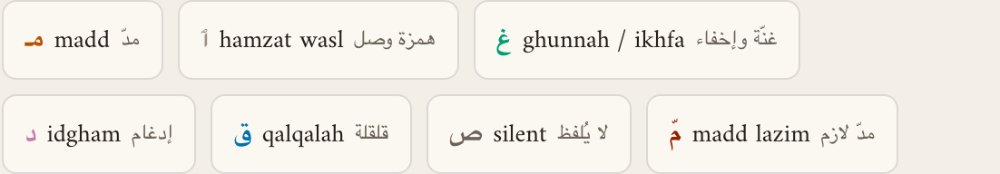
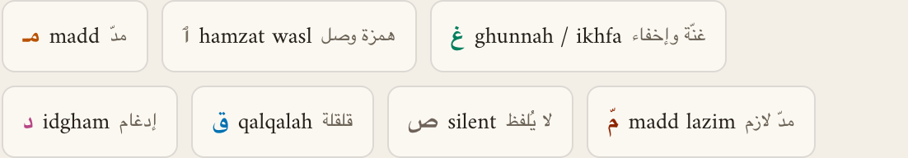
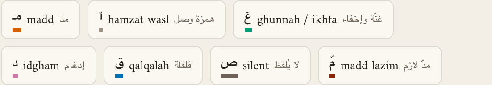

# In the mistake picker, the small coloured tajweed marks are faint on their buttons. How should they be drawn?

*Asked 2026-11-20 by the launch loop, for the owner. The pictures are the real app on a computer, with a few lines of style laid over it for each way; nothing in the app has changed yet.*

*This note is the record. Its page is [tajweed-mark-contrast-options.html](tajweed-mark-contrast-options.html), on the site at <https://blog.bytesofpurpose.com/hifth/docs/design/tajweed-mark-contrast-options.html>, rebuilt from this note by `scripts/build-design-note.mjs`. The pictures are remade by `tajweed-mark-contrast-options/shoot.mjs`.*

> [!tip] Short version
> **What differs:** each tajweed-rule button in the mistake picker starts with a small letter in that rule's colour. Four of the seven letters are too faint to read comfortably on the button's paper colour. The ways differ in whether the page's tajweed colours change too.
> **Recommended: C, a darker shade of each faint colour, in the picker only.** Every mark becomes easy to read, each keeps its own colour, and the colours on the mus'haf page do not move.
> **What it does not touch:** the colours a reader sees on the page, or the reader's own colour choices (decided in 2026-08).

## What do the words on this page mean?

- **The mistake picker**: the box that opens when a reader marks a mistake on a verse and is asked what went wrong. One of its rows is "A tajweed rule", with a button per rule.
- **The mark**: the small Arabic letter at the start of each rule button, drawn in that rule's colour, so the button matches the colour on the page.
- **Tajweed**: the rules of recitation. The seven groups here are madd (lengthening), hamzat wasl, ghunnah and ikhfa, idgham, qalqalah, silent letters and madd lazim.
- **Easy to read**: the accessibility rule most apps follow asks that small writing be at least 4.5 times lighter or darker than what it sits on ("4.5 to 1"). Body text in Hifth is far above that.

## What changes for a hafiz?

> [!important] For a hafiz mid-revision
> A hafiz marking a slip in madd or ghunnah picks the rule by its name, which is written in full on every button, so nobody is stuck today. The mark is what lets the eye jump to the right button by colour, matching what they just saw on the page. For a reader with weaker eyes, or on a bright screen, the grey wasl and pink idgham marks almost vanish, and that shortcut is lost.

## Why is this being asked now?

The automated accessibility check that runs before launch (the a11y-axe-remaining-screens row) flagged the madd mark on 2026-11-19. Measuring by hand on 2026-11-20 found it is not only madd: four marks fall short. The check sees only madd because it skips letters it judges to be decoration. Fixing madd alone would make the check pass and leave the worse three as they are.

| rule | colour | against the button |
| --- | --- | --- |
| hamzat wasl | grey #9c9284 | 2.9 to 1 |
| idgham | pink #cc79a7 | 2.9 to 1 |
| ghunnah / ikhfa | green #009e73 | 3.2 to 1 |
| madd | orange #d55e00 | 3.7 to 1 |
| qalqalah | blue #0072b2 | 4.9 to 1 (passes) |
| silent | brown #6e6259 | 5.6 to 1 (passes) |
| madd lazim | dark red #8e2400 | 8.3 to 1 (passes) |

## What happens if nobody decides?

The marks stay as they are, and the full check of the mistake picker stays switched off (a narrower check covers everything else in the box). The launch is not blocked: the marks are hidden from screen readers and the rule's name sits beside each one. But the accessibility row stays open.

## What do the ways look like?

| A. As today | B. Darker madd only |
| --- | --- |
|  |  |
| **C. A darker shade of each faint colour, picker only** | **D. Ink letters with a colour bar under each** |
|  |  |

## A. Leave the marks as they are

- **Good:** nothing changes, nothing to build.
- **Costs:** wasl, idgham and ghunnah stay hard to see; the accessibility row stays open with a known fault.
- **Commits us to:** keeping the switched-off check, and explaining it in the launch notes.

## B. Darken madd only, everywhere

- **Good:** one colour changes; the automated check passes.
- **Costs:** the three faintest marks are untouched, so the passing check hides a real fault. Madd changes on the page too, and the darker orange (#b95200) moves closer to madd lazim's dark red, the pair the page tells apart by lightness.
- **Commits us to:** a change to the page's colours, which reopens the 2026-08 colour choice for one group.

## C. A darker shade of each faint colour, in the picker only — recommended

- **Good:** every mark reaches 4.5 to 1; each keeps its own hue, so it still matches the page at a glance; the page's colours do not move.
- **Costs:** the picker's colours are a shade darker than the page's, which a sharp eye may notice. If a reader recolours a group (the 2026-08 decision lets them), the picker needs to darken their colour too, worked out in the app rather than written down.
- **Commits us to:** a small rule that darkens a colour until it reads, used wherever a rule's colour sits on paper as writing.
- The shades: wasl #786e61, madd #b95200, ghunnah #007f5d, idgham #b84685.

## D. Ink letters, with a short bar in the rule's colour under each

- **Good:** the letters are as readable as the names; the colour is still there; a reader's own colours work with no extra rule, since a bar is not writing and needs only 3 to 1 against the paper (wasl and idgham still fall a little short of that).
- **Costs:** the colour is now a thin bar, not the letter, so the eye's match to the page is weaker; the buttons look busier.
- **Commits us to:** a new small shape in the picker.

## What else could be considered, and why is it not here?

- **Darken all seven colours everywhere.** It would fix the picker, but it reopens the whole tajweed palette chosen in 2026-08, and the madd grades on the page are told apart by lightness, which darker colours squeeze together. Too large a change for a small mark.
- **Remove the marks.** The names carry the meaning, but the colour link to the page is the point of the mark; losing it is worse than a faint mark.

## What have we already decided that touches this?

- **tajweed-colours** (decided B, 2026-08-19): a reader can recolour the seven groups. Any way here must work with a reader's own colours; C needs to darken them in the app, D needs nothing.

## What do others do?

Did not look at other Qur'an apps for this. The common practice in apps generally is the one in C: a darker "text" shade of a brand colour, used wherever the colour has to be read as writing.

## What would change the answer?

- If the owner wants the picker's colours to be the very same as the page's, D is the way.
- If the reader's own colours turn out hard to darken well, D is the way.

## What is this not settling?

The colours on the mus'haf page itself, and whether the page's madd grades are distinct enough. Those stay with the 2026-08 decision.

## So what is being decided?

Which of A to D the mistake picker's tajweed marks use. Recommended: C.
