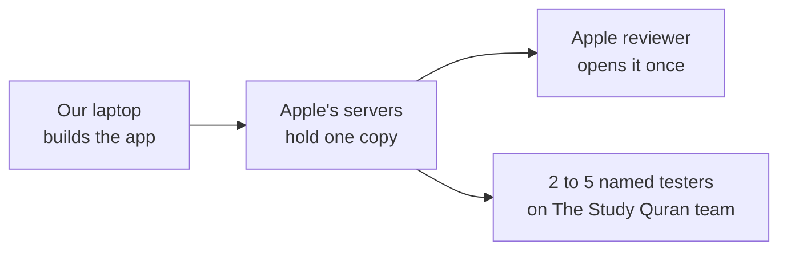

# May we send a test copy of Hifth to a few named people through Apple's TestFlight?

*A brief for a qualified licence reader, written 2026-11-08. It is step ⑤ of the
[TestFlight plan](testflight-plan.md) and the reading the decision
[native-testflight-licence](../decisions/native-testflight-licence.md) is waiting on. The
author of everything here, this page included, is not a lawyer.*

## The short version

**What we are asking:** whether an iPad app that carries the four kinds of material below may
be sent, through Apple's TestFlight, to a handful of people we name, and later whether it may
be sold on the App Store.

**What you need:** this page, and the source register it links. About an hour.

**What we need back:** a yes or no, with a sentence of reasons, on each of the five questions
at the end. "It depends on X" is a useful answer too.

| What the app carries | Under what terms | Whose |
|---|---|---|
| The word-by-word grammar data behind the "same root" feature | GPL v3, plus a line in the file saying it may not be changed | The Quranic Arabic Corpus (University of Leeds) |
| A copy of the Qur'an's text inside that same file, used only to line the grammar up | CC BY-ND 3.0 (credit the source, no changes) | Tanzil |
| The page pictures of the printed mus'haf | The printer's own terms: free for digital and software use, commercial printing on paper reserved | King Fahd Glorious Quran Printing Complex |
| The colour data for the recitation rules | CC BY 4.0 | quran-tajweed |
| The Study Quran's translation and commentary, beside the verses | Copyright of its publisher and authors; no licence to us | The Study Quran's team, who are the people receiving the test |
| Our own code | GPL v3 or later | Us |

## A few words, defined once

- **TestFlight**: Apple's service for sending an app to named people before it is in the
  store. Each person gets an email invite, installs Apple's TestFlight app, and installs ours
  from it. A test copy stops working after 90 days.
- **An outside tester**: someone invited by email who is not on our Apple developer account.
  The first build sent to outside testers is opened by an Apple reviewer first, usually
  within a day. This is the kind of test we plan to use.
- **An inside tester**: someone added to our Apple developer account. No Apple review, but
  the person then has a role on our account, which is awkward for people outside the project.
- **Mus'haf**: a printed copy of the Qur'an. The app shows the pages of one particular print.

## Who would receive it, and how?

- **Who:** two to five named people on The Study Quran's team, invited by email. Nobody else
  gets an invite, and there is no public link anyone could follow.
- **Also:** one Apple reviewer, who opens the first build before it reaches the testers.
- **How it travels:** we upload the built app to Apple once. Apple stores it and sends it to
  each tester's iPad. Apple's servers hold a copy for as long as the test runs.
- **For how long:** each build lasts 90 days. A new upload starts the clock again.
- **For money?** No. The test is free, and nothing in it is sold.

## What have we already worked out, and where might it be wrong?

Our own reading, for you to check (not advice)

- **The GPL grammar data.** Our reading is that sending a built app to named people is
  "conveying" it under the GPL, the same as any other distribution. If so, each tester must be
  able to get the matching source (it is public, in our repository) and must not be stopped
  from passing the app on. Apple's terms for testers may say otherwise. This is the part we
  are least sure of. The same tension is why we believe the App Store itself is closed to this
  data; the full argument is in [the Track B note](track-b-native.md).
- **The "may not be changed" line in the grammar file.** We keep the file exactly as it came
  and only read it while building. The app carries data computed from it, not the file.
  Whether computed data counts as a change is a question for you.
- **The Tanzil text inside the grammar file.** It is used only to line up the grammar. None of
  it is shown on screen, and the computed data the app carries holds no Qur'an text. The
  licence forbids changes, and we make none to the file.
- **The printer's page pictures.** Their terms, as published, allow digital and software use,
  including commercial use, and reserve only commercial printing on paper. We print nothing.
- **The recitation-rule colours (CC BY 4.0).** This licence forbids adding technical measures
  that stop people using the material as the licence allows. Apple's copy protection on an
  installed app may count as such a measure.
- **The Study Quran's text.** It goes only to the people who own it, at their request. Our
  reading is that this is their decision, not a licence question, but it does rest on Apple's
  servers and is seen by one Apple reviewer on the way.

The full terms of every source, quoted from the source itself, are in the
[source register](../../SOURCES.md), and how they fit together is in the
[licensing map](../../LICENSES.md).

## What would we do with each answer?

- **Yes to the test:** the decision moves to "send the whole app" (A), and we upload.
- **No, because of the GPL data:** we send the same app with the grammar data left out (B).
  The "same root" feature disappears from that copy, and everything else stays.
- **No, because of The Study Quran's text:** we ask its team for written permission first,
  and send nothing until it comes.
- **No to selling it later:** the paid extras planned in [the design page](../design.md) stay
  on our own devices, or the grammar data is replaced first.

## The questions for you

1. **Is a free TestFlight test to two to five named people, plus one Apple reviewer, a
   distribution under the GPL v3 that obliges us to anything beyond offering the source?** And
   do Apple's TestFlight terms for testers conflict with the GPL's ban on extra restrictions?
2. **Does data computed from the grammar file count as "changing" it,** given the file's own
   line that it may not be changed?
3. **Does Apple's copy protection on an installed app breach the CC BY 4.0 ban on technical
   measures** for the recitation-rule colours?
4. **May The Study Quran's translation and commentary go to its own team through Apple's
   servers on their verbal say-so,** or do we need it from them in writing first, given that
   an Apple reviewer sees it too?
5. **Later, could the app be sold on the App Store with in-app purchases,** with the GPL data
   inside it? If not, which of the materials above would have to go first?

## What is this not asking?

Not whether to release the app to the public; that is not a goal. Not the public website,
which carries no Qur'an text and none of The Study Quran's text, and is not changing. Not the
iCloud sync between the owner's own devices, which sends nothing to anyone else.
