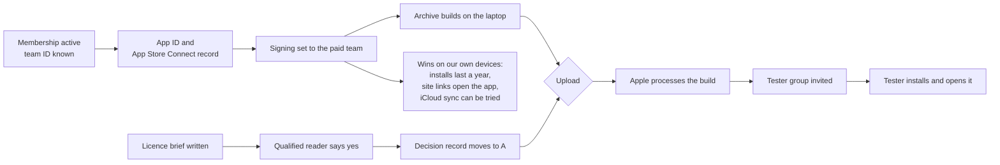

# How do we get the app onto a tester's iPad through TestFlight?

*Started 2026-11-08, the day the owner bought the paid Apple Developer membership (one year).
Worked backwards from the end: a hafiz on The Study Quran team opens Hifth on their own iPad the
next morning. Backlog item: [testflight-after-own-use](../backlog.md#testflight-after-own-use).
Decision it hangs on: [native-testflight-licence](../decisions/native-testflight-licence.md). The start page for testers and paid extras together: [design.md](../design.md).*

## The short version

**Where we are:** the membership is bought. The upload is still locked. The decision record says
"own devices only" (C) until someone qualified reads the licences and says a test with a few named
people is fine (A).

**What we need, last step first:**

| # | Step | Whose turn | Can start now? |
|---|---|---|---|
| 7 | A tester opens Hifth on their iPad from the TestFlight app | tester | no |
| 6 | The tester accepts the email invite and installs TestFlight | tester | no |
| 5 | The build is cleared for testing and the testers are added to a group | you | no |
| 4 | The build is uploaded to Apple and finishes processing | agent | **no, locked** |
| 3 | The licence reading comes back yes, and the decision record moves to A | you + reader | **yes: the brief** |
| 2 | A signed archive builds on this laptop, ready to upload | agent | yes, once ① is done |
| 1 | Apple has approved the membership; the app's name and ID are registered | you, then agent | **yes** |

**The one thing that is yours today:** check Apple's email that the membership is active (it can
take up to two days), then tell the agent the 10-character team ID shown on the membership page.

## What each step needs

① Membership active, app registered (you, then the agent)

- Apple approves the enrolment. For a person (not a company) this is usually within a day or two.
- You read the **team ID** off the membership page of the Apple Developer site and tell the agent.
- In the Apple Developer site: register the app ID `com.bytesofpurpose.hifth`. Turn on
  *Associated Domains* (site links open the app) and *iCloud* (the usage counts sync), since both
  are already waiting on this membership.
- In App Store Connect: create the app record for platforms iOS and macOS, which covers iPhone, iPad and Mac, with that ID. The name shown to
  testers is "Hifth - The Huffaz Toolkit". No store listing is made; TestFlight needs the record, not a listing.
- The agent sets the team ID in the project settings, which are empty today, and installs the app
  on your iPad and Mac with the paid team. The install then lasts a year, not seven days.

② A signed archive builds on this laptop (agent)

Today both build steps for the upload refuse, and the archive step was never written. What is
missing:

- the archive and export settings (sign for App Store Connect upload, Release build);
- a privacy manifest, the file Apple requires that says what the app collects (nothing leaves
  the device except the owner's own iCloud);
- the answer to Apple's encryption question (the app uses only Apple's own HTTPS, so the
  "no special encryption" setting goes in the app's settings and the question stops being asked
  on every upload);
- a build number that goes up by one on every upload;
- the icon (one 1024px icon exists; check the iPad set renders).

**Proposed change to the lock:** let the archive build now, since it never leaves the laptop, and
keep only the upload locked behind the decision. That way step ② is proven before the licence
reading comes back, and the day it does the upload is one command. This changes how the decision
is enforced, not what it says, so it is noted in the decision record when it is made.

③ The licence reading (you, with a qualified reader)

The agent writes a one-page brief: what the build carries (the verse-link data under its licence,
The Study Quran's commentary, the print's font), who would receive it (named people on The Study
Quran team, by email), how (TestFlight, which also means Apple's reviewers see it, see ⑤), and the
three questions the reader must answer. You send it to the reader. When the answer is yes, the
decision record moves to A, with who read it and when.

If the answer is no, option B (the same build with the verse links left out) is the fallback the
record already names.

④ Upload and processing (agent)

One command uploads the archive with an App Store Connect key (made once by you in App Store
Connect, under Users and Access, Integrations; kept as a file in your home folder, where
Apple's upload tools look for it, never in the repo). Apple
then processes the build, usually in under an hour, and emails when it is ready.

⑤ Who the testers are, and Apple's review (you)

TestFlight has two kinds of tester, and the choice matters for the licence question:

| | Internal testers | External testers |
|---|---|---|
| Who | People added to your App Store Connect team (up to 100) | Anyone invited by email (up to 10,000) |
| Apple review first? | No | Yes, a short beta review of the first build, usually about a day |
| What they can see | Your App Store Connect account, at the role you give them | Only the app |
| Fits The Study Quran team? | Awkward: they join your developer account | Yes, but an Apple reviewer opens the build too |

The recommendation is **external testers, invite by email only, no public link**. The licence
brief has to name the Apple reviewer as one more person who sees the build.

⑥ and ⑦ The tester's side

The tester gets an email, installs Apple's TestFlight app, taps the invite and installs Hifth.
A TestFlight build lasts 90 days; a new upload resets it. We write a short note for testers (what
to try, how to send feedback from inside TestFlight) when ⑤ is reached.

## What the membership unlocks even without TestFlight

These were waiting on the same membership and do not depend on the licence reading:

- **Installs on your own iPad and Mac last a year**, not seven days.
- **Site links open the app** instead of Safari (backlog: universal-links-need-paid-team).
- **The usage counts can sync between your iPad and Mac through your iCloud** (backlog:
  usage-across-devices).

## What this plan is not

It is not an App Store release; that is a separate question the backlog holds as not a target.
It does not settle the licence question; it only gets everything else ready so that the licence
answer is the last thing between the demo and a tester's iPad.

## Open questions, and what would answer each

Each step above as a piece of work, so the backlog tracks it.

### ① Is the Apple membership active, and what is the team ID? · **answered**

Yes. The membership is active (2026-11-08) and the team ID is `76NHKA839A`. It is an
individual account in the owner's own name; publishing under Bytes of Purpose instead is a
separate question, and testing does not wait for it.

### ② Register the app's ID and make its App Store Connect record · **answered**

Yours, in the Apple Developer site and App Store Connect: the ID `com.bytesofpurpose.hifth`
with Associated Domains and iCloud turned on, and an app record for iOS and macOS (iPhone, iPad and Mac) named Hifth. No store
listing. The step-by-step links are in the app-setup skill; the iPhone's own questions are in
[iphone-app.md](iphone-app.md). Both tie Hifth, and the name shown under it ("Omar Eid"), to this membership for good;
that was decided on purpose ([publisher-account.md](publisher-account.md)).

The ID was registered on 2026-11-09, with Push Notifications and Sign in with Apple also
turned on. Neither does anything until the app asks for it. The agent confirms that iCloud and
Associated Domains are on when it first signs (③). The App Store Connect record was made the
same day for iOS and macOS, named "Hifth - The Huffaz Toolkit".

### ③ Sign the app with the paid team and reinstall it on the owner's iPad and Mac · **blocked**

The agent's, now that the team ID is known (①). Installs then last a year instead of seven days.

**The iPad is done (2026-11-10).** The paid team signed it, the install has 364 days left, and
it goes on with `make app-release-ipad DEVICE=…`, which runs the verse-touch test on the iPad's
own OS first and fails on a new crash report after. Its first install closed on a touch; that
was fixed the same day (`docs/issues/ipad-crash-on-verse-touch.md`). **Left: the Mac.**

**Next for the pitch: walk the six passages on the real iPad.** Every walk so far ran in the
simulator, and the simulator missed the touch crash. Unlock the iPad and leave it plugged in. Xcode is signed in since 2026-11-09, and
its Accounts screen shows the paid Developer Team. (The first try that day stopped because no
account was signed in; the install command now checks for one first.)

**How the install proves the year.** After the build, the install command reads the signing
profile inside the app and counts the days it has left. A year means the paid team signed it and
the install goes on. A few days means a free team did, and it stops before anything reaches the
iPad. It also stops if Xcode reused an old profile with under a month left, so the app cannot run
out the week of the meeting. Xcode's own saved settings are not trusted for this: that day they
still said "Personal Team" while the Accounts screen showed the paid team.

**No cable needed after the first time, and nothing uploaded.** Xcode installs over Wi-Fi when the
laptop and the device share a network. On iOS or iPadOS 27 and later it pairs with no cable at
all; on older versions, one cable pairing first. TestFlight would also install without a cable,
but it uploads the build to Apple, which the licence decision does not allow yet
([research note](../research/2026-11-09-testflight-own-devices.md); the licence brief now asks
about that narrower step as question 6).

### ④ Make the archive build on the laptop, with the upload still locked · **open**

The agent's. Archive and export settings, the privacy manifest, the encryption answer, a build
number that counts up, the Mac sandbox (the Mac build has none today; Apple's own pages require it
only for the Mac App Store, and developer forums say TestFlight for Mac needs it too, see
[the research note](../research/2026-11-09-testflight-own-devices.md)), and the archive gate opened while the upload gate stays shut. Noted in
the decision record when the gate changes.

### ⑤ Write the brief for the licence reader · **answered**

Written 2026-11-08: [testflight-licence-brief.md](testflight-licence-brief.md). One page: what
the build carries and under whose terms, who receives it and how, that an Apple reviewer sees
it too, our own reading for the reader to check, and five questions, the last one about
selling the app later with in-app purchases.

### ⑥ Get the licence reading and move the decision to A · **open**

Yours, once the brief exists (⑤): send it to a qualified reader. On a yes, the decision record
moves to A with who read it and when; on a no, B is the fallback.

### ⑦ Make the App Store Connect key the upload uses · **open**

Yours, in App Store Connect under Users and Access, Integrations. The key file goes in your
home folder, where Apple's upload tools look for it (the app-setup skill gives the exact
place), never in the repo.

### ⑧ Write the upload step · **blocked**

The agent's, after the decision moves to A (⑥) and the key exists (⑦).

### ⑨ Invite the testers and give them a short note · **blocked**

Yours, with a note the agent drafts: an external tester group, invited by email, no public
link. Waits on the first build being uploaded (⑧).
